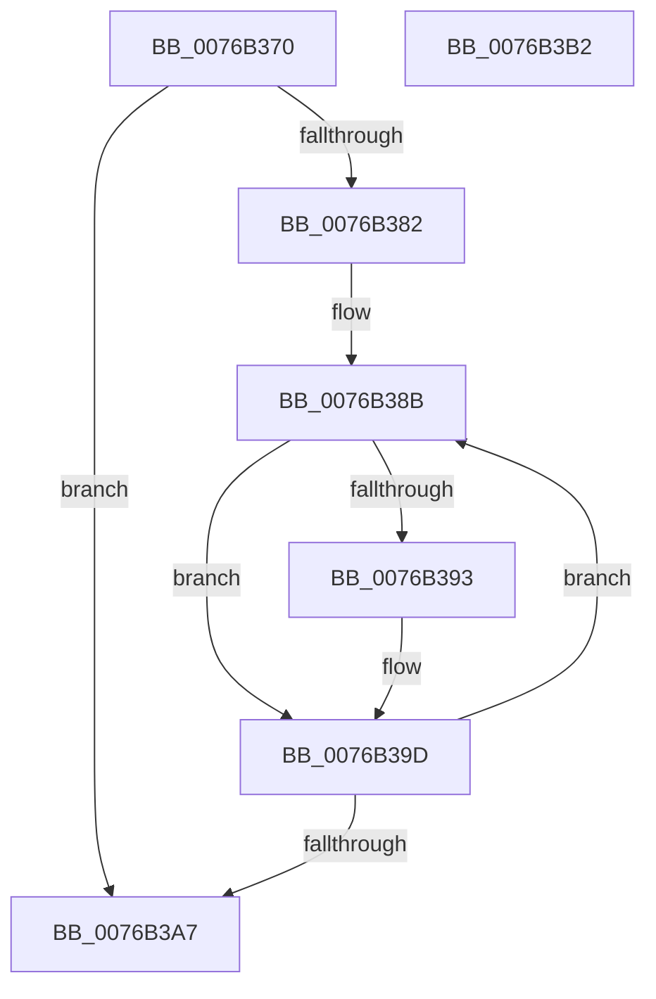

# PopIdleWakeFreeWakeSourceAccounting

- RVA: `0x0076B370`–`0x0076B3B3` (길이 `67` bytes)
- VA: `0x000000014076B370`
- 실행 섹션: `PAGE`
- PDB 이름 있음: `예`; PDB Function 태그: `아니요`
- unwind 정보 RVA: `0x0005CAAC`
- 디코드: `20`개 명령, `67/67` bytes 표시
- 미해석 바이트: `0` (있으면 어셈블리에 `.byte`로 보존)

> 이 문서는 커널 이미지의 기계어와 PDB 기호를 분석해 생성했습니다. 4번과 5번은 함수 원형과 자료형을 바이너리 사용 방식에서 추정한 C 해석이며 원본 소스 복구 결과는 아닙니다.

## 1. Dependencies

- 직접 호출 지점: **1**; 고유 호출 대상: **1**
- 직접 호출자로 확인된 함수: **1**
- RIP 상대 이미지 참조: **0**

### Outgoing calls
- `0x0076B398` → [ObfDereferenceObjectWithTag](../../text/2F/ObfDereferenceObjectWithTag_function_002F78E0.md) (function, `0x002F78E0`)

### Direct callers
- [sub_00B49D08](../B4/Unknown_function_00B49D08.md) at `0x00B49E02`

### Static image references
- 디코드된 RIP-relative 메모리 참조가 없습니다.

## 2. Other-region calls and transfers

- 다른 실행 섹션으로 향하는 call: **1**
  - `0x0076B398` → [ObfDereferenceObjectWithTag](../../text/2F/ObfDereferenceObjectWithTag_function_002F78E0.md) (`PAGE` → `.text`)
- 별도 외부 분기/꼬리 이동을 확인하지 못했습니다.

## 3. Assembly (complete function range)

```asm
0076B370  48 89 5C 24 08                  mov qword ptr [rsp + 8], rbx
0076B375  57                              push rdi
0076B376  48 83 EC 20                     sub rsp, 0x20
0076B37A  81 39 80 00 00 00               cmp dword ptr [rcx], 0x80
0076B380  75 25                           jne 0x14076b3a7
0076B382  48 8D 59 20                     lea rbx, [rcx + 0x20]
0076B386  BF 03 00 00 00                  mov edi, 3
0076B38B  48 8B 0B                        mov rcx, qword ptr [rbx]
0076B38E  48 85 C9                        test rcx, rcx
0076B391  74 0A                           je 0x14076b39d
0076B393  BA 50 6F 44 67                  mov edx, 0x67446f50
0076B398  E8 43 C5 B8 FF                  call 0x1402f78e0
0076B39D  48 83 C3 08                     add rbx, 8
0076B3A1  48 83 EF 01                     sub rdi, 1
0076B3A5  75 E4                           jne 0x14076b38b
0076B3A7  48 8B 5C 24 30                  mov rbx, qword ptr [rsp + 0x30]
0076B3AC  48 83 C4 20                     add rsp, 0x20
0076B3B0  5F                              pop rdi
0076B3B1  C3                              ret
0076B3B2  CC                              int3
```

## 4. C-style interpretation (structured pseudocode)

```c
__int64 __fastcall PopIdleWakeFreeWakeSourceAccounting(__int64 a1)
{
    __int64 result;
    __int64 v_rbx;
    __int64 v_rdi;
    __int64 v_rsp;
    unsigned __int64 v_stack_p8;

    v_stack_p8 = v_rbx;
    v_rsp = (v_rsp) - (32);
    if ((*(unsigned int *)(a1)) != 128) goto loc_0076B3A7;
loc_0076B38B:
    if (*(unsigned __int64 *)(a1 + 32) != 0) {
        a2 = 0x67446F50ULL;
        result = ObfDereferenceObjectWithTag(*(unsigned __int64 *)(a1 + 32), a2, a3, a4);
    }
    v_rbx = (a1 + 32) + (8);
    v_rdi = (3) - (1);
    if (condition_is_not_equal) goto loc_0076B38B;
loc_0076B3A7:
    v_rsp = (v_rsp) + (32);
    return result;
}
```

## 5. (Beta) C Style

```c
int64_t PopIdleWakeFreeWakeSourceAccounting(void *Arg1)
{
    uint8_t *arg1 = (uint8_t *)Arg1;

    int64_t result;
    int64_t local_rbx;
    int64_t local_rdi;
    int64_t local_rsp;
    uint64_t v_stack_p8;

    v_stack_p8 = local_rbx;
    local_rsp = (local_rsp) - (32);
    if ((*(uint32_t *)(arg1)) != 128) goto loc_0076B3A7;
loc_0076B38B:
    if (*(uint64_t *)(arg1 + 0x20) != 0) {
        a2 = 0x67446F50ULL;
        result = ObfDereferenceObjectWithTag(*(uint64_t *)(arg1 + 0x20), a2, a3, a4);
    }
    local_rbx = (Arg1 + 32) + (8);
    local_rdi = (3) - (1);
    if (condition_is_not_equal) goto loc_0076B38B;
loc_0076B3A7:
    local_rsp = (local_rsp) + (32);
    return result;
}
```

### 관측된 메모리 오프셋

구조체 형식이 확인되지 않은 접근은 인자 기준의 오프셋으로만 기록했습니다.

| 기준 인자 | 오프셋 표현 | 폭 (bit) | 접근 |
|---|---:|---:|---|
| `Arg1` | `+ 0x0` | `32` | `R` |
| `Arg1` | `+ 0x0` | `64` | `R` |
| `Arg1` | `+ 0x20` | `64` | `R` |

## 6. Execution-region graph

[열기: 2D/3D 그래프와 함수 탐색 컨트롤 패널](../../../control-panel.html?section=page&rva=0x0076B370&view=graph)

- 2D 그래프는 위에서 아래로 흐르고, 3D 그래프는 빈 공간을 드래그해 회전합니다. Shift+드래그는 이동, 휠은 확대·축소, 함수 노드 선택은 대상 보고서 이동입니다.

### Static fallback


