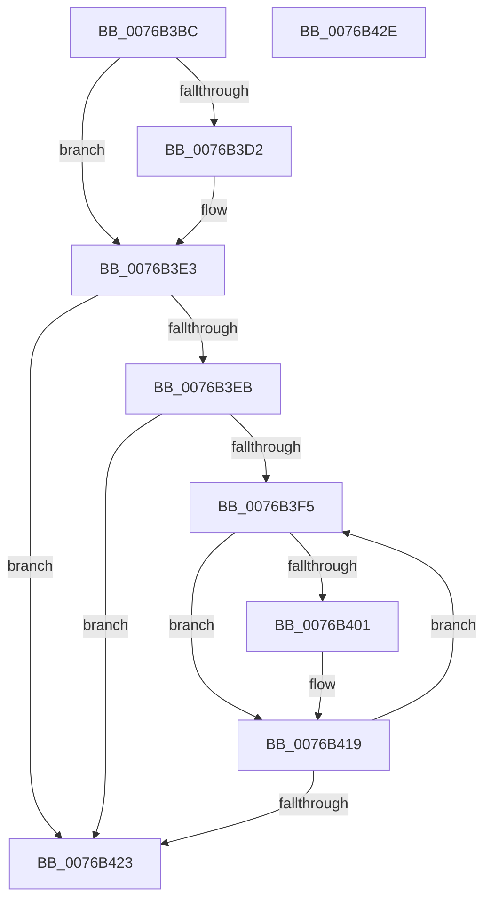

# PopIdleWakeFreeWakeSourceDiagnostic

- RVA: `0x0076B3BC`–`0x0076B42F` (길이 `115` bytes)
- VA: `0x000000014076B3BC`
- 실행 섹션: `PAGE`
- PDB 이름 있음: `예`; PDB Function 태그: `아니요`
- unwind 정보 RVA: `0x0005CAAC`
- 디코드: `30`개 명령, `115/115` bytes 표시
- 미해석 바이트: `0` (있으면 어셈블리에 `.byte`로 보존)

> 이 문서는 커널 이미지의 기계어와 PDB 기호를 분석해 생성했습니다. 4번과 5번은 함수 원형과 자료형을 바이너리 사용 방식에서 추정한 C 해석이며 원본 소스 복구 결과는 아닙니다.

## 1. Dependencies

- 직접 호출 지점: **2**; 고유 호출 대상: **1**
- 직접 호출자로 확인된 함수: **1**
- RIP 상대 이미지 참조: **0**

### Outgoing calls
- `0x0076B3DE` → [ExFreePoolWithTag](../../poolcode/B8/ExFreePoolWithTag_function_00B82870.md) (function, `0x00B82870`)
- `0x0076B414` → [ExFreePoolWithTag](../../poolcode/B8/ExFreePoolWithTag_function_00B82870.md) (function, `0x00B82870`)

### Direct callers
- [sub_00B49D08](../B4/Unknown_function_00B49D08.md) at `0x00B49DFA`

### Static image references
- 디코드된 RIP-relative 메모리 참조가 없습니다.

## 2. Other-region calls and transfers

- 다른 실행 섹션으로 향하는 call: **2**
  - `0x0076B3DE` → [ExFreePoolWithTag](../../poolcode/B8/ExFreePoolWithTag_function_00B82870.md) (`PAGE` → `POOLCODE`)
  - `0x0076B414` → [ExFreePoolWithTag](../../poolcode/B8/ExFreePoolWithTag_function_00B82870.md) (`PAGE` → `POOLCODE`)
- 별도 외부 분기/꼬리 이동을 확인하지 못했습니다.

## 3. Assembly (complete function range)

```asm
0076B3BC  48 89 5C 24 08                  mov qword ptr [rsp + 8], rbx
0076B3C1  57                              push rdi
0076B3C2  48 83 EC 20                     sub rsp, 0x20
0076B3C6  80 B9 F8 02 00 00 00            cmp byte ptr [rcx + 0x2f8], 0
0076B3CD  48 8B D9                        mov rbx, rcx
0076B3D0  74 11                           je 0x14076b3e3
0076B3D2  48 8B 89 08 03 00 00            mov rcx, qword ptr [rcx + 0x308]
0076B3D9  BA 50 64 69 67                  mov edx, 0x67696450
0076B3DE  E8 8D 74 41 00                  call 0x140b82870
0076B3E3  81 3B 80 00 00 00               cmp dword ptr [rbx], 0x80
0076B3E9  75 38                           jne 0x14076b423
0076B3EB  33 FF                           xor edi, edi
0076B3ED  39 BB 10 03 00 00               cmp dword ptr [rbx + 0x310], edi
0076B3F3  76 2E                           jbe 0x14076b423
0076B3F5  80 BC 1F 48 03 00 00 00         cmp byte ptr [rdi + rbx + 0x348], 0
0076B3FD  8B CF                           mov ecx, edi
0076B3FF  74 18                           je 0x14076b419
0076B401  48 FF C1                        inc rcx
0076B404  BA 50 64 69 67                  mov edx, 0x67696450
0076B409  48 03 C9                        add rcx, rcx
0076B40C  48 8B 8C CB 10 03 00 00         mov rcx, qword ptr [rbx + rcx*8 + 0x310]
0076B414  E8 57 74 41 00                  call 0x140b82870
0076B419  FF C7                           inc edi
0076B41B  3B BB 10 03 00 00               cmp edi, dword ptr [rbx + 0x310]
0076B421  72 D2                           jb 0x14076b3f5
0076B423  48 8B 5C 24 30                  mov rbx, qword ptr [rsp + 0x30]
0076B428  48 83 C4 20                     add rsp, 0x20
0076B42C  5F                              pop rdi
0076B42D  C3                              ret
0076B42E  CC                              int3
```

## 4. C-style interpretation (structured pseudocode)

```c
__int64 __fastcall PopIdleWakeFreeWakeSourceDiagnostic(__int64 a1)
{
    __int64 result;
    __int64 v_rdi;
    __int64 v_rsp;
    unsigned __int64 v_stack_p8;

    v_stack_p8 = v_rbx;
    v_rsp = (v_rsp) - (32);
    if ((*(unsigned __int8 *)(a1 + 760)) != 0) {
        a1 = *(unsigned __int64 *)(a1 + 776);
        a2 = 0x67696450ULL;
        result = ExFreePoolWithTag(a1, a2, a3, a4);
    }
    if ((*(unsigned int *)(a1)) != 128) goto loc_0076B423;
    v_rdi = 0;
    if ((*(unsigned int *)(a1 + 784)) <= 0) goto loc_0076B423;
loc_0076B3F5:
    if ((*(unsigned __int8 *)(v_rdi + a1 * 1 + 840)) != 0) {
        a1 = (0) + 1;
        a2 = 0x67696450ULL;
        a1 = (a1) + (a1);
        a1 = *(unsigned __int64 *)(a1 + a1 * 8 + 784);
        result = ExFreePoolWithTag(a1, a2, a3, a4);
    }
    v_rdi = (unsigned int)((v_rdi) + 1);
    if (((unsigned int)(v_rdi)) < (*(unsigned int *)(a1 + 784))) goto loc_0076B3F5;
loc_0076B423:
    v_rsp = (v_rsp) + (32);
    return result;
}
```

## 5. (Beta) C Style

```c
int64_t PopIdleWakeFreeWakeSourceDiagnostic(void *Arg1)
{
    uint8_t *arg1 = (uint8_t *)Arg1;

    int64_t result;
    int64_t local_rdi;
    int64_t local_rsp;
    uint64_t v_stack_p8;

    v_stack_p8 = local_rbx;
    local_rsp = (local_rsp) - (32);
    if ((*(uint8_t *)(arg1 + 0x2F8)) != 0) {
        Arg1 = *(uint64_t *)(arg1 + 0x308);
        a2 = 0x67696450ULL;
        result = ExFreePoolWithTag(Arg1, a2, a3, a4);
    }
    if ((*(uint32_t *)(arg1)) != 128) goto loc_0076B423;
    local_rdi = 0;
    if ((*(uint32_t *)(arg1 + 0x310)) <= 0) goto loc_0076B423;
loc_0076B3F5:
    if ((*(uint8_t *)(local_rdi + arg1 * 1 + 0x348)) != 0) {
        Arg1 = (0) + 1;
        a2 = 0x67696450ULL;
        Arg1 = (Arg1) + (Arg1);
        Arg1 = *(uint64_t *)(arg1 + arg1 * 8 + 0x310);
        result = ExFreePoolWithTag(Arg1, a2, a3, a4);
    }
    local_rdi = (uint32_t)((local_rdi) + 1);
    if (((uint32_t)(local_rdi)) < (*(uint32_t *)(arg1 + 0x310))) goto loc_0076B3F5;
loc_0076B423:
    local_rsp = (local_rsp) + (32);
    return result;
}
```

### 관측된 메모리 오프셋

구조체 형식이 확인되지 않은 접근은 인자 기준의 오프셋으로만 기록했습니다.

| 기준 인자 | 오프셋 표현 | 폭 (bit) | 접근 |
|---|---:|---:|---|
| `Arg1` | `+ 0x0` | `32` | `R` |
| `Arg1` | `+ 0x2F8` | `8` | `R` |
| `Arg1` | `+ 0x308` | `64` | `R` |
| `Arg1` | `+ 0x310` | `32` | `R` |
| `Arg1` | `+ 0x310 + rcx*8` | `64` | `R` |

## 6. Execution-region graph

[열기: 2D/3D 그래프와 함수 탐색 컨트롤 패널](../../../control-panel.html?section=page&rva=0x0076B3BC&view=graph)

- 2D 그래프는 위에서 아래로 흐르고, 3D 그래프는 빈 공간을 드래그해 회전합니다. Shift+드래그는 이동, 휠은 확대·축소, 함수 노드 선택은 대상 보고서 이동입니다.

### Static fallback


