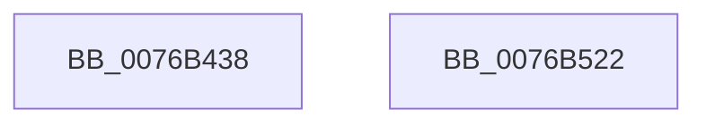

# PopIdleWakeInitialize

- RVA: `0x0076B438`–`0x0076B523` (길이 `235` bytes)
- VA: `0x000000014076B438`
- 실행 섹션: `PAGE`
- PDB 이름 있음: `예`; PDB Function 태그: `아니요`
- unwind 정보 RVA: `0x000AC81C`
- 디코드: `50`개 명령, `235/235` bytes 표시
- 미해석 바이트: `0` (있으면 어셈블리에 `.byte`로 보존)

> 이 문서는 커널 이미지의 기계어와 PDB 기호를 분석해 생성했습니다. 4번과 5번은 함수 원형과 자료형을 바이너리 사용 방식에서 추정한 C 해석이며 원본 소스 복구 결과는 아닙니다.

## 1. Dependencies

- 직접 호출 지점: **8**; 고유 호출 대상: **2**
- 직접 호출자로 확인된 함수: **1**
- RIP 상대 이미지 참조: **13**

### Outgoing calls
- `0x0076B452` → [PpmConvertTimeFrom](../../text/44/PpmConvertTimeFrom_function_00447510.md) (function, `0x00447510`)
- `0x0076B470` → [PopIdleWakeConvertIntervalBucketsFrom](PopIdleWakeConvertIntervalBucketsFrom_function_0076B31C.md) (function, `0x0076B31C`)
- `0x0076B487` → [PopIdleWakeConvertIntervalBucketsFrom](PopIdleWakeConvertIntervalBucketsFrom_function_0076B31C.md) (function, `0x0076B31C`)
- `0x0076B49E` → [PopIdleWakeConvertIntervalBucketsFrom](PopIdleWakeConvertIntervalBucketsFrom_function_0076B31C.md) (function, `0x0076B31C`)
- `0x0076B4B5` → [PopIdleWakeConvertIntervalBucketsFrom](PopIdleWakeConvertIntervalBucketsFrom_function_0076B31C.md) (function, `0x0076B31C`)
- `0x0076B4CC` → [PopIdleWakeConvertIntervalBucketsFrom](PopIdleWakeConvertIntervalBucketsFrom_function_0076B31C.md) (function, `0x0076B31C`)
- `0x0076B4EC` → [PopIdleWakeConvertIntervalBucketsFrom](PopIdleWakeConvertIntervalBucketsFrom_function_0076B31C.md) (function, `0x0076B31C`)
- `0x0076B50F` → [PopIdleWakeConvertIntervalBucketsFrom](PopIdleWakeConvertIntervalBucketsFrom_function_0076B31C.md) (function, `0x0076B31C`)

### Direct callers
- [PoInitSystem](../../init/C7/PoInitSystem_function_00C72358.md) at `0x00C72FDE`

### Static image references
- `0x0076B43E` → RVA `0x00F08290` (`.data`; read/write)
- `0x0076B457` → RVA `0x00E0C2D0` (`.data`; read)
- `0x0076B45E` → RVA `0x00F08278` (`.data`; write)
- `0x0076B475` → RVA `0x00E0C308` (`.data`; read)
- `0x0076B48C` → RVA `0x00E0C338` (`.data`; read)
- `0x0076B4A3` → RVA `0x00E0C368` (`.data`; read)
- `0x0076B4BA` → RVA `0x00E0C1F8` (`.data`; read)
- `0x0076B4D6` → RVA `0x00F08300` (`.data`; read)
- `0x0076B4E0` → RVA `0x00E0C220` (`.data`; read)
- `0x0076B4F1` → RVA `0x00F08348` (`.data`; read/write)
- `0x0076B4F9` → RVA `0x00F082A0` (`.data`; read)
- `0x0076B503` → RVA `0x00E0C270` (`.data`; read)
- `0x0076B514` → RVA `0x00F082F8` (`.data`; read/write)

## 2. Other-region calls and transfers

- 다른 실행 섹션으로 향하는 call: **1**
  - `0x0076B452` → [PpmConvertTimeFrom](../../text/44/PpmConvertTimeFrom_function_00447510.md) (`PAGE` → `.text`)
- 별도 외부 분기/꼬리 이동을 확인하지 못했습니다.

## 3. Assembly (complete function range)

```asm
0076B438  40 57                           push rdi
0076B43A  48 83 EC 20                     sub rsp, 0x20
0076B43E  48 83 25 4A CE 79 00 00         and qword ptr [rip + 0x79ce4a], 0
0076B446  BF 80 96 98 00                  mov edi, 0x989680
0076B44B  8B D7                           mov edx, edi
0076B44D  B9 80 F0 FA 02                  mov ecx, 0x2faf080
0076B452  E8 B9 C0 CD FF                  call 0x140447510
0076B457  48 8D 15 72 0E 6A 00            lea rdx, [rip + 0x6a0e72]
0076B45E  48 89 05 13 CE 79 00            mov qword ptr [rip + 0x79ce13], rax
0076B465  4C 8B C2                        mov r8, rdx
0076B468  44 8B CF                        mov r9d, edi
0076B46B  B9 06 00 00 00                  mov ecx, 6
0076B470  E8 A7 FE FF FF                  call 0x14076b31c
0076B475  48 8D 15 8C 0E 6A 00            lea rdx, [rip + 0x6a0e8c]
0076B47C  44 8B CF                        mov r9d, edi
0076B47F  4C 8B C2                        mov r8, rdx
0076B482  B9 05 00 00 00                  mov ecx, 5
0076B487  E8 90 FE FF FF                  call 0x14076b31c
0076B48C  48 8D 15 A5 0E 6A 00            lea rdx, [rip + 0x6a0ea5]
0076B493  44 8B CF                        mov r9d, edi
0076B496  4C 8B C2                        mov r8, rdx
0076B499  B9 05 00 00 00                  mov ecx, 5
0076B49E  E8 79 FE FF FF                  call 0x14076b31c
0076B4A3  48 8D 15 BE 0E 6A 00            lea rdx, [rip + 0x6a0ebe]
0076B4AA  44 8B CF                        mov r9d, edi
0076B4AD  4C 8B C2                        mov r8, rdx
0076B4B0  B9 05 00 00 00                  mov ecx, 5
0076B4B5  E8 62 FE FF FF                  call 0x14076b31c
0076B4BA  48 8D 15 37 0D 6A 00            lea rdx, [rip + 0x6a0d37]
0076B4C1  44 8B CF                        mov r9d, edi
0076B4C4  4C 8B C2                        mov r8, rdx
0076B4C7  B9 03 00 00 00                  mov ecx, 3
0076B4CC  E8 4B FE FF FF                  call 0x14076b31c
0076B4D1  BF E8 03 00 00                  mov edi, 0x3e8
0076B4D6  4C 8D 05 23 CE 79 00            lea r8, [rip + 0x79ce23]
0076B4DD  44 8B CF                        mov r9d, edi
0076B4E0  48 8D 15 39 0D 6A 00            lea rdx, [rip + 0x6a0d39]
0076B4E7  B9 09 00 00 00                  mov ecx, 9
0076B4EC  E8 2B FE FF FF                  call 0x14076b31c
0076B4F1  48 83 0D 4F CE 79 00 FF         or qword ptr [rip + 0x79ce4f], 0xffffffffffffffff
0076B4F9  4C 8D 05 A0 CD 79 00            lea r8, [rip + 0x79cda0]
0076B500  44 8B CF                        mov r9d, edi
0076B503  48 8D 15 66 0D 6A 00            lea rdx, [rip + 0x6a0d66]
0076B50A  B9 0B 00 00 00                  mov ecx, 0xb
0076B50F  E8 08 FE FF FF                  call 0x14076b31c
0076B514  48 83 0D DC CD 79 00 FF         or qword ptr [rip + 0x79cddc], 0xffffffffffffffff
0076B51C  48 83 C4 20                     add rsp, 0x20
0076B520  5F                              pop rdi
0076B521  C3                              ret
0076B522  CC                              int3
```

## 4. C-style interpretation (structured pseudocode)

```c
__int64 __fastcall PopIdleWakeInitialize(void)
{
    __int64 result;
    __int64 v_rsp;

    v_rsp = (v_rsp) - (32);
    result = PpmConvertTimeFrom((unsigned int)(0x2FAF080ULL), (unsigned int)((unsigned int)((unsigned int)(0x989680ULL))), a3, a4);
    *(unsigned __int64 *)(v_rip + 7982611) = result;
    result = PopIdleWakeConvertIntervalBucketsFrom(6, v_rip + 6950514, v_rip + 6950514, (unsigned int)((unsigned int)((unsigned int)(0x989680ULL))));
    result = PopIdleWakeConvertIntervalBucketsFrom(5, v_rip + 6950540, v_rip + 6950540, (unsigned int)((unsigned int)((unsigned int)(0x989680ULL))));
    result = PopIdleWakeConvertIntervalBucketsFrom(5, v_rip + 6950565, v_rip + 6950565, (unsigned int)((unsigned int)((unsigned int)(0x989680ULL))));
    result = PopIdleWakeConvertIntervalBucketsFrom(5, v_rip + 6950590, v_rip + 6950590, (unsigned int)((unsigned int)((unsigned int)(0x989680ULL))));
    result = PopIdleWakeConvertIntervalBucketsFrom(3, v_rip + 6950199, v_rip + 6950199, (unsigned int)((unsigned int)((unsigned int)(0x989680ULL))));
    result = PopIdleWakeConvertIntervalBucketsFrom(9, v_rip + 6950201, v_rip + 7982627, 1000);
    result = PopIdleWakeConvertIntervalBucketsFrom(11, v_rip + 6950246, v_rip + 7982496, 1000);
    v_rsp = (v_rsp) + (32);
    return result;
}
```

## 5. (Beta) C Style

```c
void PopIdleWakeInitialize(void)
{
    int64_t result;
    int64_t local_rsp;

    local_rsp = (local_rsp) - (32);
    result = PpmConvertTimeFrom((uint32_t)(0x2FAF080ULL), (uint32_t)((uint32_t)((uint32_t)(0x989680ULL))), a3, a4);
    *(uint64_t *)(v_rip + 0x79CE13) = result;
    result = PopIdleWakeConvertIntervalBucketsFrom(6, v_rip + 6950514, v_rip + 6950514, (uint32_t)((uint32_t)((uint32_t)(0x989680ULL))));
    result = PopIdleWakeConvertIntervalBucketsFrom(5, v_rip + 6950540, v_rip + 6950540, (uint32_t)((uint32_t)((uint32_t)(0x989680ULL))));
    result = PopIdleWakeConvertIntervalBucketsFrom(5, v_rip + 6950565, v_rip + 6950565, (uint32_t)((uint32_t)((uint32_t)(0x989680ULL))));
    result = PopIdleWakeConvertIntervalBucketsFrom(5, v_rip + 6950590, v_rip + 6950590, (uint32_t)((uint32_t)((uint32_t)(0x989680ULL))));
    result = PopIdleWakeConvertIntervalBucketsFrom(3, v_rip + 6950199, v_rip + 6950199, (uint32_t)((uint32_t)((uint32_t)(0x989680ULL))));
    result = PopIdleWakeConvertIntervalBucketsFrom(9, v_rip + 6950201, v_rip + 7982627, 1000);
    result = PopIdleWakeConvertIntervalBucketsFrom(11, v_rip + 6950246, v_rip + 7982496, 1000);
    local_rsp = (local_rsp) + (32);
    return result;
}
```

## 6. Execution-region graph

[열기: 2D/3D 그래프와 함수 탐색 컨트롤 패널](../../../control-panel.html?section=page&rva=0x0076B438&view=graph)

- 2D 그래프는 위에서 아래로 흐르고, 3D 그래프는 빈 공간을 드래그해 회전합니다. Shift+드래그는 이동, 휠은 확대·축소, 함수 노드 선택은 대상 보고서 이동입니다.

### Static fallback


