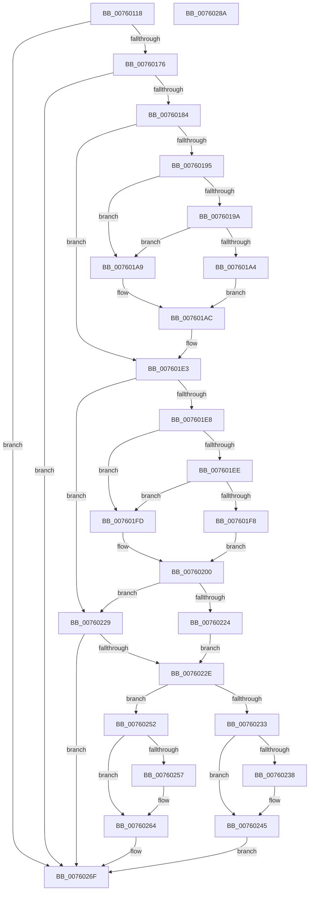

# PopIsWakeTimerImmanent

- RVA: `0x00760118`–`0x0076028B` (길이 `371` bytes)
- VA: `0x0000000140760118`
- 실행 섹션: `PAGE`
- PDB 이름 있음: `예`; PDB Function 태그: `아니요`
- unwind 정보 RVA: `0x000CC6A0`
- 디코드: `114`개 명령, `371/371` bytes 표시
- 미해석 바이트: `0` (있으면 어셈블리에 `.byte`로 보존)

> 이 문서는 커널 이미지의 기계어와 PDB 기호를 분석해 생성했습니다. 4번과 5번은 함수 원형과 자료형을 바이너리 사용 방식에서 추정한 C 해석이며 원본 소스 복구 결과는 아닙니다.

## 1. Dependencies

- 직접 호출 지점: **4**; 고유 호출 대상: **2**
- 직접 호출자로 확인된 함수: **1**
- RIP 상대 이미지 참조: **3**

### Outgoing calls
- `0x007601BF` → [ExGetNextWakeTime](../../pagelk/B7/ExGetNextWakeTime_function_00B7E018.md) (function, `0x00B7E018`)
- `0x00760213` → [ExGetNextWakeTime](../../pagelk/B7/ExGetNextWakeTime_function_00B7E018.md) (function, `0x00B7E018`)
- `0x00760240` → [ExFreePoolWithTag](../../poolcode/B8/ExFreePoolWithTag_function_00B82870.md) (function, `0x00B82870`)
- `0x0076025F` → [ExFreePoolWithTag](../../poolcode/B8/ExFreePoolWithTag_function_00B82870.md) (function, `0x00B82870`)

### Direct callers
- [PopDeferDoze](../75/PopDeferDoze_function_0075FF88.md) at `0x00760096`

### Static image references
- `0x0076015F` → RVA `0x00F0BE10` (`.data`; read)
- `0x00760176` → RVA `0x00FC50FC` (`ALMOSTRO`; read)
- `0x0076019A` → RVA `0x00F0CF0C` (`.data`; read)

## 2. Other-region calls and transfers

- 다른 실행 섹션으로 향하는 call: **4**
  - `0x007601BF` → [ExGetNextWakeTime](../../pagelk/B7/ExGetNextWakeTime_function_00B7E018.md) (`PAGE` → `PAGELK`)
  - `0x00760213` → [ExGetNextWakeTime](../../pagelk/B7/ExGetNextWakeTime_function_00B7E018.md) (`PAGE` → `PAGELK`)
  - `0x00760240` → [ExFreePoolWithTag](../../poolcode/B8/ExFreePoolWithTag_function_00B82870.md) (`PAGE` → `POOLCODE`)
  - `0x0076025F` → [ExFreePoolWithTag](../../poolcode/B8/ExFreePoolWithTag_function_00B82870.md) (`PAGE` → `POOLCODE`)
- 별도 외부 분기/꼬리 이동을 확인하지 못했습니다.

## 3. Assembly (complete function range)

```asm
00760118  48 8B C4                        mov rax, rsp
0076011B  48 89 58 10                     mov qword ptr [rax + 0x10], rbx
0076011F  4C 89 48 20                     mov qword ptr [rax + 0x20], r9
00760123  44 89 40 18                     mov dword ptr [rax + 0x18], r8d
00760127  48 89 48 08                     mov qword ptr [rax + 8], rcx
0076012B  55                              push rbp
0076012C  56                              push rsi
0076012D  57                              push rdi
0076012E  41 54                           push r12
00760130  41 55                           push r13
00760132  41 56                           push r14
00760134  41 57                           push r15
00760136  48 8B EC                        mov rbp, rsp
00760139  48 83 EC 50                     sub rsp, 0x50
0076013D  4C 8B 65 60                     mov r12, qword ptr [rbp + 0x60]
00760141  49 83 CF FF                     or r15, 0xffffffffffffffff
00760145  33 DB                           xor ebx, ebx
00760147  4C 89 7D F0                     mov qword ptr [rbp - 0x10], r15
0076014B  33 F6                           xor esi, esi
0076014D  4C 89 7D E0                     mov qword ptr [rbp - 0x20], r15
00760151  4C 8B D1                        mov r10, rcx
00760154  48 89 75 F8                     mov qword ptr [rbp - 8], rsi
00760158  49 21 1C 24                     and qword ptr [r12], rbx
0076015C  45 32 F6                        xor r14b, r14b
0076015F  48 8B 0D AA BC 7A 00            mov rcx, qword ptr [rip + 0x7abcaa]
00760166  49 8B FF                        mov rdi, r15
00760169  48 89 5D E8                     mov qword ptr [rbp - 0x18], rbx
0076016D  48 85 C9                        test rcx, rcx
00760170  0F 84 F9 00 00 00               je 0x14076026f
00760176  8B 05 80 4F 86 00               mov eax, dword ptr [rip + 0x864f80]
0076017C  85 C0                           test eax, eax
0076017E  0F 84 EB 00 00 00               je 0x14076026f
00760184  4C 69 E8 80 96 98 00            imul r13, rax, 0x989680
0076018B  4C 03 E9                        add r13, rcx
0076018E  8D 4E 01                        lea ecx, [rsi + 1]
00760191  85 D2                           test edx, edx
00760193  74 4E                           je 0x1407601e3
00760195  83 FA 02                        cmp edx, 2
00760198  75 0F                           jne 0x1407601a9
0076019A  8B 05 6C CD 7A 00               mov eax, dword ptr [rip + 0x7acd6c]
007601A0  85 C0                           test eax, eax
007601A2  78 05                           js 0x1407601a9
007601A4  44 8A C1                        mov r8b, cl
007601A7  EB 03                           jmp 0x1407601ac
007601A9  45 32 C0                        xor r8b, r8b
007601AC  48 8D 45 F8                     lea rax, [rbp - 8]
007601B0  49 8B D5                        mov rdx, r13
007601B3  4C 8D 4D F0                     lea r9, [rbp - 0x10]
007601B7  48 89 44 24 20                  mov qword ptr [rsp + 0x20], rax
007601BC  49 8B CA                        mov rcx, r10
007601BF  E8 54 DE 41 00                  call 0x140b7e018
007601C4  4C 8B 7D F0                     mov r15, qword ptr [rbp - 0x10]
007601C8  84 C0                           test al, al
007601CA  48 8B 75 F8                     mov rsi, qword ptr [rbp - 8]
007601CE  B9 01 00 00 00                  mov ecx, 1
007601D3  44 8B 45 50                     mov r8d, dword ptr [rbp + 0x50]
007601D7  4C 8B 55 40                     mov r10, qword ptr [rbp + 0x40]
007601DB  45 0F B6 F6                     movzx r14d, r14b
007601DF  44 0F 45 F1                     cmovne r14d, ecx
007601E3  45 85 C0                        test r8d, r8d
007601E6  74 41                           je 0x140760229
007601E8  41 83 F8 02                     cmp r8d, 2
007601EC  75 0F                           jne 0x1407601fd
007601EE  8B 05 18 CD 7A 00               mov eax, dword ptr [rip + 0x7acd18]
007601F4  85 C0                           test eax, eax
007601F6  78 05                           js 0x1407601fd
007601F8  44 8A C1                        mov r8b, cl
007601FB  EB 03                           jmp 0x140760200
007601FD  45 32 C0                        xor r8b, r8b
00760200  48 8D 45 E8                     lea rax, [rbp - 0x18]
00760204  49 8B D5                        mov rdx, r13
00760207  4C 8D 4D E0                     lea r9, [rbp - 0x20]
0076020B  48 89 44 24 20                  mov qword ptr [rsp + 0x20], rax
00760210  49 8B CA                        mov rcx, r10
00760213  E8 00 DE 41 00                  call 0x140b7e018
00760218  48 8B 7D E0                     mov rdi, qword ptr [rbp - 0x20]
0076021C  48 8B 5D E8                     mov rbx, qword ptr [rbp - 0x18]
00760220  84 C0                           test al, al
00760222  74 05                           je 0x140760229
00760224  41 B6 01                        mov r14b, 1
00760227  EB 05                           jmp 0x14076022e
00760229  45 84 F6                        test r14b, r14b
0076022C  74 41                           je 0x14076026f
0076022E  4C 3B FF                        cmp r15, rdi
00760231  77 1F                           ja 0x140760252
00760233  48 85 DB                        test rbx, rbx
00760236  74 0D                           je 0x140760245
00760238  BA 54 72 57 53                  mov edx, 0x53577254
0076023D  48 8B CB                        mov rcx, rbx
00760240  E8 2B 26 42 00                  call 0x140b82870
00760245  48 8B 45 58                     mov rax, qword ptr [rbp + 0x58]
00760249  49 89 34 24                     mov qword ptr [r12], rsi
0076024D  4C 89 38                        mov qword ptr [rax], r15
00760250  EB 1D                           jmp 0x14076026f
00760252  48 85 F6                        test rsi, rsi
00760255  74 0D                           je 0x140760264
00760257  BA 54 72 57 53                  mov edx, 0x53577254
0076025C  48 8B CE                        mov rcx, rsi
0076025F  E8 0C 26 42 00                  call 0x140b82870
00760264  48 8B 45 58                     mov rax, qword ptr [rbp + 0x58]
00760268  49 89 1C 24                     mov qword ptr [r12], rbx
0076026C  48 89 38                        mov qword ptr [rax], rdi
0076026F  48 8B 9C 24 98 00 00 00         mov rbx, qword ptr [rsp + 0x98]
00760277  41 8A C6                        mov al, r14b
0076027A  48 83 C4 50                     add rsp, 0x50
0076027E  41 5F                           pop r15
00760280  41 5E                           pop r14
00760282  41 5D                           pop r13
00760284  41 5C                           pop r12
00760286  5F                              pop rdi
00760287  5E                              pop rsi
00760288  5D                              pop rbp
00760289  C3                              ret
0076028A  CC                              int3
```

## 4. C-style interpretation (structured pseudocode)

```c
__int64 __fastcall PopIsWakeTimerImmanent(__int64 a1, int a2, int a3, __int64 a4, __int64 a5)
{
    __int64 result;
    __int64 v_r13;
    __int64 v_r14;
    __int64 v_r15;
    __int64 v_rbx;
    __int64 v_rsi;
    __int64 v_rsp;
    unsigned __int64 v_stack_m40;
    unsigned __int64 v_stack_m48;
    unsigned __int64 v_stack_m50;
    unsigned __int64 v_stack_m58;
    unsigned __int64 v_stack_m68;
    unsigned __int64 v_stack_p10;
    unsigned int v_stack_p18;
    unsigned __int64 v_stack_p20;
    unsigned __int64 v_stack_p8;

    *(unsigned __int64 *)(v_rsp + 16) = v_rbx;
    *(unsigned __int64 *)(v_rsp + 32) = a4;
    *(unsigned int *)(v_rsp + 24) = a3;
    *(unsigned __int64 *)(v_rsp + 8) = a1;
    v_rsp = (v_rsp) - (80);
    v_r15 = (v_r15) | (-1);
    v_rbx = 0;
    v_stack_m48 = v_r15;
    v_rsi = 0;
    v_stack_m58 = v_r15;
    v_stack_m40 = 0;
    v_r14 = 0;
    v_stack_m50 = 0;
    if (*(unsigned __int64 *)(v_rip + 8043690) == 0) goto loc_0076026F;
    if ((unsigned int)((unsigned int)(*(unsigned int *)(v_rip + 8802176))) == 0) goto loc_0076026F;
    v_r13 = (v_r13) * ((unsigned int)(*(unsigned int *)(v_rip + 8802176)));
    v_r13 = (v_r13) + (*(unsigned __int64 *)(v_rip + 8043690));
    if (a2 == 0) goto loc_007601E3;
    if (a2 != 2) goto loc_007601A9;
    if (sign_flag) goto loc_007601A9;
    goto loc_007601AC;
loc_007601A9:
    a3 = 0;
loc_007601AC:
    v_stack_m68 = v_stack_m40;
    result = ExGetNextWakeTime(a1, v_r13, a3, v_stack_m48);
    v_r14 = 0;
    if ((unsigned __int8)(result) != 0) { v_r14 = 1; }
loc_007601E3:
    if ((unsigned int)((unsigned int)(v_stack_p18)) == 0) goto loc_00760229;
    if (((unsigned int)((unsigned int)(v_stack_p18))) != 2) goto loc_007601FD;
    if (sign_flag) goto loc_007601FD;
    goto loc_00760200;
loc_007601FD:
    a3 = 0;
loc_00760200:
    v_stack_m68 = v_stack_m50;
    result = ExGetNextWakeTime(v_stack_p8, v_r13, a3, v_stack_m58);
    if ((unsigned __int8)(result) == 0) goto loc_00760229;
    goto loc_0076022E;
loc_00760229:
    if (1 == 0) goto loc_0076026F;
loc_0076022E:
    if (v_stack_m48 > v_stack_m58) goto loc_00760252;
    if (v_stack_m50 != 0) {
        a2 = 0x53577254ULL;
        a1 = v_stack_m50;
        result = ExFreePoolWithTag(a1, a2, a3, v_stack_m58);
    }
    *(unsigned __int64 *)(a5) = v_stack_m40;
    *(unsigned __int64 *)(v_stack_p20) = v_stack_m48;
    goto loc_0076026F;
loc_00760252:
    result = v_stack_p20;
    if (v_stack_m40 != 0) {
        a2 = 0x53577254ULL;
        a1 = v_stack_m40;
        result = ExFreePoolWithTag(a1, a2, a3, v_stack_m58);
    }
    *(unsigned __int64 *)(a5) = v_stack_m50;
    *(unsigned __int64 *)(v_stack_p20) = v_stack_m58;
loc_0076026F:
    v_rsp = (v_rsp) + (80);
    return 1;
}
```

## 5. (Beta) C Style

```c
int64_t PopIsWakeTimerImmanent(int64_t Arg1, int32_t Arg2, int32_t Arg3, int64_t Arg4, void *Arg5)
{
    uint8_t *arg5 = (uint8_t *)Arg5;

    int64_t result;
    int64_t local_r13;
    int64_t local_r14;
    int64_t local_r15;
    int64_t local_rbx;
    int64_t local_rsi;
    int64_t local_rsp;
    uint64_t v_stack_m40;
    uint64_t v_stack_m48;
    uint64_t v_stack_m50;
    uint64_t v_stack_m58;
    uint64_t v_stack_m68;
    uint64_t v_stack_p10;
    uint32_t v_stack_p18;
    uint64_t v_stack_p20;
    uint64_t v_stack_p8;

    *(uint64_t *)(local_rsp + 0x10) = local_rbx;
    *(uint64_t *)(local_rsp + 0x20) = Arg4;
    *(uint32_t *)(local_rsp + 0x18) = Arg3;
    *(uint64_t *)(local_rsp + 0x8) = Arg1;
    local_rsp = (local_rsp) - (80);
    local_r15 = (local_r15) | (-1);
    local_rbx = 0;
    v_stack_m48 = local_r15;
    local_rsi = 0;
    v_stack_m58 = local_r15;
    v_stack_m40 = 0;
    local_r14 = 0;
    v_stack_m50 = 0;
    if (*(uint64_t *)(v_rip + 0x7ABCAA) == 0) goto loc_0076026F;
    if ((uint32_t)((uint32_t)(*(uint32_t *)(v_rip + 0x864F80))) == 0) goto loc_0076026F;
    local_r13 = (local_r13) * ((uint32_t)(*(uint32_t *)(v_rip + 0x864F80)));
    local_r13 = (local_r13) + (*(uint64_t *)(v_rip + 0x7ABCAA));
    if (Arg2 == 0) goto loc_007601E3;
    if (Arg2 != 2) goto loc_007601A9;
    if (sign_flag) goto loc_007601A9;
    goto loc_007601AC;
loc_007601A9:
    Arg3 = 0;
loc_007601AC:
    v_stack_m68 = v_stack_m40;
    result = ExGetNextWakeTime(Arg1, local_r13, Arg3, v_stack_m48);
    local_r14 = 0;
    if ((uint8_t)(result) != 0) { local_r14 = 1; }
loc_007601E3:
    if ((uint32_t)((uint32_t)(v_stack_p18)) == 0) goto loc_00760229;
    if (((uint32_t)((uint32_t)(v_stack_p18))) != 2) goto loc_007601FD;
    if (sign_flag) goto loc_007601FD;
    goto loc_00760200;
loc_007601FD:
    Arg3 = 0;
loc_00760200:
    v_stack_m68 = v_stack_m50;
    result = ExGetNextWakeTime(v_stack_p8, local_r13, Arg3, v_stack_m58);
    if ((uint8_t)(result) == 0) goto loc_00760229;
    goto loc_0076022E;
loc_00760229:
    if (1 == 0) goto loc_0076026F;
loc_0076022E:
    if (v_stack_m48 > v_stack_m58) goto loc_00760252;
    if (v_stack_m50 != 0) {
        Arg2 = 0x53577254ULL;
        Arg1 = v_stack_m50;
        result = ExFreePoolWithTag(Arg1, Arg2, Arg3, v_stack_m58);
    }
    *(uint64_t *)(arg5) = v_stack_m40;
    *(uint64_t *)(v_stack_p20) = v_stack_m48;
    goto loc_0076026F;
loc_00760252:
    result = v_stack_p20;
    if (v_stack_m40 != 0) {
        Arg2 = 0x53577254ULL;
        Arg1 = v_stack_m40;
        result = ExFreePoolWithTag(Arg1, Arg2, Arg3, v_stack_m58);
    }
    *(uint64_t *)(arg5) = v_stack_m50;
    *(uint64_t *)(v_stack_p20) = v_stack_m58;
loc_0076026F:
    local_rsp = (local_rsp) + (80);
    return 1;
}
```

### 관측된 메모리 오프셋

구조체 형식이 확인되지 않은 접근은 인자 기준의 오프셋으로만 기록했습니다.

| 기준 인자 | 오프셋 표현 | 폭 (bit) | 접근 |
|---|---:|---:|---|
| `Arg5` | `+ 0x0` | `64` | `R/W` |
| `Arg5` | `+ 0x0` | `64` | `W` |

## 6. Execution-region graph

[열기: 2D/3D 그래프와 함수 탐색 컨트롤 패널](../../../control-panel.html?section=page&rva=0x00760118&view=graph)

- 2D 그래프는 위에서 아래로 흐르고, 3D 그래프는 빈 공간을 드래그해 회전합니다. Shift+드래그는 이동, 휠은 확대·축소, 함수 노드 선택은 대상 보고서 이동입니다.

### Static fallback


