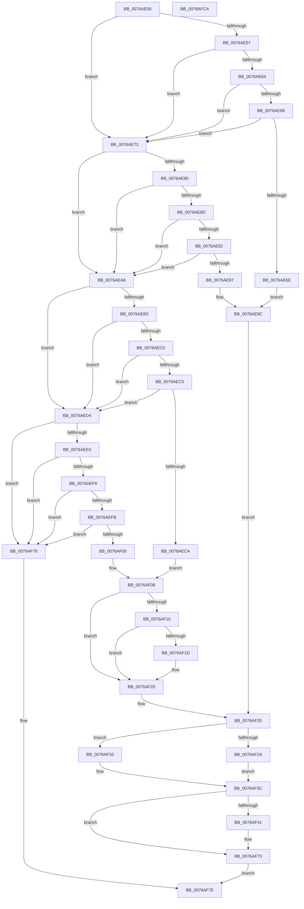

# PopModernStandbyNotificationCallback

- RVA: `0x0076AE00`–`0x0076AFCB` (길이 `459` bytes)
- VA: `0x000000014076AE00`
- 실행 섹션: `PAGE`
- PDB 이름 있음: `예`; PDB Function 태그: `아니요`
- unwind 정보 RVA: `0x000C3AF8`
- 디코드: `127`개 명령, `459/459` bytes 표시
- 미해석 바이트: `0` (있으면 어셈블리에 `.byte`로 보존)

> 이 문서는 커널 이미지의 기계어와 PDB 기호를 분석해 생성했습니다. 4번과 5번은 함수 원형과 자료형을 바이너리 사용 방식에서 추정한 C 해석이며 원본 소스 복구 결과는 아닙니다.

## 1. Dependencies

- 직접 호출 지점: **4**; 고유 호출 대상: **4**
- 직접 호출자로 확인된 함수: **0**
- RIP 상대 이미지 참조: **16**

### Outgoing calls
- `0x0076AE3A` → [PopAcquireRwLockExclusive](../../text/43/PopAcquireRwLockExclusive_function_00430B44.md) (function, `0x00430B44`)
- `0x0076AF6B` → [ZwUpdateWnfStateData](../../text/6B/ZwUpdateWnfStateData_function_006B0D10.md) (function, `0x006B0D10`)
- `0x0076AF98` → [PopDiagTraceModernStandbyStateNotification](PopDiagTraceModernStandbyStateNotification_function_00761BB4.md) (function, `0x00761BB4`)
- `0x0076AFA4` → [PopReleaseRwLock](../../text/2D/PopReleaseRwLock_function_002DFBBC.md) (function, `0x002DFBBC`)

### Direct callers
- 이 함수 시작 RVA로 연결되는 직접 call은 확인되지 않았습니다. 간접 호출은 완전히 역산할 수 없습니다.

### Static image references
- `0x0076AE21` → RVA `0x00F08360` (`.data`; read)
- `0x0076AE3F` → RVA `0x0001A268` (`.rdata`; read)
- `0x0076AE4A` → RVA `0x00F08370` (`.data`; read)
- `0x0076AE57` → RVA `0x0001A270` (`.rdata`; read)
- `0x0076AE73` → RVA `0x0001C740` (`.rdata`; read)
- `0x0076AE80` → RVA `0x0001C748` (`.rdata`; read)
- `0x0076AEA6` → RVA `0x0001C130` (`.rdata`; read)
- `0x0076AEB3` → RVA `0x0001C138` (`.rdata`; read)
- `0x0076AECC` → RVA `0x00F08374` (`.data`; write)
- `0x0076AED4` → RVA `0x0001ED50` (`.rdata`; read)
- `0x0076AEE5` → RVA `0x0001ED58` (`.rdata`; read)
- `0x0076AF02` → RVA `0x00F08378` (`.data`; write)
- `0x0076AF08` → RVA `0x00F08374` (`.data`; read)
- `0x0076AF15` → RVA `0x00F08378` (`.data`; read)
- `0x0076AF4E` → RVA `0x00020A40` (`.rdata`; read)
- `0x0076AF61` → RVA `0x00F08370` (`.data`; write)

## 2. Other-region calls and transfers

- 다른 실행 섹션으로 향하는 call: **3**
  - `0x0076AE3A` → [PopAcquireRwLockExclusive](../../text/43/PopAcquireRwLockExclusive_function_00430B44.md) (`PAGE` → `.text`)
  - `0x0076AF6B` → [ZwUpdateWnfStateData](../../text/6B/ZwUpdateWnfStateData_function_006B0D10.md) (`PAGE` → `.text`)
  - `0x0076AFA4` → [PopReleaseRwLock](../../text/2D/PopReleaseRwLock_function_002DFBBC.md) (`PAGE` → `.text`)
- 별도 외부 분기/꼬리 이동을 확인하지 못했습니다.

## 3. Assembly (complete function range)

```asm
0076AE00  48 8B C4                        mov rax, rsp
0076AE03  48 89 58 08                     mov qword ptr [rax + 8], rbx
0076AE07  48 89 68 10                     mov qword ptr [rax + 0x10], rbp
0076AE0B  48 89 70 18                     mov qword ptr [rax + 0x18], rsi
0076AE0F  57                              push rdi
0076AE10  41 54                           push r12
0076AE12  41 55                           push r13
0076AE14  41 56                           push r14
0076AE16  41 57                           push r15
0076AE18  48 83 EC 50                     sub rsp, 0x50
0076AE1C  33 DB                           xor ebx, ebx
0076AE1E  48 8B E9                        mov rbp, rcx
0076AE21  48 8D 0D 38 D5 79 00            lea rcx, [rip + 0x79d538]
0076AE28  89 58 C8                        mov dword ptr [rax - 0x38], ebx
0076AE2B  44 8A F3                        mov r14b, bl
0076AE2E  44 8B EB                        mov r13d, ebx
0076AE31  45 8B F8                        mov r15d, r8d
0076AE34  48 8B FA                        mov rdi, rdx
0076AE37  83 CE FF                        or esi, 0xffffffff
0076AE3A  E8 05 5D CC FF                  call 0x140430b44
0076AE3F  48 8B 05 22 F4 8A FF            mov rax, qword ptr [rip - 0x750bde]
0076AE46  44 8D 43 04                     lea r8d, [rbx + 4]
0076AE4A  44 8B 25 1F D5 79 00            mov r12d, dword ptr [rip + 0x79d51f]
0076AE51  48 3B 45 00                     cmp rax, qword ptr [rbp]
0076AE55  75 1C                           jne 0x14076ae73
0076AE57  48 8B 05 12 F4 8A FF            mov rax, qword ptr [rip - 0x750bee]
0076AE5E  48 3B 45 08                     cmp rax, qword ptr [rbp + 8]
0076AE62  75 0F                           jne 0x14076ae73
0076AE64  45 3B F8                        cmp r15d, r8d
0076AE67  75 0A                           jne 0x14076ae73
0076AE69  48 85 FF                        test rdi, rdi
0076AE6C  74 05                           je 0x14076ae73
0076AE6E  8D 43 03                        lea eax, [rbx + 3]
0076AE71  EB 29                           jmp 0x14076ae9c
0076AE73  48 8B 05 C6 18 8B FF            mov rax, qword ptr [rip - 0x74e73a]
0076AE7A  48 3B 45 00                     cmp rax, qword ptr [rbp]
0076AE7E  75 26                           jne 0x14076aea6
0076AE80  48 8B 05 C1 18 8B FF            mov rax, qword ptr [rip - 0x74e73f]
0076AE87  48 3B 45 08                     cmp rax, qword ptr [rbp + 8]
0076AE8B  75 19                           jne 0x14076aea6
0076AE8D  45 3B F8                        cmp r15d, r8d
0076AE90  75 14                           jne 0x14076aea6
0076AE92  48 85 FF                        test rdi, rdi
0076AE95  74 0F                           je 0x14076aea6
0076AE97  B8 02 00 00 00                  mov eax, 2
0076AE9C  8B 37                           mov esi, dword ptr [rdi]
0076AE9E  85 F6                           test esi, esi
0076AEA0  41 0F 95 C6                     setne r14b
0076AEA4  EB 7F                           jmp 0x14076af25
0076AEA6  48 8B 05 83 12 8B FF            mov rax, qword ptr [rip - 0x74ed7d]
0076AEAD  48 3B 45 00                     cmp rax, qword ptr [rbp]
0076AEB1  75 21                           jne 0x14076aed4
0076AEB3  48 8B 05 7E 12 8B FF            mov rax, qword ptr [rip - 0x74ed82]
0076AEBA  48 3B 45 08                     cmp rax, qword ptr [rbp + 8]
0076AEBE  75 14                           jne 0x14076aed4
0076AEC0  45 3B F8                        cmp r15d, r8d
0076AEC3  75 0F                           jne 0x14076aed4
0076AEC5  48 85 FF                        test rdi, rdi
0076AEC8  74 0A                           je 0x14076aed4
0076AECA  8B 37                           mov esi, dword ptr [rdi]
0076AECC  89 35 A2 D4 79 00               mov dword ptr [rip + 0x79d4a2], esi
0076AED2  EB 34                           jmp 0x14076af08
0076AED4  48 8B 05 75 3E 8B FF            mov rax, qword ptr [rip - 0x74c18b]
0076AEDB  48 3B 45 00                     cmp rax, qword ptr [rbp]
0076AEDF  0F 85 93 00 00 00               jne 0x14076af78
0076AEE5  48 8B 05 6C 3E 8B FF            mov rax, qword ptr [rip - 0x74c194]
0076AEEC  48 3B 45 08                     cmp rax, qword ptr [rbp + 8]
0076AEF0  0F 85 82 00 00 00               jne 0x14076af78
0076AEF6  45 3B F8                        cmp r15d, r8d
0076AEF9  75 7D                           jne 0x14076af78
0076AEFB  48 85 FF                        test rdi, rdi
0076AEFE  74 78                           je 0x14076af78
0076AF00  8B 37                           mov esi, dword ptr [rdi]
0076AF02  89 35 70 D4 79 00               mov dword ptr [rip + 0x79d470], esi
0076AF08  39 1D 66 D4 79 00               cmp dword ptr [rip + 0x79d466], ebx
0076AF0E  75 10                           jne 0x14076af20
0076AF10  B8 02 00 00 00                  mov eax, 2
0076AF15  39 05 5D D4 79 00               cmp dword ptr [rip + 0x79d45d], eax
0076AF1B  75 03                           jne 0x14076af20
0076AF1D  41 B6 01                        mov r14b, 1
0076AF20  B8 01 00 00 00                  mov eax, 1
0076AF25  45 84 F6                        test r14b, r14b
0076AF28  74 09                           je 0x14076af33
0076AF2A  41 3B C4                        cmp eax, r12d
0076AF2D  40 0F 9F C7                     setg dil
0076AF31  EB 09                           jmp 0x14076af3c
0076AF33  FF C8                           dec eax
0076AF35  41 3B C4                        cmp eax, r12d
0076AF38  40 0F 9C C7                     setl dil
0076AF3C  40 84 FF                        test dil, dil
0076AF3F  74 32                           je 0x14076af73
0076AF41  89 5C 24 30                     mov dword ptr [rsp + 0x30], ebx
0076AF45  48 8D 54 24 40                  lea rdx, [rsp + 0x40]
0076AF4A  89 5C 24 40                     mov dword ptr [rsp + 0x40], ebx
0076AF4E  48 8D 0D EB 5A 8B FF            lea rcx, [rip - 0x74a515]
0076AF55  89 5C 24 28                     mov dword ptr [rsp + 0x28], ebx
0076AF59  45 33 C9                        xor r9d, r9d
0076AF5C  48 89 5C 24 20                  mov qword ptr [rsp + 0x20], rbx
0076AF61  89 05 09 D4 79 00               mov dword ptr [rip + 0x79d409], eax
0076AF67  88 44 24 41                     mov byte ptr [rsp + 0x41], al
0076AF6B  E8 A0 5D F4 FF                  call 0x1406b0d10
0076AF70  44 8B E8                        mov r13d, eax
0076AF73  40 8A DF                        mov bl, dil
0076AF76  EB 06                           jmp 0x14076af7e
0076AF78  41 BD BB 00 00 C0               mov r13d, 0xc00000bb
0076AF7E  8B 15 EC D3 79 00               mov edx, dword ptr [rip + 0x79d3ec]
0076AF84  41 8B CC                        mov ecx, r12d
0076AF87  45 0F B6 CE                     movzx r9d, r14b
0076AF8B  44 0F B6 C3                     movzx r8d, bl
0076AF8F  89 74 24 28                     mov dword ptr [rsp + 0x28], esi
0076AF93  48 89 6C 24 20                  mov qword ptr [rsp + 0x20], rbp
0076AF98  E8 17 6C FF FF                  call 0x140761bb4
0076AF9D  48 8D 0D BC D3 79 00            lea rcx, [rip + 0x79d3bc]
0076AFA4  E8 13 4C B7 FF                  call 0x1402dfbbc
0076AFA9  4C 8D 5C 24 50                  lea r11, [rsp + 0x50]
0076AFAE  41 8B C5                        mov eax, r13d
0076AFB1  49 8B 5B 30                     mov rbx, qword ptr [r11 + 0x30]
0076AFB5  49 8B 6B 38                     mov rbp, qword ptr [r11 + 0x38]
0076AFB9  49 8B 73 40                     mov rsi, qword ptr [r11 + 0x40]
0076AFBD  49 8B E3                        mov rsp, r11
0076AFC0  41 5F                           pop r15
0076AFC2  41 5E                           pop r14
0076AFC4  41 5D                           pop r13
0076AFC6  41 5C                           pop r12
0076AFC8  5F                              pop rdi
0076AFC9  C3                              ret
0076AFCA  CC                              int3
```

## 4. C-style interpretation (structured pseudocode)

```c
__int64 __fastcall PopModernStandbyNotificationCallback(__int64 a1, __int64 a2, int a3, int a4)
{
    __int64 result;
    __int64 v_r13;
    __int64 v_r14;
    __int64 v_rbx;
    __int64 v_rdi;
    __int64 v_rsi;
    __int64 v_rsp;
    unsigned __int64 v_stack_m28;
    unsigned __int8 v_stack_m37;
    unsigned __int64 v_stack_m38;
    unsigned int v_stack_m48;
    unsigned int v_stack_m50;
    unsigned __int64 v_stack_m58;

    *(unsigned __int64 *)(v_rsp + 8) = v_rbx;
    *(unsigned __int64 *)(v_rsp + 16) = v_rbp;
    *(unsigned __int64 *)(v_rsp + 24) = v_rsi;
    v_rsp = (v_rsp) - (80);
    v_rbx = 0;
    *(unsigned int *)(v_rsp - 56) = 0;
    v_rsi = (unsigned int)((v_rsi) | (0xFFFFFFFFULL));
    result = PopAcquireRwLockExclusive(v_rip + 7984440, a2, a3, a4);
    if ((*(unsigned __int64 *)(v_rip - 7670750)) != (*(unsigned __int64 *)(a1))) goto loc_0076AE73;
    if ((*(unsigned __int64 *)(v_rip - 7670766)) != (*(unsigned __int64 *)(a1 + 8))) goto loc_0076AE73;
    if (((unsigned int)((unsigned int)(a3))) != ((unsigned int)(v_rbx + 4))) goto loc_0076AE73;
    if (a2 == 0) goto loc_0076AE73;
    goto loc_0076AE9C;
loc_0076AE73:
    if ((*(unsigned __int64 *)(v_rip - 7661370)) != (*(unsigned __int64 *)(a1))) goto loc_0076AEA6;
    if ((*(unsigned __int64 *)(v_rip - 7661375)) != (*(unsigned __int64 *)(a1 + 8))) goto loc_0076AEA6;
    if (((unsigned int)((unsigned int)(a3))) != ((unsigned int)(v_rbx + 4))) goto loc_0076AEA6;
    if (a2 == 0) goto loc_0076AEA6;
loc_0076AE9C:
    v_r14 = ((unsigned int)((unsigned int)(*(unsigned int *)(a2))) != 0) ? 1 : 0;
    goto loc_0076AF25;
loc_0076AEA6:
    if ((*(unsigned __int64 *)(v_rip - 7662973)) != (*(unsigned __int64 *)(a1))) goto loc_0076AED4;
    if ((*(unsigned __int64 *)(v_rip - 7662978)) != (*(unsigned __int64 *)(a1 + 8))) goto loc_0076AED4;
    if (((unsigned int)((unsigned int)(a3))) != ((unsigned int)(v_rbx + 4))) goto loc_0076AED4;
    if (a2 == 0) goto loc_0076AED4;
    *(unsigned int *)(v_rip + 7984290) = (unsigned int)((unsigned int)(*(unsigned int *)(a2)));
    goto loc_0076AF08;
loc_0076AED4:
    if ((*(unsigned __int64 *)(v_rip - 7651723)) != (*(unsigned __int64 *)(a1))) goto loc_0076AF78;
    if ((*(unsigned __int64 *)(v_rip - 7651732)) != (*(unsigned __int64 *)(a1 + 8))) goto loc_0076AF78;
    if (((unsigned int)((unsigned int)(a3))) != ((unsigned int)(v_rbx + 4))) goto loc_0076AF78;
    if (a2 == 0) goto loc_0076AF78;
    *(unsigned int *)(v_rip + 7984240) = (unsigned int)((unsigned int)(*(unsigned int *)(a2)));
loc_0076AF08:
    if ((*(unsigned int *)(v_rip + 7984230)) != 0) goto loc_0076AF20;
    if ((*(unsigned int *)(v_rip + 7984221)) == 2) {
        v_r14 = 1;
    }
loc_0076AF25:
    if ((unsigned __int8)(v_r14) == 0) goto loc_0076AF33;
    v_rdi = (1 > ((unsigned int)((unsigned int)(*(unsigned int *)(v_rip + 7984415))))) ? 1 : 0;
    goto loc_0076AF3C;
loc_0076AF33:
    result = (unsigned int)((1) - 1);
    v_rdi = (((unsigned int)(result)) < ((unsigned int)((unsigned int)(*(unsigned int *)(v_rip + 7984415))))) ? 1 : 0;
loc_0076AF3C:
    v_r13 = 0;
    if ((unsigned __int8)(v_rdi) != 0) {
        v_stack_m48 = 0;
        a2 = v_stack_m38;
        v_stack_m38 = 0;
        a1 = v_rip - 7644437;
        v_stack_m50 = 0;
        a4 = 0;
        v_stack_m58 = 0;
        *(unsigned int *)(v_rip + 7984137) = (unsigned int)(result);
        v_stack_m37 = (unsigned __int8)(result);
        result = ZwUpdateWnfStateData(a1, a2, v_rbx + 4, a4);
        v_r13 = (unsigned int)(result);
    }
    goto loc_0076AF7E;
loc_0076AF78:
loc_0076AF7E:
    v_stack_m50 = (unsigned int)((unsigned int)(*(unsigned int *)(a2)));
    v_stack_m58 = a1;
    result = PopDiagTraceModernStandbyStateNotification((unsigned int)((unsigned int)((unsigned int)(*(unsigned int *)(v_rip + 7984415)))), (unsigned int)(*(unsigned int *)(v_rip + 7984108)), (unsigned __int8)((unsigned __int8)(v_rdi)), (unsigned __int8)(v_r14));
    result = PopReleaseRwLock(v_rip + 7984060, (unsigned int)(*(unsigned int *)(v_rip + 7984108)), (unsigned __int8)((unsigned __int8)(v_rdi)), (unsigned __int8)(v_r14));
    return (unsigned int)((unsigned int)((unsigned int)(0xC00000BBULL)));
}
```

## 5. (Beta) C Style

```c
int64_t PopModernStandbyNotificationCallback(void *Arg1, int64_t Arg2, int32_t Arg3, int32_t Arg4)
{
    uint8_t *arg1 = (uint8_t *)Arg1;

    int64_t result;
    int64_t local_r13;
    int64_t local_r14;
    int64_t local_rbx;
    int64_t local_rdi;
    int64_t local_rsi;
    int64_t local_rsp;
    uint64_t v_stack_m28;
    uint8_t v_stack_m37;
    uint64_t v_stack_m38;
    uint32_t v_stack_m48;
    uint32_t v_stack_m50;
    uint64_t v_stack_m58;

    *(uint64_t *)(local_rsp + 0x8) = local_rbx;
    *(uint64_t *)(local_rsp + 0x10) = local_rbp;
    *(uint64_t *)(local_rsp + 0x18) = local_rsi;
    local_rsp = (local_rsp) - (80);
    local_rbx = 0;
    *(uint32_t *)(local_rsp - 0x38) = 0;
    local_rsi = (uint32_t)((local_rsi) | (0xFFFFFFFFULL));
    result = PopAcquireRwLockExclusive(v_rip + 7984440, Arg2, Arg3, Arg4);
    if ((*(uint64_t *)(v_rip - 0x750BDE)) != (*(uint64_t *)(arg1))) goto loc_0076AE73;
    if ((*(uint64_t *)(v_rip - 0x750BEE)) != (*(uint64_t *)(arg1 + 0x8))) goto loc_0076AE73;
    if (((uint32_t)((uint32_t)(Arg3))) != ((uint32_t)(local_rbx + 4))) goto loc_0076AE73;
    if (Arg2 == 0) goto loc_0076AE73;
    goto loc_0076AE9C;
loc_0076AE73:
    if ((*(uint64_t *)(v_rip - 0x74E73A)) != (*(uint64_t *)(arg1))) goto loc_0076AEA6;
    if ((*(uint64_t *)(v_rip - 0x74E73F)) != (*(uint64_t *)(arg1 + 0x8))) goto loc_0076AEA6;
    if (((uint32_t)((uint32_t)(Arg3))) != ((uint32_t)(local_rbx + 4))) goto loc_0076AEA6;
    if (Arg2 == 0) goto loc_0076AEA6;
loc_0076AE9C:
    local_r14 = ((uint32_t)((uint32_t)(*(uint32_t *)(Arg2))) != 0) ? 1 : 0;
    goto loc_0076AF25;
loc_0076AEA6:
    if ((*(uint64_t *)(v_rip - 0x74ED7D)) != (*(uint64_t *)(arg1))) goto loc_0076AED4;
    if ((*(uint64_t *)(v_rip - 0x74ED82)) != (*(uint64_t *)(arg1 + 0x8))) goto loc_0076AED4;
    if (((uint32_t)((uint32_t)(Arg3))) != ((uint32_t)(local_rbx + 4))) goto loc_0076AED4;
    if (Arg2 == 0) goto loc_0076AED4;
    *(uint32_t *)(v_rip + 0x79D4A2) = (uint32_t)((uint32_t)(*(uint32_t *)(Arg2)));
    goto loc_0076AF08;
loc_0076AED4:
    if ((*(uint64_t *)(v_rip - 0x74C18B)) != (*(uint64_t *)(arg1))) goto loc_0076AF78;
    if ((*(uint64_t *)(v_rip - 0x74C194)) != (*(uint64_t *)(arg1 + 0x8))) goto loc_0076AF78;
    if (((uint32_t)((uint32_t)(Arg3))) != ((uint32_t)(local_rbx + 4))) goto loc_0076AF78;
    if (Arg2 == 0) goto loc_0076AF78;
    *(uint32_t *)(v_rip + 0x79D470) = (uint32_t)((uint32_t)(*(uint32_t *)(Arg2)));
loc_0076AF08:
    if ((*(uint32_t *)(v_rip + 0x79D466)) != 0) goto loc_0076AF20;
    if ((*(uint32_t *)(v_rip + 0x79D45D)) == 2) {
        local_r14 = 1;
    }
loc_0076AF25:
    if ((uint8_t)(local_r14) == 0) goto loc_0076AF33;
    local_rdi = (1 > ((uint32_t)((uint32_t)(*(uint32_t *)(v_rip + 0x79D51F))))) ? 1 : 0;
    goto loc_0076AF3C;
loc_0076AF33:
    result = (uint32_t)((1) - 1);
    local_rdi = (((uint32_t)(result)) < ((uint32_t)((uint32_t)(*(uint32_t *)(v_rip + 0x79D51F))))) ? 1 : 0;
loc_0076AF3C:
    local_r13 = 0;
    if ((uint8_t)(local_rdi) != 0) {
        v_stack_m48 = 0;
        Arg2 = v_stack_m38;
        v_stack_m38 = 0;
        Arg1 = v_rip - 7644437;
        v_stack_m50 = 0;
        Arg4 = 0;
        v_stack_m58 = 0;
        *(uint32_t *)(v_rip + 0x79D409) = (uint32_t)(result);
        v_stack_m37 = (uint8_t)(result);
        result = ZwUpdateWnfStateData(Arg1, Arg2, local_rbx + 4, Arg4);
        local_r13 = (uint32_t)(result);
    }
    goto loc_0076AF7E;
loc_0076AF78:
loc_0076AF7E:
    v_stack_m50 = (uint32_t)((uint32_t)(*(uint32_t *)(Arg2)));
    v_stack_m58 = Arg1;
    result = PopDiagTraceModernStandbyStateNotification((uint32_t)((uint32_t)((uint32_t)(*(uint32_t *)(v_rip + 0x79D51F)))), (uint32_t)(*(uint32_t *)(v_rip + 0x79D3EC)), (uint8_t)((uint8_t)(local_rdi)), (uint8_t)(local_r14));
    result = PopReleaseRwLock(v_rip + 7984060, (uint32_t)(*(uint32_t *)(v_rip + 0x79D3EC)), (uint8_t)((uint8_t)(local_rdi)), (uint8_t)(local_r14));
    return (uint32_t)((uint32_t)((uint32_t)(0xC00000BBULL)));
}
```

### 관측된 메모리 오프셋

구조체 형식이 확인되지 않은 접근은 인자 기준의 오프셋으로만 기록했습니다.

| 기준 인자 | 오프셋 표현 | 폭 (bit) | 접근 |
|---|---:|---:|---|
| `Arg1` | `+ 0x0` | `64` | `R` |
| `Arg1` | `+ 0x8` | `64` | `R` |

## 6. Execution-region graph

[열기: 2D/3D 그래프와 함수 탐색 컨트롤 패널](../../../control-panel.html?section=page&rva=0x0076AE00&view=graph)

- 2D 그래프는 위에서 아래로 흐르고, 3D 그래프는 빈 공간을 드래그해 회전합니다. Shift+드래그는 이동, 휠은 확대·축소, 함수 노드 선택은 대상 보고서 이동입니다.

### Static fallback


