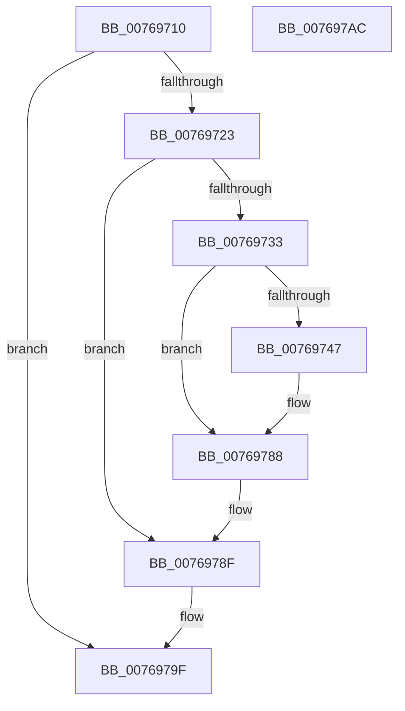

# PopMonitorInvocation

- RVA: `0x00769710`–`0x007697AD` (길이 `157` bytes)
- VA: `0x0000000140769710`
- 실행 섹션: `PAGE`
- PDB 이름 있음: `예`; PDB Function 태그: `아니요`
- unwind 정보 RVA: `0x00068D5C`
- 디코드: `44`개 명령, `157/157` bytes 표시
- 미해석 바이트: `0` (있으면 어셈블리에 `.byte`로 보존)

> 이 문서는 커널 이미지의 기계어와 PDB 기호를 분석해 생성했습니다. 4번과 5번은 함수 원형과 자료형을 바이너리 사용 방식에서 추정한 C 해석이며 원본 소스 복구 결과는 아닙니다.

## 1. Dependencies

- 직접 호출 지점: **7**; 고유 호출 대상: **7**
- 직접 호출자로 확인된 함수: **1**
- RIP 상대 이미지 참조: **2**

### Outgoing calls
- `0x00769723` → [PopAcquirePolicyLock](../../pagelk/B7/PopAcquirePolicyLock_function_00B783C0.md) (function, `0x00B783C0`)
- `0x0076972A` → [PopIsInputSuppressionEngaged](../AD/PopIsInputSuppressionEngaged_function_00ADFDA4.md) (function, `0x00ADFDA4`)
- `0x00769770` → [wil_details_FeatureReporting_ReportUsageToService](../../text/53/wil_details_FeatureReporting_ReportUsageToService_function_0053E6E4.md) (function, `0x0053E6E4`)
- `0x00769783` → [wil_details_FeatureStateCache_TryEnableDeviceUsageFastPath](../../text/53/wil_details_FeatureStateCache_TryEnableDeviceUsageFastPath_function_0053E774.md) (function, `0x0053E774`)
- `0x0076978A` → [PopTraceMonitorOnRequestUserInput](PopTraceMonitorOnRequestUserInput_function_00763BE8.md) (function, `0x00763BE8`)
- `0x00769793` → [PopProcessSessionDisplayStateChange](../91/PopProcessSessionDisplayStateChange_function_00914380.md) (function, `0x00914380`)
- `0x0076979A` → [PopReleasePolicyLock](../../pagelk/B7/PopReleasePolicyLock_function_00B78410.md) (function, `0x00B78410`)

### Direct callers
- [NtPowerInformation](../95/NtPowerInformation_function_00955D80.md) at `0x009575C8`

### Static image references
- `0x00769733` → RVA `0x00FC4780` (`.data`; read)
- `0x00769765` → RVA `0x000DD6A0` (`.rdata`; read)

## 2. Other-region calls and transfers

- 다른 실행 섹션으로 향하는 call: **4**
  - `0x00769723` → [PopAcquirePolicyLock](../../pagelk/B7/PopAcquirePolicyLock_function_00B783C0.md) (`PAGE` → `PAGELK`)
  - `0x00769770` → [wil_details_FeatureReporting_ReportUsageToService](../../text/53/wil_details_FeatureReporting_ReportUsageToService_function_0053E6E4.md) (`PAGE` → `.text`)
  - `0x00769783` → [wil_details_FeatureStateCache_TryEnableDeviceUsageFastPath](../../text/53/wil_details_FeatureStateCache_TryEnableDeviceUsageFastPath_function_0053E774.md) (`PAGE` → `.text`)
  - `0x0076979A` → [PopReleasePolicyLock](../../pagelk/B7/PopReleasePolicyLock_function_00B78410.md) (`PAGE` → `PAGELK`)
- 별도 외부 분기/꼬리 이동을 확인하지 못했습니다.

## 3. Assembly (complete function range)

```asm
00769710  48 89 5C 24 10                  mov qword ptr [rsp + 0x10], rbx
00769715  57                              push rdi
00769716  48 83 EC 20                     sub rsp, 0x20
0076971A  8B 79 04                        mov edi, dword ptr [rcx + 4]
0076971D  33 DB                           xor ebx, ebx
0076971F  38 19                           cmp byte ptr [rcx], bl
00769721  74 7C                           je 0x14076979f
00769723  E8 98 EC 40 00                  call 0x140b783c0
00769728  8B CF                           mov ecx, edi
0076972A  E8 75 66 37 00                  call 0x140adfda4
0076972F  84 C0                           test al, al
00769731  74 5C                           je 0x14076978f
00769733  8B 0D 47 B0 85 00               mov ecx, dword ptr [rip + 0x85b047]
00769739  48 89 5C 24 30                  mov qword ptr [rsp + 0x30], rbx
0076973E  89 4C 24 30                     mov dword ptr [rsp + 0x30], ecx
00769742  F6 C1 10                        test cl, 0x10
00769745  75 41                           jne 0x140769788
00769747  48 8B 44 24 30                  mov rax, qword ptr [rsp + 0x30]
0076974C  83 C9 01                        or ecx, 1
0076974F  48 89 44 24 30                  mov qword ptr [rsp + 0x30], rax
00769754  BB 03 00 00 00                  mov ebx, 3
00769759  89 4C 24 30                     mov dword ptr [rsp + 0x30], ecx
0076975D  44 8B C3                        mov r8d, ebx
00769760  48 8B 54 24 30                  mov rdx, qword ptr [rsp + 0x30]
00769765  48 8D 0D 34 3F 97 FF            lea rcx, [rip - 0x68c0cc]
0076976C  44 8D 4B FE                     lea r9d, [rbx - 2]
00769770  E8 6F 4F DD FF                  call 0x14053e6e4
00769775  48 8B 4C 24 30                  mov rcx, qword ptr [rsp + 0x30]
0076977A  4C 8D 05 1F 3F 97 FF            lea r8, [rip - 0x68c0e1]
00769781  8B D3                           mov edx, ebx
00769783  E8 EC 4F DD FF                  call 0x14053e774
00769788  8B CF                           mov ecx, edi
0076978A  E8 59 A4 FF FF                  call 0x140763be8
0076978F  8B D7                           mov edx, edi
00769791  B1 01                           mov cl, 1
00769793  E8 E8 AB 1A 00                  call 0x140914380
00769798  8B D8                           mov ebx, eax
0076979A  E8 71 EC 40 00                  call 0x140b78410
0076979F  8B C3                           mov eax, ebx
007697A1  48 8B 5C 24 38                  mov rbx, qword ptr [rsp + 0x38]
007697A6  48 83 C4 20                     add rsp, 0x20
007697AA  5F                              pop rdi
007697AB  C3                              ret
007697AC  CC                              int3
```

## 4. C-style interpretation (structured pseudocode)

```c
__int64 __fastcall PopMonitorInvocation(__int64 a1)
{
    __int64 result;
    __int64 v_rbx;
    __int64 v_rsp;
    unsigned __int64 v_stack_p10;
    unsigned __int64 v_stack_p8;

    v_stack_p10 = v_rbx;
    v_rsp = (v_rsp) - (32);
    v_rbx = 0;
    if ((*(unsigned __int8 *)(a1)) == 0) goto loc_0076979F;
    result = PopAcquirePolicyLock(a1, a2, a3, a4);
    result = PopIsInputSuppressionEngaged((unsigned int)((unsigned int)((unsigned int)(*(unsigned int *)(a1 + 4)))), a2, a3, a4);
    if ((unsigned __int8)(result) == 0) goto loc_0076978F;
    v_stack_p8 = 0;
    v_stack_p8 = (unsigned int)((unsigned int)(*(unsigned int *)(v_rip + 8761415)));
    if ((((unsigned __int8)((unsigned int)(*(unsigned int *)(v_rip + 8761415)))) & (16)) == 0) {
        result = v_stack_p8;
        a1 = (unsigned int)(((unsigned int)(*(unsigned int *)(v_rip + 8761415))) | (1));
        v_stack_p8 = result;
        v_rbx = 3;
        v_stack_p8 = (unsigned int)(a1);
        a3 = (unsigned int)(v_rbx);
        a2 = v_stack_p8;
        a1 = v_rip - 6865100;
        a4 = v_rbx - 2;
        result = wil_details_FeatureReporting_ReportUsageToService(a1, a2, a3, a4);
        a1 = v_stack_p8;
        a3 = v_rip - 6865121;
        a2 = (unsigned int)(v_rbx);
        result = wil_details_FeatureStateCache_TryEnableDeviceUsageFastPath(a1, a2, a3, a4);
    }
    result = PopTraceMonitorOnRequestUserInput((unsigned int)((unsigned int)((unsigned int)(*(unsigned int *)(a1 + 4)))), a2, a3, a4);
loc_0076978F:
    result = PopProcessSessionDisplayStateChange(1, (unsigned int)((unsigned int)((unsigned int)(*(unsigned int *)(a1 + 4)))), a3, a4);
    result = PopReleasePolicyLock(1, (unsigned int)((unsigned int)((unsigned int)(*(unsigned int *)(a1 + 4)))), a3, a4);
loc_0076979F:
    v_rsp = (v_rsp) + (32);
    return (unsigned int)((unsigned int)((unsigned int)((unsigned int)(result))));
}
```

## 5. (Beta) C Style

```c
int64_t PopMonitorInvocation(void *Arg1)
{
    uint8_t *arg1 = (uint8_t *)Arg1;

    int64_t result;
    int64_t local_rbx;
    int64_t local_rsp;
    uint64_t v_stack_p10;
    uint64_t v_stack_p8;

    v_stack_p10 = local_rbx;
    local_rsp = (local_rsp) - (32);
    local_rbx = 0;
    if ((*(uint8_t *)(arg1)) == 0) goto loc_0076979F;
    result = PopAcquirePolicyLock(Arg1, a2, a3, a4);
    result = PopIsInputSuppressionEngaged((uint32_t)((uint32_t)((uint32_t)(*(uint32_t *)(arg1 + 0x4)))), a2, a3, a4);
    if ((uint8_t)(result) == 0) goto loc_0076978F;
    v_stack_p8 = 0;
    v_stack_p8 = (uint32_t)((uint32_t)(*(uint32_t *)(v_rip + 0x85B047)));
    if ((((uint8_t)((uint32_t)(*(uint32_t *)(v_rip + 0x85B047)))) & (16)) == 0) {
        result = v_stack_p8;
        Arg1 = (uint32_t)(((uint32_t)(*(uint32_t *)(v_rip + 0x85B047))) | (1));
        v_stack_p8 = result;
        local_rbx = 3;
        v_stack_p8 = (uint32_t)(Arg1);
        a3 = (uint32_t)(local_rbx);
        a2 = v_stack_p8;
        Arg1 = v_rip - 6865100;
        a4 = local_rbx - 2;
        result = wil_details_FeatureReporting_ReportUsageToService(Arg1, a2, a3, a4);
        Arg1 = v_stack_p8;
        a3 = v_rip - 6865121;
        a2 = (uint32_t)(local_rbx);
        result = wil_details_FeatureStateCache_TryEnableDeviceUsageFastPath(Arg1, a2, a3, a4);
    }
    result = PopTraceMonitorOnRequestUserInput((uint32_t)((uint32_t)((uint32_t)(*(uint32_t *)(arg1 + 0x4)))), a2, a3, a4);
loc_0076978F:
    result = PopProcessSessionDisplayStateChange(1, (uint32_t)((uint32_t)((uint32_t)(*(uint32_t *)(arg1 + 0x4)))), a3, a4);
    result = PopReleasePolicyLock(1, (uint32_t)((uint32_t)((uint32_t)(*(uint32_t *)(arg1 + 0x4)))), a3, a4);
loc_0076979F:
    local_rsp = (local_rsp) + (32);
    return (uint32_t)((uint32_t)((uint32_t)((uint32_t)(result))));
}
```

### 관측된 메모리 오프셋

구조체 형식이 확인되지 않은 접근은 인자 기준의 오프셋으로만 기록했습니다.

| 기준 인자 | 오프셋 표현 | 폭 (bit) | 접근 |
|---|---:|---:|---|
| `Arg1` | `+ 0x0` | `8` | `R` |
| `Arg1` | `+ 0x4` | `32` | `R` |

## 6. Execution-region graph

[열기: 2D/3D 그래프와 함수 탐색 컨트롤 패널](../../../control-panel.html?section=page&rva=0x00769710&view=graph)

- 2D 그래프는 위에서 아래로 흐르고, 3D 그래프는 빈 공간을 드래그해 회전합니다. Shift+드래그는 이동, 휠은 확대·축소, 함수 노드 선택은 대상 보고서 이동입니다.

### Static fallback


