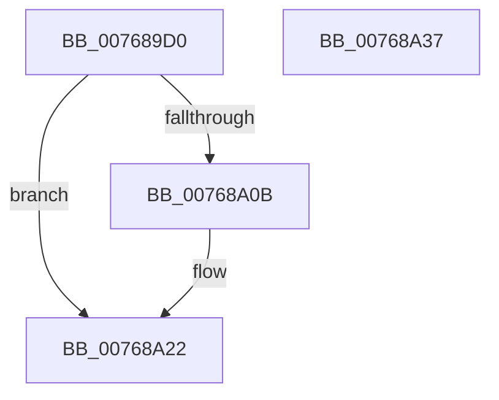

# PopNetArmRefreshTimer

- RVA: `0x007689D0`–`0x00768A38` (길이 `104` bytes)
- VA: `0x00000001407689D0`
- 실행 섹션: `PAGE`
- PDB 이름 있음: `예`; PDB Function 태그: `아니요`
- unwind 정보 RVA: `0x00060BC4`
- 디코드: `30`개 명령, `104/104` bytes 표시
- 미해석 바이트: `0` (있으면 어셈블리에 `.byte`로 보존)

> 이 문서는 커널 이미지의 기계어와 PDB 기호를 분석해 생성했습니다. 4번과 5번은 함수 원형과 자료형을 바이너리 사용 방식에서 추정한 C 해석이며 원본 소스 복구 결과는 아닙니다.

## 1. Dependencies

- 직접 호출 지점: **2**; 고유 호출 대상: **2**
- 직접 호출자로 확인된 함수: **2**
- RIP 상대 이미지 참조: **1**

### Outgoing calls
- `0x007689FF` → [KeSetTimer2](../../text/3A/KeSetTimer2_function_003A08E0.md) (function, `0x003A08E0`)
- `0x00768A22` → [PopTraceNetRefreshTimerArmed](PopTraceNetRefreshTimerArmed_function_00763CD4.md) (function, `0x00763CD4`)

### Direct callers
- [PopNetRefreshTimerWorkerCallback](PopNetRefreshTimerWorkerCallback_function_00768D10.md) at `0x00768DB3`
- [PopNetWnfLowPowerEpochCallback](../A4/PopNetWnfLowPowerEpochCallback_function_00A49FB0.md) at `0x00A4A07D`

### Static image references
- `0x007689F8` → RVA `0x00F08700` (`.data`; read)

## 2. Other-region calls and transfers

- 다른 실행 섹션으로 향하는 call: **1**
  - `0x007689FF` → [KeSetTimer2](../../text/3A/KeSetTimer2_function_003A08E0.md) (`PAGE` → `.text`)
- 별도 외부 분기/꼬리 이동을 확인하지 못했습니다.

## 3. Assembly (complete function range)

```asm
007689D0  48 89 5C 24 08                  mov qword ptr [rsp + 8], rbx
007689D5  48 89 74 24 10                  mov qword ptr [rsp + 0x10], rsi
007689DA  57                              push rdi
007689DB  48 83 EC 20                     sub rsp, 0x20
007689DF  8A DA                           mov bl, dl
007689E1  48 8B F9                        mov rdi, rcx
007689E4  48 8B D1                        mov rdx, rcx
007689E7  33 F6                           xor esi, esi
007689E9  48 F7 DA                        neg rdx
007689EC  84 DB                           test bl, bl
007689EE  48 0F 45 D1                     cmovne rdx, rcx
007689F2  45 33 C9                        xor r9d, r9d
007689F5  45 33 C0                        xor r8d, r8d
007689F8  48 8D 0D 01 FD 79 00            lea rcx, [rip + 0x79fd01]
007689FF  E8 DC 7E C3 FF                  call 0x1403a08e0
00768A04  48 8B CF                        mov rcx, rdi
00768A07  84 DB                           test bl, bl
00768A09  74 17                           je 0x140768a22
00768A0B  48 B8 14 00 00 00 80 F7 FF FF   movabs rax, 0xfffff78000000014
00768A15  48 8B 00                        mov rax, qword ptr [rax]
00768A18  48 2B C8                        sub rcx, rax
00768A1B  48 3B C7                        cmp rax, rdi
00768A1E  48 0F 4D CE                     cmovge rcx, rsi
00768A22  E8 AD B2 FF FF                  call 0x140763cd4
00768A27  48 8B 5C 24 30                  mov rbx, qword ptr [rsp + 0x30]
00768A2C  48 8B 74 24 38                  mov rsi, qword ptr [rsp + 0x38]
00768A31  48 83 C4 20                     add rsp, 0x20
00768A35  5F                              pop rdi
00768A36  C3                              ret
00768A37  CC                              int3
```

## 4. C-style interpretation (structured pseudocode)

```c
__int64 __fastcall PopNetArmRefreshTimer(__int64 a1, unsigned __int8 a2, int a3, int a4)
{
    __int64 result;
    __int64 v_rsi;
    __int64 v_rsp;
    unsigned __int64 v_stack_p10;
    unsigned __int64 v_stack_p8;

    v_stack_p8 = v_rbx;
    v_stack_p10 = v_rsi;
    v_rsp = (v_rsp) - (32);
    v_rsi = 0;
    a2 = -(a1);
    if (a2 != 0) { a2 = a1; }
    a4 = 0;
    a3 = 0;
    result = KeSetTimer2(v_rip + 7994625, a2, a3, a4);
    if (a2 != 0) {
        result = *(unsigned __int64 *)(result);
        a1 = (a1) - (result);
        if (result >= a1) { a1 = 0; }
    }
    result = PopTraceNetRefreshTimerArmed(a1, a2, a3, a4);
    v_rsp = (v_rsp) + (32);
    return result;
}
```

## 5. (Beta) C Style

```c
int64_t PopNetArmRefreshTimer(int64_t Arg1, uint8_t Arg2, int32_t Arg3, int32_t Arg4)
{
    int64_t result;
    int64_t local_rsi;
    int64_t local_rsp;
    uint64_t v_stack_p10;
    uint64_t v_stack_p8;

    v_stack_p8 = local_rbx;
    v_stack_p10 = local_rsi;
    local_rsp = (local_rsp) - (32);
    local_rsi = 0;
    Arg2 = -(Arg1);
    if (Arg2 != 0) { Arg2 = Arg1; }
    Arg4 = 0;
    Arg3 = 0;
    result = KeSetTimer2(v_rip + 7994625, Arg2, Arg3, Arg4);
    if (Arg2 != 0) {
        result = *(uint64_t *)(result);
        Arg1 = (Arg1) - (result);
        if (result >= Arg1) { Arg1 = 0; }
    }
    result = PopTraceNetRefreshTimerArmed(Arg1, Arg2, Arg3, Arg4);
    local_rsp = (local_rsp) + (32);
    return result;
}
```

## 6. Execution-region graph

[열기: 2D/3D 그래프와 함수 탐색 컨트롤 패널](../../../control-panel.html?section=page&rva=0x007689D0&view=graph)

- 2D 그래프는 위에서 아래로 흐르고, 3D 그래프는 빈 공간을 드래그해 회전합니다. Shift+드래그는 이동, 휠은 확대·축소, 함수 노드 선택은 대상 보고서 이동입니다.

### Static fallback


