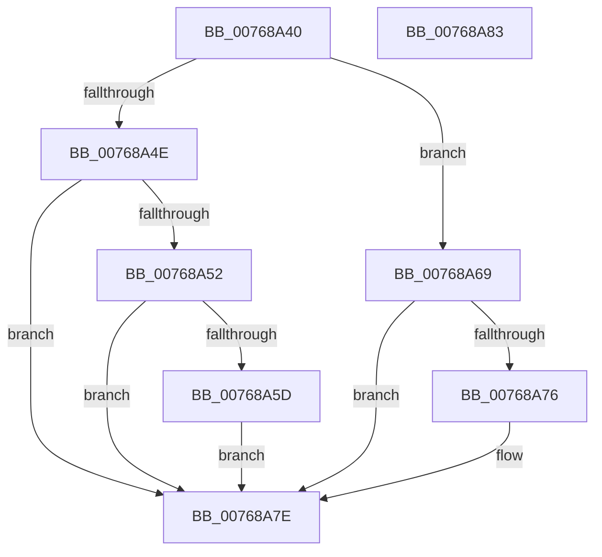

# PopNetCompliantNicUpdate

- RVA: `0x00768A40`–`0x00768A84` (길이 `68` bytes)
- VA: `0x0000000140768A40`
- 실행 섹션: `PAGE`
- PDB 이름 있음: `예`; PDB Function 태그: `아니요`
- unwind 정보 RVA: `0x0005C788`
- 디코드: `21`개 명령, `68/68` bytes 표시
- 미해석 바이트: `0` (있으면 어셈블리에 `.byte`로 보존)

> 이 문서는 커널 이미지의 기계어와 PDB 기호를 분석해 생성했습니다. 4번과 5번은 함수 원형과 자료형을 바이너리 사용 방식에서 추정한 C 해석이며 원본 소스 복구 결과는 아닙니다.

## 1. Dependencies

- 직접 호출 지점: **2**; 고유 호출 대상: **2**
- 직접 호출자로 확인된 함수: **1**
- RIP 상대 이미지 참조: **2**

### Outgoing calls
- `0x00768A62` → [PopNetSetConnectivityConstraint](PopNetSetConnectivityConstraint_function_00768E90.md) (function, `0x00768E90`)
- `0x00768A79` → [PopNetClearConnectivityConstraint](../AD/PopNetClearConnectivityConstraint_function_00ADB124.md) (function, `0x00ADB124`)

### Direct callers
- [PopPdcCsDeviceNotification](../AA/PopPdcCsDeviceNotification_function_00AA1B28.md) at `0x00AA1CC0`

### Static image references
- `0x00768A44` → RVA `0x00F08874` (`.data`; read)
- `0x00768A55` → RVA `0x00F08874` (`.data`; write)

## 2. Other-region calls and transfers

- 다른 실행 섹션으로 향하는 call: **0**
- 별도 외부 분기/꼬리 이동을 확인하지 못했습니다.

## 3. Assembly (complete function range)

```asm
00768A40  48 83 EC 28                     sub rsp, 0x28
00768A44  8B 05 2A FE 79 00               mov eax, dword ptr [rip + 0x79fe2a]
00768A4A  84 C9                           test cl, cl
00768A4C  75 1B                           jne 0x140768a69
00768A4E  85 C0                           test eax, eax
00768A50  74 2C                           je 0x140768a7e
00768A52  83 C0 FF                        add eax, -1
00768A55  89 05 19 FE 79 00               mov dword ptr [rip + 0x79fe19], eax
00768A5B  75 21                           jne 0x140768a7e
00768A5D  B9 06 00 00 00                  mov ecx, 6
00768A62  E8 29 04 00 00                  call 0x140768e90
00768A67  EB 15                           jmp 0x140768a7e
00768A69  FF C0                           inc eax
00768A6B  89 05 03 FE 79 00               mov dword ptr [rip + 0x79fe03], eax
00768A71  83 F8 01                        cmp eax, 1
00768A74  75 08                           jne 0x140768a7e
00768A76  8D 48 05                        lea ecx, [rax + 5]
00768A79  E8 A6 26 37 00                  call 0x140adb124
00768A7E  48 83 C4 28                     add rsp, 0x28
00768A82  C3                              ret
00768A83  CC                              int3
```

## 4. C-style interpretation (structured pseudocode)

```c
__int64 __fastcall PopNetCompliantNicUpdate(unsigned __int8 a1)
{
    __int64 result;
    __int64 v_rsp;

    v_rsp = (v_rsp) - (40);
    if (a1 != 0) goto loc_00768A69;
    if ((unsigned int)((unsigned int)(*(unsigned int *)(v_rip + 7994922))) == 0) goto loc_00768A7E;
    result = (unsigned int)(((unsigned int)(*(unsigned int *)(v_rip + 7994922))) + (-1));
    *(unsigned int *)(v_rip + 7994905) = (unsigned int)(result);
    if (condition_is_not_equal) goto loc_00768A7E;
    result = PopNetSetConnectivityConstraint(6, a2, a3, a4);
    goto loc_00768A7E;
loc_00768A69:
    result = (unsigned int)((result) + 1);
    *(unsigned int *)(v_rip + 7994883) = (unsigned int)(result);
    if (((unsigned int)(result)) == 1) {
        a1 = result + 5;
        result = PopNetClearConnectivityConstraint(a1, a2, a3, a4);
    }
    v_rsp = (v_rsp) + (40);
    return result;
}
```

## 5. (Beta) C Style

```c
int64_t PopNetCompliantNicUpdate(uint8_t Arg1)
{
    int64_t result;
    int64_t local_rsp;

    local_rsp = (local_rsp) - (40);
    if (Arg1 != 0) goto loc_00768A69;
    if ((uint32_t)((uint32_t)(*(uint32_t *)(v_rip + 0x79FE2A))) == 0) goto loc_00768A7E;
    result = (uint32_t)(((uint32_t)(*(uint32_t *)(v_rip + 0x79FE2A))) + (-1));
    *(uint32_t *)(v_rip + 0x79FE19) = (uint32_t)(result);
    if (condition_is_not_equal) goto loc_00768A7E;
    result = PopNetSetConnectivityConstraint(6, a2, a3, a4);
    goto loc_00768A7E;
loc_00768A69:
    result = (uint32_t)((result) + 1);
    *(uint32_t *)(v_rip + 0x79FE03) = (uint32_t)(result);
    if (((uint32_t)(result)) == 1) {
        Arg1 = result + 5;
        result = PopNetClearConnectivityConstraint(Arg1, a2, a3, a4);
    }
    local_rsp = (local_rsp) + (40);
    return result;
}
```

## 6. Execution-region graph

[열기: 2D/3D 그래프와 함수 탐색 컨트롤 패널](../../../control-panel.html?section=page&rva=0x00768A40&view=graph)

- 2D 그래프는 위에서 아래로 흐르고, 3D 그래프는 빈 공간을 드래그해 회전합니다. Shift+드래그는 이동, 휠은 확대·축소, 함수 노드 선택은 대상 보고서 이동입니다.

### Static fallback


