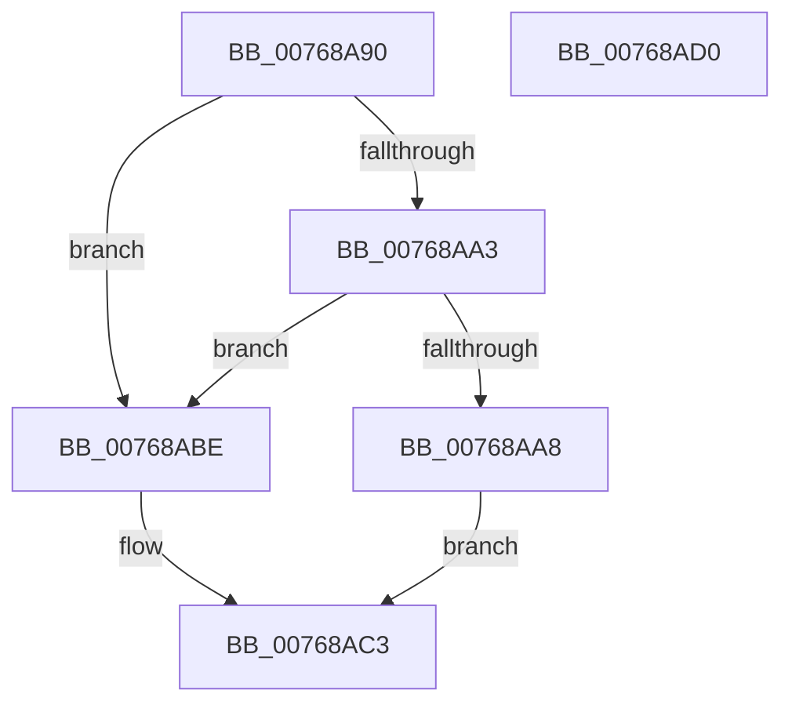

# PopNetConnectivityInStandbyCallback

- RVA: `0x00768A90`–`0x00768AD1` (길이 `65` bytes)
- VA: `0x0000000140768A90`
- 실행 섹션: `PAGE`
- PDB 이름 있음: `예`; PDB Function 태그: `아니요`
- unwind 정보 RVA: `0x0005CAAC`
- 디코드: `21`개 명령, `65/65` bytes 표시
- 미해석 바이트: `0` (있으면 어셈블리에 `.byte`로 보존)

> 이 문서는 커널 이미지의 기계어와 PDB 기호를 분석해 생성했습니다. 4번과 5번은 함수 원형과 자료형을 바이너리 사용 방식에서 추정한 C 해석이며 원본 소스 복구 결과는 아닙니다.

## 1. Dependencies

- 직접 호출 지점: **2**; 고유 호출 대상: **2**
- 직접 호출자로 확인된 함수: **0**
- RIP 상대 이미지 참조: **1**

### Outgoing calls
- `0x00768AAA` → [PopAcquirePolicyLock](../../pagelk/B7/PopAcquirePolicyLock_function_00B783C0.md) (function, `0x00B783C0`)
- `0x00768AB7` → [PopReleasePolicyLock](../../pagelk/B7/PopReleasePolicyLock_function_00B78410.md) (function, `0x00B78410`)

### Direct callers
- 이 함수 시작 RVA로 연결되는 직접 call은 확인되지 않았습니다. 간접 호출은 완전히 역산할 수 없습니다.

### Static image references
- `0x00768AB1` → RVA `0x00F0CE58` (`.data`; write)

## 2. Other-region calls and transfers

- 다른 실행 섹션으로 향하는 call: **2**
  - `0x00768AAA` → [PopAcquirePolicyLock](../../pagelk/B7/PopAcquirePolicyLock_function_00B783C0.md) (`PAGE` → `PAGELK`)
  - `0x00768AB7` → [PopReleasePolicyLock](../../pagelk/B7/PopReleasePolicyLock_function_00B78410.md) (`PAGE` → `PAGELK`)
- 별도 외부 분기/꼬리 이동을 확인하지 못했습니다.

## 3. Assembly (complete function range)

```asm
00768A90  48 89 5C 24 08                  mov qword ptr [rsp + 8], rbx
00768A95  57                              push rdi
00768A96  48 83 EC 20                     sub rsp, 0x20
00768A9A  48 8B FA                        mov rdi, rdx
00768A9D  41 83 F8 04                     cmp r8d, 4
00768AA1  75 1B                           jne 0x140768abe
00768AA3  83 3A 02                        cmp dword ptr [rdx], 2
00768AA6  77 16                           ja 0x140768abe
00768AA8  33 DB                           xor ebx, ebx
00768AAA  E8 11 F9 40 00                  call 0x140b783c0
00768AAF  8B 07                           mov eax, dword ptr [rdi]
00768AB1  89 05 A1 43 7A 00               mov dword ptr [rip + 0x7a43a1], eax
00768AB7  E8 54 F9 40 00                  call 0x140b78410
00768ABC  EB 05                           jmp 0x140768ac3
00768ABE  BB 0D 00 00 C0                  mov ebx, 0xc000000d
00768AC3  8B C3                           mov eax, ebx
00768AC5  48 8B 5C 24 30                  mov rbx, qword ptr [rsp + 0x30]
00768ACA  48 83 C4 20                     add rsp, 0x20
00768ACE  5F                              pop rdi
00768ACF  C3                              ret
00768AD0  CC                              int3
```

## 4. C-style interpretation (structured pseudocode)

```c
__int64 __fastcall PopNetConnectivityInStandbyCallback(__int64 a1, __int64 a2, int a3)
{
    __int64 result;
    __int64 v_rbx;
    __int64 v_rsp;
    unsigned __int64 v_stack_p8;

    v_stack_p8 = v_rbx;
    v_rsp = (v_rsp) - (32);
    if (a3 != 4) goto loc_00768ABE;
    if ((*(unsigned int *)(a2)) > 2) goto loc_00768ABE;
    v_rbx = 0;
    result = PopAcquirePolicyLock(a1, a2, a3, a4);
    *(unsigned int *)(v_rip + 8012705) = (unsigned int)((unsigned int)(*(unsigned int *)(a2)));
    result = PopReleasePolicyLock(a1, a2, a3, a4);
    goto loc_00768AC3;
loc_00768ABE:
loc_00768AC3:
    v_rsp = (v_rsp) + (32);
    return (unsigned int)((unsigned int)((unsigned int)(0xC000000DULL)));
}
```

## 5. (Beta) C Style

```c
int64_t PopNetConnectivityInStandbyCallback(int64_t Arg1, void *Arg2, int32_t Arg3)
{
    uint8_t *arg2 = (uint8_t *)Arg2;

    int64_t result;
    int64_t local_rbx;
    int64_t local_rsp;
    uint64_t v_stack_p8;

    v_stack_p8 = local_rbx;
    local_rsp = (local_rsp) - (32);
    if (Arg3 != 4) goto loc_00768ABE;
    if ((*(uint32_t *)(arg2)) > 2) goto loc_00768ABE;
    local_rbx = 0;
    result = PopAcquirePolicyLock(Arg1, Arg2, Arg3, a4);
    *(uint32_t *)(v_rip + 0x7A43A1) = (uint32_t)((uint32_t)(*(uint32_t *)(arg2)));
    result = PopReleasePolicyLock(Arg1, Arg2, Arg3, a4);
    goto loc_00768AC3;
loc_00768ABE:
loc_00768AC3:
    local_rsp = (local_rsp) + (32);
    return (uint32_t)((uint32_t)((uint32_t)(0xC000000DULL)));
}
```

### 관측된 메모리 오프셋

구조체 형식이 확인되지 않은 접근은 인자 기준의 오프셋으로만 기록했습니다.

| 기준 인자 | 오프셋 표현 | 폭 (bit) | 접근 |
|---|---:|---:|---|
| `Arg2` | `+ 0x0` | `32` | `R` |

## 6. Execution-region graph

[열기: 2D/3D 그래프와 함수 탐색 컨트롤 패널](../../../control-panel.html?section=page&rva=0x00768A90&view=graph)

- 2D 그래프는 위에서 아래로 흐르고, 3D 그래프는 빈 공간을 드래그해 회전합니다. Shift+드래그는 이동, 휠은 확대·축소, 함수 노드 선택은 대상 보고서 이동입니다.

### Static fallback


