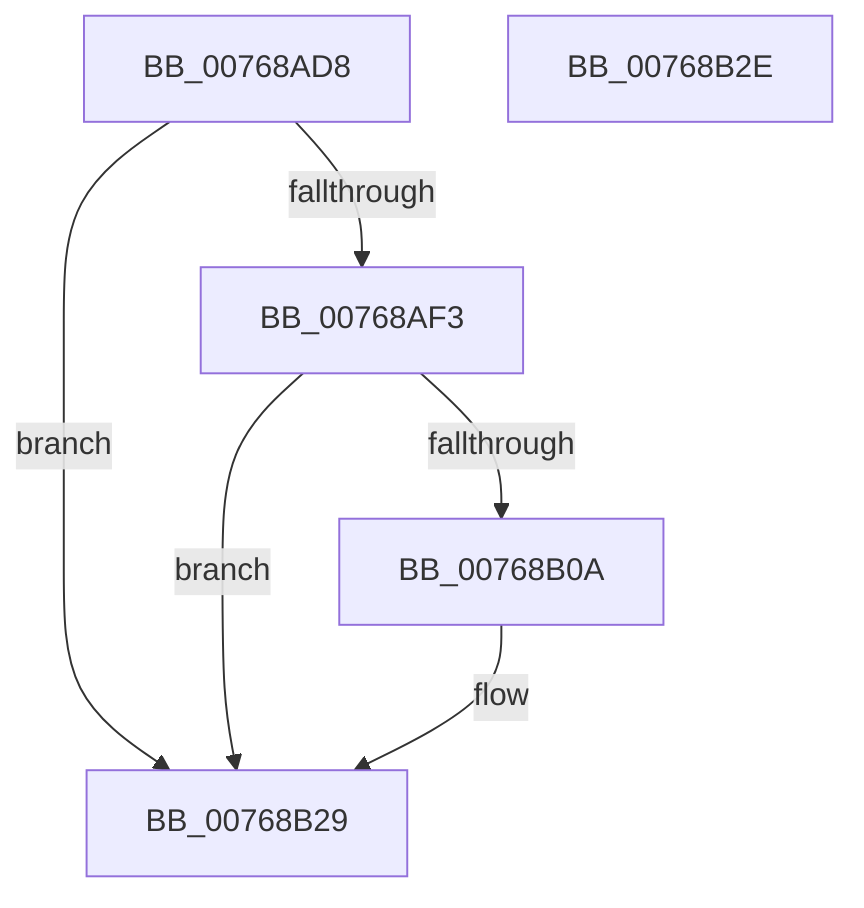

# PopNetDisarmRefreshTimer

- RVA: `0x00768AD8`–`0x00768B2F` (길이 `87` bytes)
- VA: `0x0000000140768AD8`
- 실행 섹션: `PAGE`
- PDB 이름 있음: `예`; PDB Function 태그: `아니요`
- unwind 정보 RVA: `0x0005D2F4`
- 디코드: `20`개 명령, `87/87` bytes 표시
- 미해석 바이트: `0` (있으면 어셈블리에 `.byte`로 보존)

> 이 문서는 커널 이미지의 기계어와 PDB 기호를 분석해 생성했습니다. 4번과 5번은 함수 원형과 자료형을 바이너리 사용 방식에서 추정한 C 해석이며 원본 소스 복구 결과는 아닙니다.

## 1. Dependencies

- 직접 호출 지점: **3**; 고유 호출 대상: **3**
- 직접 호출자로 확인된 함수: **1**
- RIP 상대 이미지 참조: **4**

### Outgoing calls
- `0x00768AE5` → [KeCancelTimer2](../../text/3A/KeCancelTimer2_function_003A01E0.md) (function, `0x003A01E0`)
- `0x00768B01` → [EtwEventEnabled](../../text/39/EtwEventEnabled_function_00392450.md) (function, `0x00392450`)
- `0x00768B24` → [EtwWrite](../../text/41/EtwWrite_function_0041C720.md) (function, `0x0041C720`)

### Direct callers
- [PopNetWnfLowPowerEpochCallback](../A4/PopNetWnfLowPowerEpochCallback_function_00A49FB0.md) at `0x00A4A0A1`

### Static image references
- `0x00768ADE` → RVA `0x00F08700` (`.data`; read)
- `0x00768AEA` → RVA `0x00E67858` (`.data`; read)
- `0x00768AF3` → RVA `0x00F0B408` (`.data`; read)
- `0x00768AFA` → RVA `0x00022928` (`.rdata`; read)

## 2. Other-region calls and transfers

- 다른 실행 섹션으로 향하는 call: **3**
  - `0x00768AE5` → [KeCancelTimer2](../../text/3A/KeCancelTimer2_function_003A01E0.md) (`PAGE` → `.text`)
  - `0x00768B01` → [EtwEventEnabled](../../text/39/EtwEventEnabled_function_00392450.md) (`PAGE` → `.text`)
  - `0x00768B24` → [EtwWrite](../../text/41/EtwWrite_function_0041C720.md) (`PAGE` → `.text`)
- 별도 외부 분기/꼬리 이동을 확인하지 못했습니다.

## 3. Assembly (complete function range)

```asm
00768AD8  48 83 EC 38                     sub rsp, 0x38
00768ADC  33 D2                           xor edx, edx
00768ADE  48 8D 0D 1B FC 79 00            lea rcx, [rip + 0x79fc1b]
00768AE5  E8 F6 76 C3 FF                  call 0x1403a01e0
00768AEA  80 3D 67 ED 6F 00 00            cmp byte ptr [rip + 0x6fed67], 0
00768AF1  74 36                           je 0x140768b29
00768AF3  48 8B 0D 0E 29 7A 00            mov rcx, qword ptr [rip + 0x7a290e]
00768AFA  48 8D 15 27 9E 8B FF            lea rdx, [rip - 0x7461d9]
00768B01  E8 4A 99 C2 FF                  call 0x140392450
00768B06  84 C0                           test al, al
00768B08  74 1F                           je 0x140768b29
00768B0A  48 83 64 24 20 00               and qword ptr [rsp + 0x20], 0
00768B10  48 8D 15 11 9E 8B FF            lea rdx, [rip - 0x7461ef]
00768B17  48 8B 0D EA 28 7A 00            mov rcx, qword ptr [rip + 0x7a28ea]
00768B1E  45 33 C9                        xor r9d, r9d
00768B21  45 33 C0                        xor r8d, r8d
00768B24  E8 F7 3B CB FF                  call 0x14041c720
00768B29  48 83 C4 38                     add rsp, 0x38
00768B2D  C3                              ret
00768B2E  CC                              int3
```

## 4. C-style interpretation (structured pseudocode)

```c
__int64 __fastcall PopNetDisarmRefreshTimer(__int64 a1, int a2, int a3, int a4)
{
    __int64 result;
    __int64 v_rsp;
    unsigned __int64 v_stack_m18;

    v_rsp = (v_rsp) - (56);
    a2 = 0;
    result = KeCancelTimer2(v_rip + 7994395, a2, a3, a4);
    if ((*(unsigned __int8 *)(v_rip + 7335271)) == 0) goto loc_00768B29;
    result = EtwEventEnabled(*(unsigned __int64 *)(v_rip + 8005902), v_rip - 7627225, a3, a4);
    if ((unsigned __int8)(result) != 0) {
        a2 = v_rip - 7627247;
        a1 = *(unsigned __int64 *)(v_rip + 8005866);
        a4 = 0;
        a3 = 0;
        result = EtwWrite(a1, a2, a3, a4);
    }
    v_rsp = (v_rsp) + (56);
    return result;
}
```

## 5. (Beta) C Style

```c
int64_t PopNetDisarmRefreshTimer(int64_t Arg1, int32_t Arg2, int32_t Arg3, int32_t Arg4)
{
    int64_t result;
    int64_t local_rsp;
    uint64_t v_stack_m18;

    local_rsp = (local_rsp) - (56);
    Arg2 = 0;
    result = KeCancelTimer2(v_rip + 7994395, Arg2, Arg3, Arg4);
    if ((*(uint8_t *)(v_rip + 0x6FED67)) == 0) goto loc_00768B29;
    result = EtwEventEnabled(*(uint64_t *)(v_rip + 0x7A290E), v_rip - 7627225, Arg3, Arg4);
    if ((uint8_t)(result) != 0) {
        Arg2 = v_rip - 7627247;
        Arg1 = *(uint64_t *)(v_rip + 0x7A28EA);
        Arg4 = 0;
        Arg3 = 0;
        result = EtwWrite(Arg1, Arg2, Arg3, Arg4);
    }
    local_rsp = (local_rsp) + (56);
    return result;
}
```

## 6. Execution-region graph

[열기: 2D/3D 그래프와 함수 탐색 컨트롤 패널](../../../control-panel.html?section=page&rva=0x00768AD8&view=graph)

- 2D 그래프는 위에서 아래로 흐르고, 3D 그래프는 빈 공간을 드래그해 회전합니다. Shift+드래그는 이동, 휠은 확대·축소, 함수 노드 선택은 대상 보고서 이동입니다.

### Static fallback


