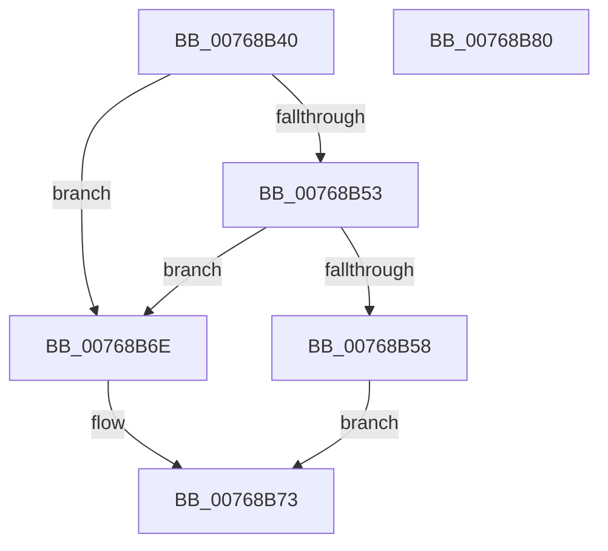

# PopNetDisconnectedStandbyModeCallback

- RVA: `0x00768B40`–`0x00768B81` (길이 `65` bytes)
- VA: `0x0000000140768B40`
- 실행 섹션: `PAGE`
- PDB 이름 있음: `예`; PDB Function 태그: `아니요`
- unwind 정보 RVA: `0x0005CAAC`
- 디코드: `21`개 명령, `65/65` bytes 표시
- 미해석 바이트: `0` (있으면 어셈블리에 `.byte`로 보존)

> 이 문서는 커널 이미지의 기계어와 PDB 기호를 분석해 생성했습니다. 4번과 5번은 함수 원형과 자료형을 바이너리 사용 방식에서 추정한 C 해석이며 원본 소스 복구 결과는 아닙니다.

## 1. Dependencies

- 직접 호출 지점: **2**; 고유 호출 대상: **2**
- 직접 호출자로 확인된 함수: **0**
- RIP 상대 이미지 참조: **1**

### Outgoing calls
- `0x00768B5A` → [PopAcquirePolicyLock](../../pagelk/B7/PopAcquirePolicyLock_function_00B783C0.md) (function, `0x00B783C0`)
- `0x00768B67` → [PopReleasePolicyLock](../../pagelk/B7/PopReleasePolicyLock_function_00B78410.md) (function, `0x00B78410`)

### Direct callers
- 이 함수 시작 RVA로 연결되는 직접 call은 확인되지 않았습니다. 간접 호출은 완전히 역산할 수 없습니다.

### Static image references
- `0x00768B61` → RVA `0x00F0CE5C` (`.data`; write)

## 2. Other-region calls and transfers

- 다른 실행 섹션으로 향하는 call: **2**
  - `0x00768B5A` → [PopAcquirePolicyLock](../../pagelk/B7/PopAcquirePolicyLock_function_00B783C0.md) (`PAGE` → `PAGELK`)
  - `0x00768B67` → [PopReleasePolicyLock](../../pagelk/B7/PopReleasePolicyLock_function_00B78410.md) (`PAGE` → `PAGELK`)
- 별도 외부 분기/꼬리 이동을 확인하지 못했습니다.

## 3. Assembly (complete function range)

```asm
00768B40  48 89 5C 24 08                  mov qword ptr [rsp + 8], rbx
00768B45  57                              push rdi
00768B46  48 83 EC 20                     sub rsp, 0x20
00768B4A  48 8B FA                        mov rdi, rdx
00768B4D  41 83 F8 04                     cmp r8d, 4
00768B51  75 1B                           jne 0x140768b6e
00768B53  83 3A 01                        cmp dword ptr [rdx], 1
00768B56  77 16                           ja 0x140768b6e
00768B58  33 DB                           xor ebx, ebx
00768B5A  E8 61 F8 40 00                  call 0x140b783c0
00768B5F  8B 07                           mov eax, dword ptr [rdi]
00768B61  89 05 F5 42 7A 00               mov dword ptr [rip + 0x7a42f5], eax
00768B67  E8 A4 F8 40 00                  call 0x140b78410
00768B6C  EB 05                           jmp 0x140768b73
00768B6E  BB 0D 00 00 C0                  mov ebx, 0xc000000d
00768B73  8B C3                           mov eax, ebx
00768B75  48 8B 5C 24 30                  mov rbx, qword ptr [rsp + 0x30]
00768B7A  48 83 C4 20                     add rsp, 0x20
00768B7E  5F                              pop rdi
00768B7F  C3                              ret
00768B80  CC                              int3
```

## 4. C-style interpretation (structured pseudocode)

```c
__int64 __fastcall PopNetDisconnectedStandbyModeCallback(__int64 a1, __int64 a2, int a3)
{
    __int64 result;
    __int64 v_rbx;
    __int64 v_rsp;
    unsigned __int64 v_stack_p8;

    v_stack_p8 = v_rbx;
    v_rsp = (v_rsp) - (32);
    if (a3 != 4) goto loc_00768B6E;
    if ((*(unsigned int *)(a2)) > 1) goto loc_00768B6E;
    v_rbx = 0;
    result = PopAcquirePolicyLock(a1, a2, a3, a4);
    *(unsigned int *)(v_rip + 8012533) = (unsigned int)((unsigned int)(*(unsigned int *)(a2)));
    result = PopReleasePolicyLock(a1, a2, a3, a4);
    goto loc_00768B73;
loc_00768B6E:
loc_00768B73:
    v_rsp = (v_rsp) + (32);
    return (unsigned int)((unsigned int)((unsigned int)(0xC000000DULL)));
}
```

## 5. (Beta) C Style

```c
int64_t PopNetDisconnectedStandbyModeCallback(int64_t Arg1, void *Arg2, int32_t Arg3)
{
    uint8_t *arg2 = (uint8_t *)Arg2;

    int64_t result;
    int64_t local_rbx;
    int64_t local_rsp;
    uint64_t v_stack_p8;

    v_stack_p8 = local_rbx;
    local_rsp = (local_rsp) - (32);
    if (Arg3 != 4) goto loc_00768B6E;
    if ((*(uint32_t *)(arg2)) > 1) goto loc_00768B6E;
    local_rbx = 0;
    result = PopAcquirePolicyLock(Arg1, Arg2, Arg3, a4);
    *(uint32_t *)(v_rip + 0x7A42F5) = (uint32_t)((uint32_t)(*(uint32_t *)(arg2)));
    result = PopReleasePolicyLock(Arg1, Arg2, Arg3, a4);
    goto loc_00768B73;
loc_00768B6E:
loc_00768B73:
    local_rsp = (local_rsp) + (32);
    return (uint32_t)((uint32_t)((uint32_t)(0xC000000DULL)));
}
```

### 관측된 메모리 오프셋

구조체 형식이 확인되지 않은 접근은 인자 기준의 오프셋으로만 기록했습니다.

| 기준 인자 | 오프셋 표현 | 폭 (bit) | 접근 |
|---|---:|---:|---|
| `Arg2` | `+ 0x0` | `32` | `R` |

## 6. Execution-region graph

[열기: 2D/3D 그래프와 함수 탐색 컨트롤 패널](../../../control-panel.html?section=page&rva=0x00768B40&view=graph)

- 2D 그래프는 위에서 아래로 흐르고, 3D 그래프는 빈 공간을 드래그해 회전합니다. Shift+드래그는 이동, 휠은 확대·축소, 함수 노드 선택은 대상 보고서 이동입니다.

### Static fallback


