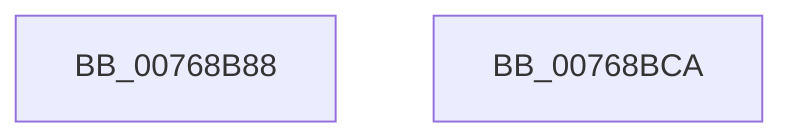

# PopNetDisengageNetworkRefresh

- RVA: `0x00768B88`–`0x00768BCB` (길이 `67` bytes)
- VA: `0x0000000140768B88`
- 실행 섹션: `PAGE`
- PDB 이름 있음: `예`; PDB Function 태그: `아니요`
- unwind 정보 RVA: `0x00082420`
- 디코드: `17`개 명령, `67/67` bytes 표시
- 미해석 바이트: `0` (있으면 어셈블리에 `.byte`로 보존)

> 이 문서는 커널 이미지의 기계어와 PDB 기호를 분석해 생성했습니다. 4번과 5번은 함수 원형과 자료형을 바이너리 사용 방식에서 추정한 C 해석이며 원본 소스 복구 결과는 아닙니다.

## 1. Dependencies

- 직접 호출 지점: **2**; 고유 호출 대상: **2**
- 직접 호출자로 확인된 함수: **2**
- RIP 상대 이미지 참조: **2**

### Outgoing calls
- `0x00768BB2` → [ZwUpdateWnfStateData](../../text/6B/ZwUpdateWnfStateData_function_006B0D10.md) (function, `0x006B0D10`)
- `0x00768BB9` → [PopNetSetResiliencyPhaseBias](../AB/PopNetSetResiliencyPhaseBias_function_00ABD9F0.md) (function, `0x00ABD9F0`)

### Direct callers
- [PopNetRefreshTimerWorkerCallback](PopNetRefreshTimerWorkerCallback_function_00768D10.md) at `0x00768D97`
- [PopNetWnfLowPowerEpochCallback](../A4/PopNetWnfLowPowerEpochCallback_function_00A49FB0.md) at `0x00A4A0AF`

### Static image references
- `0x00768B9B` → RVA `0x000209F8` (`.rdata`; read)
- `0x00768BBE` → RVA `0x00F087B0` (`.data`; write)

## 2. Other-region calls and transfers

- 다른 실행 섹션으로 향하는 call: **1**
  - `0x00768BB2` → [ZwUpdateWnfStateData](../../text/6B/ZwUpdateWnfStateData_function_006B0D10.md) (`PAGE` → `.text`)
- 별도 외부 분기/꼬리 이동을 확인하지 못했습니다.

## 3. Assembly (complete function range)

```asm
00768B88  48 8B C4                        mov rax, rsp
00768B8B  48 83 EC 48                     sub rsp, 0x48
00768B8F  83 60 E8 00                     and dword ptr [rax - 0x18], 0
00768B93  48 8D 50 08                     lea rdx, [rax + 8]
00768B97  83 60 E0 00                     and dword ptr [rax - 0x20], 0
00768B9B  48 8D 0D 56 7E 8B FF            lea rcx, [rip - 0x7481aa]
00768BA2  48 83 60 D8 00                  and qword ptr [rax - 0x28], 0
00768BA7  45 33 C9                        xor r9d, r9d
00768BAA  C6 40 08 00                     mov byte ptr [rax + 8], 0
00768BAE  45 8D 41 01                     lea r8d, [r9 + 1]
00768BB2  E8 59 81 F4 FF                  call 0x1406b0d10
00768BB7  33 C9                           xor ecx, ecx
00768BB9  E8 32 4E 35 00                  call 0x140abd9f0
00768BBE  C6 05 EB FB 79 00 00            mov byte ptr [rip + 0x79fbeb], 0
00768BC5  48 83 C4 48                     add rsp, 0x48
00768BC9  C3                              ret
00768BCA  CC                              int3
```

## 4. C-style interpretation (structured pseudocode)

```c
__int64 __fastcall PopNetDisengageNetworkRefresh(__int64 a1, __int64 a2, __int64 a3, int a4)
{
    __int64 result;
    __int64 v_rsp;

    v_rsp = (v_rsp) - (72);
    a4 = 0;
    *(unsigned __int8 *)(v_rsp + 8) = 0;
    result = ZwUpdateWnfStateData(v_rip - 7635370, v_rsp + 8, a4 + 1, a4);
    a1 = 0;
    result = PopNetSetResiliencyPhaseBias(a1, v_rsp + 8, a4 + 1, a4);
    *(unsigned __int8 *)(v_rip + 7994347) = 0;
    v_rsp = (v_rsp) + (72);
    return result;
}
```

## 5. (Beta) C Style

```c
int64_t PopNetDisengageNetworkRefresh(int64_t Arg1, int64_t Arg2, int64_t Arg3, int32_t Arg4)
{
    int64_t result;
    int64_t local_rsp;

    local_rsp = (local_rsp) - (72);
    Arg4 = 0;
    *(uint8_t *)(local_rsp + 0x8) = 0;
    result = ZwUpdateWnfStateData(v_rip - 7635370, local_rsp + 8, Arg4 + 1, Arg4);
    Arg1 = 0;
    result = PopNetSetResiliencyPhaseBias(Arg1, local_rsp + 8, Arg4 + 1, Arg4);
    *(uint8_t *)(v_rip + 0x79FBEB) = 0;
    local_rsp = (local_rsp) + (72);
    return result;
}
```

## 6. Execution-region graph

[열기: 2D/3D 그래프와 함수 탐색 컨트롤 패널](../../../control-panel.html?section=page&rva=0x00768B88&view=graph)

- 2D 그래프는 위에서 아래로 흐르고, 3D 그래프는 빈 공간을 드래그해 회전합니다. Shift+드래그는 이동, 휠은 확대·축소, 함수 노드 선택은 대상 보고서 이동입니다.

### Static fallback


