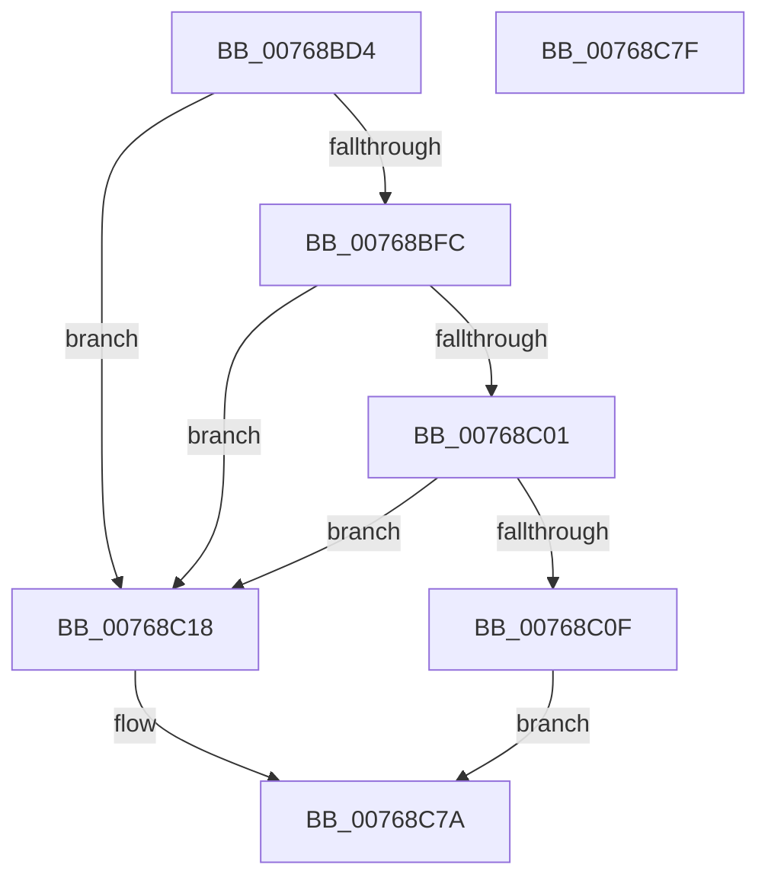

# PopNetGetNextDueRefreshTime

- RVA: `0x00768BD4`–`0x00768C80` (길이 `172` bytes)
- VA: `0x0000000140768BD4`
- 실행 섹션: `PAGE`
- PDB 이름 있음: `예`; PDB Function 태그: `아니요`
- unwind 정보 RVA: `0x0005C788`
- 디코드: `41`개 명령, `172/172` bytes 표시
- 미해석 바이트: `0` (있으면 어셈블리에 `.byte`로 보존)

> 이 문서는 커널 이미지의 기계어와 PDB 기호를 분석해 생성했습니다. 4번과 5번은 함수 원형과 자료형을 바이너리 사용 방식에서 추정한 C 해석이며 원본 소스 복구 결과는 아닙니다.

## 1. Dependencies

- 직접 호출 지점: **2**; 고유 호출 대상: **2**
- 직접 호출자로 확인된 함수: **2**
- RIP 상대 이미지 참조: **1**

### Outgoing calls
- `0x00768C22` → [ExSystemTimeToLocalTime](../../text/2F/ExSystemTimeToLocalTime_function_002FE1C0.md) (function, `0x002FE1C0`)
- `0x00768C70` → [ExLocalTimeToSystemTime](../../text/49/ExLocalTimeToSystemTime_function_00494BC0.md) (function, `0x00494BC0`)

### Direct callers
- [PopNetRefreshTimerWorkerCallback](PopNetRefreshTimerWorkerCallback_function_00768D10.md) at `0x00768D9C`
- [PopNetWnfLowPowerEpochCallback](../A4/PopNetWnfLowPowerEpochCallback_function_00A49FB0.md) at `0x00A4A068`

### Static image references
- `0x00768BEB` → RVA `0x00F0BC78` (`.data`; read)

## 2. Other-region calls and transfers

- 다른 실행 섹션으로 향하는 call: **2**
  - `0x00768C22` → [ExSystemTimeToLocalTime](../../text/2F/ExSystemTimeToLocalTime_function_002FE1C0.md) (`PAGE` → `.text`)
  - `0x00768C70` → [ExLocalTimeToSystemTime](../../text/49/ExLocalTimeToSystemTime_function_00494BC0.md) (`PAGE` → `.text`)
- 별도 외부 분기/꼬리 이동을 확인하지 못했습니다.

## 3. Assembly (complete function range)

```asm
00768BD4  48 83 EC 28                     sub rsp, 0x28
00768BD8  48 83 64 24 30 00               and qword ptr [rsp + 0x30], 0
00768BDE  48 BA 14 00 00 00 80 F7 FF FF   movabs rdx, 0xfffff78000000014
00768BE8  48 8B 12                        mov rdx, qword ptr [rdx]
00768BEB  48 8B 0D 86 30 7A 00            mov rcx, qword ptr [rip + 0x7a3086]
00768BF2  48 89 54 24 38                  mov qword ptr [rsp + 0x38], rdx
00768BF7  48 85 C9                        test rcx, rcx
00768BFA  74 1C                           je 0x140768c18
00768BFC  48 3B D1                        cmp rdx, rcx
00768BFF  7D 17                           jge 0x140768c18
00768C01  48 8B C1                        mov rax, rcx
00768C04  48 2B C2                        sub rax, rdx
00768C07  48 3D 00 8C 86 47               cmp rax, 0x47868c00
00768C0D  7C 09                           jl 0x140768c18
00768C0F  48 8D 81 00 74 79 B8            lea rax, [rcx - 0x47868c00]
00768C16  EB 62                           jmp 0x140768c7a
00768C18  48 8D 54 24 30                  lea rdx, [rsp + 0x30]
00768C1D  48 8D 4C 24 38                  lea rcx, [rsp + 0x38]
00768C22  E8 99 55 B9 FF                  call 0x1402fe1c0
00768C27  48 8B 4C 24 30                  mov rcx, qword ptr [rsp + 0x30]
00768C2C  49 B9 00 34 E2 30 04 00 00 00   movabs r9, 0x430e23400
00768C36  4E 8D 04 09                     lea r8, [rcx + r9]
00768C3A  49 8B C0                        mov rax, r8
00768C3D  48 99                           cqo
00768C3F  49 F7 F9                        idiv r9
00768C42  4C 2B C2                        sub r8, rdx
00768C45  48 8D 54 24 30                  lea rdx, [rsp + 0x30]
00768C4A  49 8B C0                        mov rax, r8
00768C4D  48 2B C1                        sub rax, rcx
00768C50  48 8D 4C 24 30                  lea rcx, [rsp + 0x30]
00768C55  48 3D 00 8C 86 47               cmp rax, 0x47868c00
00768C5B  48 1B C0                        sbb rax, rax
00768C5E  49 81 C0 00 74 79 B8            add r8, -0x47868c00
00768C65  49 23 C1                        and rax, r9
00768C68  49 03 C0                        add rax, r8
00768C6B  48 89 44 24 30                  mov qword ptr [rsp + 0x30], rax
00768C70  E8 4B BF D2 FF                  call 0x140494bc0
00768C75  48 8B 44 24 30                  mov rax, qword ptr [rsp + 0x30]
00768C7A  48 83 C4 28                     add rsp, 0x28
00768C7E  C3                              ret
00768C7F  CC                              int3
```

## 4. C-style interpretation (structured pseudocode)

```c
__int64 __fastcall PopNetGetNextDueRefreshTime(void)
{
    __int64 result;
    __int64 v_rsp;
    unsigned __int64 v_stack_p10;
    unsigned __int64 v_stack_p8;

    v_rsp = (v_rsp) - (40);
    v_stack_p10 = *(unsigned __int64 *)(a2);
    if (*(unsigned __int64 *)(v_rip + 8007814) == 0) goto loc_00768C18;
    if ((*(unsigned __int64 *)(a2)) >= (*(unsigned __int64 *)(v_rip + 8007814))) goto loc_00768C18;
    result = (*(unsigned __int64 *)(v_rip + 8007814)) - (*(unsigned __int64 *)(a2));
    if (result < 0x47868C00ULL) goto loc_00768C18;
    goto loc_00768C7A;
loc_00768C18:
    result = ExSystemTimeToLocalTime(v_stack_p10, v_stack_p8, a3, a4);
    a3 = (v_stack_p8 + a4 * 1) - (v_stack_p8);
    result = (a3) - (v_stack_p8);
    a3 = (a3) + (0xFFFFFFFFB8797400ULL);
    result = (result) & (a4);
    result = (result) + (a3);
    v_stack_p8 = result;
    result = ExLocalTimeToSystemTime(v_stack_p8, v_stack_p8, a3, a4);
loc_00768C7A:
    v_rsp = (v_rsp) + (40);
    return v_stack_p8;
}
```

## 5. (Beta) C Style

```c
void PopNetGetNextDueRefreshTime(void)
{
    int64_t result;
    int64_t local_rsp;
    uint64_t v_stack_p10;
    uint64_t v_stack_p8;

    local_rsp = (local_rsp) - (40);
    v_stack_p10 = *(uint64_t *)(a2);
    if (*(uint64_t *)(v_rip + 0x7A3086) == 0) goto loc_00768C18;
    if ((*(uint64_t *)(a2)) >= (*(uint64_t *)(v_rip + 0x7A3086))) goto loc_00768C18;
    result = (*(uint64_t *)(v_rip + 0x7A3086)) - (*(uint64_t *)(a2));
    if (result < 0x47868C00ULL) goto loc_00768C18;
    goto loc_00768C7A;
loc_00768C18:
    result = ExSystemTimeToLocalTime(v_stack_p10, v_stack_p8, a3, a4);
    a3 = (v_stack_p8 + a4 * 1) - (v_stack_p8);
    result = (a3) - (v_stack_p8);
    a3 = (a3) + (0xFFFFFFFFB8797400ULL);
    result = (result) & (a4);
    result = (result) + (a3);
    v_stack_p8 = result;
    result = ExLocalTimeToSystemTime(v_stack_p8, v_stack_p8, a3, a4);
loc_00768C7A:
    local_rsp = (local_rsp) + (40);
    return v_stack_p8;
}
```

## 6. Execution-region graph

[열기: 2D/3D 그래프와 함수 탐색 컨트롤 패널](../../../control-panel.html?section=page&rva=0x00768BD4&view=graph)

- 2D 그래프는 위에서 아래로 흐르고, 3D 그래프는 빈 공간을 드래그해 회전합니다. Shift+드래그는 이동, 휠은 확대·축소, 함수 노드 선택은 대상 보고서 이동입니다.

### Static fallback


