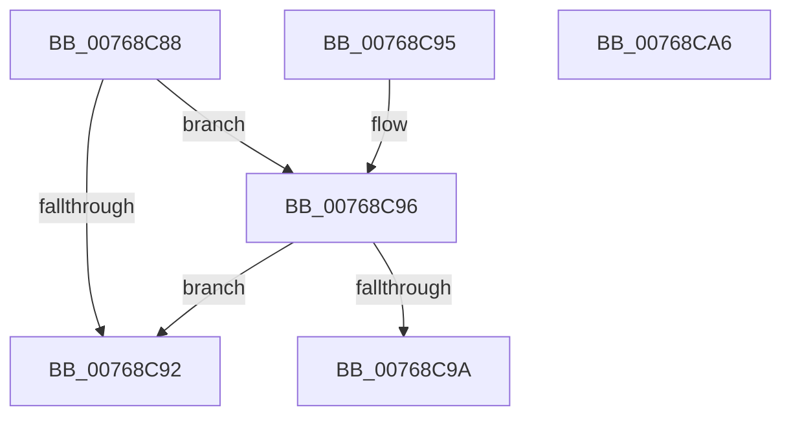

# PopNetIsNetworkRefreshEnabled

- RVA: `0x00768C88`–`0x00768CA7` (길이 `31` bytes)
- VA: `0x0000000140768C88`
- 실행 섹션: `PAGE`
- PDB 이름 있음: `예`; PDB Function 태그: `아니요`
- unwind 정보 RVA: `0x000DB714`
- 디코드: `13`개 명령, `31/31` bytes 표시
- 미해석 바이트: `0` (있으면 어셈블리에 `.byte`로 보존)

> 이 문서는 커널 이미지의 기계어와 PDB 기호를 분석해 생성했습니다. 4번과 5번은 함수 원형과 자료형을 바이너리 사용 방식에서 추정한 C 해석이며 원본 소스 복구 결과는 아닙니다.

## 1. Dependencies

- 직접 호출 지점: **0**; 고유 호출 대상: **0**
- 직접 호출자로 확인된 함수: **2**
- RIP 상대 이미지 참조: **2**

### Outgoing calls
- 직접 디코드된 call 명령이 없습니다.

### Direct callers
- [PopNetRefreshTimerWorkerCallback](PopNetRefreshTimerWorkerCallback_function_00768D10.md) at `0x00768D28`
- [PopNetWnfLowPowerEpochCallback](../A4/PopNetWnfLowPowerEpochCallback_function_00A49FB0.md) at `0x00A4A05F`

### Static image references
- `0x00768C88` → RVA `0x00F08878` (`.data`; read)
- `0x00768C9C` → RVA `0x00FC6FA4` (`ALMOSTRO`; read)

## 2. Other-region calls and transfers

- 다른 실행 섹션으로 향하는 call: **0**
- 별도 외부 분기/꼬리 이동을 확인하지 못했습니다.

## 3. Assembly (complete function range)

```asm
00768C88  8B 05 EA FB 79 00               mov eax, dword ptr [rip + 0x79fbea]
00768C8E  A8 4E                           test al, 0x4e
00768C90  74 04                           je 0x140768c96
00768C92  33 C0                           xor eax, eax
00768C94  C3                              ret
00768C95  CC                              int3
00768C96  84 C0                           test al, al
00768C98  79 F8                           jns 0x140768c92
00768C9A  33 C0                           xor eax, eax
00768C9C  39 05 02 E3 85 00               cmp dword ptr [rip + 0x85e302], eax
00768CA2  0F 95 C0                        setne al
00768CA5  C3                              ret
00768CA6  CC                              int3
```

## 4. C-style interpretation (structured pseudocode)

```c
__int64 __fastcall PopNetIsNetworkRefreshEnabled(void)
{
    __int64 result;

    if ((((unsigned __int8)((unsigned int)(*(unsigned int *)(v_rip + 7994346)))) & (78)) == 0) goto loc_00768C96;
loc_00768C92:
    result = 0;
    return result;
loc_00768C96:
    if (!sign_flag) goto loc_00768C92;
    result = 0;
    result = ((*(unsigned int *)(v_rip + 8774402)) != 0) ? 1 : 0;
    return result;
}
```

## 5. (Beta) C Style

```c
void PopNetIsNetworkRefreshEnabled(void)
{
    int64_t result;

    if ((((uint8_t)((uint32_t)(*(uint32_t *)(v_rip + 0x79FBEA)))) & (78)) == 0) goto loc_00768C96;
loc_00768C92:
    result = 0;
    return result;
loc_00768C96:
    if (!sign_flag) goto loc_00768C92;
    result = 0;
    result = ((*(uint32_t *)(v_rip + 0x85E302)) != 0) ? 1 : 0;
    return result;
}
```

## 6. Execution-region graph

[열기: 2D/3D 그래프와 함수 탐색 컨트롤 패널](../../../control-panel.html?section=page&rva=0x00768C88&view=graph)

- 2D 그래프는 위에서 아래로 흐르고, 3D 그래프는 빈 공간을 드래그해 회전합니다. Shift+드래그는 이동, 휠은 확대·축소, 함수 노드 선택은 대상 보고서 이동입니다.

### Static fallback


