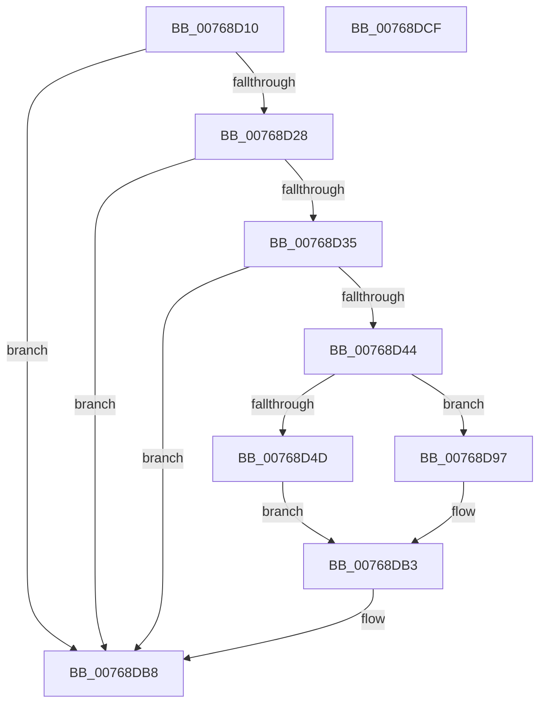

# PopNetRefreshTimerWorkerCallback

- RVA: `0x00768D10`–`0x00768DD0` (길이 `192` bytes)
- VA: `0x0000000140768D10`
- 실행 섹션: `PAGE`
- PDB 이름 있음: `예`; PDB Function 태그: `아니요`
- unwind 정보 RVA: `0x000697A4`
- 디코드: `46`개 명령, `192/192` bytes 표시
- 미해석 바이트: `0` (있으면 어셈블리에 `.byte`로 보존)

> 이 문서는 커널 이미지의 기계어와 PDB 기호를 분석해 생성했습니다. 4번과 5번은 함수 원형과 자료형을 바이너리 사용 방식에서 추정한 C 해석이며 원본 소스 복구 결과는 아닙니다.

## 1. Dependencies

- 직접 호출 지점: **9**; 고유 호출 대상: **9**
- 직접 호출자로 확인된 함수: **0**
- RIP 상대 이미지 참조: **6**

### Outgoing calls
- `0x00768D16` → [PopAcquirePolicyLock](../../pagelk/B7/PopAcquirePolicyLock_function_00B783C0.md) (function, `0x00B783C0`)
- `0x00768D28` → [PopNetIsNetworkRefreshEnabled](PopNetIsNetworkRefreshEnabled_function_00768C88.md) (function, `0x00768C88`)
- `0x00768D52` → [PopNetSetResiliencyPhaseBias](../AB/PopNetSetResiliencyPhaseBias_function_00ABD9F0.md) (function, `0x00ABD9F0`)
- `0x00768D7D` → [ZwUpdateWnfStateData](../../text/6B/ZwUpdateWnfStateData_function_006B0D10.md) (function, `0x006B0D10`)
- `0x00768D97` → [PopNetDisengageNetworkRefresh](PopNetDisengageNetworkRefresh_function_00768B88.md) (function, `0x00768B88`)
- `0x00768D9C` → [PopNetGetNextDueRefreshTime](PopNetGetNextDueRefreshTime_function_00768BD4.md) (function, `0x00768BD4`)
- `0x00768DB3` → [PopNetArmRefreshTimer](PopNetArmRefreshTimer_function_007689D0.md) (function, `0x007689D0`)
- `0x00768DBF` → [PopOkayToQueueNextWorkItem](../../text/4A/PopOkayToQueueNextWorkItem_function_004AED54.md) (function, `0x004AED54`)
- `0x00768DC4` → [PopReleasePolicyLock](../../pagelk/B7/PopReleasePolicyLock_function_00B78410.md) (function, `0x00B78410`)

### Direct callers
- 이 함수 시작 RVA로 연결되는 직접 call은 확인되지 않았습니다. 간접 호출은 완전히 역산할 수 없습니다.

### Static image references
- `0x00768D1B` → RVA `0x00F086F8` (`.data`; read)
- `0x00768D37` → RVA `0x00E678E4` (`.data`; read/write)
- `0x00768D44` → RVA `0x00F087B0` (`.data`; read)
- `0x00768D66` → RVA `0x000209F8` (`.rdata`; read)
- `0x00768D82` → RVA `0x00F087B0` (`.data`; write)
- `0x00768DB8` → RVA `0x00F08788` (`.data`; read)

## 2. Other-region calls and transfers

- 다른 실행 섹션으로 향하는 call: **4**
  - `0x00768D16` → [PopAcquirePolicyLock](../../pagelk/B7/PopAcquirePolicyLock_function_00B783C0.md) (`PAGE` → `PAGELK`)
  - `0x00768D7D` → [ZwUpdateWnfStateData](../../text/6B/ZwUpdateWnfStateData_function_006B0D10.md) (`PAGE` → `.text`)
  - `0x00768DBF` → [PopOkayToQueueNextWorkItem](../../text/4A/PopOkayToQueueNextWorkItem_function_004AED54.md) (`PAGE` → `.text`)
  - `0x00768DC4` → [PopReleasePolicyLock](../../pagelk/B7/PopReleasePolicyLock_function_00B78410.md) (`PAGE` → `PAGELK`)
- 별도 외부 분기/꼬리 이동을 확인하지 못했습니다.

## 3. Assembly (complete function range)

```asm
00768D10  40 53                           push rbx
00768D12  48 83 EC 40                     sub rsp, 0x40
00768D16  E8 A5 F6 40 00                  call 0x140b783c0
00768D1B  83 3D D6 F9 79 00 00            cmp dword ptr [rip + 0x79f9d6], 0
00768D22  0F 84 90 00 00 00               je 0x140768db8
00768D28  E8 5B FF FF FF                  call 0x140768c88
00768D2D  84 C0                           test al, al
00768D2F  0F 84 83 00 00 00               je 0x140768db8
00768D35  33 C0                           xor eax, eax
00768D37  F0 0F C1 05 A5 EB 6F 00         lock xadd dword ptr [rip + 0x6feba5], eax
00768D3F  83 F8 02                        cmp eax, 2
00768D42  75 74                           jne 0x140768db8
00768D44  80 3D 65 FA 79 00 00            cmp byte ptr [rip + 0x79fa65], 0
00768D4B  75 4A                           jne 0x140768d97
00768D4D  8D 58 FF                        lea ebx, [rax - 1]
00768D50  8A CB                           mov cl, bl
00768D52  E8 99 4C 35 00                  call 0x140abd9f0
00768D57  83 64 24 30 00                  and dword ptr [rsp + 0x30], 0
00768D5C  48 8D 54 24 58                  lea rdx, [rsp + 0x58]
00768D61  83 64 24 28 00                  and dword ptr [rsp + 0x28], 0
00768D66  48 8D 0D 8B 7C 8B FF            lea rcx, [rip - 0x748375]
00768D6D  48 83 64 24 20 00               and qword ptr [rsp + 0x20], 0
00768D73  45 33 C9                        xor r9d, r9d
00768D76  44 8B C3                        mov r8d, ebx
00768D79  88 5C 24 58                     mov byte ptr [rsp + 0x58], bl
00768D7D  E8 8E 7F F4 FF                  call 0x1406b0d10
00768D82  88 1D 28 FA 79 00               mov byte ptr [rip + 0x79fa28], bl
00768D88  33 D2                           xor edx, edx
00768D8A  87 1D 54 EB 6F 00               xchg dword ptr [rip + 0x6feb54], ebx
00768D90  B9 00 A3 E1 11                  mov ecx, 0x11e1a300
00768D95  EB 1C                           jmp 0x140768db3
00768D97  E8 EC FD FF FF                  call 0x140768b88
00768D9C  E8 33 FE FF FF                  call 0x140768bd4
00768DA1  BB 01 00 00 00                  mov ebx, 1
00768DA6  8B CB                           mov ecx, ebx
00768DA8  8A D3                           mov dl, bl
00768DAA  87 0D 34 EB 6F 00               xchg dword ptr [rip + 0x6feb34], ecx
00768DB0  48 8B C8                        mov rcx, rax
00768DB3  E8 18 FC FF FF                  call 0x1407689d0
00768DB8  48 8D 0D C9 F9 79 00            lea rcx, [rip + 0x79f9c9]
00768DBF  E8 90 5F D4 FF                  call 0x1404aed54
00768DC4  E8 47 F6 40 00                  call 0x140b78410
00768DC9  48 83 C4 40                     add rsp, 0x40
00768DCD  5B                              pop rbx
00768DCE  C3                              ret
00768DCF  CC                              int3
```

## 4. C-style interpretation (structured pseudocode)

```c
__int64 __fastcall PopNetRefreshTimerWorkerCallback(__int64 a1, __int64 a2, __int64 a3, int a4)
{
    __int64 result;
    __int64 v_rsp;
    unsigned int v_stack_m18;
    unsigned int v_stack_m20;
    unsigned __int64 v_stack_m28;
    unsigned __int64 v_stack_p10;

    v_rsp = (v_rsp) - (64);
    result = PopAcquirePolicyLock(a1, a2, a3, a4);
    if ((*(unsigned int *)(v_rip + 7993814)) == 0) goto loc_00768DB8;
    result = PopNetIsNetworkRefreshEnabled(a1, a2, a3, a4);
    if ((unsigned __int8)(result) == 0) goto loc_00768DB8;
    result = 0;
    if (0 != 2) goto loc_00768DB8;
    if ((*(unsigned __int8 *)(v_rip + 7993957)) != 0) goto loc_00768D97;
    result = PopNetSetResiliencyPhaseBias((unsigned __int8)(result - 1), a2, a3, a4);
    a4 = 0;
    v_stack_p10 = (unsigned __int8)(result - 1);
    result = ZwUpdateWnfStateData(v_rip - 7635829, v_stack_p10, (unsigned int)((unsigned int)(result - 1)), a4);
    *(unsigned __int8 *)(v_rip + 7993896) = (unsigned __int8)(result - 1);
    a2 = 0;
    goto loc_00768DB3;
loc_00768D97:
    result = PopNetDisengageNetworkRefresh((unsigned int)(0x11E1A300ULL), a2, (unsigned int)((unsigned int)(result - 1)), a4);
    result = PopNetGetNextDueRefreshTime((unsigned int)(0x11E1A300ULL), a2, (unsigned int)((unsigned int)(result - 1)), a4);
loc_00768DB3:
    result = PopNetArmRefreshTimer(result, 1, (unsigned int)((unsigned int)(result - 1)), a4);
loc_00768DB8:
    result = PopOkayToQueueNextWorkItem(v_rip + 7993801, 1, (unsigned int)((unsigned int)(result - 1)), a4);
    result = PopReleasePolicyLock(v_rip + 7993801, 1, (unsigned int)((unsigned int)(result - 1)), a4);
    v_rsp = (v_rsp) + (64);
    return result;
}
```

## 5. (Beta) C Style

```c
int64_t PopNetRefreshTimerWorkerCallback(int64_t Arg1, int64_t Arg2, int64_t Arg3, int32_t Arg4)
{
    int64_t result;
    int64_t local_rsp;
    uint32_t v_stack_m18;
    uint32_t v_stack_m20;
    uint64_t v_stack_m28;
    uint64_t v_stack_p10;

    local_rsp = (local_rsp) - (64);
    result = PopAcquirePolicyLock(Arg1, Arg2, Arg3, Arg4);
    if ((*(uint32_t *)(v_rip + 0x79F9D6)) == 0) goto loc_00768DB8;
    result = PopNetIsNetworkRefreshEnabled(Arg1, Arg2, Arg3, Arg4);
    if ((uint8_t)(result) == 0) goto loc_00768DB8;
    result = 0;
    if (0 != 2) goto loc_00768DB8;
    if ((*(uint8_t *)(v_rip + 0x79FA65)) != 0) goto loc_00768D97;
    result = PopNetSetResiliencyPhaseBias((uint8_t)(result - 1), Arg2, Arg3, Arg4);
    Arg4 = 0;
    v_stack_p10 = (uint8_t)(result - 1);
    result = ZwUpdateWnfStateData(v_rip - 7635829, v_stack_p10, (uint32_t)((uint32_t)(result - 1)), Arg4);
    *(uint8_t *)(v_rip + 0x79FA28) = (uint8_t)(result - 1);
    Arg2 = 0;
    goto loc_00768DB3;
loc_00768D97:
    result = PopNetDisengageNetworkRefresh((uint32_t)(0x11E1A300ULL), Arg2, (uint32_t)((uint32_t)(result - 1)), Arg4);
    result = PopNetGetNextDueRefreshTime((uint32_t)(0x11E1A300ULL), Arg2, (uint32_t)((uint32_t)(result - 1)), Arg4);
loc_00768DB3:
    result = PopNetArmRefreshTimer(result, 1, (uint32_t)((uint32_t)(result - 1)), Arg4);
loc_00768DB8:
    result = PopOkayToQueueNextWorkItem(v_rip + 7993801, 1, (uint32_t)((uint32_t)(result - 1)), Arg4);
    result = PopReleasePolicyLock(v_rip + 7993801, 1, (uint32_t)((uint32_t)(result - 1)), Arg4);
    local_rsp = (local_rsp) + (64);
    return result;
}
```

## 6. Execution-region graph

[열기: 2D/3D 그래프와 함수 탐색 컨트롤 패널](../../../control-panel.html?section=page&rva=0x00768D10&view=graph)

- 2D 그래프는 위에서 아래로 흐르고, 3D 그래프는 빈 공간을 드래그해 회전합니다. Shift+드래그는 이동, 휠은 확대·축소, 함수 노드 선택은 대상 보고서 이동입니다.

### Static fallback


