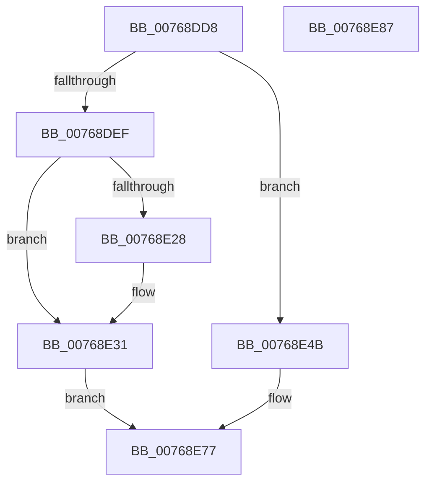

# PopNetResiliencyPhaseStateChanged

- RVA: `0x00768DD8`–`0x00768E88` (길이 `176` bytes)
- VA: `0x0000000140768DD8`
- 실행 섹션: `PAGE`
- PDB 이름 있음: `예`; PDB Function 태그: `아니요`
- unwind 정보 RVA: `0x0005CAAC`
- 디코드: `43`개 명령, `176/176` bytes 표시
- 미해석 바이트: `0` (있으면 어셈블리에 `.byte`로 보존)

> 이 문서는 커널 이미지의 기계어와 PDB 기호를 분석해 생성했습니다. 4번과 5번은 함수 원형과 자료형을 바이너리 사용 방식에서 추정한 C 해석이며 원본 소스 복구 결과는 아닙니다.

## 1. Dependencies

- 직접 호출 지점: **5**; 고유 호출 대상: **5**
- 직접 호출자로 확인된 함수: **1**
- RIP 상대 이미지 참조: **6**

### Outgoing calls
- `0x00768DE4` → [PopAcquirePolicyLock](../../pagelk/B7/PopAcquirePolicyLock_function_00B783C0.md) (function, `0x00B783C0`)
- `0x00768E44` → [KeSetTimer2](../../text/3A/KeSetTimer2_function_003A08E0.md) (function, `0x003A08E0`)
- `0x00768E5B` → [KeCancelTimer2](../../text/3A/KeCancelTimer2_function_003A01E0.md) (function, `0x003A01E0`)
- `0x00768E72` → [PopQueueWorkItem](../../text/4A/PopQueueWorkItem_function_004A20F8.md) (function, `0x004A20F8`)
- `0x00768E77` → [PopReleasePolicyLock](../../pagelk/B7/PopReleasePolicyLock_function_00B78410.md) (function, `0x00B78410`)

### Direct callers
- [PdcPoCurrentPdcPhase](../../text/5D/PdcPoCurrentPdcPhase_function_005D9E70.md) at `0x005D9ED5`

### Static image references
- `0x00768DFC` → RVA `0x00F0887C` (`.data`; write)
- `0x00768E02` → RVA `0x00E678E8` (`.data`; read/write)
- `0x00768E0B` → RVA `0x00FC533C` (`ALMOSTRO`; read)
- `0x00768E11` → RVA `0x00E27D08` (`.data`; read)
- `0x00768E34` → RVA `0x00F087C0` (`.data`; read)
- `0x00768E6B` → RVA `0x00F08848` (`.data`; read)

## 2. Other-region calls and transfers

- 다른 실행 섹션으로 향하는 call: **5**
  - `0x00768DE4` → [PopAcquirePolicyLock](../../pagelk/B7/PopAcquirePolicyLock_function_00B783C0.md) (`PAGE` → `PAGELK`)
  - `0x00768E44` → [KeSetTimer2](../../text/3A/KeSetTimer2_function_003A08E0.md) (`PAGE` → `.text`)
  - `0x00768E5B` → [KeCancelTimer2](../../text/3A/KeCancelTimer2_function_003A01E0.md) (`PAGE` → `.text`)
  - `0x00768E72` → [PopQueueWorkItem](../../text/4A/PopQueueWorkItem_function_004A20F8.md) (`PAGE` → `.text`)
  - `0x00768E77` → [PopReleasePolicyLock](../../pagelk/B7/PopReleasePolicyLock_function_00B78410.md) (`PAGE` → `PAGELK`)
- 별도 외부 분기/꼬리 이동을 확인하지 못했습니다.

## 3. Assembly (complete function range)

```asm
00768DD8  48 89 5C 24 08                  mov qword ptr [rsp + 8], rbx
00768DDD  57                              push rdi
00768DDE  48 83 EC 20                     sub rsp, 0x20
00768DE2  8A D9                           mov bl, cl
00768DE4  E8 D7 F5 40 00                  call 0x140b783c0
00768DE9  33 FF                           xor edi, edi
00768DEB  84 DB                           test bl, bl
00768DED  74 5C                           je 0x140768e4b
00768DEF  8D 57 01                        lea edx, [rdi + 1]
00768DF2  48 B9 08 00 00 00 80 F7 FF FF   movabs rcx, 0xfffff78000000008
00768DFC  88 15 7A FA 79 00               mov byte ptr [rip + 0x79fa7a], dl
00768E02  87 15 E0 EA 6F 00               xchg dword ptr [rip + 0x6feae0], edx
00768E08  48 8B 09                        mov rcx, qword ptr [rcx]
00768E0B  8B 05 2B C5 85 00               mov eax, dword ptr [rip + 0x85c52b]
00768E11  48 8B 15 F0 EE 6B 00            mov rdx, qword ptr [rip + 0x6beef0]
00768E18  4C 69 C0 80 96 98 00            imul r8, rax, 0x989680
00768E1F  4A 8D 04 02                     lea rax, [rdx + r8]
00768E23  48 3B C8                        cmp rcx, rax
00768E26  73 09                           jae 0x140768e31
00768E28  48 8B FA                        mov rdi, rdx
00768E2B  48 2B F9                        sub rdi, rcx
00768E2E  49 03 F8                        add rdi, r8
00768E31  48 F7 DF                        neg rdi
00768E34  48 8D 0D 85 F9 79 00            lea rcx, [rip + 0x79f985]
00768E3B  48 8B D7                        mov rdx, rdi
00768E3E  45 33 C9                        xor r9d, r9d
00768E41  45 33 C0                        xor r8d, r8d
00768E44  E8 97 7A C3 FF                  call 0x1403a08e0
00768E49  EB 2C                           jmp 0x140768e77
00768E4B  33 D2                           xor edx, edx
00768E4D  40 88 3D 28 FA 79 00            mov byte ptr [rip + 0x79fa28], dil
00768E54  48 8D 0D 65 F9 79 00            lea rcx, [rip + 0x79f965]
00768E5B  E8 80 73 C3 FF                  call 0x1403a01e0
00768E60  87 3D 82 EA 6F 00               xchg dword ptr [rip + 0x6fea82], edi
00768E66  BA 01 00 00 00                  mov edx, 1
00768E6B  48 8D 0D D6 F9 79 00            lea rcx, [rip + 0x79f9d6]
00768E72  E8 81 92 D3 FF                  call 0x1404a20f8
00768E77  E8 94 F5 40 00                  call 0x140b78410
00768E7C  48 8B 5C 24 30                  mov rbx, qword ptr [rsp + 0x30]
00768E81  48 83 C4 20                     add rsp, 0x20
00768E85  5F                              pop rdi
00768E86  C3                              ret
00768E87  CC                              int3
```

## 4. C-style interpretation (structured pseudocode)

```c
__int64 __fastcall PopNetResiliencyPhaseStateChanged(unsigned __int8 a1, __int64 a2, __int64 a3, int a4)
{
    __int64 result;
    __int64 v_rdi;
    __int64 v_rsp;
    unsigned __int64 v_stack_p8;

    v_stack_p8 = v_rbx;
    v_rsp = (v_rsp) - (32);
    result = PopAcquirePolicyLock(a1, a2, a3, a4);
    v_rdi = 0;
    if (a1 == 0) goto loc_00768E4B;
    *(unsigned __int8 *)(v_rip + 7993978) = (unsigned __int8)(v_rdi + 1);
    a3 = (a3) * ((unsigned int)(*(unsigned int *)(v_rip + 8766763)));
    if ((*(unsigned __int64 *)(a1)) < (*(unsigned __int64 *)(v_rip + 7073520) + a3 * 1)) {
        v_rdi = *(unsigned __int64 *)(v_rip + 7073520);
        v_rdi = (v_rdi) - (*(unsigned __int64 *)(a1));
        v_rdi = (v_rdi) + (a3);
    }
    v_rdi = -(v_rdi);
    a4 = 0;
    a3 = 0;
    result = KeSetTimer2(v_rip + 7993733, v_rdi, a3, a4);
    goto loc_00768E77;
loc_00768E4B:
    a2 = 0;
    *(unsigned __int8 *)(v_rip + 7993896) = (unsigned __int8)(v_rdi);
    result = KeCancelTimer2(v_rip + 7993701, a2, a3, a4);
    result = PopQueueWorkItem(v_rip + 7993814, 1, a3, a4);
loc_00768E77:
    result = PopReleasePolicyLock(v_rip + 7993814, 1, a3, a4);
    v_rsp = (v_rsp) + (32);
    return result;
}
```

## 5. (Beta) C Style

```c
int64_t PopNetResiliencyPhaseStateChanged(uint8_t Arg1, int64_t Arg2, int64_t Arg3, int32_t Arg4)
{
    int64_t result;
    int64_t local_rdi;
    int64_t local_rsp;
    uint64_t v_stack_p8;

    v_stack_p8 = local_rbx;
    local_rsp = (local_rsp) - (32);
    result = PopAcquirePolicyLock(Arg1, Arg2, Arg3, Arg4);
    local_rdi = 0;
    if (Arg1 == 0) goto loc_00768E4B;
    *(uint8_t *)(v_rip + 0x79FA7A) = (uint8_t)(local_rdi + 1);
    Arg3 = (Arg3) * ((uint32_t)(*(uint32_t *)(v_rip + 0x85C52B)));
    if ((*(uint64_t *)(Arg1)) < (*(uint64_t *)(v_rip + 0x6BEEF0) + Arg3 * 1)) {
        local_rdi = *(uint64_t *)(v_rip + 0x6BEEF0);
        local_rdi = (local_rdi) - (*(uint64_t *)(Arg1));
        local_rdi = (local_rdi) + (Arg3);
    }
    local_rdi = -(local_rdi);
    Arg4 = 0;
    Arg3 = 0;
    result = KeSetTimer2(v_rip + 7993733, local_rdi, Arg3, Arg4);
    goto loc_00768E77;
loc_00768E4B:
    Arg2 = 0;
    *(uint8_t *)(v_rip + 0x79FA28) = (uint8_t)(local_rdi);
    result = KeCancelTimer2(v_rip + 7993701, Arg2, Arg3, Arg4);
    result = PopQueueWorkItem(v_rip + 7993814, 1, Arg3, Arg4);
loc_00768E77:
    result = PopReleasePolicyLock(v_rip + 7993814, 1, Arg3, Arg4);
    local_rsp = (local_rsp) + (32);
    return result;
}
```

## 6. Execution-region graph

[열기: 2D/3D 그래프와 함수 탐색 컨트롤 패널](../../../control-panel.html?section=page&rva=0x00768DD8&view=graph)

- 2D 그래프는 위에서 아래로 흐르고, 3D 그래프는 빈 공간을 드래그해 회전합니다. Shift+드래그는 이동, 휠은 확대·축소, 함수 노드 선택은 대상 보고서 이동입니다.

### Static fallback


