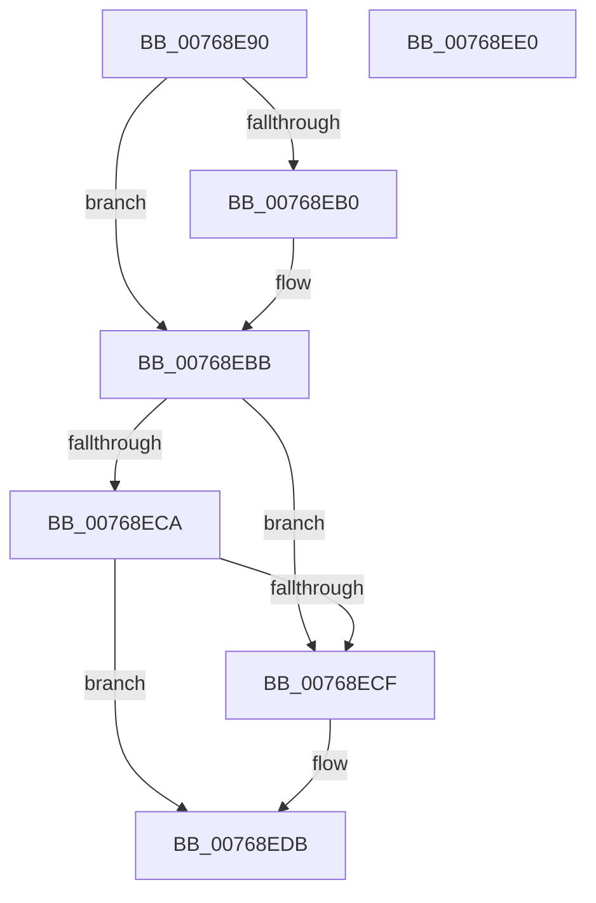

# PopNetSetConnectivityConstraint

- RVA: `0x00768E90`–`0x00768EE1` (길이 `81` bytes)
- VA: `0x0000000140768E90`
- 실행 섹션: `PAGE`
- PDB 이름 있음: `예`; PDB Function 태그: `아니요`
- unwind 정보 RVA: `0x0005C788`
- 디코드: `23`개 명령, `81/81` bytes 표시
- 미해석 바이트: `0` (있으면 어셈블리에 `.byte`로 보존)

> 이 문서는 커널 이미지의 기계어와 PDB 기호를 분석해 생성했습니다. 4번과 5번은 함수 원형과 자료형을 바이너리 사용 방식에서 추정한 C 해석이며 원본 소스 복구 결과는 아닙니다.

## 1. Dependencies

- 직접 호출 지점: **1**; 고유 호출 대상: **1**
- 직접 호출자로 확인된 함수: **4**
- RIP 상대 이미지 참조: **3**

### Outgoing calls
- `0x00768ED6` → [PopQueueWorkItem](../../text/4A/PopQueueWorkItem_function_004A20F8.md) (function, `0x004A20F8`)

### Direct callers
- [PopPowerAggregatorEngageAggressiveStandbyActions](PopPowerAggregatorEngageAggressiveStandbyActions_function_0076460C.md) at `0x00764698`
- [PopPowerAggregatorEngageAggressiveStandbyActions](PopPowerAggregatorEngageAggressiveStandbyActions_function_0076460C.md) at `0x007646AB`
- [PopNetCompliantNicUpdate](PopNetCompliantNicUpdate_function_00768A40.md) at `0x00768A62`
- [PopNetNonCompliantDeviceUpdate](PopNetNonCompliantDeviceUpdate_function_00768CB0.md) at `0x00768CF5`
- [PopNetInitialize](../../init/C4/PopNetInitialize_function_00C423AC.md) at `0x00C42520`

### Static image references
- `0x00768EA0` → RVA `0x00F08878` (`.data`; read/write)
- `0x00768EBD` → RVA `0x00E678E8` (`.data`; read/write)
- `0x00768ECF` → RVA `0x00F08848` (`.data`; read)

## 2. Other-region calls and transfers

- 다른 실행 섹션으로 향하는 call: **1**
  - `0x00768ED6` → [PopQueueWorkItem](../../text/4A/PopQueueWorkItem_function_004A20F8.md) (`PAGE` → `.text`)
- 별도 외부 분기/꼬리 이동을 확인하지 못했습니다.

## 3. Assembly (complete function range)

```asm
00768E90  48 83 EC 28                     sub rsp, 0x28
00768E94  BA 01 00 00 00                  mov edx, 1
00768E99  45 32 C0                        xor r8b, r8b
00768E9C  8B C2                           mov eax, edx
00768E9E  D3 E0                           shl eax, cl
00768EA0  09 05 D2 F9 79 00               or dword ptr [rip + 0x79f9d2], eax
00768EA6  8D 41 FE                        lea eax, [rcx - 2]
00768EA9  A9 FA FF FF FF                  test eax, 0xfffffffa
00768EAE  75 0B                           jne 0x140768ebb
00768EB0  83 F9 07                        cmp ecx, 7
00768EB3  45 0F B6 C0                     movzx r8d, r8b
00768EB7  44 0F 45 C2                     cmovne r8d, edx
00768EBB  33 C0                           xor eax, eax
00768EBD  F0 0F C1 05 23 EA 6F 00         lock xadd dword ptr [rip + 0x6fea23], eax
00768EC5  83 F8 02                        cmp eax, 2
00768EC8  74 05                           je 0x140768ecf
00768ECA  45 84 C0                        test r8b, r8b
00768ECD  74 0C                           je 0x140768edb
00768ECF  48 8D 0D 72 F9 79 00            lea rcx, [rip + 0x79f972]
00768ED6  E8 1D 92 D3 FF                  call 0x1404a20f8
00768EDB  48 83 C4 28                     add rsp, 0x28
00768EDF  C3                              ret
00768EE0  CC                              int3
```

## 4. C-style interpretation (structured pseudocode)

```c
__int64 __fastcall PopNetSetConnectivityConstraint(__int64 a1, __int64 a2, unsigned __int8 a3)
{
    __int64 result;
    __int64 v_rsp;

    v_rsp = (v_rsp) - (40);
    a3 = 0;
    result = (unsigned int)((1) << ((unsigned __int8)(a1)));
    if ((((unsigned int)(a1 - 2)) & (0xFFFFFFFAULL)) == 0) {
        a3 = 0;
        if (((unsigned int)(a1)) != 7) { a3 = 1; }
    }
    result = 0;
    if (0 == 2) goto loc_00768ECF;
    if (a3 != 0) {
        a1 = v_rip + 7993714;
        result = PopQueueWorkItem(a1, 1, a3, a4);
    }
    v_rsp = (v_rsp) + (40);
    return result;
}
```

## 5. (Beta) C Style

```c
int64_t PopNetSetConnectivityConstraint(void *Arg1, int64_t Arg2, uint8_t Arg3)
{
    uint8_t *arg1 = (uint8_t *)Arg1;

    int64_t result;
    int64_t local_rsp;

    local_rsp = (local_rsp) - (40);
    Arg3 = 0;
    result = (uint32_t)((1) << ((uint8_t)(Arg1)));
    if ((((uint32_t)(Arg1 - 2)) & (0xFFFFFFFAULL)) == 0) {
        Arg3 = 0;
        if (((uint32_t)(Arg1)) != 7) { Arg3 = 1; }
    }
    result = 0;
    if (0 == 2) goto loc_00768ECF;
    if (Arg3 != 0) {
        Arg1 = v_rip + 7993714;
        result = PopQueueWorkItem(Arg1, 1, Arg3, a4);
    }
    local_rsp = (local_rsp) + (40);
    return result;
}
```

### 관측된 메모리 오프셋

구조체 형식이 확인되지 않은 접근은 인자 기준의 오프셋으로만 기록했습니다.

| 기준 인자 | 오프셋 표현 | 폭 (bit) | 접근 |
|---|---:|---:|---|
| `Arg1` | `- 0x2` | `32` | `R` |

## 6. Execution-region graph

[열기: 2D/3D 그래프와 함수 탐색 컨트롤 패널](../../../control-panel.html?section=page&rva=0x00768E90&view=graph)

- 2D 그래프는 위에서 아래로 흐르고, 3D 그래프는 빈 공간을 드래그해 회전합니다. Shift+드래그는 이동, 휠은 확대·축소, 함수 노드 선택은 대상 보고서 이동입니다.

### Static fallback


