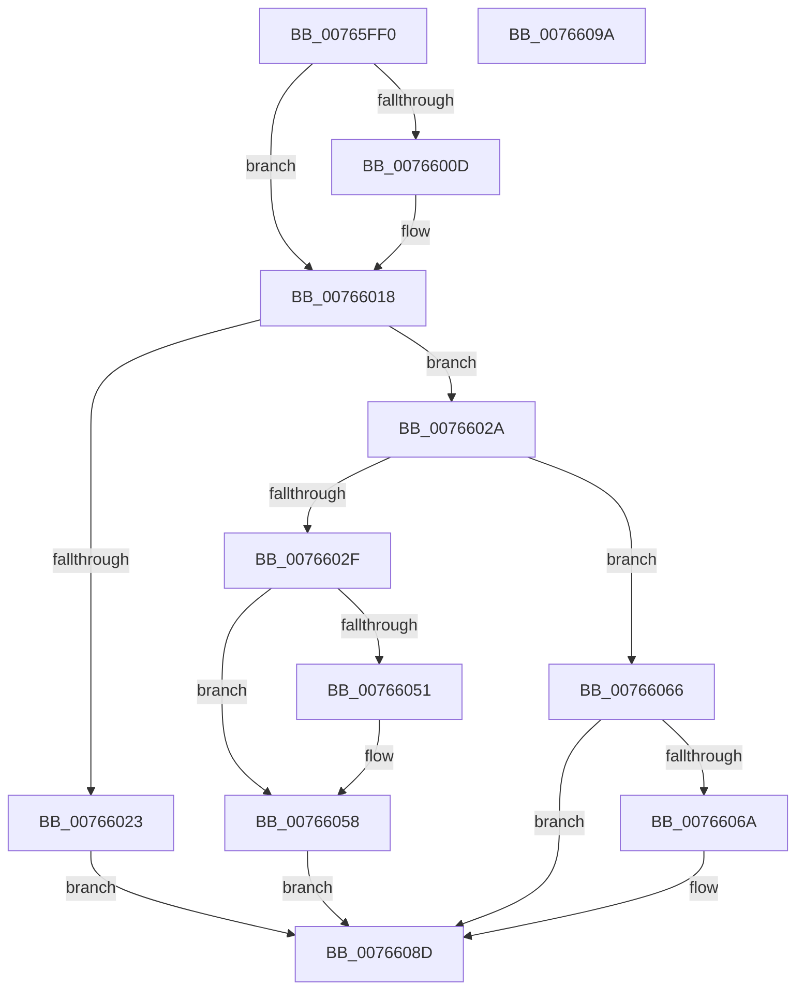

# PopNotifyPolicyDevice

- RVA: `0x00765FF0`–`0x0076609B` (길이 `171` bytes)
- VA: `0x0000000140765FF0`
- 실행 섹션: `PAGE`
- PDB 이름 있음: `예`; PDB Function 태그: `아니요`
- unwind 정보 RVA: `0x0005CAAC`
- 디코드: `48`개 명령, `171/171` bytes 표시
- 미해석 바이트: `0` (있으면 어셈블리에 `.byte`로 보존)

> 이 문서는 커널 이미지의 기계어와 PDB 기호를 분석해 생성했습니다. 4번과 5번은 함수 원형과 자료형을 바이너리 사용 방식에서 추정한 C 해석이며 원본 소스 복구 결과는 아닙니다.

## 1. Dependencies

- 직접 호출 지점: **10**; 고유 호출 대상: **9**
- 직접 호출자로 확인된 함수: **0**
- RIP 상대 이미지 참조: **4**

### Outgoing calls
- `0x00766023` → [PopPolicyDeviceHandleWakeAlarmNotification](PopPolicyDeviceHandleWakeAlarmNotification_function_007660A4.md) (function, `0x007660A4`)
- `0x00766036` → [PopAcquireTransitionLock](../AA/PopAcquireTransitionLock_function_00AA9E7C.md) (function, `0x00AA9E7C`)
- `0x0076603B` → [PopAcquirePolicyLock](../../pagelk/B7/PopAcquirePolicyLock_function_00B783C0.md) (function, `0x00B783C0`)
- `0x00766048` → [PopEnableHiberFile](../90/PopEnableHiberFile_function_0090F850.md) (function, `0x0090F850`)
- `0x00766053` → [PopEnableHiberFile](../90/PopEnableHiberFile_function_0090F850.md) (function, `0x0090F850`)
- `0x00766058` → [PopReleasePolicyLock](../../pagelk/B7/PopReleasePolicyLock_function_00B78410.md) (function, `0x00B78410`)
- `0x0076605F` → [PopReleaseTransitionLock](../AB/PopReleaseTransitionLock_function_00ABDABC.md) (function, `0x00ABDABC`)
- `0x00766071` → [PopAcquireRwLockExclusive](../../text/43/PopAcquireRwLockExclusive_function_00430B44.md) (function, `0x00430B44`)
- `0x0076607C` → [PopConnectToPolicyDevice](PopConnectToPolicyDevice_function_00765D20.md) (function, `0x00765D20`)
- `0x00766088` → [PopReleaseRwLock](../../text/2D/PopReleaseRwLock_function_002DFBBC.md) (function, `0x002DFBBC`)

### Direct callers
- 이 함수 시작 RVA로 연결되는 직접 call은 확인되지 않았습니다. 간접 호출은 완전히 역산할 수 없습니다.

### Static image references
- `0x00766001` → RVA `0x000122D8` (`.rdata`; read)
- `0x00766011` → RVA `0x000122E0` (`.rdata`; read)
- `0x00766040` → RVA `0x00FC6AFF` (`ALMOSTRO`; read)
- `0x0076606A` → RVA `0x00F0C900` (`.data`; read)

## 2. Other-region calls and transfers

- 다른 실행 섹션으로 향하는 call: **4**
  - `0x0076603B` → [PopAcquirePolicyLock](../../pagelk/B7/PopAcquirePolicyLock_function_00B783C0.md) (`PAGE` → `PAGELK`)
  - `0x00766058` → [PopReleasePolicyLock](../../pagelk/B7/PopReleasePolicyLock_function_00B78410.md) (`PAGE` → `PAGELK`)
  - `0x00766071` → [PopAcquireRwLockExclusive](../../text/43/PopAcquireRwLockExclusive_function_00430B44.md) (`PAGE` → `.text`)
  - `0x00766088` → [PopReleaseRwLock](../../text/2D/PopReleaseRwLock_function_002DFBBC.md) (`PAGE` → `.text`)
- 별도 외부 분기/꼬리 이동을 확인하지 못했습니다.

## 3. Assembly (complete function range)

```asm
00765FF0  48 89 5C 24 08                  mov qword ptr [rsp + 8], rbx
00765FF5  57                              push rdi
00765FF6  48 83 EC 20                     sub rsp, 0x20
00765FFA  48 8B 41 04                     mov rax, qword ptr [rcx + 4]
00765FFE  48 8B FA                        mov rdi, rdx
00766001  48 2B 05 D0 C2 8A FF            sub rax, qword ptr [rip - 0x753d30]
00766008  48 8B D9                        mov rbx, rcx
0076600B  75 0B                           jne 0x140766018
0076600D  48 8B 41 0C                     mov rax, qword ptr [rcx + 0xc]
00766011  48 2B 05 C8 C2 8A FF            sub rax, qword ptr [rip - 0x753d38]
00766018  48 85 C0                        test rax, rax
0076601B  0F 94 C0                        sete al
0076601E  83 FF 08                        cmp edi, 8
00766021  75 07                           jne 0x14076602a
00766023  E8 7C 00 00 00                  call 0x1407660a4
00766028  EB 63                           jmp 0x14076608d
0076602A  83 FF 03                        cmp edi, 3
0076602D  75 37                           jne 0x140766066
0076602F  BF 04 00 00 00                  mov edi, 4
00766034  8B CF                           mov ecx, edi
00766036  E8 41 3E 34 00                  call 0x140aa9e7c
0076603B  E8 80 23 41 00                  call 0x140b783c0
00766040  8A 1D B9 0A 86 00               mov bl, byte ptr [rip + 0x860ab9]
00766046  33 C9                           xor ecx, ecx
00766048  E8 03 98 1A 00                  call 0x14090f850
0076604D  84 DB                           test bl, bl
0076604F  74 07                           je 0x140766058
00766051  B1 01                           mov cl, 1
00766053  E8 F8 97 1A 00                  call 0x14090f850
00766058  E8 B3 23 41 00                  call 0x140b78410
0076605D  8B CF                           mov ecx, edi
0076605F  E8 58 7A 35 00                  call 0x140abdabc
00766064  EB 27                           jmp 0x14076608d
00766066  84 C0                           test al, al
00766068  75 23                           jne 0x14076608d
0076606A  48 8D 0D 8F 68 7A 00            lea rcx, [rip + 0x7a688f]
00766071  E8 CE AA CC FF                  call 0x140430b44
00766076  48 8B 53 28                     mov rdx, qword ptr [rbx + 0x28]
0076607A  8B CF                           mov ecx, edi
0076607C  E8 9F FC FF FF                  call 0x140765d20
00766081  48 8D 0D 78 68 7A 00            lea rcx, [rip + 0x7a6878]
00766088  E8 2F 9B B7 FF                  call 0x1402dfbbc
0076608D  48 8B 5C 24 30                  mov rbx, qword ptr [rsp + 0x30]
00766092  33 C0                           xor eax, eax
00766094  48 83 C4 20                     add rsp, 0x20
00766098  5F                              pop rdi
00766099  C3                              ret
0076609A  CC                              int3
```

## 4. C-style interpretation (structured pseudocode)

```c
__int64 __fastcall PopNotifyPolicyDevice(__int64 a1, __int64 a2)
{
    __int64 result;
    __int64 v_rsp;
    unsigned __int64 v_stack_p8;

    v_stack_p8 = v_rbx;
    v_rsp = (v_rsp) - (32);
    result = (*(unsigned __int64 *)(a1 + 4)) - (*(unsigned __int64 *)(v_rip - 7683376));
    if (!(condition_is_not_equal)) {
        result = *(unsigned __int64 *)(a1 + 12);
        result = (result) - (*(unsigned __int64 *)(v_rip - 7683384));
    }
    result = (result == 0) ? 1 : 0;
    if (((unsigned int)(a2)) != 8) goto loc_0076602A;
    result = PopPolicyDeviceHandleWakeAlarmNotification(a1, a2, a3, a4);
    goto loc_0076608D;
loc_0076602A:
    if (((unsigned int)(a2)) != 3) goto loc_00766066;
    result = PopAcquireTransitionLock(4, a2, a3, a4);
    result = PopAcquirePolicyLock(4, a2, a3, a4);
    a1 = 0;
    result = PopEnableHiberFile(a1, a2, a3, a4);
    if ((unsigned __int8)(*(unsigned __int8 *)(v_rip + 8784569)) != 0) {
        a1 = 1;
        result = PopEnableHiberFile(a1, a2, a3, a4);
    }
    result = PopReleasePolicyLock(a1, a2, a3, a4);
    result = PopReleaseTransitionLock(4, a2, a3, a4);
    goto loc_0076608D;
loc_00766066:
    if ((unsigned __int8)(result) == 0) {
        a1 = v_rip + 8022159;
        result = PopAcquireRwLockExclusive(a1, a2, a3, a4);
        a2 = *(unsigned __int64 *)(*(unsigned __int8 *)(v_rip + 8784569) + 40);
        a1 = 4;
        result = PopConnectToPolicyDevice(a1, a2, a3, a4);
        a1 = v_rip + 8022136;
        result = PopReleaseRwLock(a1, a2, a3, a4);
    }
    result = 0;
    v_rsp = (v_rsp) + (32);
    return result;
}
```

## 5. (Beta) C Style

```c
int64_t PopNotifyPolicyDevice(void *Arg1, int64_t Arg2)
{
    uint8_t *arg1 = (uint8_t *)Arg1;

    int64_t result;
    int64_t local_rsp;
    uint64_t v_stack_p8;

    v_stack_p8 = local_rbx;
    local_rsp = (local_rsp) - (32);
    result = (*(uint64_t *)(arg1 + 0x4)) - (*(uint64_t *)(v_rip - 0x753D30));
    if (!(condition_is_not_equal)) {
        result = *(uint64_t *)(arg1 + 0xC);
        result = (result) - (*(uint64_t *)(v_rip - 0x753D38));
    }
    result = (result == 0) ? 1 : 0;
    if (((uint32_t)(Arg2)) != 8) goto loc_0076602A;
    result = PopPolicyDeviceHandleWakeAlarmNotification(Arg1, Arg2, a3, a4);
    goto loc_0076608D;
loc_0076602A:
    if (((uint32_t)(Arg2)) != 3) goto loc_00766066;
    result = PopAcquireTransitionLock(4, Arg2, a3, a4);
    result = PopAcquirePolicyLock(4, Arg2, a3, a4);
    Arg1 = 0;
    result = PopEnableHiberFile(Arg1, Arg2, a3, a4);
    if ((uint8_t)(*(uint8_t *)(v_rip + 0x860AB9)) != 0) {
        Arg1 = 1;
        result = PopEnableHiberFile(Arg1, Arg2, a3, a4);
    }
    result = PopReleasePolicyLock(Arg1, Arg2, a3, a4);
    result = PopReleaseTransitionLock(4, Arg2, a3, a4);
    goto loc_0076608D;
loc_00766066:
    if ((uint8_t)(result) == 0) {
        Arg1 = v_rip + 8022159;
        result = PopAcquireRwLockExclusive(Arg1, Arg2, a3, a4);
        Arg2 = *(uint64_t *)(*(uint8_t *)(v_rip + 0x860AB9) + 0x28);
        Arg1 = 4;
        result = PopConnectToPolicyDevice(Arg1, Arg2, a3, a4);
        Arg1 = v_rip + 8022136;
        result = PopReleaseRwLock(Arg1, Arg2, a3, a4);
    }
    result = 0;
    local_rsp = (local_rsp) + (32);
    return result;
}
```

### 관측된 메모리 오프셋

구조체 형식이 확인되지 않은 접근은 인자 기준의 오프셋으로만 기록했습니다.

| 기준 인자 | 오프셋 표현 | 폭 (bit) | 접근 |
|---|---:|---:|---|
| `Arg1` | `+ 0x4` | `64` | `R` |
| `Arg1` | `+ 0xC` | `64` | `R` |
| `Arg1` | `+ 0x28` | `64` | `R` |

## 6. Execution-region graph

[열기: 2D/3D 그래프와 함수 탐색 컨트롤 패널](../../../control-panel.html?section=page&rva=0x00765FF0&view=graph)

- 2D 그래프는 위에서 아래로 흐르고, 3D 그래프는 빈 공간을 드래그해 회전합니다. Shift+드래그는 이동, 휠은 확대·축소, 함수 노드 선택은 대상 보고서 이동입니다.

### Static fallback


