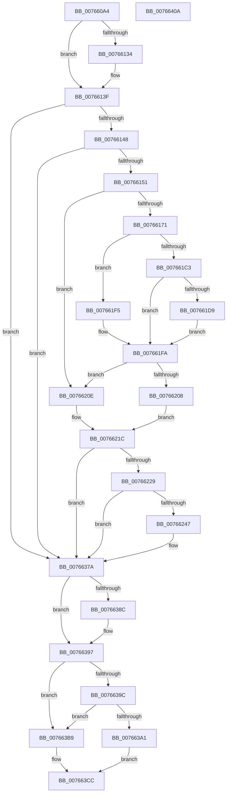

# PopPolicyDeviceHandleWakeAlarmNotification

- RVA: `0x007660A4`–`0x0076640B` (길이 `871` bytes)
- VA: `0x00000001407660A4`
- 실행 섹션: `PAGE`
- PDB 이름 있음: `예`; PDB Function 태그: `아니요`
- unwind 정보 RVA: `0x000CCDE0`
- 디코드: `201`개 명령, `871/871` bytes 표시
- 미해석 바이트: `0` (있으면 어셈블리에 `.byte`로 보존)

> 이 문서는 커널 이미지의 기계어와 PDB 기호를 분석해 생성했습니다. 4번과 5번은 함수 원형과 자료형을 바이너리 사용 방식에서 추정한 C 해석이며 원본 소스 복구 결과는 아닙니다.

## 1. Dependencies

- 직접 호출 지점: **14**; 고유 호출 대상: **13**
- 직접 호출자로 확인된 함수: **1**
- RIP 상대 이미지 참조: **11**

### Outgoing calls
- `0x00766115` → [EmClientQueryRuleState](../../pagelk/B7/EmClientQueryRuleState_function_00B77D70.md) (function, `0x00B77D70`)
- `0x00766162` → [IoGetDeviceObjectPointer](../95/IoGetDeviceObjectPointer_function_00953220.md) (function, `0x00953220`)
- `0x0076617B` → [KeInitializeEvent](../../text/40/KeInitializeEvent_function_0040DD10.md) (function, `0x0040DD10`)
- `0x007661B9` → [IoBuildDeviceIoControlRequest](../../text/20/IoBuildDeviceIoControlRequest_function_00204FD0.md) (function, `0x00204FD0`)
- `0x007661CB` → [IofCallDriver](../../text/29/IofCallDriver_function_0029B4B0.md) (function, `0x0029B4B0`)
- `0x007661EB` → [KeWaitForSingleObject](../../text/20/KeWaitForSingleObject_function_0020E6B0.md) (function, `0x0020E6B0`)
- `0x007661FF` → [ObfDereferenceObject](../../text/2F/ObfDereferenceObject_function_002F9350.md) (function, `0x002F9350`)
- `0x0076623A` → [tlgKeywordOn](../../text/42/tlgKeywordOn_function_0042EAA0.md) (function, `0x0042EAA0`)
- `0x00766375` → [tlgWriteTransfer_EtwWriteTransfer](../../text/42/tlgWriteTransfer_EtwWriteTransfer_function_004260E0.md) (function, `0x004260E0`)
- `0x0076637A` → [PopAcquirePolicyLock](../../pagelk/B7/PopAcquirePolicyLock_function_00B783C0.md) (function, `0x00B783C0`)
- `0x007663AB` → [PopChangeCapability](../90/PopChangeCapability_function_0090FF48.md) (function, `0x0090FF48`)
- `0x007663C2` → [PopChangeCapability](../90/PopChangeCapability_function_0090FF48.md) (function, `0x0090FF48`)
- `0x007663D9` → [PopReleasePolicyLock](../../pagelk/B7/PopReleasePolicyLock_function_00B78410.md) (function, `0x00B78410`)
- `0x007663E8` → [_security_check_cookie](../../text/6A/_security_check_cookie_function_006AC640.md) (function, `0x006AC640`)

### Direct callers
- [PopNotifyPolicyDevice](PopNotifyPolicyDevice_function_00765FF0.md) at `0x00766023`

### Static image references
- `0x007660C6` → RVA `0x00E0A740` (`.data`; read)
- `0x007660EE` → RVA `0x00029718` (`.rdata`; read)
- `0x0076612B` → RVA `0x00013E30` (`.rdata`; read)
- `0x00766138` → RVA `0x00013E38` (`.rdata`; read)
- `0x0076621C` → RVA `0x00E07748` (`.data`; read)
- `0x00766255` → RVA `0x0004C364` (`.rdata`; read)
- `0x00766383` → RVA `0x000122D8` (`.rdata`; read)
- `0x00766390` → RVA `0x000122E0` (`.rdata`; read)
- `0x007663A4` → RVA `0x00F0CED3` (`.data`; read)
- `0x007663CC` → RVA `0x00F090F0` (`.data`; write)
- `0x007663D2` → RVA `0x00F090E0` (`.data`; read)

## 2. Other-region calls and transfers

- 다른 실행 섹션으로 향하는 call: **11**
  - `0x00766115` → [EmClientQueryRuleState](../../pagelk/B7/EmClientQueryRuleState_function_00B77D70.md) (`PAGE` → `PAGELK`)
  - `0x0076617B` → [KeInitializeEvent](../../text/40/KeInitializeEvent_function_0040DD10.md) (`PAGE` → `.text`)
  - `0x007661B9` → [IoBuildDeviceIoControlRequest](../../text/20/IoBuildDeviceIoControlRequest_function_00204FD0.md) (`PAGE` → `.text`)
  - `0x007661CB` → [IofCallDriver](../../text/29/IofCallDriver_function_0029B4B0.md) (`PAGE` → `.text`)
  - `0x007661EB` → [KeWaitForSingleObject](../../text/20/KeWaitForSingleObject_function_0020E6B0.md) (`PAGE` → `.text`)
  - `0x007661FF` → [ObfDereferenceObject](../../text/2F/ObfDereferenceObject_function_002F9350.md) (`PAGE` → `.text`)
  - `0x0076623A` → [tlgKeywordOn](../../text/42/tlgKeywordOn_function_0042EAA0.md) (`PAGE` → `.text`)
  - `0x00766375` → [tlgWriteTransfer_EtwWriteTransfer](../../text/42/tlgWriteTransfer_EtwWriteTransfer_function_004260E0.md) (`PAGE` → `.text`)
  - `0x0076637A` → [PopAcquirePolicyLock](../../pagelk/B7/PopAcquirePolicyLock_function_00B783C0.md) (`PAGE` → `PAGELK`)
  - `0x007663D9` → [PopReleasePolicyLock](../../pagelk/B7/PopReleasePolicyLock_function_00B78410.md) (`PAGE` → `PAGELK`)
  - `0x007663E8` → [_security_check_cookie](../../text/6A/_security_check_cookie_function_006AC640.md) (`PAGE` → `.text`)
- 별도 외부 분기/꼬리 이동을 확인하지 못했습니다.

## 3. Assembly (complete function range)

```asm
007660A4  48 8B C4                        mov rax, rsp
007660A7  48 89 58 10                     mov qword ptr [rax + 0x10], rbx
007660AB  48 89 70 18                     mov qword ptr [rax + 0x18], rsi
007660AF  48 89 78 20                     mov qword ptr [rax + 0x20], rdi
007660B3  55                              push rbp
007660B4  41 56                           push r14
007660B6  41 57                           push r15
007660B8  48 8D A8 38 FF FF FF            lea rbp, [rax - 0xc8]
007660BF  48 81 EC B0 01 00 00            sub rsp, 0x1b0
007660C6  48 8B 05 73 46 6A 00            mov rax, qword ptr [rip + 0x6a4673]
007660CD  48 33 C4                        xor rax, rsp
007660D0  48 89 85 A0 00 00 00            mov qword ptr [rbp + 0xa0], rax
007660D7  33 C0                           xor eax, eax
007660D9  48 8D 54 24 58                  lea rdx, [rsp + 0x58]
007660DE  0F 57 C0                        xorps xmm0, xmm0
007660E1  89 45 B0                        mov dword ptr [rbp - 0x50], eax
007660E4  48 8B F9                        mov rdi, rcx
007660E7  48 89 45 88                     mov qword ptr [rbp - 0x78], rax
007660EB  45 33 F6                        xor r14d, r14d
007660EE  48 8D 0D 23 36 8C FF            lea rcx, [rip - 0x73c9dd]
007660F5  44 8D 78 01                     lea r15d, [rax + 1]
007660F9  4C 89 74 24 60                  mov qword ptr [rsp + 0x60], r14
007660FE  44 89 7C 24 58                  mov dword ptr [rsp + 0x58], r15d
00766103  0F 11 45 A0                     movups xmmword ptr [rbp - 0x60], xmm0
00766107  4C 89 74 24 68                  mov qword ptr [rsp + 0x68], r14
0076610C  0F 11 44 24 78                  movups xmmword ptr [rsp + 0x78], xmm0
00766111  0F 11 45 90                     movups xmmword ptr [rbp - 0x70], xmm0
00766115  E8 56 1C 41 00                  call 0x140b77d70
0076611A  83 7C 24 58 02                  cmp dword ptr [rsp + 0x58], 2
0076611F  48 8B 47 04                     mov rax, qword ptr [rdi + 4]
00766123  41 0F B6 F6                     movzx esi, r14b
00766127  41 0F 44 F7                     cmove esi, r15d
0076612B  48 2B 05 FE DC 8A FF            sub rax, qword ptr [rip - 0x752302]
00766132  75 0B                           jne 0x14076613f
00766134  48 8B 47 0C                     mov rax, qword ptr [rdi + 0xc]
00766138  48 2B 05 F9 DC 8A FF            sub rax, qword ptr [rip - 0x752307]
0076613F  48 85 C0                        test rax, rax
00766142  0F 85 32 02 00 00               jne 0x14076637a
00766148  40 84 F6                        test sil, sil
0076614B  0F 85 29 02 00 00               jne 0x14076637a
00766151  48 8B 4F 28                     mov rcx, qword ptr [rdi + 0x28]
00766155  4C 8D 4C 24 60                  lea r9, [rsp + 0x60]
0076615A  4C 8D 44 24 68                  lea r8, [rsp + 0x68]
0076615F  8D 50 03                        lea edx, [rax + 3]
00766162  E8 B9 D0 1E 00                  call 0x140953220
00766167  8B D8                           mov ebx, eax
00766169  85 C0                           test eax, eax
0076616B  0F 88 9D 00 00 00               js 0x14076620e
00766171  45 33 C0                        xor r8d, r8d
00766174  48 8D 4C 24 78                  lea rcx, [rsp + 0x78]
00766179  33 D2                           xor edx, edx
0076617B  E8 90 7B CA FF                  call 0x14040dd10
00766180  48 8B 54 24 60                  mov rdx, qword ptr [rsp + 0x60]
00766185  48 8D 45 90                     lea rax, [rbp - 0x70]
00766189  48 89 44 24 40                  mov qword ptr [rsp + 0x40], rax
0076618E  45 33 C9                        xor r9d, r9d
00766191  48 8D 44 24 78                  lea rax, [rsp + 0x78]
00766196  45 33 C0                        xor r8d, r8d
00766199  48 89 44 24 38                  mov qword ptr [rsp + 0x38], rax
0076619E  B9 1C 42 29 00                  mov ecx, 0x29421c
007661A3  44 88 74 24 30                  mov byte ptr [rsp + 0x30], r14b
007661A8  48 8D 45 A0                     lea rax, [rbp - 0x60]
007661AC  C7 44 24 28 14 00 00 00         mov dword ptr [rsp + 0x28], 0x14
007661B4  48 89 44 24 20                  mov qword ptr [rsp + 0x20], rax
007661B9  E8 12 EE A9 FF                  call 0x140204fd0
007661BE  48 85 C0                        test rax, rax
007661C1  74 32                           je 0x1407661f5
007661C3  48 8B 4C 24 60                  mov rcx, qword ptr [rsp + 0x60]
007661C8  48 8B D0                        mov rdx, rax
007661CB  E8 E0 52 B3 FF                  call 0x14029b4b0
007661D0  8B D8                           mov ebx, eax
007661D2  3D 03 01 00 00                  cmp eax, 0x103
007661D7  75 21                           jne 0x1407661fa
007661D9  45 33 C9                        xor r9d, r9d
007661DC  4C 89 74 24 20                  mov qword ptr [rsp + 0x20], r14
007661E1  45 33 C0                        xor r8d, r8d
007661E4  48 8D 4C 24 78                  lea rcx, [rsp + 0x78]
007661E9  33 D2                           xor edx, edx
007661EB  E8 C0 84 AA FF                  call 0x14020e6b0
007661F0  8B 5D 90                        mov ebx, dword ptr [rbp - 0x70]
007661F3  EB 05                           jmp 0x1407661fa
007661F5  BB 9A 00 00 C0                  mov ebx, 0xc000009a
007661FA  48 8B 4C 24 68                  mov rcx, qword ptr [rsp + 0x68]
007661FF  E8 4C 31 B9 FF                  call 0x1402f9350
00766204  85 DB                           test ebx, ebx
00766206  78 06                           js 0x14076620e
00766208  44 8B 45 B0                     mov r8d, dword ptr [rbp - 0x50]
0076620C  EB 0E                           jmp 0x14076621c
0076620E  0F 57 C0                        xorps xmm0, xmm0
00766211  45 33 C0                        xor r8d, r8d
00766214  0F 11 45 A0                     movups xmmword ptr [rbp - 0x60], xmm0
00766218  44 89 45 B0                     mov dword ptr [rbp - 0x50], r8d
0076621C  83 3D 25 15 6A 00 05            cmp dword ptr [rip + 0x6a1525], 5
00766223  0F 86 51 01 00 00               jbe 0x14076637a
00766229  48 BA 00 00 00 00 00 40 00 00   movabs rdx, 0x400000000000
00766233  48 8D 0D 0E 15 6A 00            lea rcx, [rip + 0x6a150e]
0076623A  E8 61 88 CC FF                  call 0x14042eaa0
0076623F  84 C0                           test al, al
00766241  0F 84 33 01 00 00               je 0x14076637a
00766247  48 8D 44 24 58                  lea rax, [rsp + 0x58]
0076624C  44 89 44 24 60                  mov dword ptr [rsp + 0x60], r8d
00766251  48 89 45 E0                     mov qword ptr [rbp - 0x20], rax
00766255  48 8D 15 08 61 8E FF            lea rdx, [rip - 0x719ef8]
0076625C  8A 45 A0                        mov al, byte ptr [rbp - 0x60]
0076625F  48 8D 0D E2 14 6A 00            lea rcx, [rip + 0x6a14e2]
00766266  88 44 24 50                     mov byte ptr [rsp + 0x50], al
0076626A  45 33 C9                        xor r9d, r9d
0076626D  48 8D 44 24 50                  lea rax, [rsp + 0x50]
00766272  89 5C 24 58                     mov dword ptr [rsp + 0x58], ebx
00766276  48 89 45 F0                     mov qword ptr [rbp - 0x10], rax
0076627A  45 33 C0                        xor r8d, r8d
0076627D  8A 45 A1                        mov al, byte ptr [rbp - 0x5f]
00766280  88 44 24 51                     mov byte ptr [rsp + 0x51], al
00766284  48 8D 44 24 51                  lea rax, [rsp + 0x51]
00766289  48 89 45 00                     mov qword ptr [rbp], rax
0076628D  8A 45 A2                        mov al, byte ptr [rbp - 0x5e]
00766290  88 44 24 52                     mov byte ptr [rsp + 0x52], al
00766294  48 8D 44 24 52                  lea rax, [rsp + 0x52]
00766299  48 89 45 10                     mov qword ptr [rbp + 0x10], rax
0076629D  8A 45 A3                        mov al, byte ptr [rbp - 0x5d]
007662A0  88 44 24 53                     mov byte ptr [rsp + 0x53], al
007662A4  48 8D 44 24 53                  lea rax, [rsp + 0x53]
007662A9  48 89 45 20                     mov qword ptr [rbp + 0x20], rax
007662AD  8A 45 A4                        mov al, byte ptr [rbp - 0x5c]
007662B0  88 44 24 54                     mov byte ptr [rsp + 0x54], al
007662B4  48 8D 44 24 54                  lea rax, [rsp + 0x54]
007662B9  48 89 45 30                     mov qword ptr [rbp + 0x30], rax
007662BD  8A 45 A5                        mov al, byte ptr [rbp - 0x5b]
007662C0  88 44 24 55                     mov byte ptr [rsp + 0x55], al
007662C4  48 8D 44 24 55                  lea rax, [rsp + 0x55]
007662C9  48 89 45 40                     mov qword ptr [rbp + 0x40], rax
007662CD  8A 45 A6                        mov al, byte ptr [rbp - 0x5a]
007662D0  88 44 24 56                     mov byte ptr [rsp + 0x56], al
007662D4  48 8D 44 24 56                  lea rax, [rsp + 0x56]
007662D9  48 89 45 50                     mov qword ptr [rbp + 0x50], rax
007662DD  8B 45 A8                        mov eax, dword ptr [rbp - 0x58]
007662E0  89 44 24 68                     mov dword ptr [rsp + 0x68], eax
007662E4  48 8D 44 24 68                  lea rax, [rsp + 0x68]
007662E9  48 89 45 60                     mov qword ptr [rbp + 0x60], rax
007662ED  8A 45 AC                        mov al, byte ptr [rbp - 0x54]
007662F0  88 44 24 57                     mov byte ptr [rsp + 0x57], al
007662F4  48 8D 44 24 57                  lea rax, [rsp + 0x57]
007662F9  48 89 45 70                     mov qword ptr [rbp + 0x70], rax
007662FD  48 8D 44 24 60                  lea rax, [rsp + 0x60]
00766302  48 89 85 80 00 00 00            mov qword ptr [rbp + 0x80], rax
00766309  48 8D 44 24 70                  lea rax, [rsp + 0x70]
0076630E  48 89 85 90 00 00 00            mov qword ptr [rbp + 0x90], rax
00766315  48 8D 45 C0                     lea rax, [rbp - 0x40]
00766319  48 89 44 24 28                  mov qword ptr [rsp + 0x28], rax
0076631E  C7 44 24 20 0E 00 00 00         mov dword ptr [rsp + 0x20], 0xe
00766326  48 C7 45 E8 04 00 00 00         mov qword ptr [rbp - 0x18], 4
0076632E  4C 89 7D F8                     mov qword ptr [rbp - 8], r15
00766332  4C 89 7D 08                     mov qword ptr [rbp + 8], r15
00766336  4C 89 7D 18                     mov qword ptr [rbp + 0x18], r15
0076633A  4C 89 7D 28                     mov qword ptr [rbp + 0x28], r15
0076633E  4C 89 7D 38                     mov qword ptr [rbp + 0x38], r15
00766342  4C 89 7D 48                     mov qword ptr [rbp + 0x48], r15
00766346  4C 89 7D 58                     mov qword ptr [rbp + 0x58], r15
0076634A  48 C7 45 68 04 00 00 00         mov qword ptr [rbp + 0x68], 4
00766352  4C 89 7D 78                     mov qword ptr [rbp + 0x78], r15
00766356  48 C7 85 88 00 00 00 04 00 00 00  mov qword ptr [rbp + 0x88], 4
00766361  48 C7 44 24 70 00 00 00 01      mov qword ptr [rsp + 0x70], 0x1000000
0076636A  48 C7 85 98 00 00 00 08 00 00 00  mov qword ptr [rbp + 0x98], 8
00766375  E8 66 FD CB FF                  call 0x1404260e0
0076637A  E8 41 20 41 00                  call 0x140b783c0
0076637F  48 8B 47 04                     mov rax, qword ptr [rdi + 4]
00766383  48 2B 05 4E BF 8A FF            sub rax, qword ptr [rip - 0x7540b2]
0076638A  75 0B                           jne 0x140766397
0076638C  48 8B 47 0C                     mov rax, qword ptr [rdi + 0xc]
00766390  48 2B 05 49 BF 8A FF            sub rax, qword ptr [rip - 0x7540b7]
00766397  48 85 C0                        test rax, rax
0076639A  74 1D                           je 0x1407663b9
0076639C  40 84 F6                        test sil, sil
0076639F  75 18                           jne 0x1407663b9
007663A1  41 8A D7                        mov dl, r15b
007663A4  48 8D 0D 28 6B 7A 00            lea rcx, [rip + 0x7a6b28]
007663AB  E8 98 9B 1A 00                  call 0x14090ff48
007663B0  0F 10 45 A0                     movups xmm0, xmmword ptr [rbp - 0x60]
007663B4  8B 45 B0                        mov eax, dword ptr [rbp - 0x50]
007663B7  EB 13                           jmp 0x1407663cc
007663B9  33 D2                           xor edx, edx
007663BB  48 8D 0D 11 6B 7A 00            lea rcx, [rip + 0x7a6b11]
007663C2  E8 81 9B 1A 00                  call 0x14090ff48
007663C7  0F 57 C0                        xorps xmm0, xmm0
007663CA  33 C0                           xor eax, eax
007663CC  89 05 1E 2D 7A 00               mov dword ptr [rip + 0x7a2d1e], eax
007663D2  0F 11 05 07 2D 7A 00            movups xmmword ptr [rip + 0x7a2d07], xmm0
007663D9  E8 32 20 41 00                  call 0x140b78410
007663DE  48 8B 8D A0 00 00 00            mov rcx, qword ptr [rbp + 0xa0]
007663E5  48 33 CC                        xor rcx, rsp
007663E8  E8 53 62 F4 FF                  call 0x1406ac640
007663ED  4C 8D 9C 24 B0 01 00 00         lea r11, [rsp + 0x1b0]
007663F5  49 8B 5B 28                     mov rbx, qword ptr [r11 + 0x28]
007663F9  49 8B 73 30                     mov rsi, qword ptr [r11 + 0x30]
007663FD  49 8B 7B 38                     mov rdi, qword ptr [r11 + 0x38]
00766401  49 8B E3                        mov rsp, r11
00766404  41 5F                           pop r15
00766406  41 5E                           pop r14
00766408  5D                              pop rbp
00766409  C3                              ret
0076640A  CC                              int3
```

## 4. C-style interpretation (structured pseudocode)

```c
__int64 __fastcall PopPolicyDeviceHandleWakeAlarmNotification(__int64 a1)
{
    __int64 result;
    __int64 v_r14;
    __int64 v_rsi;
    __int64 v_rsp;
    unsigned __int64 v_stack_m150;
    unsigned __int64 v_stack_m158;
    unsigned __int64 v_stack_m160;
    unsigned __int64 v_stack_m168;
    unsigned __int64 v_stack_m170;
    unsigned __int8 v_stack_m171;
    unsigned __int8 v_stack_m172;
    unsigned __int8 v_stack_m173;
    unsigned __int8 v_stack_m174;
    unsigned __int8 v_stack_m175;
    unsigned __int8 v_stack_m176;
    unsigned __int8 v_stack_m177;
    unsigned __int8 v_stack_m178;
    unsigned __int64 v_stack_m18;
    unsigned __int64 v_stack_m188;
    unsigned __int64 v_stack_m190;
    unsigned __int8 v_stack_m198;
    unsigned int v_stack_m1A0;
    unsigned __int64 v_stack_m1A8;

    *(unsigned __int64 *)(v_rsp + 16) = v_rbx;
    *(unsigned __int64 *)(v_rsp + 24) = v_rsi;
    *(unsigned __int64 *)(v_rsp + 32) = v_rdi;
    v_rsp = (v_rsp) - (432);
    result = (*(unsigned __int64 *)(v_rip + 6964851)) ^ (v_rsp);
    *(unsigned __int64 *)(v_rsp - 200 + 160) = result;
    result = 0;
    *(unsigned int *)(v_rsp - 200 - 80) = 0;
    *(unsigned __int64 *)(v_rsp - 200 - 120) = 0;
    v_r14 = 0;
    v_stack_m168 = 0;
    v_stack_m170 = (unsigned int)(result + 1);
    *(unsigned __int64 *)(v_rsp - 200 - 96) = v_xmm0;
    v_stack_m160 = 0;
    v_stack_m150 = v_xmm0;
    *(unsigned __int64 *)(v_rsp - 200 - 112) = v_xmm0;
    result = EmClientQueryRuleState(v_rip - 7588317, v_stack_m170, a3, a4);
    v_rsi = 0;
    if (v_stack_m170 == 2) { v_rsi = (unsigned int)(result + 1); }
    result = (*(unsigned __int64 *)(a1 + 4)) - (*(unsigned __int64 *)(v_rip - 7676674));
    if (!(condition_is_not_equal)) {
        result = *(unsigned __int64 *)(a1 + 12);
        result = (result) - (*(unsigned __int64 *)(v_rip - 7676679));
    }
    if (result != 0) goto loc_0076637A;
    if ((unsigned __int8)(v_rsi) != 0) goto loc_0076637A;
    result = IoGetDeviceObjectPointer(*(unsigned __int64 *)(a1 + 40), result + 3, v_stack_m160, v_stack_m168);
    if (sign_flag) goto loc_0076620E;
    a3 = 0;
    a2 = 0;
    result = KeInitializeEvent(v_stack_m150, a2, a3, v_stack_m168);
    v_stack_m188 = v_rsp - 200 - 112;
    a4 = 0;
    a3 = 0;
    v_stack_m190 = v_stack_m150;
    v_stack_m198 = 0;
    v_stack_m1A0 = 20;
    v_stack_m1A8 = v_rsp - 200 - 96;
    result = IoBuildDeviceIoControlRequest((unsigned int)(0x29421CULL), v_stack_m168, a3, a4);
    if (result == 0) goto loc_007661F5;
    result = IofCallDriver(v_stack_m168, result, a3, a4);
    if (((unsigned int)(result)) != 259) goto loc_007661FA;
    a4 = 0;
    v_stack_m1A8 = 0;
    a3 = 0;
    a2 = 0;
    result = KeWaitForSingleObject(v_stack_m150, a2, a3, a4);
    goto loc_007661FA;
loc_007661F5:
loc_007661FA:
    result = ObfDereferenceObject(v_stack_m160, a2, a3, a4);
    if (sign_flag) goto loc_0076620E;
    goto loc_0076621C;
loc_0076620E:
    a3 = 0;
    *(unsigned __int64 *)(v_rsp - 200 - 96) = v_xmm0;
    *(unsigned int *)(v_rsp - 200 - 80) = 0;
loc_0076621C:
    if ((*(unsigned int *)(v_rip + 6952229)) <= 5) goto loc_0076637A;
    result = tlgKeywordOn(v_rip + 6952206, a2, a3, a4);
    if ((unsigned __int8)(result) != 0) {
        result = v_stack_m170;
        v_stack_m168 = 0;
        *(unsigned __int64 *)(v_rsp - 200 - 32) = result;
        a2 = v_rip - 7446264;
        result = *(unsigned __int8 *)(v_rsp - 200 - 96);
        a1 = v_rip + 6952162;
        v_stack_m178 = (unsigned __int8)(result);
        a4 = 0;
        result = v_stack_m178;
        v_stack_m170 = (unsigned int)((unsigned int)(0xC000009AULL));
        *(unsigned __int64 *)(v_rsp - 200 - 16) = result;
        a3 = 0;
        result = *(unsigned __int8 *)(v_rsp - 200 - 95);
        v_stack_m177 = (unsigned __int8)(result);
        result = v_stack_m177;
        *(unsigned __int64 *)(v_rsp - 200) = result;
        result = *(unsigned __int8 *)(v_rsp - 200 - 94);
        v_stack_m176 = (unsigned __int8)(result);
        result = v_stack_m176;
        *(unsigned __int64 *)(v_rsp - 200 + 16) = result;
        result = *(unsigned __int8 *)(v_rsp - 200 - 93);
        v_stack_m175 = (unsigned __int8)(result);
        result = v_stack_m175;
        *(unsigned __int64 *)(v_rsp - 200 + 32) = result;
        result = *(unsigned __int8 *)(v_rsp - 200 - 92);
        v_stack_m174 = (unsigned __int8)(result);
        result = v_stack_m174;
        *(unsigned __int64 *)(v_rsp - 200 + 48) = result;
        result = *(unsigned __int8 *)(v_rsp - 200 - 91);
        v_stack_m173 = (unsigned __int8)(result);
        result = v_stack_m173;
        *(unsigned __int64 *)(v_rsp - 200 + 64) = result;
        result = *(unsigned __int8 *)(v_rsp - 200 - 90);
        v_stack_m172 = (unsigned __int8)(result);
        result = v_stack_m172;
        *(unsigned __int64 *)(v_rsp - 200 + 80) = result;
        result = *(unsigned int *)(v_rsp - 200 - 88);
        v_stack_m160 = (unsigned int)(result);
        result = v_stack_m160;
        *(unsigned __int64 *)(v_rsp - 200 + 96) = result;
        result = *(unsigned __int8 *)(v_rsp - 200 - 84);
        v_stack_m171 = (unsigned __int8)(result);
        result = v_stack_m171;
        *(unsigned __int64 *)(v_rsp - 200 + 112) = result;
        result = v_stack_m168;
        *(unsigned __int64 *)(v_rsp - 200 + 128) = result;
        result = v_stack_m158;
        *(unsigned __int64 *)(v_rsp - 200 + 144) = result;
        result = v_rsp - 200 - 64;
        v_stack_m1A0 = result;
        v_stack_m1A8 = 14;
        *(unsigned __int64 *)(v_rsp - 200 - 24) = 4;
        *(unsigned __int64 *)(v_rsp - 200 - 8) = result + 1;
        *(unsigned __int64 *)(v_rsp - 200 + 8) = result + 1;
        *(unsigned __int64 *)(v_rsp - 200 + 24) = result + 1;
        *(unsigned __int64 *)(v_rsp - 200 + 40) = result + 1;
        *(unsigned __int64 *)(v_rsp - 200 + 56) = result + 1;
        *(unsigned __int64 *)(v_rsp - 200 + 72) = result + 1;
        *(unsigned __int64 *)(v_rsp - 200 + 88) = result + 1;
        *(unsigned __int64 *)(v_rsp - 200 + 104) = 4;
        *(unsigned __int64 *)(v_rsp - 200 + 120) = result + 1;
        *(unsigned __int64 *)(v_rsp - 200 + 136) = 4;
        v_stack_m158 = 0x1000000ULL;
        *(unsigned __int64 *)(v_rsp - 200 + 152) = 8;
        result = tlgWriteTransfer_EtwWriteTransfer(a1, a2, a3, a4);
    }
    result = PopAcquirePolicyLock(a1, a2, a3, a4);
    result = (*(unsigned __int64 *)(a1 + 4)) - (*(unsigned __int64 *)(v_rip - 7684274));
    if (!(condition_is_not_equal)) {
        result = *(unsigned __int64 *)(a1 + 12);
        result = (result) - (*(unsigned __int64 *)(v_rip - 7684279));
    }
    if (result == 0) goto loc_007663B9;
    if ((unsigned __int8)(v_rsi) != 0) goto loc_007663B9;
    result = PopChangeCapability(v_rip + 8022824, (unsigned __int8)(result + 1), a3, a4);
    goto loc_007663CC;
loc_007663B9:
    a2 = 0;
    result = PopChangeCapability(v_rip + 8022801, a2, a3, a4);
    result = 0;
loc_007663CC:
    *(unsigned int *)(v_rip + 8006942) = 0;
    *(unsigned __int64 *)(v_rip + 8006919) = v_xmm0;
    result = PopReleasePolicyLock(v_rip + 8022801, a2, a3, a4);
    a1 = (*(unsigned __int64 *)(v_rsp - 200 + 160)) ^ (v_rsp);
    result = _security_check_cookie(a1, a2, a3, a4);
    return result;
}
```

## 5. (Beta) C Style

```c
int64_t PopPolicyDeviceHandleWakeAlarmNotification(void *Arg1)
{
    uint8_t *arg1 = (uint8_t *)Arg1;

    int64_t result;
    int64_t local_r14;
    int64_t local_rsi;
    int64_t local_rsp;
    uint64_t v_stack_m150;
    uint64_t v_stack_m158;
    uint64_t v_stack_m160;
    uint64_t v_stack_m168;
    uint64_t v_stack_m170;
    uint8_t v_stack_m171;
    uint8_t v_stack_m172;
    uint8_t v_stack_m173;
    uint8_t v_stack_m174;
    uint8_t v_stack_m175;
    uint8_t v_stack_m176;
    uint8_t v_stack_m177;
    uint8_t v_stack_m178;
    uint64_t v_stack_m18;
    uint64_t v_stack_m188;
    uint64_t v_stack_m190;
    uint8_t v_stack_m198;
    uint32_t v_stack_m1A0;
    uint64_t v_stack_m1A8;

    *(uint64_t *)(local_rsp + 0x10) = local_rbx;
    *(uint64_t *)(local_rsp + 0x18) = local_rsi;
    *(uint64_t *)(local_rsp + 0x20) = local_rdi;
    local_rsp = (local_rsp) - (432);
    result = (*(uint64_t *)(v_rip + 0x6A4673)) ^ (local_rsp);
    *(uint64_t *)(local_rsp - 0xC8 + 0xA0) = result;
    result = 0;
    *(uint32_t *)(local_rsp - 0xC8 - 0x50) = 0;
    *(uint64_t *)(local_rsp - 0xC8 - 0x78) = 0;
    local_r14 = 0;
    v_stack_m168 = 0;
    v_stack_m170 = (uint32_t)(result + 1);
    *(uint64_t *)(local_rsp - 0xC8 - 0x60) = v_xmm0;
    v_stack_m160 = 0;
    v_stack_m150 = v_xmm0;
    *(uint64_t *)(local_rsp - 0xC8 - 0x70) = v_xmm0;
    result = EmClientQueryRuleState(v_rip - 7588317, v_stack_m170, a3, a4);
    local_rsi = 0;
    if (v_stack_m170 == 2) { local_rsi = (uint32_t)(result + 1); }
    result = (*(uint64_t *)(arg1 + 0x4)) - (*(uint64_t *)(v_rip - 0x752302));
    if (!(condition_is_not_equal)) {
        result = *(uint64_t *)(arg1 + 0xC);
        result = (result) - (*(uint64_t *)(v_rip - 0x752307));
    }
    if (result != 0) goto loc_0076637A;
    if ((uint8_t)(local_rsi) != 0) goto loc_0076637A;
    result = IoGetDeviceObjectPointer(*(uint64_t *)(arg1 + 0x28), result + 3, v_stack_m160, v_stack_m168);
    if (sign_flag) goto loc_0076620E;
    a3 = 0;
    a2 = 0;
    result = KeInitializeEvent(v_stack_m150, a2, a3, v_stack_m168);
    v_stack_m188 = local_rsp - 200 - 112;
    a4 = 0;
    a3 = 0;
    v_stack_m190 = v_stack_m150;
    v_stack_m198 = 0;
    v_stack_m1A0 = 20;
    v_stack_m1A8 = local_rsp - 200 - 96;
    result = IoBuildDeviceIoControlRequest((uint32_t)(0x29421CULL), v_stack_m168, a3, a4);
    if (result == 0) goto loc_007661F5;
    result = IofCallDriver(v_stack_m168, result, a3, a4);
    if (((uint32_t)(result)) != 259) goto loc_007661FA;
    a4 = 0;
    v_stack_m1A8 = 0;
    a3 = 0;
    a2 = 0;
    result = KeWaitForSingleObject(v_stack_m150, a2, a3, a4);
    goto loc_007661FA;
loc_007661F5:
loc_007661FA:
    result = ObfDereferenceObject(v_stack_m160, a2, a3, a4);
    if (sign_flag) goto loc_0076620E;
    goto loc_0076621C;
loc_0076620E:
    a3 = 0;
    *(uint64_t *)(local_rsp - 0xC8 - 0x60) = v_xmm0;
    *(uint32_t *)(local_rsp - 0xC8 - 0x50) = 0;
loc_0076621C:
    if ((*(uint32_t *)(v_rip + 0x6A1525)) <= 5) goto loc_0076637A;
    result = tlgKeywordOn(v_rip + 6952206, a2, a3, a4);
    if ((uint8_t)(result) != 0) {
        result = v_stack_m170;
        v_stack_m168 = 0;
        *(uint64_t *)(local_rsp - 0xC8 - 0x20) = result;
        a2 = v_rip - 7446264;
        result = *(uint8_t *)(local_rsp - 0xC8 - 0x60);
        Arg1 = v_rip + 6952162;
        v_stack_m178 = (uint8_t)(result);
        a4 = 0;
        result = v_stack_m178;
        v_stack_m170 = (uint32_t)((uint32_t)(0xC000009AULL));
        *(uint64_t *)(local_rsp - 0xC8 - 0x10) = result;
        a3 = 0;
        result = *(uint8_t *)(local_rsp - 0xC8 - 0x5F);
        v_stack_m177 = (uint8_t)(result);
        result = v_stack_m177;
        *(uint64_t *)(local_rsp - 0xC8) = result;
        result = *(uint8_t *)(local_rsp - 0xC8 - 0x5E);
        v_stack_m176 = (uint8_t)(result);
        result = v_stack_m176;
        *(uint64_t *)(local_rsp - 0xC8 + 0x10) = result;
        result = *(uint8_t *)(local_rsp - 0xC8 - 0x5D);
        v_stack_m175 = (uint8_t)(result);
        result = v_stack_m175;
        *(uint64_t *)(local_rsp - 0xC8 + 0x20) = result;
        result = *(uint8_t *)(local_rsp - 0xC8 - 0x5C);
        v_stack_m174 = (uint8_t)(result);
        result = v_stack_m174;
        *(uint64_t *)(local_rsp - 0xC8 + 0x30) = result;
        result = *(uint8_t *)(local_rsp - 0xC8 - 0x5B);
        v_stack_m173 = (uint8_t)(result);
        result = v_stack_m173;
        *(uint64_t *)(local_rsp - 0xC8 + 0x40) = result;
        result = *(uint8_t *)(local_rsp - 0xC8 - 0x5A);
        v_stack_m172 = (uint8_t)(result);
        result = v_stack_m172;
        *(uint64_t *)(local_rsp - 0xC8 + 0x50) = result;
        result = *(uint32_t *)(local_rsp - 0xC8 - 0x58);
        v_stack_m160 = (uint32_t)(result);
        result = v_stack_m160;
        *(uint64_t *)(local_rsp - 0xC8 + 0x60) = result;
        result = *(uint8_t *)(local_rsp - 0xC8 - 0x54);
        v_stack_m171 = (uint8_t)(result);
        result = v_stack_m171;
        *(uint64_t *)(local_rsp - 0xC8 + 0x70) = result;
        result = v_stack_m168;
        *(uint64_t *)(local_rsp - 0xC8 + 0x80) = result;
        result = v_stack_m158;
        *(uint64_t *)(local_rsp - 0xC8 + 0x90) = result;
        result = local_rsp - 200 - 64;
        v_stack_m1A0 = result;
        v_stack_m1A8 = 14;
        *(uint64_t *)(local_rsp - 0xC8 - 0x18) = 4;
        *(uint64_t *)(local_rsp - 0xC8 - 0x8) = result + 1;
        *(uint64_t *)(local_rsp - 0xC8 + 0x8) = result + 1;
        *(uint64_t *)(local_rsp - 0xC8 + 0x18) = result + 1;
        *(uint64_t *)(local_rsp - 0xC8 + 0x28) = result + 1;
        *(uint64_t *)(local_rsp - 0xC8 + 0x38) = result + 1;
        *(uint64_t *)(local_rsp - 0xC8 + 0x48) = result + 1;
        *(uint64_t *)(local_rsp - 0xC8 + 0x58) = result + 1;
        *(uint64_t *)(local_rsp - 0xC8 + 0x68) = 4;
        *(uint64_t *)(local_rsp - 0xC8 + 0x78) = result + 1;
        *(uint64_t *)(local_rsp - 0xC8 + 0x88) = 4;
        v_stack_m158 = 0x1000000ULL;
        *(uint64_t *)(local_rsp - 0xC8 + 0x98) = 8;
        result = tlgWriteTransfer_EtwWriteTransfer(Arg1, a2, a3, a4);
    }
    result = PopAcquirePolicyLock(Arg1, a2, a3, a4);
    result = (*(uint64_t *)(arg1 + 0x4)) - (*(uint64_t *)(v_rip - 0x7540B2));
    if (!(condition_is_not_equal)) {
        result = *(uint64_t *)(arg1 + 0xC);
        result = (result) - (*(uint64_t *)(v_rip - 0x7540B7));
    }
    if (result == 0) goto loc_007663B9;
    if ((uint8_t)(local_rsi) != 0) goto loc_007663B9;
    result = PopChangeCapability(v_rip + 8022824, (uint8_t)(result + 1), a3, a4);
    goto loc_007663CC;
loc_007663B9:
    a2 = 0;
    result = PopChangeCapability(v_rip + 8022801, a2, a3, a4);
    result = 0;
loc_007663CC:
    *(uint32_t *)(v_rip + 0x7A2D1E) = 0;
    *(uint64_t *)(v_rip + 0x7A2D07) = v_xmm0;
    result = PopReleasePolicyLock(v_rip + 8022801, a2, a3, a4);
    Arg1 = (*(uint64_t *)(local_rsp - 0xC8 + 0xA0)) ^ (local_rsp);
    result = _security_check_cookie(Arg1, a2, a3, a4);
    return result;
}
```

### 관측된 메모리 오프셋

구조체 형식이 확인되지 않은 접근은 인자 기준의 오프셋으로만 기록했습니다.

| 기준 인자 | 오프셋 표현 | 폭 (bit) | 접근 |
|---|---:|---:|---|
| `Arg1` | `+ 0x4` | `64` | `R` |
| `Arg1` | `+ 0xC` | `64` | `R` |
| `Arg1` | `+ 0x28` | `64` | `R` |

## 6. Execution-region graph

[열기: 2D/3D 그래프와 함수 탐색 컨트롤 패널](../../../control-panel.html?section=page&rva=0x007660A4&view=graph)

- 2D 그래프는 위에서 아래로 흐르고, 3D 그래프는 빈 공간을 드래그해 회전합니다. Shift+드래그는 이동, 휠은 확대·축소, 함수 노드 선택은 대상 보고서 이동입니다.

### Static fallback


