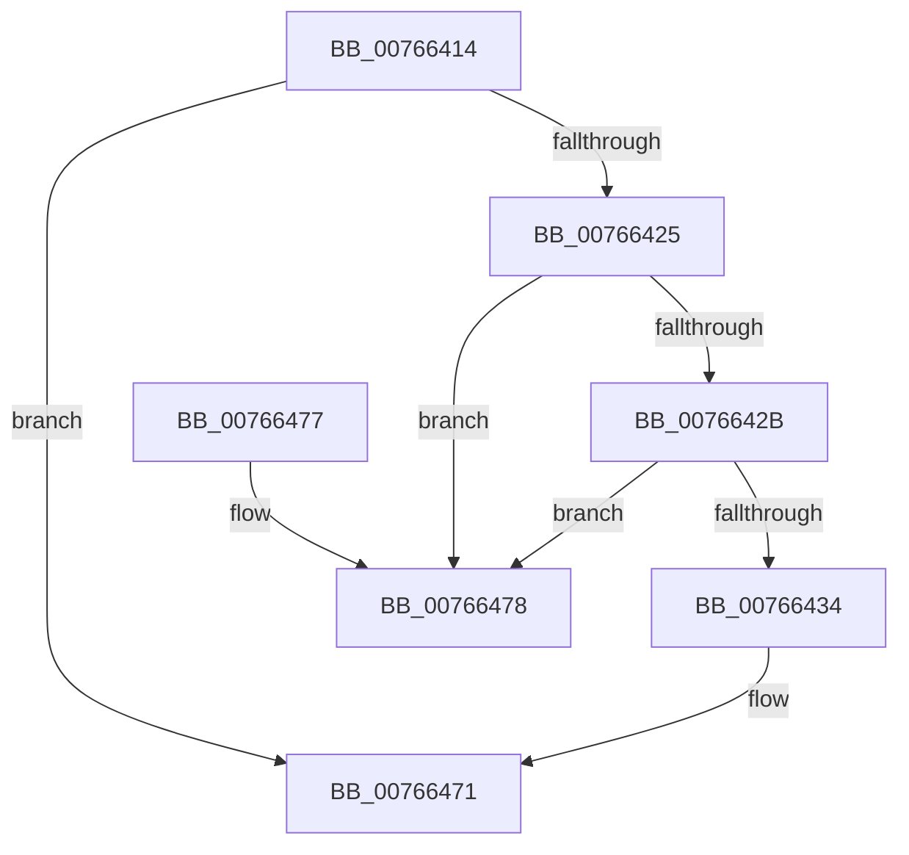

# PopPolicyDeviceRemove

- RVA: `0x00766414`–`0x0076647F` (길이 `107` bytes)
- VA: `0x0000000140766414`
- 실행 섹션: `PAGE`
- PDB 이름 있음: `예`; PDB Function 태그: `아니요`
- unwind 정보 RVA: `0x0005DAC8`
- 디코드: `31`개 명령, `107/107` bytes 표시
- 미해석 바이트: `0` (있으면 어셈블리에 `.byte`로 보존)

> 이 문서는 커널 이미지의 기계어와 PDB 기호를 분석해 생성했습니다. 4번과 5번은 함수 원형과 자료형을 바이너리 사용 방식에서 추정한 C 해석이며 원본 소스 복구 결과는 아닙니다.

## 1. Dependencies

- 직접 호출 지점: **3**; 고유 호출 대상: **3**
- 직접 호출자로 확인된 함수: **1**
- RIP 상대 이미지 참조: **1**

### Outgoing calls
- `0x00766455` → [guard_dispatch_icall](../../text/6B/guard_dispatch_icall_function_006BAAD0.md) (function, `0x006BAAD0`)
- `0x0076645E` → [IoFreeIrp](../../text/24/IoFreeIrp_function_0024DF70.md) (function, `0x0024DF70`)
- `0x0076646C` → [ObfDereferenceObjectWithTag](../../text/2F/ObfDereferenceObjectWithTag_function_002F78E0.md) (function, `0x002F78E0`)

### Direct callers
- [PopPolicyDeviceTargetChange](PopPolicyDeviceTargetChange_function_00766490.md) at `0x007664D4`
- [PopPolicyDeviceTargetChange](PopPolicyDeviceTargetChange_function_00766490.md) at `0x007664FB`

### Static image references
- `0x0076643B` → RVA `0x00E01AF8` (`.data`; read)

## 2. Other-region calls and transfers

- 다른 실행 섹션으로 향하는 call: **3**
  - `0x00766455` → [guard_dispatch_icall](../../text/6B/guard_dispatch_icall_function_006BAAD0.md) (`PAGE` → `.text`)
  - `0x0076645E` → [IoFreeIrp](../../text/24/IoFreeIrp_function_0024DF70.md) (`PAGE` → `.text`)
  - `0x0076646C` → [ObfDereferenceObjectWithTag](../../text/2F/ObfDereferenceObjectWithTag_function_002F78E0.md) (`PAGE` → `.text`)
- 별도 외부 분기/꼬리 이동을 확인하지 못했습니다.

## 3. Assembly (complete function range)

```asm
00766414  40 53                           push rbx
00766416  48 83 EC 20                     sub rsp, 0x20
0076641A  48 8B 01                        mov rax, qword ptr [rcx]
0076641D  48 8B D9                        mov rbx, rcx
00766420  48 85 C0                        test rax, rax
00766423  74 4C                           je 0x140766471
00766425  48 39 48 08                     cmp qword ptr [rax + 8], rcx
00766429  75 4D                           jne 0x140766478
0076642B  48 8B 49 08                     mov rcx, qword ptr [rcx + 8]
0076642F  48 39 19                        cmp qword ptr [rcx], rbx
00766432  75 44                           jne 0x140766478
00766434  48 89 01                        mov qword ptr [rcx], rax
00766437  48 89 48 08                     mov qword ptr [rax + 8], rcx
0076643B  48 8D 0D B6 B6 69 00            lea rcx, [rip + 0x69b6b6]
00766442  48 63 43 10                     movsxd rax, dword ptr [rbx + 0x10]
00766446  48 83 23 00                     and qword ptr [rbx], 0
0076644A  48 C1 E0 05                     shl rax, 5
0076644E  48 8B 04 08                     mov rax, qword ptr [rax + rcx]
00766452  48 8B CB                        mov rcx, rbx
00766455  E8 76 46 F5 FF                  call 0x1406baad0
0076645A  48 8B 4B 38                     mov rcx, qword ptr [rbx + 0x38]
0076645E  E8 0D 7B AE FF                  call 0x14024df70
00766463  48 8B 4B 30                     mov rcx, qword ptr [rbx + 0x30]
00766467  BA 50 6F 50 64                  mov edx, 0x64506f50
0076646C  E8 6F 14 B9 FF                  call 0x1402f78e0
00766471  48 83 C4 20                     add rsp, 0x20
00766475  5B                              pop rbx
00766476  C3                              ret
00766477  CC                              int3
00766478  B9 03 00 00 00                  mov ecx, 3
0076647D  CD 29                           int 0x29
```

## 4. C-style interpretation (structured pseudocode)

```c
__int64 __fastcall PopPolicyDeviceRemove(__int64 a1)
{
    __int64 result;
    __int64 v_rsp;

    v_rsp = (v_rsp) - (32);
    if (*(unsigned __int64 *)(a1) == 0) goto loc_00766471;
    if ((*(unsigned __int64 *)(*(unsigned __int64 *)(a1) + 8)) != a1) goto loc_00766478;
    if ((*(unsigned __int64 *)(*(unsigned __int64 *)(a1 + 8))) != a1) goto loc_00766478;
    *(unsigned __int64 *)(*(unsigned __int64 *)(a1 + 8)) = *(unsigned __int64 *)(a1);
    *(unsigned __int64 *)(*(unsigned __int64 *)(a1) + 8) = *(unsigned __int64 *)(a1 + 8);
    result = ((int)(*(unsigned int *)(a1 + 16))) << (5);
    result = guard_dispatch_icall(a1, a2, a3, a4);
    result = IoFreeIrp(*(unsigned __int64 *)(a1 + 56), a2, a3, a4);
    result = ObfDereferenceObjectWithTag(*(unsigned __int64 *)(a1 + 48), (unsigned int)(0x64506F50ULL), a3, a4);
loc_00766471:
    v_rsp = (v_rsp) + (32);
    return result;
loc_00766478:
    return result;
}
```

## 5. (Beta) C Style

```c
int64_t PopPolicyDeviceRemove(void *Arg1)
{
    uint8_t *arg1 = (uint8_t *)Arg1;

    int64_t result;
    int64_t local_rsp;

    local_rsp = (local_rsp) - (32);
    if (*(uint64_t *)(arg1) == 0) goto loc_00766471;
    if ((*(uint64_t *)(*(uint64_t *)(arg1) + 0x8)) != Arg1) goto loc_00766478;
    if ((*(uint64_t *)(*(uint64_t *)(arg1 + 0x8))) != Arg1) goto loc_00766478;
    *(uint64_t *)(*(uint64_t *)(arg1 + 0x8)) = *(uint64_t *)(arg1);
    *(uint64_t *)(*(uint64_t *)(arg1) + 0x8) = *(uint64_t *)(arg1 + 0x8);
    result = ((int32_t)(*(uint32_t *)(arg1 + 0x10))) << (5);
    result = guard_dispatch_icall(Arg1, a2, a3, a4);
    result = IoFreeIrp(*(uint64_t *)(arg1 + 0x38), a2, a3, a4);
    result = ObfDereferenceObjectWithTag(*(uint64_t *)(arg1 + 0x30), (uint32_t)(0x64506F50ULL), a3, a4);
loc_00766471:
    local_rsp = (local_rsp) + (32);
    return result;
loc_00766478:
    return result;
}
```

### 관측된 메모리 오프셋

구조체 형식이 확인되지 않은 접근은 인자 기준의 오프셋으로만 기록했습니다.

| 기준 인자 | 오프셋 표현 | 폭 (bit) | 접근 |
|---|---:|---:|---|
| `Arg1` | `+ 0x0` | `64` | `R` |
| `Arg1` | `+ 0x0` | `64` | `R/W` |
| `Arg1` | `+ 0x8` | `64` | `R` |
| `Arg1` | `+ 0x10` | `32` | `R` |
| `Arg1` | `+ 0x30` | `64` | `R` |
| `Arg1` | `+ 0x38` | `64` | `R` |

## 6. Execution-region graph

[열기: 2D/3D 그래프와 함수 탐색 컨트롤 패널](../../../control-panel.html?section=page&rva=0x00766414&view=graph)

- 2D 그래프는 위에서 아래로 흐르고, 3D 그래프는 빈 공간을 드래그해 회전합니다. Shift+드래그는 이동, 휠은 확대·축소, 함수 노드 선택은 대상 보고서 이동입니다.

### Static fallback


