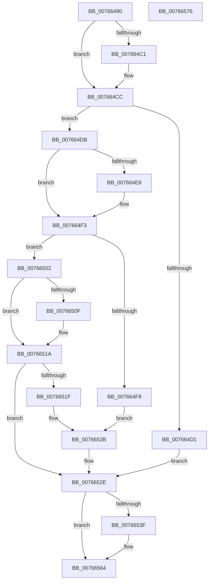

# PopPolicyDeviceTargetChange

- RVA: `0x00766490`–`0x00766577` (길이 `231` bytes)
- VA: `0x0000000140766490`
- 실행 섹션: `PAGE`
- PDB 이름 있음: `예`; PDB Function 태그: `아니요`
- unwind 정보 RVA: `0x00060BC4`
- 디코드: `60`개 명령, `231/231` bytes 표시
- 미해석 바이트: `0` (있으면 어셈블리에 `.byte`로 보존)

> 이 문서는 커널 이미지의 기계어와 PDB 기호를 분석해 생성했습니다. 4번과 5번은 함수 원형과 자료형을 바이너리 사용 방식에서 추정한 C 해석이며 원본 소스 복구 결과는 아닙니다.

## 1. Dependencies

- 직접 호출 지점: **7**; 고유 호출 대상: **6**
- 직접 호출자로 확인된 함수: **0**
- RIP 상대 이미지 참조: **8**

### Outgoing calls
- `0x007664AF` → [PopAcquireRwLockExclusive](../../text/43/PopAcquireRwLockExclusive_function_00430B44.md) (function, `0x00430B44`)
- `0x007664D4` → [PopPolicyDeviceRemove](PopPolicyDeviceRemove_function_00766414.md) (function, `0x00766414`)
- `0x007664FB` → [PopPolicyDeviceRemove](PopPolicyDeviceRemove_function_00766414.md) (function, `0x00766414`)
- `0x00766526` → [PopConnectToPolicyDevice](PopConnectToPolicyDevice_function_00765D20.md) (function, `0x00765D20`)
- `0x00766535` → [PopReleaseRwLock](../../text/2D/PopReleaseRwLock_function_002DFBBC.md) (function, `0x002DFBBC`)
- `0x00766545` → [PnpUnregisterPlugPlayNotification](../../text/47/PnpUnregisterPlugPlayNotification_function_0047AFAC.md) (function, `0x0047AFAC`)
- `0x0076655F` → [ExFreePoolWithTag](../../poolcode/B8/ExFreePoolWithTag_function_00B82870.md) (function, `0x00B82870`)

### Direct callers
- 이 함수 시작 RVA로 연결되는 직접 call은 확인되지 않았습니다. 간접 호출은 완전히 역산할 수 없습니다.

### Static image references
- `0x007664A5` → RVA `0x00F0C900` (`.data`; read)
- `0x007664B8` → RVA `0x0001A210` (`.rdata`; read)
- `0x007664C5` → RVA `0x0001A218` (`.rdata`; read)
- `0x007664DF` → RVA `0x0001A220` (`.rdata`; read)
- `0x007664EC` → RVA `0x0001A228` (`.rdata`; read)
- `0x00766506` → RVA `0x00012320` (`.rdata`; read)
- `0x00766513` → RVA `0x00012328` (`.rdata`; read)
- `0x0076654E` → RVA `0x00E01AE4` (`.data`; read)

## 2. Other-region calls and transfers

- 다른 실행 섹션으로 향하는 call: **4**
  - `0x007664AF` → [PopAcquireRwLockExclusive](../../text/43/PopAcquireRwLockExclusive_function_00430B44.md) (`PAGE` → `.text`)
  - `0x00766535` → [PopReleaseRwLock](../../text/2D/PopReleaseRwLock_function_002DFBBC.md) (`PAGE` → `.text`)
  - `0x00766545` → [PnpUnregisterPlugPlayNotification](../../text/47/PnpUnregisterPlugPlayNotification_function_0047AFAC.md) (`PAGE` → `.text`)
  - `0x0076655F` → [ExFreePoolWithTag](../../poolcode/B8/ExFreePoolWithTag_function_00B82870.md) (`PAGE` → `POOLCODE`)
- 별도 외부 분기/꼬리 이동을 확인하지 못했습니다.

## 3. Assembly (complete function range)

```asm
00766490  48 89 5C 24 08                  mov qword ptr [rsp + 8], rbx
00766495  48 89 74 24 10                  mov qword ptr [rsp + 0x10], rsi
0076649A  57                              push rdi
0076649B  48 83 EC 20                     sub rsp, 0x20
0076649F  48 8B F9                        mov rdi, rcx
007664A2  48 8B DA                        mov rbx, rdx
007664A5  48 8D 0D 54 64 7A 00            lea rcx, [rip + 0x7a6454]
007664AC  40 32 F6                        xor sil, sil
007664AF  E8 90 A6 CC FF                  call 0x140430b44
007664B4  48 8B 47 04                     mov rax, qword ptr [rdi + 4]
007664B8  48 2B 05 51 3D 8B FF            sub rax, qword ptr [rip - 0x74c2af]
007664BF  75 0B                           jne 0x1407664cc
007664C1  48 8B 47 0C                     mov rax, qword ptr [rdi + 0xc]
007664C5  48 2B 05 4C 3D 8B FF            sub rax, qword ptr [rip - 0x74c2b4]
007664CC  48 85 C0                        test rax, rax
007664CF  75 0A                           jne 0x1407664db
007664D1  48 8B CB                        mov rcx, rbx
007664D4  E8 3B FF FF FF                  call 0x140766414
007664D9  EB 53                           jmp 0x14076652e
007664DB  48 8B 47 04                     mov rax, qword ptr [rdi + 4]
007664DF  48 2B 05 3A 3D 8B FF            sub rax, qword ptr [rip - 0x74c2c6]
007664E6  75 0B                           jne 0x1407664f3
007664E8  48 8B 47 0C                     mov rax, qword ptr [rdi + 0xc]
007664EC  48 2B 05 35 3D 8B FF            sub rax, qword ptr [rip - 0x74c2cb]
007664F3  48 85 C0                        test rax, rax
007664F6  75 0A                           jne 0x140766502
007664F8  48 8B CB                        mov rcx, rbx
007664FB  E8 14 FF FF FF                  call 0x140766414
00766500  EB 29                           jmp 0x14076652b
00766502  48 8B 47 04                     mov rax, qword ptr [rdi + 4]
00766506  48 2B 05 13 BE 8A FF            sub rax, qword ptr [rip - 0x7541ed]
0076650D  75 0B                           jne 0x14076651a
0076650F  48 8B 47 0C                     mov rax, qword ptr [rdi + 0xc]
00766513  48 2B 05 0E BE 8A FF            sub rax, qword ptr [rip - 0x7541f2]
0076651A  48 85 C0                        test rax, rax
0076651D  75 0F                           jne 0x14076652e
0076651F  8B 4B 10                        mov ecx, dword ptr [rbx + 0x10]
00766522  48 8D 53 20                     lea rdx, [rbx + 0x20]
00766526  E8 F5 F7 FF FF                  call 0x140765d20
0076652B  40 B6 01                        mov sil, 1
0076652E  48 8D 0D CB 63 7A 00            lea rcx, [rip + 0x7a63cb]
00766535  E8 82 96 B7 FF                  call 0x1402dfbbc
0076653A  40 84 F6                        test sil, sil
0076653D  74 25                           je 0x140766564
0076653F  48 8B 4B 18                     mov rcx, qword ptr [rbx + 0x18]
00766543  B2 01                           mov dl, 1
00766545  E8 62 4A D1 FF                  call 0x14047afac
0076654A  48 63 53 10                     movsxd rdx, dword ptr [rbx + 0x10]
0076654E  48 8D 05 8F B5 69 00            lea rax, [rip + 0x69b58f]
00766555  48 C1 E2 05                     shl rdx, 5
00766559  48 8B CB                        mov rcx, rbx
0076655C  8B 14 02                        mov edx, dword ptr [rdx + rax]
0076655F  E8 0C C3 41 00                  call 0x140b82870
00766564  48 8B 5C 24 30                  mov rbx, qword ptr [rsp + 0x30]
00766569  33 C0                           xor eax, eax
0076656B  48 8B 74 24 38                  mov rsi, qword ptr [rsp + 0x38]
00766570  48 83 C4 20                     add rsp, 0x20
00766574  5F                              pop rdi
00766575  C3                              ret
00766576  CC                              int3
```

## 4. C-style interpretation (structured pseudocode)

```c
__int64 __fastcall PopPolicyDeviceTargetChange(__int64 a1, __int64 a2)
{
    __int64 result;
    __int64 v_rsi;
    __int64 v_rsp;
    unsigned __int64 v_stack_p10;
    unsigned __int64 v_stack_p8;

    v_stack_p8 = v_rbx;
    v_stack_p10 = v_rsi;
    v_rsp = (v_rsp) - (32);
    v_rsi = 0;
    result = PopAcquireRwLockExclusive(v_rip + 8021076, a2, a3, a4);
    result = (*(unsigned __int64 *)(a1 + 4)) - (*(unsigned __int64 *)(v_rip - 7652015));
    if (!(condition_is_not_equal)) {
        result = *(unsigned __int64 *)(a1 + 12);
        result = (result) - (*(unsigned __int64 *)(v_rip - 7652020));
    }
    if (result != 0) goto loc_007664DB;
    result = PopPolicyDeviceRemove(a2, a2, a3, a4);
    goto loc_0076652E;
loc_007664DB:
    result = (*(unsigned __int64 *)(a1 + 4)) - (*(unsigned __int64 *)(v_rip - 7652038));
    if (!(condition_is_not_equal)) {
        result = *(unsigned __int64 *)(a1 + 12);
        result = (result) - (*(unsigned __int64 *)(v_rip - 7652043));
    }
    if (result != 0) goto loc_00766502;
    result = PopPolicyDeviceRemove(a2, a2, a3, a4);
    goto loc_0076652B;
loc_00766502:
    result = (*(unsigned __int64 *)(a1 + 4)) - (*(unsigned __int64 *)(v_rip - 7684589));
    if (!(condition_is_not_equal)) {
        result = *(unsigned __int64 *)(a1 + 12);
        result = (result) - (*(unsigned __int64 *)(v_rip - 7684594));
    }
    if (result != 0) goto loc_0076652E;
    result = PopConnectToPolicyDevice((unsigned int)(*(unsigned int *)(a2 + 16)), a2 + 32, a3, a4);
loc_0076652B:
loc_0076652E:
    result = PopReleaseRwLock(v_rip + 8020939, a2 + 32, a3, a4);
    if (1 != 0) {
        a1 = *(unsigned __int64 *)(a2 + 24);
        a2 = 1;
        result = PnpUnregisterPlugPlayNotification(a1, a2, a3, a4);
        a2 = (int)(*(unsigned int *)(a2 + 16));
        result = v_rip + 6927759;
        a2 = (a2) << (5);
        a1 = a2;
        a2 = *(unsigned int *)(a2 + result * 1);
        result = ExFreePoolWithTag(a1, a2, a3, a4);
    }
    result = 0;
    v_rsp = (v_rsp) + (32);
    return result;
}
```

## 5. (Beta) C Style

```c
int64_t PopPolicyDeviceTargetChange(void *Arg1, void *Arg2)
{
    uint8_t *arg1 = (uint8_t *)Arg1;
    uint8_t *arg2 = (uint8_t *)Arg2;

    int64_t result;
    int64_t local_rsi;
    int64_t local_rsp;
    uint64_t v_stack_p10;
    uint64_t v_stack_p8;

    v_stack_p8 = local_rbx;
    v_stack_p10 = local_rsi;
    local_rsp = (local_rsp) - (32);
    local_rsi = 0;
    result = PopAcquireRwLockExclusive(v_rip + 8021076, Arg2, a3, a4);
    result = (*(uint64_t *)(arg1 + 0x4)) - (*(uint64_t *)(v_rip - 0x74C2AF));
    if (!(condition_is_not_equal)) {
        result = *(uint64_t *)(arg1 + 0xC);
        result = (result) - (*(uint64_t *)(v_rip - 0x74C2B4));
    }
    if (result != 0) goto loc_007664DB;
    result = PopPolicyDeviceRemove(Arg2, Arg2, a3, a4);
    goto loc_0076652E;
loc_007664DB:
    result = (*(uint64_t *)(arg1 + 0x4)) - (*(uint64_t *)(v_rip - 0x74C2C6));
    if (!(condition_is_not_equal)) {
        result = *(uint64_t *)(arg1 + 0xC);
        result = (result) - (*(uint64_t *)(v_rip - 0x74C2CB));
    }
    if (result != 0) goto loc_00766502;
    result = PopPolicyDeviceRemove(Arg2, Arg2, a3, a4);
    goto loc_0076652B;
loc_00766502:
    result = (*(uint64_t *)(arg1 + 0x4)) - (*(uint64_t *)(v_rip - 0x7541ED));
    if (!(condition_is_not_equal)) {
        result = *(uint64_t *)(arg1 + 0xC);
        result = (result) - (*(uint64_t *)(v_rip - 0x7541F2));
    }
    if (result != 0) goto loc_0076652E;
    result = PopConnectToPolicyDevice((uint32_t)(*(uint32_t *)(arg2 + 0x10)), Arg2 + 32, a3, a4);
loc_0076652B:
loc_0076652E:
    result = PopReleaseRwLock(v_rip + 8020939, Arg2 + 32, a3, a4);
    if (1 != 0) {
        Arg1 = *(uint64_t *)(arg2 + 0x18);
        Arg2 = 1;
        result = PnpUnregisterPlugPlayNotification(Arg1, Arg2, a3, a4);
        Arg2 = (int32_t)(*(uint32_t *)(arg2 + 0x10));
        result = v_rip + 6927759;
        Arg2 = (Arg2) << (5);
        Arg1 = Arg2;
        Arg2 = *(uint32_t *)(arg2 + result * 1);
        result = ExFreePoolWithTag(Arg1, Arg2, a3, a4);
    }
    result = 0;
    local_rsp = (local_rsp) + (32);
    return result;
}
```

### 관측된 메모리 오프셋

구조체 형식이 확인되지 않은 접근은 인자 기준의 오프셋으로만 기록했습니다.

| 기준 인자 | 오프셋 표현 | 폭 (bit) | 접근 |
|---|---:|---:|---|
| `Arg1` | `+ 0x4` | `64` | `R` |
| `Arg1` | `+ 0xC` | `64` | `R` |
| `Arg2` | `+ 0x10` | `32` | `R` |
| `Arg2` | `+ 0x18` | `64` | `R` |
| `Arg2` | `+ 0x20` | `64` | `R` |

## 6. Execution-region graph

[열기: 2D/3D 그래프와 함수 탐색 컨트롤 패널](../../../control-panel.html?section=page&rva=0x00766490&view=graph)

- 2D 그래프는 위에서 아래로 흐르고, 3D 그래프는 빈 공간을 드래그해 회전합니다. Shift+드래그는 이동, 휠은 확대·축소, 함수 노드 선택은 대상 보고서 이동입니다.

### Static fallback


