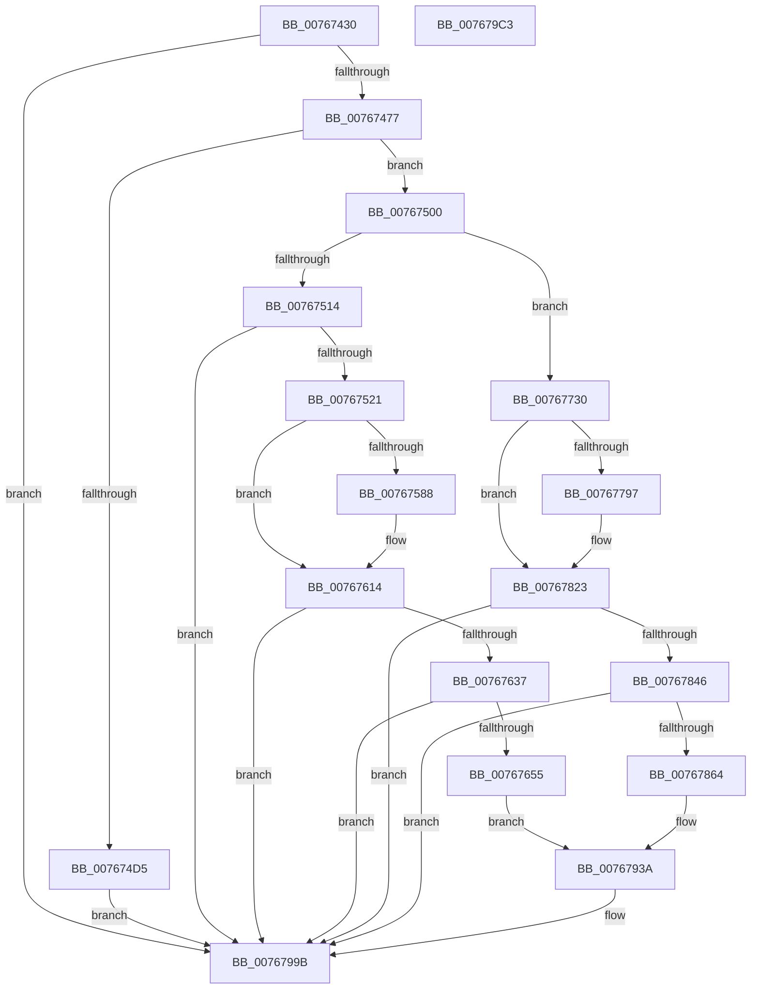

# PopPowerAdapterAdd

- RVA: `0x00767430`–`0x007679C4` (길이 `1,428` bytes)
- VA: `0x0000000140767430`
- 실행 섹션: `PAGE`
- PDB 이름 있음: `예`; PDB Function 태그: `아니요`
- unwind 정보 RVA: `0x000CCFF4`
- 디코드: `291`개 명령, `1,428/1,428` bytes 표시
- 미해석 바이트: `0` (있으면 어셈블리에 `.byte`로 보존)

> 이 문서는 커널 이미지의 기계어와 PDB 기호를 분석해 생성했습니다. 4번과 5번은 함수 원형과 자료형을 바이너리 사용 방식에서 추정한 C 해석이며 원본 소스 복구 결과는 아닙니다.

## 1. Dependencies

- 직접 호출 지점: **21**; 고유 호출 대상: **13**
- 직접 호출자로 확인된 함수: **0**
- RIP 상대 이미지 참조: **13**

### Outgoing calls
- `0x00767484` → [KeInitializeEvent](../../text/40/KeInitializeEvent_function_0040DD10.md) (function, `0x0040DD10`)
- `0x007674BF` → [PopPrepareIoctl](../A7/PopPrepareIoctl_function_00A74A98.md) (function, `0x00A74A98`)
- `0x007674CC` → [IoSynchronousCallDriver](../../text/48/IoSynchronousCallDriver_function_00484050.md) (function, `0x00484050`)
- `0x007674F6` → [PopPowerAdapterTraceFailure](PopPowerAdapterTraceFailure_function_007682B8.md) (function, `0x007682B8`)
- `0x00767507` → [Feature_Servicing_BatteryTestExempt__private_IsEnabledDeviceUsageNoInline](../../text/5D/Feature_Servicing_BatteryTestExempt__private_IsEnabledDeviceUsageNoInline_function_005D12D8.md) (function, `0x005D12D8`)
- `0x00767528` → [PopAcquireRwLockExclusive](../../text/43/PopAcquireRwLockExclusive_function_00430B44.md) (function, `0x00430B44`)
- `0x00767574` → [ZwUpdateWnfStateData](../../text/6B/ZwUpdateWnfStateData_function_006B0D10.md) (function, `0x006B0D10`)
- `0x0076760F` → [tlgWriteTransfer_EtwWriteTransfer](../../text/42/tlgWriteTransfer_EtwWriteTransfer_function_004260E0.md) (function, `0x004260E0`)
- `0x00767619` → [PopPowerAdapterQueryStatus](PopPowerAdapterQueryStatus_function_00767C44.md) (function, `0x00767C44`)
- `0x00767625` → [PopReleaseRwLock](../../text/2D/PopReleaseRwLock_function_002DFBBC.md) (function, `0x002DFBBC`)
- `0x00767648` → [tlgKeywordOn](../../text/42/tlgKeywordOn_function_0042EAA0.md) (function, `0x0042EAA0`)
- `0x0076768B` → [tlgCreate1Sz_char](../../text/42/tlgCreate1Sz_char_function_00427304.md) (function, `0x00427304`)
- `0x00767737` → [PopAcquireRwLockExclusive](../../text/43/PopAcquireRwLockExclusive_function_00430B44.md) (function, `0x00430B44`)
- `0x00767783` → [ZwUpdateWnfStateData](../../text/6B/ZwUpdateWnfStateData_function_006B0D10.md) (function, `0x006B0D10`)
- `0x0076781E` → [tlgWriteTransfer_EtwWriteTransfer](../../text/42/tlgWriteTransfer_EtwWriteTransfer_function_004260E0.md) (function, `0x004260E0`)
- `0x00767828` → [PopPowerAdapterQueryStatus](PopPowerAdapterQueryStatus_function_00767C44.md) (function, `0x00767C44`)
- `0x00767834` → [PopReleaseRwLock](../../text/2D/PopReleaseRwLock_function_002DFBBC.md) (function, `0x002DFBBC`)
- `0x00767857` → [tlgKeywordOn](../../text/42/tlgKeywordOn_function_0042EAA0.md) (function, `0x0042EAA0`)
- `0x0076789A` → [tlgCreate1Sz_char](../../text/42/tlgCreate1Sz_char_function_00427304.md) (function, `0x00427304`)
- `0x00767996` → [tlgWriteTransfer_EtwWriteTransfer](../../text/42/tlgWriteTransfer_EtwWriteTransfer_function_004260E0.md) (function, `0x004260E0`)
- `0x007679A5` → [_security_check_cookie](../../text/6A/_security_check_cookie_function_006AC640.md) (function, `0x006AC640`)

### Direct callers
- 이 함수 시작 RVA로 연결되는 직접 call은 확인되지 않았습니다. 간접 호출은 완전히 역산할 수 없습니다.

### Static image references
- `0x0076744E` → RVA `0x00E0A740` (`.data`; read)
- `0x00767465` → RVA `0x00F0C2D8` (`.data`; read)
- `0x00767514` → RVA `0x00E678AC` (`.data`; read)
- `0x00767521` → RVA `0x00F0C020` (`.data`; read)
- `0x0076752D` → RVA `0x00F0C2D8` (`.data`; write)
- `0x0076753F` → RVA `0x00020A10` (`.rdata`; read)
- `0x00767579` → RVA `0x00E07748` (`.data`; read)
- `0x007675E2` → RVA `0x0004E2E2` (`.rdata`; read)
- `0x0076765B` → RVA `0x00B02500` (` ?? ::NNGAKEGL::`string'`; read)
- `0x00767680` → RVA `0x00B028B0` (` ?? ::NNGAKEGL::`string'`; read)
- `0x0076769F` → RVA `0x0004E1C0` (`.rdata`; read)
- `0x007677F1` → RVA `0x0004E275` (`.rdata`; read)
- `0x007678AE` → RVA `0x0004E10B` (`.rdata`; read)

## 2. Other-region calls and transfers

- 다른 실행 섹션으로 향하는 call: **17**
  - `0x00767484` → [KeInitializeEvent](../../text/40/KeInitializeEvent_function_0040DD10.md) (`PAGE` → `.text`)
  - `0x007674CC` → [IoSynchronousCallDriver](../../text/48/IoSynchronousCallDriver_function_00484050.md) (`PAGE` → `.text`)
  - `0x00767507` → [Feature_Servicing_BatteryTestExempt__private_IsEnabledDeviceUsageNoInline](../../text/5D/Feature_Servicing_BatteryTestExempt__private_IsEnabledDeviceUsageNoInline_function_005D12D8.md) (`PAGE` → `.text`)
  - `0x00767528` → [PopAcquireRwLockExclusive](../../text/43/PopAcquireRwLockExclusive_function_00430B44.md) (`PAGE` → `.text`)
  - `0x00767574` → [ZwUpdateWnfStateData](../../text/6B/ZwUpdateWnfStateData_function_006B0D10.md) (`PAGE` → `.text`)
  - `0x0076760F` → [tlgWriteTransfer_EtwWriteTransfer](../../text/42/tlgWriteTransfer_EtwWriteTransfer_function_004260E0.md) (`PAGE` → `.text`)
  - `0x00767625` → [PopReleaseRwLock](../../text/2D/PopReleaseRwLock_function_002DFBBC.md) (`PAGE` → `.text`)
  - `0x00767648` → [tlgKeywordOn](../../text/42/tlgKeywordOn_function_0042EAA0.md) (`PAGE` → `.text`)
  - `0x0076768B` → [tlgCreate1Sz_char](../../text/42/tlgCreate1Sz_char_function_00427304.md) (`PAGE` → `.text`)
  - `0x00767737` → [PopAcquireRwLockExclusive](../../text/43/PopAcquireRwLockExclusive_function_00430B44.md) (`PAGE` → `.text`)
  - `0x00767783` → [ZwUpdateWnfStateData](../../text/6B/ZwUpdateWnfStateData_function_006B0D10.md) (`PAGE` → `.text`)
  - `0x0076781E` → [tlgWriteTransfer_EtwWriteTransfer](../../text/42/tlgWriteTransfer_EtwWriteTransfer_function_004260E0.md) (`PAGE` → `.text`)
  - `0x00767834` → [PopReleaseRwLock](../../text/2D/PopReleaseRwLock_function_002DFBBC.md) (`PAGE` → `.text`)
  - `0x00767857` → [tlgKeywordOn](../../text/42/tlgKeywordOn_function_0042EAA0.md) (`PAGE` → `.text`)
  - `0x0076789A` → [tlgCreate1Sz_char](../../text/42/tlgCreate1Sz_char_function_00427304.md) (`PAGE` → `.text`)
  - `0x00767996` → [tlgWriteTransfer_EtwWriteTransfer](../../text/42/tlgWriteTransfer_EtwWriteTransfer_function_004260E0.md) (`PAGE` → `.text`)
  - `0x007679A5` → [_security_check_cookie](../../text/6A/_security_check_cookie_function_006AC640.md) (`PAGE` → `.text`)
- 별도 외부 분기/꼬리 이동을 확인하지 못했습니다.

## 3. Assembly (complete function range)

```asm
00767430  48 89 5C 24 10                  mov qword ptr [rsp + 0x10], rbx
00767435  48 89 7C 24 18                  mov qword ptr [rsp + 0x18], rdi
0076743A  55                              push rbp
0076743B  41 56                           push r14
0076743D  41 57                           push r15
0076743F  48 8D AC 24 40 FF FF FF         lea rbp, [rsp - 0xc0]
00767447  48 81 EC C0 01 00 00            sub rsp, 0x1c0
0076744E  48 8B 05 EB 32 6A 00            mov rax, qword ptr [rip + 0x6a32eb]
00767455  48 33 C4                        xor rax, rsp
00767458  48 89 85 B0 00 00 00            mov qword ptr [rbp + 0xb0], rax
0076745F  45 33 F6                        xor r14d, r14d
00767462  48 8B D9                        mov rbx, rcx
00767465  4C 39 35 6C 4E 7A 00            cmp qword ptr [rip + 0x7a4e6c], r14
0076746C  44 89 74 24 44                  mov dword ptr [rsp + 0x44], r14d
00767471  0F 85 24 05 00 00               jne 0x14076799b
00767477  45 8D 7E 01                     lea r15d, [r14 + 1]
0076747B  48 83 C1 68                     add rcx, 0x68
0076747F  45 8A C7                        mov r8b, r15b
00767482  33 D2                           xor edx, edx
00767484  E8 87 68 CA FF                  call 0x14040dd10
00767489  4C 8D 8B 84 00 00 00            lea r9, [rbx + 0x84]
00767490  C7 44 24 28 2C 00 00 00         mov dword ptr [rsp + 0x28], 0x2c
00767498  0F 57 C0                        xorps xmm0, xmm0
0076749B  44 89 74 24 20                  mov dword ptr [rsp + 0x20], r14d
007674A0  41 0F 11 01                     movups xmmword ptr [r9], xmm0
007674A4  33 C0                           xor eax, eax
007674A6  45 33 C0                        xor r8d, r8d
007674A9  41 0F 11 41 10                  movups xmmword ptr [r9 + 0x10], xmm0
007674AE  49 89 41 20                     mov qword ptr [r9 + 0x20], rax
007674B2  BA 70 40 29 00                  mov edx, 0x294070
007674B7  41 89 41 28                     mov dword ptr [r9 + 0x28], eax
007674BB  48 8B 4B 38                     mov rcx, qword ptr [rbx + 0x38]
007674BF  E8 D4 D5 30 00                  call 0x140a74a98
007674C4  48 8B 53 38                     mov rdx, qword ptr [rbx + 0x38]
007674C8  48 8B 4B 30                     mov rcx, qword ptr [rbx + 0x30]
007674CC  E8 7F CB D1 FF                  call 0x140484050
007674D1  85 C0                           test eax, eax
007674D3  79 2B                           jns 0x140767500
007674D5  44 8B C0                        mov r8d, eax
007674D8  C7 83 80 00 00 00 02 00 00 00   mov dword ptr [rbx + 0x80], 2
007674E2  41 8B D7                        mov edx, r15d
007674E5  44 89 BB DC 00 00 00            mov dword ptr [rbx + 0xdc], r15d
007674EC  48 8B CB                        mov rcx, rbx
007674EF  44 89 B3 E4 00 00 00            mov dword ptr [rbx + 0xe4], r14d
007674F6  E8 BD 0D 00 00                  call 0x1407682b8
007674FB  E9 9B 04 00 00                  jmp 0x14076799b
00767500  44 89 BB 80 00 00 00            mov dword ptr [rbx + 0x80], r15d
00767507  E8 CC 9D E6 FF                  call 0x1405d12d8
0076750C  85 C0                           test eax, eax
0076750E  0F 84 1C 02 00 00               je 0x140767730
00767514  44 39 35 91 03 70 00            cmp dword ptr [rip + 0x700391], r14d
0076751B  0F 85 7A 04 00 00               jne 0x14076799b
00767521  48 8D 0D F8 4A 7A 00            lea rcx, [rip + 0x7a4af8]
00767528  E8 17 96 CC FF                  call 0x140430b44
0076752D  48 89 1D A4 4D 7A 00            mov qword ptr [rip + 0x7a4da4], rbx
00767534  48 8D 54 24 44                  lea rdx, [rsp + 0x44]
00767539  8A 83 8C 00 00 00               mov al, byte ptr [rbx + 0x8c]
0076753F  48 8D 0D CA 94 8B FF            lea rcx, [rip - 0x746b36]
00767546  45 33 C9                        xor r9d, r9d
00767549  44 89 74 24 30                  mov dword ptr [rsp + 0x30], r14d
0076754E  41 22 C7                        and al, r15b
00767551  44 89 74 24 28                  mov dword ptr [rsp + 0x28], r14d
00767556  44 88 B3 D8 00 00 00            mov byte ptr [rbx + 0xd8], r14b
0076755D  88 44 24 46                     mov byte ptr [rsp + 0x46], al
00767561  41 8D 79 04                     lea edi, [r9 + 4]
00767565  66 C7 44 24 44 00 01            mov word ptr [rsp + 0x44], 0x100
0076756C  44 8B C7                        mov r8d, edi
0076756F  4C 89 74 24 20                  mov qword ptr [rsp + 0x20], r14
00767574  E8 97 97 F4 FF                  call 0x1406b0d10
00767579  83 3D C8 01 6A 00 05            cmp dword ptr [rip + 0x6a01c8], 5
00767580  8B D0                           mov edx, eax
00767582  0F 86 8C 00 00 00               jbe 0x140767614
00767588  8A 4C 24 44                     mov cl, byte ptr [rsp + 0x44]
0076758C  48 8D 44 24 40                  lea rax, [rsp + 0x40]
00767591  48 89 45 70                     mov qword ptr [rbp + 0x70], rax
00767595  45 33 C9                        xor r9d, r9d
00767598  48 8D 44 24 41                  lea rax, [rsp + 0x41]
0076759D  88 4C 24 40                     mov byte ptr [rsp + 0x40], cl
007675A1  8A 4C 24 45                     mov cl, byte ptr [rsp + 0x45]
007675A5  45 33 C0                        xor r8d, r8d
007675A8  48 89 85 80 00 00 00            mov qword ptr [rbp + 0x80], rax
007675AF  8A 44 24 46                     mov al, byte ptr [rsp + 0x46]
007675B3  88 44 24 42                     mov byte ptr [rsp + 0x42], al
007675B7  48 8D 44 24 42                  lea rax, [rsp + 0x42]
007675BC  48 89 85 90 00 00 00            mov qword ptr [rbp + 0x90], rax
007675C3  48 8D 44 24 48                  lea rax, [rsp + 0x48]
007675C8  48 89 85 A0 00 00 00            mov qword ptr [rbp + 0xa0], rax
007675CF  48 8D 45 50                     lea rax, [rbp + 0x50]
007675D3  88 4C 24 41                     mov byte ptr [rsp + 0x41], cl
007675D7  48 8D 0D 6A 01 6A 00            lea rcx, [rip + 0x6a016a]
007675DE  89 54 24 48                     mov dword ptr [rsp + 0x48], edx
007675E2  48 8D 15 F9 6C 8E FF            lea rdx, [rip - 0x719307]
007675E9  48 89 44 24 28                  mov qword ptr [rsp + 0x28], rax
007675EE  C7 44 24 20 06 00 00 00         mov dword ptr [rsp + 0x20], 6
007675F6  4C 89 7D 78                     mov qword ptr [rbp + 0x78], r15
007675FA  4C 89 BD 88 00 00 00            mov qword ptr [rbp + 0x88], r15
00767601  4C 89 BD 98 00 00 00            mov qword ptr [rbp + 0x98], r15
00767608  48 89 BD A8 00 00 00            mov qword ptr [rbp + 0xa8], rdi
0076760F  E8 CC EA CB FF                  call 0x1404260e0
00767614  33 D2                           xor edx, edx
00767616  48 8B CB                        mov rcx, rbx
00767619  E8 26 06 00 00                  call 0x140767c44
0076761E  48 8D 0D FB 49 7A 00            lea rcx, [rip + 0x7a49fb]
00767625  E8 92 85 B7 FF                  call 0x1402dfbbc
0076762A  83 3D 17 01 6A 00 05            cmp dword ptr [rip + 0x6a0117], 5
00767631  0F 86 64 03 00 00               jbe 0x14076799b
00767637  48 BA 00 00 00 00 00 40 00 00   movabs rdx, 0x400000000000
00767641  48 8D 0D 00 01 6A 00            lea rcx, [rip + 0x6a0100]
00767648  E8 53 74 CC FF                  call 0x14042eaa0
0076764D  84 C0                           test al, al
0076764F  0F 84 46 03 00 00               je 0x14076799b
00767655  8B 83 88 00 00 00               mov eax, dword ptr [rbx + 0x88]
0076765B  48 8D 15 9E AE 39 00            lea rdx, [rip + 0x39ae9e]
00767662  89 44 24 48                     mov dword ptr [rsp + 0x48], eax
00767666  48 8D 4D B0                     lea rcx, [rbp - 0x50]
0076766A  48 8D 44 24 48                  lea rax, [rsp + 0x48]
0076766F  48 89 7D A8                     mov qword ptr [rbp - 0x58], rdi
00767673  48 89 45 A0                     mov qword ptr [rbp - 0x60], rax
00767677  8B 83 8C 00 00 00               mov eax, dword ptr [rbx + 0x8c]
0076767D  41 84 C7                        test r15b, al
00767680  48 8D 05 29 B2 39 00            lea rax, [rip + 0x39b229]
00767687  48 0F 44 D0                     cmove rdx, rax
0076768B  E8 74 FC CB FF                  call 0x140427304
00767690  8B 8B 90 00 00 00               mov ecx, dword ptr [rbx + 0x90]
00767696  48 8D 44 24 50                  lea rax, [rsp + 0x50]
0076769B  48 89 45 C0                     mov qword ptr [rbp - 0x40], rax
0076769F  48 8D 15 1A 6B 8E FF            lea rdx, [rip - 0x7194e6]
007676A6  8B 83 94 00 00 00               mov eax, dword ptr [rbx + 0x94]
007676AC  89 44 24 54                     mov dword ptr [rsp + 0x54], eax
007676B0  48 8D 44 24 54                  lea rax, [rsp + 0x54]
007676B5  48 89 45 D0                     mov qword ptr [rbp - 0x30], rax
007676B9  8B 83 98 00 00 00               mov eax, dword ptr [rbx + 0x98]
007676BF  89 44 24 58                     mov dword ptr [rsp + 0x58], eax
007676C3  48 8D 44 24 58                  lea rax, [rsp + 0x58]
007676C8  48 89 45 E0                     mov qword ptr [rbp - 0x20], rax
007676CC  8B 83 9C 00 00 00               mov eax, dword ptr [rbx + 0x9c]
007676D2  89 44 24 5C                     mov dword ptr [rsp + 0x5c], eax
007676D6  48 8D 44 24 5C                  lea rax, [rsp + 0x5c]
007676DB  48 89 45 F0                     mov qword ptr [rbp - 0x10], rax
007676DF  8B 83 A0 00 00 00               mov eax, dword ptr [rbx + 0xa0]
007676E5  89 44 24 60                     mov dword ptr [rsp + 0x60], eax
007676E9  48 8D 44 24 60                  lea rax, [rsp + 0x60]
007676EE  48 89 45 00                     mov qword ptr [rbp], rax
007676F2  8B 83 A4 00 00 00               mov eax, dword ptr [rbx + 0xa4]
007676F8  89 44 24 64                     mov dword ptr [rsp + 0x64], eax
007676FC  48 8D 44 24 64                  lea rax, [rsp + 0x64]
00767701  48 89 45 10                     mov qword ptr [rbp + 0x10], rax
00767705  8B 83 A8 00 00 00               mov eax, dword ptr [rbx + 0xa8]
0076770B  89 44 24 68                     mov dword ptr [rsp + 0x68], eax
0076770F  48 8D 44 24 68                  lea rax, [rsp + 0x68]
00767714  48 89 45 20                     mov qword ptr [rbp + 0x20], rax
00767718  8B 83 AC 00 00 00               mov eax, dword ptr [rbx + 0xac]
0076771E  89 44 24 4C                     mov dword ptr [rsp + 0x4c], eax
00767722  48 8D 44 24 4C                  lea rax, [rsp + 0x4c]
00767727  89 4C 24 50                     mov dword ptr [rsp + 0x50], ecx
0076772B  E9 0A 02 00 00                  jmp 0x14076793a
00767730  48 8D 0D E9 48 7A 00            lea rcx, [rip + 0x7a48e9]
00767737  E8 08 94 CC FF                  call 0x140430b44
0076773C  48 89 1D 95 4B 7A 00            mov qword ptr [rip + 0x7a4b95], rbx
00767743  48 8D 54 24 44                  lea rdx, [rsp + 0x44]
00767748  8A 83 8C 00 00 00               mov al, byte ptr [rbx + 0x8c]
0076774E  48 8D 0D BB 92 8B FF            lea rcx, [rip - 0x746d45]
00767755  45 33 C9                        xor r9d, r9d
00767758  44 89 74 24 30                  mov dword ptr [rsp + 0x30], r14d
0076775D  41 22 C7                        and al, r15b
00767760  44 89 74 24 28                  mov dword ptr [rsp + 0x28], r14d
00767765  44 88 B3 D8 00 00 00            mov byte ptr [rbx + 0xd8], r14b
0076776C  88 44 24 46                     mov byte ptr [rsp + 0x46], al
00767770  41 8D 79 04                     lea edi, [r9 + 4]
00767774  66 C7 44 24 44 00 01            mov word ptr [rsp + 0x44], 0x100
0076777B  44 8B C7                        mov r8d, edi
0076777E  4C 89 74 24 20                  mov qword ptr [rsp + 0x20], r14
00767783  E8 88 95 F4 FF                  call 0x1406b0d10
00767788  83 3D B9 FF 69 00 05            cmp dword ptr [rip + 0x69ffb9], 5
0076778F  8B D0                           mov edx, eax
00767791  0F 86 8C 00 00 00               jbe 0x140767823
00767797  8A 4C 24 44                     mov cl, byte ptr [rsp + 0x44]
0076779B  48 8D 44 24 42                  lea rax, [rsp + 0x42]
007677A0  48 89 45 70                     mov qword ptr [rbp + 0x70], rax
007677A4  45 33 C9                        xor r9d, r9d
007677A7  48 8D 44 24 41                  lea rax, [rsp + 0x41]
007677AC  88 4C 24 42                     mov byte ptr [rsp + 0x42], cl
007677B0  8A 4C 24 45                     mov cl, byte ptr [rsp + 0x45]
007677B4  45 33 C0                        xor r8d, r8d
007677B7  48 89 85 80 00 00 00            mov qword ptr [rbp + 0x80], rax
007677BE  8A 44 24 46                     mov al, byte ptr [rsp + 0x46]
007677C2  88 44 24 40                     mov byte ptr [rsp + 0x40], al
007677C6  48 8D 44 24 40                  lea rax, [rsp + 0x40]
007677CB  48 89 85 90 00 00 00            mov qword ptr [rbp + 0x90], rax
007677D2  48 8D 44 24 4C                  lea rax, [rsp + 0x4c]
007677D7  48 89 85 A0 00 00 00            mov qword ptr [rbp + 0xa0], rax
007677DE  48 8D 45 50                     lea rax, [rbp + 0x50]
007677E2  88 4C 24 41                     mov byte ptr [rsp + 0x41], cl
007677E6  48 8D 0D 5B FF 69 00            lea rcx, [rip + 0x69ff5b]
007677ED  89 54 24 4C                     mov dword ptr [rsp + 0x4c], edx
007677F1  48 8D 15 7D 6A 8E FF            lea rdx, [rip - 0x719583]
007677F8  48 89 44 24 28                  mov qword ptr [rsp + 0x28], rax
007677FD  C7 44 24 20 06 00 00 00         mov dword ptr [rsp + 0x20], 6
00767805  4C 89 7D 78                     mov qword ptr [rbp + 0x78], r15
00767809  4C 89 BD 88 00 00 00            mov qword ptr [rbp + 0x88], r15
00767810  4C 89 BD 98 00 00 00            mov qword ptr [rbp + 0x98], r15
00767817  48 89 BD A8 00 00 00            mov qword ptr [rbp + 0xa8], rdi
0076781E  E8 BD E8 CB FF                  call 0x1404260e0
00767823  33 D2                           xor edx, edx
00767825  48 8B CB                        mov rcx, rbx
00767828  E8 17 04 00 00                  call 0x140767c44
0076782D  48 8D 0D EC 47 7A 00            lea rcx, [rip + 0x7a47ec]
00767834  E8 83 83 B7 FF                  call 0x1402dfbbc
00767839  83 3D 08 FF 69 00 05            cmp dword ptr [rip + 0x69ff08], 5
00767840  0F 86 55 01 00 00               jbe 0x14076799b
00767846  48 BA 00 00 00 00 00 40 00 00   movabs rdx, 0x400000000000
00767850  48 8D 0D F1 FE 69 00            lea rcx, [rip + 0x69fef1]
00767857  E8 44 72 CC FF                  call 0x14042eaa0
0076785C  84 C0                           test al, al
0076785E  0F 84 37 01 00 00               je 0x14076799b
00767864  8B 83 88 00 00 00               mov eax, dword ptr [rbx + 0x88]
0076786A  48 8D 15 8F AC 39 00            lea rdx, [rip + 0x39ac8f]
00767871  89 44 24 4C                     mov dword ptr [rsp + 0x4c], eax
00767875  48 8D 4D B0                     lea rcx, [rbp - 0x50]
00767879  48 8D 44 24 4C                  lea rax, [rsp + 0x4c]
0076787E  48 89 7D A8                     mov qword ptr [rbp - 0x58], rdi
00767882  48 89 45 A0                     mov qword ptr [rbp - 0x60], rax
00767886  8B 83 8C 00 00 00               mov eax, dword ptr [rbx + 0x8c]
0076788C  41 84 C7                        test r15b, al
0076788F  48 8D 05 1A B0 39 00            lea rax, [rip + 0x39b01a]
00767896  48 0F 44 D0                     cmove rdx, rax
0076789A  E8 65 FA CB FF                  call 0x140427304
0076789F  8B 8B 90 00 00 00               mov ecx, dword ptr [rbx + 0x90]
007678A5  48 8D 44 24 68                  lea rax, [rsp + 0x68]
007678AA  48 89 45 C0                     mov qword ptr [rbp - 0x40], rax
007678AE  48 8D 15 56 68 8E FF            lea rdx, [rip - 0x7197aa]
007678B5  8B 83 94 00 00 00               mov eax, dword ptr [rbx + 0x94]
007678BB  89 44 24 64                     mov dword ptr [rsp + 0x64], eax
007678BF  48 8D 44 24 64                  lea rax, [rsp + 0x64]
007678C4  48 89 45 D0                     mov qword ptr [rbp - 0x30], rax
007678C8  8B 83 98 00 00 00               mov eax, dword ptr [rbx + 0x98]
007678CE  89 44 24 60                     mov dword ptr [rsp + 0x60], eax
007678D2  48 8D 44 24 60                  lea rax, [rsp + 0x60]
007678D7  48 89 45 E0                     mov qword ptr [rbp - 0x20], rax
007678DB  8B 83 9C 00 00 00               mov eax, dword ptr [rbx + 0x9c]
007678E1  89 44 24 5C                     mov dword ptr [rsp + 0x5c], eax
007678E5  48 8D 44 24 5C                  lea rax, [rsp + 0x5c]
007678EA  48 89 45 F0                     mov qword ptr [rbp - 0x10], rax
007678EE  8B 83 A0 00 00 00               mov eax, dword ptr [rbx + 0xa0]
007678F4  89 44 24 58                     mov dword ptr [rsp + 0x58], eax
007678F8  48 8D 44 24 58                  lea rax, [rsp + 0x58]
007678FD  48 89 45 00                     mov qword ptr [rbp], rax
00767901  8B 83 A4 00 00 00               mov eax, dword ptr [rbx + 0xa4]
00767907  89 44 24 54                     mov dword ptr [rsp + 0x54], eax
0076790B  48 8D 44 24 54                  lea rax, [rsp + 0x54]
00767910  48 89 45 10                     mov qword ptr [rbp + 0x10], rax
00767914  8B 83 A8 00 00 00               mov eax, dword ptr [rbx + 0xa8]
0076791A  89 44 24 50                     mov dword ptr [rsp + 0x50], eax
0076791E  48 8D 44 24 50                  lea rax, [rsp + 0x50]
00767923  48 89 45 20                     mov qword ptr [rbp + 0x20], rax
00767927  8B 83 AC 00 00 00               mov eax, dword ptr [rbx + 0xac]
0076792D  89 44 24 48                     mov dword ptr [rsp + 0x48], eax
00767931  48 8D 44 24 48                  lea rax, [rsp + 0x48]
00767936  89 4C 24 68                     mov dword ptr [rsp + 0x68], ecx
0076793A  48 89 45 30                     mov qword ptr [rbp + 0x30], rax
0076793E  48 8D 0D 03 FE 69 00            lea rcx, [rip + 0x69fe03]
00767945  48 8D 44 24 70                  lea rax, [rsp + 0x70]
0076794A  48 89 7D C8                     mov qword ptr [rbp - 0x38], rdi
0076794E  48 89 45 40                     mov qword ptr [rbp + 0x40], rax
00767952  45 33 C9                        xor r9d, r9d
00767955  48 8D 45 80                     lea rax, [rbp - 0x80]
00767959  48 89 7D F8                     mov qword ptr [rbp - 8], rdi
0076795D  48 89 44 24 28                  mov qword ptr [rsp + 0x28], rax
00767962  45 33 C0                        xor r8d, r8d
00767965  C7 44 24 20 0D 00 00 00         mov dword ptr [rsp + 0x20], 0xd
0076796D  48 89 7D E8                     mov qword ptr [rbp - 0x18], rdi
00767971  48 89 7D D8                     mov qword ptr [rbp - 0x28], rdi
00767975  48 89 7D 08                     mov qword ptr [rbp + 8], rdi
00767979  48 89 7D 18                     mov qword ptr [rbp + 0x18], rdi
0076797D  48 89 7D 28                     mov qword ptr [rbp + 0x28], rdi
00767981  48 89 7D 38                     mov qword ptr [rbp + 0x38], rdi
00767985  48 C7 44 24 70 00 00 00 01      mov qword ptr [rsp + 0x70], 0x1000000
0076798E  48 C7 45 48 08 00 00 00         mov qword ptr [rbp + 0x48], 8
00767996  E8 45 E7 CB FF                  call 0x1404260e0
0076799B  48 8B 8D B0 00 00 00            mov rcx, qword ptr [rbp + 0xb0]
007679A2  48 33 CC                        xor rcx, rsp
007679A5  E8 96 4C F4 FF                  call 0x1406ac640
007679AA  4C 8D 9C 24 C0 01 00 00         lea r11, [rsp + 0x1c0]
007679B2  49 8B 5B 28                     mov rbx, qword ptr [r11 + 0x28]
007679B6  49 8B 7B 30                     mov rdi, qword ptr [r11 + 0x30]
007679BA  49 8B E3                        mov rsp, r11
007679BD  41 5F                           pop r15
007679BF  41 5E                           pop r14
007679C1  5D                              pop rbp
007679C2  C3                              ret
007679C3  CC                              int3
```

## 4. C-style interpretation (structured pseudocode)

```c
__int64 __fastcall PopPowerAdapterAdd(__int64 a1, int a2)
{
    __int64 result;
    __int64 v_r14;
    __int64 v_rsp;
    unsigned __int64 v_stack_m100;
    unsigned __int64 v_stack_m108;
    unsigned __int64 v_stack_m110;
    unsigned __int64 v_stack_m118;
    unsigned __int64 v_stack_m128;
    unsigned __int64 v_stack_m130;
    unsigned __int64 v_stack_m138;
    unsigned __int64 v_stack_m158;
    unsigned __int64 v_stack_m168;
    unsigned int v_stack_m170;
    unsigned int v_stack_m174;
    unsigned int v_stack_m178;
    unsigned int v_stack_m17C;
    unsigned __int64 v_stack_m18;
    unsigned int v_stack_m180;
    unsigned int v_stack_m184;
    unsigned __int64 v_stack_m188;
    unsigned int v_stack_m18C;
    unsigned __int64 v_stack_m190;
    unsigned __int8 v_stack_m192;
    unsigned __int8 v_stack_m193;
    unsigned int v_stack_m194;
    unsigned __int8 v_stack_m196;
    unsigned __int64 v_stack_m197;
    unsigned __int64 v_stack_m198;
    unsigned int v_stack_m1A8;
    unsigned int v_stack_m1B0;
    unsigned int v_stack_m1B8;
    unsigned __int64 v_stack_m28;
    unsigned __int64 v_stack_m30;
    unsigned __int64 v_stack_m38;
    unsigned __int64 v_stack_m40;
    unsigned __int64 v_stack_m48;
    unsigned __int64 v_stack_m50;
    unsigned __int64 v_stack_m58;
    unsigned __int64 v_stack_m60;
    unsigned __int64 v_stack_m68;
    unsigned __int64 v_stack_m88;
    unsigned __int64 v_stack_m90;
    unsigned __int64 v_stack_m98;
    unsigned __int64 v_stack_mA0;
    unsigned __int64 v_stack_mA8;
    unsigned __int64 v_stack_mB0;
    unsigned __int64 v_stack_mB8;
    unsigned __int64 v_stack_mC0;
    unsigned __int64 v_stack_mC8;
    unsigned __int64 v_stack_mD0;
    unsigned __int64 v_stack_mD8;
    unsigned __int64 v_stack_mE0;
    unsigned __int64 v_stack_mE8;
    unsigned __int64 v_stack_mF0;
    unsigned __int64 v_stack_mF8;
    unsigned __int64 v_stack_p10;
    unsigned __int64 v_stack_p18;

    v_stack_p10 = v_rbx;
    v_stack_p18 = v_rdi;
    v_rsp = (v_rsp) - (448);
    result = (*(unsigned __int64 *)(v_rip + 6959851)) ^ (v_rsp);
    v_stack_m28 = result;
    v_r14 = 0;
    v_stack_m194 = 0;
    if ((*(unsigned __int64 *)(v_rip + 8015468)) != 0) goto loc_0076799B;
    a1 = (a1) + (104);
    a2 = 0;
    result = KeInitializeEvent(a1, a2, (unsigned __int8)(v_r14 + 1), a4);
    v_stack_m1B0 = 44;
    v_stack_m1B8 = 0;
    *(unsigned __int64 *)(a1 + 132) = v_xmm0;
    result = 0;
    a3 = 0;
    *(unsigned __int64 *)(a1 + 132 + 16) = v_xmm0;
    *(unsigned __int64 *)(a1 + 132 + 32) = 0;
    *(unsigned int *)(a1 + 132 + 40) = 0;
    result = PopPrepareIoctl(*(unsigned __int64 *)(a1 + 56), (unsigned int)(0x294070ULL), a3, a1 + 132);
    result = IoSynchronousCallDriver(*(unsigned __int64 *)(a1 + 48), *(unsigned __int64 *)(a1 + 56), a3, a1 + 132);
    if (!sign_flag) goto loc_00767500;
    *(unsigned int *)(a1 + 128) = 2;
    *(unsigned int *)(a1 + 220) = (unsigned int)(v_r14 + 1);
    *(unsigned int *)(a1 + 228) = 0;
    result = PopPowerAdapterTraceFailure(a1, (unsigned int)((unsigned int)(v_r14 + 1)), (unsigned int)((unsigned int)(result)), a1 + 132);
    goto loc_0076799B;
loc_00767500:
    *(unsigned int *)(a1 + 128) = (unsigned int)(v_r14 + 1);
    result = Feature_Servicing_BatteryTestExempt__private_IsEnabledDeviceUsageNoInline(a1, (unsigned int)((unsigned int)(v_r14 + 1)), (unsigned int)((unsigned int)(result)), a1 + 132);
    if ((unsigned int)(result) == 0) goto loc_00767730;
    if ((*(unsigned int *)(v_rip + 7340945)) != 0) goto loc_0076799B;
    result = PopAcquireRwLockExclusive(v_rip + 8014584, (unsigned int)((unsigned int)(v_r14 + 1)), (unsigned int)((unsigned int)(result)), a1 + 132);
    *(unsigned __int64 *)(v_rip + 8015268) = a1;
    a4 = 0;
    v_stack_m1A8 = 0;
    result = (unsigned __int8)((*(unsigned __int8 *)(a1 + 140)) & ((unsigned __int8)(v_r14 + 1)));
    v_stack_m1B0 = 0;
    *(unsigned __int8 *)(a1 + 216) = 0;
    v_stack_m192 = (unsigned __int8)(result);
    v_stack_m194 = 256;
    v_stack_m1B8 = 0;
    result = ZwUpdateWnfStateData(v_rip - 7629622, v_stack_m194, (unsigned int)((unsigned int)(a4 + 4)), a4);
    if ((*(unsigned int *)(v_rip + 6947272)) >= = 5) {
        a1 = v_stack_m194;
        result = v_stack_m198;
        v_stack_m68 = result;
        a4 = 0;
        result = v_stack_m197;
        v_stack_m198 = (unsigned __int8)(a1);
        a1 = v_stack_m193;
        a3 = 0;
        v_stack_m58 = result;
        result = v_stack_m192;
        v_stack_m196 = (unsigned __int8)(result);
        result = v_stack_m196;
        v_stack_m48 = result;
        result = v_stack_m190;
        v_stack_m38 = result;
        result = v_stack_m88;
        v_stack_m197 = (unsigned __int8)(a1);
        a1 = v_rip + 6947178;
        v_stack_m190 = (unsigned int)((unsigned int)((unsigned int)(result)));
        a2 = v_rip - 7443207;
        v_stack_m1B0 = result;
        v_stack_m1B8 = 6;
        v_stack_m60 = v_r14 + 1;
        v_stack_m50 = v_r14 + 1;
        v_stack_m40 = v_r14 + 1;
        v_stack_m30 = a4 + 4;
        result = tlgWriteTransfer_EtwWriteTransfer(a1, a2, a3, a4);
    }
    a2 = 0;
    result = PopPowerAdapterQueryStatus(a1, a2, a3, a4);
    result = PopReleaseRwLock(v_rip + 8014331, a2, a3, a4);
    if ((*(unsigned int *)(v_rip + 6947095)) <= 5) goto loc_0076799B;
    result = tlgKeywordOn(v_rip + 6947072, a2, a3, a4);
    if ((unsigned __int8)(result) == 0) goto loc_0076799B;
    v_stack_m190 = (unsigned int)((unsigned int)(*(unsigned int *)(a1 + 136)));
    v_stack_m130 = a4 + 4;
    v_stack_m138 = v_stack_m190;
    a2 = v_rip + 3780254;
    if ((((unsigned __int8)(v_r14 + 1)) & ((unsigned __int8)((unsigned int)(*(unsigned int *)(a1 + 140))))) == 0) { a2 = v_rip + 3781161; }
    result = tlgCreate1Sz_char(v_stack_m128, a2, a3, a4);
    v_stack_m118 = v_stack_m188;
    v_stack_m184 = (unsigned int)((unsigned int)(*(unsigned int *)(a1 + 148)));
    v_stack_m108 = v_stack_m184;
    v_stack_m180 = (unsigned int)((unsigned int)(*(unsigned int *)(a1 + 152)));
    v_stack_mF8 = v_stack_m180;
    v_stack_m17C = (unsigned int)((unsigned int)(*(unsigned int *)(a1 + 156)));
    v_stack_mE8 = v_stack_m17C;
    v_stack_m178 = (unsigned int)((unsigned int)(*(unsigned int *)(a1 + 160)));
    v_stack_mD8 = v_stack_m178;
    v_stack_m174 = (unsigned int)((unsigned int)(*(unsigned int *)(a1 + 164)));
    v_stack_mC8 = v_stack_m174;
    v_stack_m170 = (unsigned int)((unsigned int)(*(unsigned int *)(a1 + 168)));
    v_stack_mB8 = v_stack_m170;
    v_stack_m18C = (unsigned int)((unsigned int)(*(unsigned int *)(a1 + 172)));
    v_stack_m188 = (unsigned int)((unsigned int)(*(unsigned int *)(a1 + 144)));
    goto loc_0076793A;
loc_00767730:
    result = PopAcquireRwLockExclusive(v_rip + 8014057, v_rip - 7443686, a3, a4);
    *(unsigned __int64 *)(v_rip + 8014741) = a1;
    a4 = 0;
    v_stack_m1A8 = 0;
    result = (unsigned __int8)((*(unsigned __int8 *)(a1 + 140)) & ((unsigned __int8)(v_r14 + 1)));
    v_stack_m1B0 = 0;
    *(unsigned __int8 *)(a1 + 216) = 0;
    v_stack_m192 = (unsigned __int8)(result);
    v_stack_m194 = 256;
    v_stack_m1B8 = 0;
    result = ZwUpdateWnfStateData(v_rip - 7630149, v_stack_m194, (unsigned int)((unsigned int)(a4 + 4)), a4);
    if ((*(unsigned int *)(v_rip + 6946745)) >= = 5) {
        a1 = v_stack_m194;
        result = v_stack_m196;
        v_stack_m68 = result;
        a4 = 0;
        result = v_stack_m197;
        v_stack_m196 = (unsigned __int8)(a1);
        a1 = v_stack_m193;
        a3 = 0;
        v_stack_m58 = result;
        result = v_stack_m192;
        v_stack_m198 = (unsigned __int8)(result);
        result = v_stack_m198;
        v_stack_m48 = result;
        result = v_stack_m18C;
        v_stack_m38 = result;
        result = v_stack_m88;
        v_stack_m197 = (unsigned __int8)(a1);
        a1 = v_rip + 6946651;
        v_stack_m18C = (unsigned int)((unsigned int)((unsigned int)(result)));
        a2 = v_rip - 7443843;
        v_stack_m1B0 = result;
        v_stack_m1B8 = 6;
        v_stack_m60 = v_r14 + 1;
        v_stack_m50 = v_r14 + 1;
        v_stack_m40 = v_r14 + 1;
        v_stack_m30 = a4 + 4;
        result = tlgWriteTransfer_EtwWriteTransfer(a1, a2, a3, a4);
    }
    a2 = 0;
    result = PopPowerAdapterQueryStatus(a1, a2, a3, a4);
    result = PopReleaseRwLock(v_rip + 8013804, a2, a3, a4);
    if ((*(unsigned int *)(v_rip + 6946568)) <= 5) goto loc_0076799B;
    result = tlgKeywordOn(v_rip + 6946545, a2, a3, a4);
    if ((unsigned __int8)(result) == 0) goto loc_0076799B;
    v_stack_m18C = (unsigned int)((unsigned int)(*(unsigned int *)(a1 + 136)));
    v_stack_m130 = a4 + 4;
    v_stack_m138 = v_stack_m18C;
    a2 = v_rip + 3779727;
    if ((((unsigned __int8)(v_r14 + 1)) & ((unsigned __int8)((unsigned int)(*(unsigned int *)(a1 + 140))))) == 0) { a2 = v_rip + 3780634; }
    result = tlgCreate1Sz_char(v_stack_m128, a2, a3, a4);
    v_stack_m118 = v_stack_m170;
    v_stack_m174 = (unsigned int)((unsigned int)(*(unsigned int *)(a1 + 148)));
    v_stack_m108 = v_stack_m174;
    v_stack_m178 = (unsigned int)((unsigned int)(*(unsigned int *)(a1 + 152)));
    v_stack_mF8 = v_stack_m178;
    v_stack_m17C = (unsigned int)((unsigned int)(*(unsigned int *)(a1 + 156)));
    v_stack_mE8 = v_stack_m17C;
    v_stack_m180 = (unsigned int)((unsigned int)(*(unsigned int *)(a1 + 160)));
    v_stack_mD8 = v_stack_m180;
    v_stack_m184 = (unsigned int)((unsigned int)(*(unsigned int *)(a1 + 164)));
    v_stack_mC8 = v_stack_m184;
    v_stack_m188 = (unsigned int)((unsigned int)(*(unsigned int *)(a1 + 168)));
    v_stack_mB8 = v_stack_m188;
    v_stack_m190 = (unsigned int)((unsigned int)(*(unsigned int *)(a1 + 172)));
    v_stack_m170 = (unsigned int)((unsigned int)(*(unsigned int *)(a1 + 144)));
loc_0076793A:
    v_stack_mA8 = v_stack_m190;
    v_stack_m110 = a4 + 4;
    v_stack_m98 = v_stack_m168;
    a4 = 0;
    v_stack_mE0 = a4 + 4;
    v_stack_m1B0 = v_stack_m158;
    a3 = 0;
    v_stack_m1B8 = 13;
    v_stack_mF0 = a4 + 4;
    v_stack_m100 = a4 + 4;
    v_stack_mD0 = a4 + 4;
    v_stack_mC0 = a4 + 4;
    v_stack_mB0 = a4 + 4;
    v_stack_mA0 = a4 + 4;
    v_stack_m168 = 0x1000000ULL;
    v_stack_m90 = 8;
    result = tlgWriteTransfer_EtwWriteTransfer(v_rip + 6946307, v_rip - 7444394, a3, a4);
loc_0076799B:
    a1 = (v_stack_m28) ^ (v_rsp);
    result = _security_check_cookie(a1, v_rip - 7444394, a3, a4);
    return result;
}
```

## 5. (Beta) C Style

```c
int64_t PopPowerAdapterAdd(void *Arg1, int32_t Arg2)
{
    uint8_t *arg1 = (uint8_t *)Arg1;

    int64_t result;
    int64_t local_r14;
    int64_t local_rsp;
    uint64_t v_stack_m100;
    uint64_t v_stack_m108;
    uint64_t v_stack_m110;
    uint64_t v_stack_m118;
    uint64_t v_stack_m128;
    uint64_t v_stack_m130;
    uint64_t v_stack_m138;
    uint64_t v_stack_m158;
    uint64_t v_stack_m168;
    uint32_t v_stack_m170;
    uint32_t v_stack_m174;
    uint32_t v_stack_m178;
    uint32_t v_stack_m17C;
    uint64_t v_stack_m18;
    uint32_t v_stack_m180;
    uint32_t v_stack_m184;
    uint64_t v_stack_m188;
    uint32_t v_stack_m18C;
    uint64_t v_stack_m190;
    uint8_t v_stack_m192;
    uint8_t v_stack_m193;
    uint32_t v_stack_m194;
    uint8_t v_stack_m196;
    uint64_t v_stack_m197;
    uint64_t v_stack_m198;
    uint32_t v_stack_m1A8;
    uint32_t v_stack_m1B0;
    uint32_t v_stack_m1B8;
    uint64_t v_stack_m28;
    uint64_t v_stack_m30;
    uint64_t v_stack_m38;
    uint64_t v_stack_m40;
    uint64_t v_stack_m48;
    uint64_t v_stack_m50;
    uint64_t v_stack_m58;
    uint64_t v_stack_m60;
    uint64_t v_stack_m68;
    uint64_t v_stack_m88;
    uint64_t v_stack_m90;
    uint64_t v_stack_m98;
    uint64_t v_stack_mA0;
    uint64_t v_stack_mA8;
    uint64_t v_stack_mB0;
    uint64_t v_stack_mB8;
    uint64_t v_stack_mC0;
    uint64_t v_stack_mC8;
    uint64_t v_stack_mD0;
    uint64_t v_stack_mD8;
    uint64_t v_stack_mE0;
    uint64_t v_stack_mE8;
    uint64_t v_stack_mF0;
    uint64_t v_stack_mF8;
    uint64_t v_stack_p10;
    uint64_t v_stack_p18;

    v_stack_p10 = local_rbx;
    v_stack_p18 = local_rdi;
    local_rsp = (local_rsp) - (448);
    result = (*(uint64_t *)(v_rip + 0x6A32EB)) ^ (local_rsp);
    v_stack_m28 = result;
    local_r14 = 0;
    v_stack_m194 = 0;
    if ((*(uint64_t *)(v_rip + 0x7A4E6C)) != 0) goto loc_0076799B;
    Arg1 = (Arg1) + (104);
    Arg2 = 0;
    result = KeInitializeEvent(Arg1, Arg2, (uint8_t)(local_r14 + 1), a4);
    v_stack_m1B0 = 44;
    v_stack_m1B8 = 0;
    *(uint64_t *)(arg1 + 0x84) = v_xmm0;
    result = 0;
    a3 = 0;
    *(uint64_t *)(arg1 + 0x84 + 0x10) = v_xmm0;
    *(uint64_t *)(arg1 + 0x84 + 0x20) = 0;
    *(uint32_t *)(arg1 + 0x84 + 0x28) = 0;
    result = PopPrepareIoctl(*(uint64_t *)(arg1 + 0x38), (uint32_t)(0x294070ULL), a3, Arg1 + 132);
    result = IoSynchronousCallDriver(*(uint64_t *)(arg1 + 0x30), *(uint64_t *)(arg1 + 0x38), a3, Arg1 + 132);
    if (!sign_flag) goto loc_00767500;
    *(uint32_t *)(arg1 + 0x80) = 2;
    *(uint32_t *)(arg1 + 0xDC) = (uint32_t)(local_r14 + 1);
    *(uint32_t *)(arg1 + 0xE4) = 0;
    result = PopPowerAdapterTraceFailure(Arg1, (uint32_t)((uint32_t)(local_r14 + 1)), (uint32_t)((uint32_t)(result)), Arg1 + 132);
    goto loc_0076799B;
loc_00767500:
    *(uint32_t *)(arg1 + 0x80) = (uint32_t)(local_r14 + 1);
    result = Feature_Servicing_BatteryTestExempt__private_IsEnabledDeviceUsageNoInline(Arg1, (uint32_t)((uint32_t)(local_r14 + 1)), (uint32_t)((uint32_t)(result)), Arg1 + 132);
    if ((uint32_t)(result) == 0) goto loc_00767730;
    if ((*(uint32_t *)(v_rip + 0x700391)) != 0) goto loc_0076799B;
    result = PopAcquireRwLockExclusive(v_rip + 8014584, (uint32_t)((uint32_t)(local_r14 + 1)), (uint32_t)((uint32_t)(result)), Arg1 + 132);
    *(void **)(v_rip + 0x7A4DA4) = Arg1;
    a4 = 0;
    v_stack_m1A8 = 0;
    result = (uint8_t)((*(uint8_t *)(arg1 + 0x8C)) & ((uint8_t)(local_r14 + 1)));
    v_stack_m1B0 = 0;
    *(uint8_t *)(arg1 + 0xD8) = 0;
    v_stack_m192 = (uint8_t)(result);
    v_stack_m194 = 256;
    v_stack_m1B8 = 0;
    result = ZwUpdateWnfStateData(v_rip - 7629622, v_stack_m194, (uint32_t)((uint32_t)(a4 + 4)), a4);
    if ((*(uint32_t *)(v_rip + 0x6A01C8)) >= = 5) {
        Arg1 = v_stack_m194;
        result = v_stack_m198;
        v_stack_m68 = result;
        a4 = 0;
        result = v_stack_m197;
        v_stack_m198 = (uint8_t)(Arg1);
        Arg1 = v_stack_m193;
        a3 = 0;
        v_stack_m58 = result;
        result = v_stack_m192;
        v_stack_m196 = (uint8_t)(result);
        result = v_stack_m196;
        v_stack_m48 = result;
        result = v_stack_m190;
        v_stack_m38 = result;
        result = v_stack_m88;
        v_stack_m197 = (uint8_t)(Arg1);
        Arg1 = v_rip + 6947178;
        v_stack_m190 = (uint32_t)((uint32_t)((uint32_t)(result)));
        Arg2 = v_rip - 7443207;
        v_stack_m1B0 = result;
        v_stack_m1B8 = 6;
        v_stack_m60 = local_r14 + 1;
        v_stack_m50 = local_r14 + 1;
        v_stack_m40 = local_r14 + 1;
        v_stack_m30 = a4 + 4;
        result = tlgWriteTransfer_EtwWriteTransfer(Arg1, Arg2, a3, a4);
    }
    Arg2 = 0;
    result = PopPowerAdapterQueryStatus(Arg1, Arg2, a3, a4);
    result = PopReleaseRwLock(v_rip + 8014331, Arg2, a3, a4);
    if ((*(uint32_t *)(v_rip + 0x6A0117)) <= 5) goto loc_0076799B;
    result = tlgKeywordOn(v_rip + 6947072, Arg2, a3, a4);
    if ((uint8_t)(result) == 0) goto loc_0076799B;
    v_stack_m190 = (uint32_t)((uint32_t)(*(uint32_t *)(arg1 + 0x88)));
    v_stack_m130 = a4 + 4;
    v_stack_m138 = v_stack_m190;
    Arg2 = v_rip + 3780254;
    if ((((uint8_t)(local_r14 + 1)) & ((uint8_t)((uint32_t)(*(uint32_t *)(arg1 + 0x8C))))) == 0) { Arg2 = v_rip + 3781161; }
    result = tlgCreate1Sz_char(v_stack_m128, Arg2, a3, a4);
    v_stack_m118 = v_stack_m188;
    v_stack_m184 = (uint32_t)((uint32_t)(*(uint32_t *)(arg1 + 0x94)));
    v_stack_m108 = v_stack_m184;
    v_stack_m180 = (uint32_t)((uint32_t)(*(uint32_t *)(arg1 + 0x98)));
    v_stack_mF8 = v_stack_m180;
    v_stack_m17C = (uint32_t)((uint32_t)(*(uint32_t *)(arg1 + 0x9C)));
    v_stack_mE8 = v_stack_m17C;
    v_stack_m178 = (uint32_t)((uint32_t)(*(uint32_t *)(arg1 + 0xA0)));
    v_stack_mD8 = v_stack_m178;
    v_stack_m174 = (uint32_t)((uint32_t)(*(uint32_t *)(arg1 + 0xA4)));
    v_stack_mC8 = v_stack_m174;
    v_stack_m170 = (uint32_t)((uint32_t)(*(uint32_t *)(arg1 + 0xA8)));
    v_stack_mB8 = v_stack_m170;
    v_stack_m18C = (uint32_t)((uint32_t)(*(uint32_t *)(arg1 + 0xAC)));
    v_stack_m188 = (uint32_t)((uint32_t)(*(uint32_t *)(arg1 + 0x90)));
    goto loc_0076793A;
loc_00767730:
    result = PopAcquireRwLockExclusive(v_rip + 8014057, v_rip - 7443686, a3, a4);
    *(void **)(v_rip + 0x7A4B95) = Arg1;
    a4 = 0;
    v_stack_m1A8 = 0;
    result = (uint8_t)((*(uint8_t *)(arg1 + 0x8C)) & ((uint8_t)(local_r14 + 1)));
    v_stack_m1B0 = 0;
    *(uint8_t *)(arg1 + 0xD8) = 0;
    v_stack_m192 = (uint8_t)(result);
    v_stack_m194 = 256;
    v_stack_m1B8 = 0;
    result = ZwUpdateWnfStateData(v_rip - 7630149, v_stack_m194, (uint32_t)((uint32_t)(a4 + 4)), a4);
    if ((*(uint32_t *)(v_rip + 0x69FFB9)) >= = 5) {
        Arg1 = v_stack_m194;
        result = v_stack_m196;
        v_stack_m68 = result;
        a4 = 0;
        result = v_stack_m197;
        v_stack_m196 = (uint8_t)(Arg1);
        Arg1 = v_stack_m193;
        a3 = 0;
        v_stack_m58 = result;
        result = v_stack_m192;
        v_stack_m198 = (uint8_t)(result);
        result = v_stack_m198;
        v_stack_m48 = result;
        result = v_stack_m18C;
        v_stack_m38 = result;
        result = v_stack_m88;
        v_stack_m197 = (uint8_t)(Arg1);
        Arg1 = v_rip + 6946651;
        v_stack_m18C = (uint32_t)((uint32_t)((uint32_t)(result)));
        Arg2 = v_rip - 7443843;
        v_stack_m1B0 = result;
        v_stack_m1B8 = 6;
        v_stack_m60 = local_r14 + 1;
        v_stack_m50 = local_r14 + 1;
        v_stack_m40 = local_r14 + 1;
        v_stack_m30 = a4 + 4;
        result = tlgWriteTransfer_EtwWriteTransfer(Arg1, Arg2, a3, a4);
    }
    Arg2 = 0;
    result = PopPowerAdapterQueryStatus(Arg1, Arg2, a3, a4);
    result = PopReleaseRwLock(v_rip + 8013804, Arg2, a3, a4);
    if ((*(uint32_t *)(v_rip + 0x69FF08)) <= 5) goto loc_0076799B;
    result = tlgKeywordOn(v_rip + 6946545, Arg2, a3, a4);
    if ((uint8_t)(result) == 0) goto loc_0076799B;
    v_stack_m18C = (uint32_t)((uint32_t)(*(uint32_t *)(arg1 + 0x88)));
    v_stack_m130 = a4 + 4;
    v_stack_m138 = v_stack_m18C;
    Arg2 = v_rip + 3779727;
    if ((((uint8_t)(local_r14 + 1)) & ((uint8_t)((uint32_t)(*(uint32_t *)(arg1 + 0x8C))))) == 0) { Arg2 = v_rip + 3780634; }
    result = tlgCreate1Sz_char(v_stack_m128, Arg2, a3, a4);
    v_stack_m118 = v_stack_m170;
    v_stack_m174 = (uint32_t)((uint32_t)(*(uint32_t *)(arg1 + 0x94)));
    v_stack_m108 = v_stack_m174;
    v_stack_m178 = (uint32_t)((uint32_t)(*(uint32_t *)(arg1 + 0x98)));
    v_stack_mF8 = v_stack_m178;
    v_stack_m17C = (uint32_t)((uint32_t)(*(uint32_t *)(arg1 + 0x9C)));
    v_stack_mE8 = v_stack_m17C;
    v_stack_m180 = (uint32_t)((uint32_t)(*(uint32_t *)(arg1 + 0xA0)));
    v_stack_mD8 = v_stack_m180;
    v_stack_m184 = (uint32_t)((uint32_t)(*(uint32_t *)(arg1 + 0xA4)));
    v_stack_mC8 = v_stack_m184;
    v_stack_m188 = (uint32_t)((uint32_t)(*(uint32_t *)(arg1 + 0xA8)));
    v_stack_mB8 = v_stack_m188;
    v_stack_m190 = (uint32_t)((uint32_t)(*(uint32_t *)(arg1 + 0xAC)));
    v_stack_m170 = (uint32_t)((uint32_t)(*(uint32_t *)(arg1 + 0x90)));
loc_0076793A:
    v_stack_mA8 = v_stack_m190;
    v_stack_m110 = a4 + 4;
    v_stack_m98 = v_stack_m168;
    a4 = 0;
    v_stack_mE0 = a4 + 4;
    v_stack_m1B0 = v_stack_m158;
    a3 = 0;
    v_stack_m1B8 = 13;
    v_stack_mF0 = a4 + 4;
    v_stack_m100 = a4 + 4;
    v_stack_mD0 = a4 + 4;
    v_stack_mC0 = a4 + 4;
    v_stack_mB0 = a4 + 4;
    v_stack_mA0 = a4 + 4;
    v_stack_m168 = 0x1000000ULL;
    v_stack_m90 = 8;
    result = tlgWriteTransfer_EtwWriteTransfer(v_rip + 6946307, v_rip - 7444394, a3, a4);
loc_0076799B:
    Arg1 = (v_stack_m28) ^ (local_rsp);
    result = _security_check_cookie(Arg1, v_rip - 7444394, a3, a4);
    return result;
}
```

### 관측된 메모리 오프셋

구조체 형식이 확인되지 않은 접근은 인자 기준의 오프셋으로만 기록했습니다.

| 기준 인자 | 오프셋 표현 | 폭 (bit) | 접근 |
|---|---:|---:|---|
| `Arg1` | `+ 0x0` | `128` | `R` |
| `Arg1` | `+ 0x10` | `128` | `R` |
| `Arg1` | `+ 0x20` | `64` | `W` |
| `Arg1` | `+ 0x28` | `32` | `W` |
| `Arg1` | `+ 0x30` | `64` | `R` |
| `Arg1` | `+ 0x38` | `64` | `R` |
| `Arg1` | `+ 0x80` | `32` | `W` |
| `Arg1` | `+ 0x84` | `64` | `R` |
| `Arg1` | `+ 0x88` | `32` | `R` |
| `Arg1` | `+ 0x8C` | `8` | `R` |
| `Arg1` | `+ 0x8C` | `32` | `R` |
| `Arg1` | `+ 0x90` | `32` | `R` |
| `Arg1` | `+ 0x94` | `32` | `R` |
| `Arg1` | `+ 0x98` | `32` | `R` |
| `Arg1` | `+ 0x9C` | `32` | `R` |
| `Arg1` | `+ 0xA0` | `32` | `R` |
| `Arg1` | `+ 0xA4` | `32` | `R` |
| `Arg1` | `+ 0xA8` | `32` | `R` |
| `Arg1` | `+ 0xAC` | `32` | `R` |
| `Arg1` | `+ 0xD8` | `8` | `W` |
| `Arg1` | `+ 0xDC` | `32` | `W` |
| `Arg1` | `+ 0xE4` | `32` | `W` |

## 6. Execution-region graph

[열기: 2D/3D 그래프와 함수 탐색 컨트롤 패널](../../../control-panel.html?section=page&rva=0x00767430&view=graph)

- 2D 그래프는 위에서 아래로 흐르고, 3D 그래프는 빈 공간을 드래그해 회전합니다. Shift+드래그는 이동, 휠은 확대·축소, 함수 노드 선택은 대상 보고서 이동입니다.

### Static fallback


