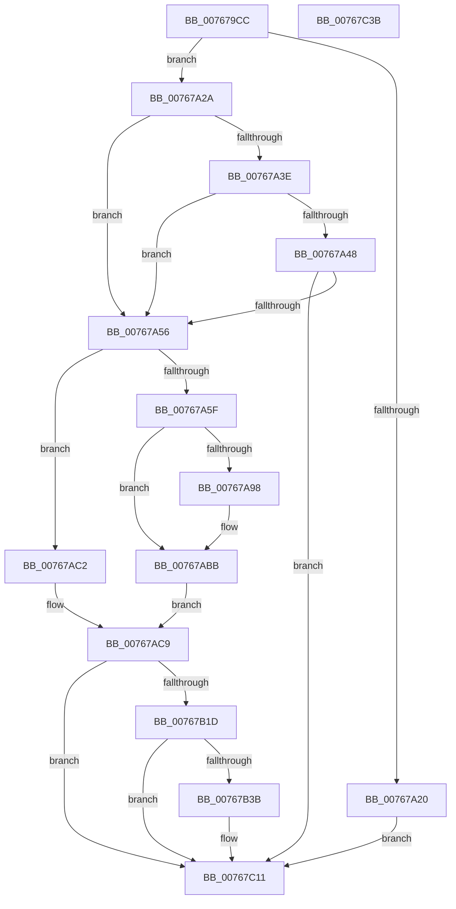

# PopPowerAdapterPublishRecState

- RVA: `0x007679CC`–`0x00767C3C` (길이 `624` bytes)
- VA: `0x00000001407679CC`
- 실행 섹션: `PAGE`
- PDB 이름 있음: `예`; PDB Function 태그: `아니요`
- unwind 정보 RVA: `0x000CCEA0`
- 디코드: `142`개 명령, `624/624` bytes 표시
- 미해석 바이트: `0` (있으면 어셈블리에 `.byte`로 보존)

> 이 문서는 커널 이미지의 기계어와 PDB 기호를 분석해 생성했습니다. 4번과 5번은 함수 원형과 자료형을 바이너리 사용 방식에서 추정한 C 해석이며 원본 소스 복구 결과는 아닙니다.

## 1. Dependencies

- 직접 호출 지점: **9**; 고유 호출 대상: **6**
- 직접 호출자로 확인된 함수: **1**
- RIP 상대 이미지 참조: **8**

### Outgoing calls
- `0x00767A86` → [ExSystemTimeToLocalTime](../../text/2F/ExSystemTimeToLocalTime_function_002FE1C0.md) (function, `0x002FE1C0`)
- `0x00767AB1` → [ExSystemTimeToLocalTime](../../text/2F/ExSystemTimeToLocalTime_function_002FE1C0.md) (function, `0x002FE1C0`)
- `0x00767B09` → [ZwUpdateWnfStateData](../../text/6B/ZwUpdateWnfStateData_function_006B0D10.md) (function, `0x006B0D10`)
- `0x00767B2E` → [tlgKeywordOn](../../text/42/tlgKeywordOn_function_0042EAA0.md) (function, `0x0042EAA0`)
- `0x00767B55` → [tlgCreate1Sz_char](../../text/42/tlgCreate1Sz_char_function_00427304.md) (function, `0x00427304`)
- `0x00767B73` → [tlgCreate1Sz_char](../../text/42/tlgCreate1Sz_char_function_00427304.md) (function, `0x00427304`)
- `0x00767B7F` → [tlgCreate1Sz_char](../../text/42/tlgCreate1Sz_char_function_00427304.md) (function, `0x00427304`)
- `0x00767C0C` → [tlgWriteTransfer_EtwWriteTransfer](../../text/42/tlgWriteTransfer_EtwWriteTransfer_function_004260E0.md) (function, `0x004260E0`)
- `0x00767C1A` → [_security_check_cookie](../../text/6A/_security_check_cookie_function_006AC640.md) (function, `0x006AC640`)

### Direct callers
- [PopBatteryWorker](../AE/PopBatteryWorker_function_00AE1650.md) at `0x00AE1C9D`

### Static image references
- `0x007679EA` → RVA `0x00E0A740` (`.data`; read)
- `0x00767AE0` → RVA `0x00020B08` (`.rdata`; read)
- `0x00767B0E` → RVA `0x00E07748` (`.data`; read)
- `0x00767B3B` → RVA `0x00B02B00` (` ?? ::NNGAKEGL::`string'`; read)
- `0x00767B46` → RVA `0x00B02B20` (` ?? ::NNGAKEGL::`string'`; read)
- `0x00767B5D` → RVA `0x00B028B0` (` ?? ::NNGAKEGL::`string'`; read)
- `0x00767B64` → RVA `0x00B02B40` (` ?? ::NNGAKEGL::`string'`; read)
- `0x00767B91` → RVA `0x0004CABB` (`.rdata`; read)

## 2. Other-region calls and transfers

- 다른 실행 섹션으로 향하는 call: **9**
  - `0x00767A86` → [ExSystemTimeToLocalTime](../../text/2F/ExSystemTimeToLocalTime_function_002FE1C0.md) (`PAGE` → `.text`)
  - `0x00767AB1` → [ExSystemTimeToLocalTime](../../text/2F/ExSystemTimeToLocalTime_function_002FE1C0.md) (`PAGE` → `.text`)
  - `0x00767B09` → [ZwUpdateWnfStateData](../../text/6B/ZwUpdateWnfStateData_function_006B0D10.md) (`PAGE` → `.text`)
  - `0x00767B2E` → [tlgKeywordOn](../../text/42/tlgKeywordOn_function_0042EAA0.md) (`PAGE` → `.text`)
  - `0x00767B55` → [tlgCreate1Sz_char](../../text/42/tlgCreate1Sz_char_function_00427304.md) (`PAGE` → `.text`)
  - `0x00767B73` → [tlgCreate1Sz_char](../../text/42/tlgCreate1Sz_char_function_00427304.md) (`PAGE` → `.text`)
  - `0x00767B7F` → [tlgCreate1Sz_char](../../text/42/tlgCreate1Sz_char_function_00427304.md) (`PAGE` → `.text`)
  - `0x00767C0C` → [tlgWriteTransfer_EtwWriteTransfer](../../text/42/tlgWriteTransfer_EtwWriteTransfer_function_004260E0.md) (`PAGE` → `.text`)
  - `0x00767C1A` → [_security_check_cookie](../../text/6A/_security_check_cookie_function_006AC640.md) (`PAGE` → `.text`)
- 별도 외부 분기/꼬리 이동을 확인하지 못했습니다.

## 3. Assembly (complete function range)

```asm
007679CC  48 89 5C 24 08                  mov qword ptr [rsp + 8], rbx
007679D1  48 89 74 24 18                  mov qword ptr [rsp + 0x18], rsi
007679D6  55                              push rbp
007679D7  57                              push rdi
007679D8  41 54                           push r12
007679DA  41 56                           push r14
007679DC  41 57                           push r15
007679DE  48 8D 6C 24 E0                  lea rbp, [rsp - 0x20]
007679E3  48 81 EC 20 01 00 00            sub rsp, 0x120
007679EA  48 8B 05 4F 2D 6A 00            mov rax, qword ptr [rip + 0x6a2d4f]
007679F1  48 33 C4                        xor rax, rsp
007679F4  48 89 45 10                     mov qword ptr [rbp + 0x10], rax
007679F8  44 8B 72 04                     mov r14d, dword ptr [rdx + 4]
007679FC  45 33 E4                        xor r12d, r12d
007679FF  4C 89 64 24 48                  mov qword ptr [rsp + 0x48], r12
00767A04  48 8B F2                        mov rsi, rdx
00767A07  4C 89 64 24 50                  mov qword ptr [rsp + 0x50], r12
00767A0C  41 8B DC                        mov ebx, r12d
00767A0F  66 44 89 64 24 61               mov word ptr [rsp + 0x61], r12w
00767A15  44 88 64 24 63                  mov byte ptr [rsp + 0x63], r12b
00767A1A  41 F6 C6 04                     test r14b, 4
00767A1E  74 0A                           je 0x140767a2a
00767A20  BB D3 02 00 C0                  mov ebx, 0xc00002d3
00767A25  E9 E7 01 00 00                  jmp 0x140767c11
00767A2A  8B 41 04                        mov eax, dword ptr [rcx + 4]
00767A2D  41 8B FE                        mov edi, r14d
00767A30  D1 EF                           shr edi, 1
00767A32  D1 E8                           shr eax, 1
00767A34  83 E7 03                        and edi, 3
00767A37  83 E0 03                        and eax, 3
00767A3A  3B C7                           cmp eax, edi
00767A3C  75 18                           jne 0x140767a56
00767A3E  48 8B 42 18                     mov rax, qword ptr [rdx + 0x18]
00767A42  48 39 41 18                     cmp qword ptr [rcx + 0x18], rax
00767A46  75 0E                           jne 0x140767a56
00767A48  48 8B 42 20                     mov rax, qword ptr [rdx + 0x20]
00767A4C  48 39 41 20                     cmp qword ptr [rcx + 0x20], rax
00767A50  0F 84 BB 01 00 00               je 0x140767c11
00767A56  45 8B FE                        mov r15d, r14d
00767A59  41 83 E7 02                     and r15d, 2
00767A5D  74 63                           je 0x140767ac2
00767A5F  48 69 42 18 80 96 98 00         imul rax, qword ptr [rdx + 0x18], 0x989680
00767A67  48 BB 14 00 00 00 80 F7 FF FF   movabs rbx, 0xfffff78000000014
00767A71  48 8D 54 24 50                  lea rdx, [rsp + 0x50]
00767A76  48 8D 4C 24 40                  lea rcx, [rsp + 0x40]
00767A7B  48 8B 1B                        mov rbx, qword ptr [rbx]
00767A7E  48 03 C3                        add rax, rbx
00767A81  48 89 44 24 40                  mov qword ptr [rsp + 0x40], rax
00767A86  E8 35 67 B9 FF                  call 0x1402fe1c0
00767A8B  48 8B 4E 20                     mov rcx, qword ptr [rsi + 0x20]
00767A8F  48 83 C8 FF                     or rax, 0xffffffffffffffff
00767A93  48 3B C8                        cmp rcx, rax
00767A96  74 23                           je 0x140767abb
00767A98  48 69 C1 80 96 98 00            imul rax, rcx, 0x989680
00767A9F  48 8D 54 24 48                  lea rdx, [rsp + 0x48]
00767AA4  48 03 C3                        add rax, rbx
00767AA7  48 8D 4C 24 40                  lea rcx, [rsp + 0x40]
00767AAC  48 89 44 24 40                  mov qword ptr [rsp + 0x40], rax
00767AB1  E8 0A 67 B9 FF                  call 0x1402fe1c0
00767AB6  48 8B 44 24 48                  mov rax, qword ptr [rsp + 0x48]
00767ABB  48 8B 4C 24 50                  mov rcx, qword ptr [rsp + 0x50]
00767AC0  EB 07                           jmp 0x140767ac9
00767AC2  48 83 C8 FF                     or rax, 0xffffffffffffffff
00767AC6  48 8B C8                        mov rcx, rax
00767AC9  45 33 C9                        xor r9d, r9d
00767ACC  48 89 4C 24 68                  mov qword ptr [rsp + 0x68], rcx
00767AD1  44 89 64 24 30                  mov dword ptr [rsp + 0x30], r12d
00767AD6  48 8D 54 24 60                  lea rdx, [rsp + 0x60]
00767ADB  44 89 64 24 28                  mov dword ptr [rsp + 0x28], r12d
00767AE0  48 8D 0D 21 90 8B FF            lea rcx, [rip - 0x746fdf]
00767AE7  66 44 89 64 24 61               mov word ptr [rsp + 0x61], r12w
00767AED  45 8D 41 18                     lea r8d, [r9 + 0x18]
00767AF1  44 88 64 24 63                  mov byte ptr [rsp + 0x63], r12b
00767AF6  44 88 64 24 60                  mov byte ptr [rsp + 0x60], r12b
00767AFB  89 7C 24 64                     mov dword ptr [rsp + 0x64], edi
00767AFF  48 89 44 24 70                  mov qword ptr [rsp + 0x70], rax
00767B04  4C 89 64 24 20                  mov qword ptr [rsp + 0x20], r12
00767B09  E8 02 92 F4 FF                  call 0x1406b0d10
00767B0E  83 3D 33 FC 69 00 05            cmp dword ptr [rip + 0x69fc33], 5
00767B15  8B D8                           mov ebx, eax
00767B17  0F 86 F4 00 00 00               jbe 0x140767c11
00767B1D  48 BA 00 00 00 00 00 40 00 00   movabs rdx, 0x400000000000
00767B27  48 8D 0D 1A FC 69 00            lea rcx, [rip + 0x69fc1a]
00767B2E  E8 6D 6F CC FF                  call 0x14042eaa0
00767B33  84 C0                           test al, al
00767B35  0F 84 D6 00 00 00               je 0x140767c11
00767B3B  48 8D 05 BE AF 39 00            lea rax, [rip + 0x39afbe]
00767B42  41 F6 C6 01                     test r14b, 1
00767B46  48 8D 15 D3 AF 39 00            lea rdx, [rip + 0x39afd3]
00767B4D  48 0F 44 D0                     cmove rdx, rax
00767B51  48 8D 4D A0                     lea rcx, [rbp - 0x60]
00767B55  E8 AA F7 CB FF                  call 0x140427304
00767B5A  45 85 FF                        test r15d, r15d
00767B5D  4C 8D 05 4C AD 39 00            lea r8, [rip + 0x39ad4c]
00767B64  48 8D 15 D5 AF 39 00            lea rdx, [rip + 0x39afd5]
00767B6B  49 0F 44 D0                     cmove rdx, r8
00767B6F  48 8D 4D B0                     lea rcx, [rbp - 0x50]
00767B73  E8 8C F7 CB FF                  call 0x140427304
00767B78  49 8B D0                        mov rdx, r8
00767B7B  48 8D 4D C0                     lea rcx, [rbp - 0x40]
00767B7F  E8 80 F7 CB FF                  call 0x140427304
00767B84  48 8B 4E 18                     mov rcx, qword ptr [rsi + 0x18]
00767B88  48 8D 44 24 40                  lea rax, [rsp + 0x40]
00767B8D  48 89 45 D0                     mov qword ptr [rbp - 0x30], rax
00767B91  48 8D 15 23 4F 8E FF            lea rdx, [rip - 0x71b0dd]
00767B98  48 8B 46 20                     mov rax, qword ptr [rsi + 0x20]
00767B9C  45 33 C9                        xor r9d, r9d
00767B9F  48 89 44 24 50                  mov qword ptr [rsp + 0x50], rax
00767BA4  45 33 C0                        xor r8d, r8d
00767BA7  48 8D 44 24 50                  lea rax, [rsp + 0x50]
00767BAC  48 89 4C 24 40                  mov qword ptr [rsp + 0x40], rcx
00767BB1  48 89 45 E0                     mov qword ptr [rbp - 0x20], rax
00767BB5  48 8D 0D 8C FB 69 00            lea rcx, [rip + 0x69fb8c]
00767BBC  48 8D 44 24 48                  lea rax, [rsp + 0x48]
00767BC1  48 C7 45 D8 08 00 00 00         mov qword ptr [rbp - 0x28], 8
00767BC9  48 89 45 F0                     mov qword ptr [rbp - 0x10], rax
00767BCD  48 8D 44 24 58                  lea rax, [rsp + 0x58]
00767BD2  48 89 45 00                     mov qword ptr [rbp], rax
00767BD6  48 8D 45 80                     lea rax, [rbp - 0x80]
00767BDA  48 89 44 24 28                  mov qword ptr [rsp + 0x28], rax
00767BDF  C7 44 24 20 09 00 00 00         mov dword ptr [rsp + 0x20], 9
00767BE7  48 C7 45 E8 08 00 00 00         mov qword ptr [rbp - 0x18], 8
00767BEF  89 5C 24 48                     mov dword ptr [rsp + 0x48], ebx
00767BF3  48 C7 45 F8 04 00 00 00         mov qword ptr [rbp - 8], 4
00767BFB  48 C7 44 24 58 00 00 00 01      mov qword ptr [rsp + 0x58], 0x1000000
00767C04  48 C7 45 08 08 00 00 00         mov qword ptr [rbp + 8], 8
00767C0C  E8 CF E4 CB FF                  call 0x1404260e0
00767C11  8B C3                           mov eax, ebx
00767C13  48 8B 4D 10                     mov rcx, qword ptr [rbp + 0x10]
00767C17  48 33 CC                        xor rcx, rsp
00767C1A  E8 21 4A F4 FF                  call 0x1406ac640
00767C1F  4C 8D 9C 24 20 01 00 00         lea r11, [rsp + 0x120]
00767C27  49 8B 5B 30                     mov rbx, qword ptr [r11 + 0x30]
00767C2B  49 8B 73 40                     mov rsi, qword ptr [r11 + 0x40]
00767C2F  49 8B E3                        mov rsp, r11
00767C32  41 5F                           pop r15
00767C34  41 5E                           pop r14
00767C36  41 5C                           pop r12
00767C38  5F                              pop rdi
00767C39  5D                              pop rbp
00767C3A  C3                              ret
00767C3B  CC                              int3
```

## 4. C-style interpretation (structured pseudocode)

```c
__int64 __fastcall PopPowerAdapterPublishRecState(__int64 a1, __int64 a2, __int64 a3, int a4)
{
    __int64 result;
    __int64 v_r12;
    __int64 v_r15;
    __int64 v_rdi;
    __int64 v_rsp;
    unsigned __int64 v_stack_m100;
    unsigned __int64 v_stack_m108;
    unsigned int v_stack_m118;
    unsigned int v_stack_m120;
    unsigned __int64 v_stack_m128;
    unsigned __int64 v_stack_m28;
    unsigned __int64 v_stack_m38;
    unsigned __int64 v_stack_m40;
    unsigned __int64 v_stack_m48;
    unsigned __int64 v_stack_m50;
    unsigned __int64 v_stack_m58;
    unsigned __int64 v_stack_m60;
    unsigned __int64 v_stack_m68;
    unsigned __int64 v_stack_m70;
    unsigned __int64 v_stack_m78;
    unsigned __int64 v_stack_m88;
    unsigned __int64 v_stack_m98;
    unsigned __int64 v_stack_mA8;
    unsigned __int64 v_stack_mC8;
    unsigned __int64 v_stack_mD8;
    unsigned __int64 v_stack_mE0;
    unsigned int v_stack_mE4;
    unsigned __int8 v_stack_mE5;
    unsigned __int16 v_stack_mE7;
    unsigned __int64 v_stack_mE8;
    unsigned __int64 v_stack_mF0;
    unsigned __int64 v_stack_mF8;
    unsigned __int64 v_stack_p18;
    unsigned __int64 v_stack_p8;

    v_stack_p8 = v_rbx;
    v_stack_p18 = v_rsi;
    v_rsp = (v_rsp) - (288);
    result = (*(unsigned __int64 *)(v_rip + 6958415)) ^ (v_rsp);
    v_stack_m38 = result;
    v_r12 = 0;
    v_stack_m100 = 0;
    v_stack_mF8 = 0;
    v_stack_mE7 = 0;
    v_stack_mE5 = 0;
    if ((((unsigned __int8)((unsigned int)(*(unsigned int *)(a2 + 4)))) & (4)) == 0) goto loc_00767A2A;
    goto loc_00767C11;
loc_00767A2A:
    v_rdi = (unsigned int)(((unsigned int)((unsigned int)((unsigned int)(*(unsigned int *)(a2 + 4))))) >> (1));
    result = (unsigned int)(((unsigned int)(*(unsigned int *)(a1 + 4))) >> (1));
    v_rdi = (unsigned int)((v_rdi) & (3));
    result = (unsigned int)((result) & (3));
    if (((unsigned int)(result)) != ((unsigned int)(v_rdi))) goto loc_00767A56;
    if ((*(unsigned __int64 *)(a1 + 24)) != (*(unsigned __int64 *)(a2 + 24))) goto loc_00767A56;
    if ((*(unsigned __int64 *)(a1 + 32)) == (*(unsigned __int64 *)(a2 + 32))) goto loc_00767C11;
loc_00767A56:
    v_r15 = (unsigned int)(((unsigned int)((unsigned int)((unsigned int)(*(unsigned int *)(a2 + 4))))) & (2));
    if (condition_is_equal) goto loc_00767AC2;
    result = (*(unsigned __int64 *)(a2 + 32)) * (*(unsigned __int64 *)(a2 + 24));
    result = (result) + (*(unsigned __int64 *)((unsigned int)(0xC00002D3ULL)));
    v_stack_m108 = result;
    result = ExSystemTimeToLocalTime(v_stack_m108, v_stack_mF8, a3, a4);
    result = (result) | (-1);
    if ((*(unsigned __int64 *)(a2 + 32)) != result) {
        result = (result) * (*(unsigned __int64 *)(a2 + 32));
        a2 = v_stack_m100;
        result = (result) + (*(unsigned __int64 *)((unsigned int)(0xC00002D3ULL)));
        a1 = v_stack_m108;
        v_stack_m108 = result;
        result = ExSystemTimeToLocalTime(a1, a2, a3, a4);
        result = v_stack_m100;
    }
    goto loc_00767AC9;
loc_00767AC2:
    result = (result) | (-1);
loc_00767AC9:
    a4 = 0;
    v_stack_mE0 = result;
    v_stack_m118 = 0;
    v_stack_m120 = 0;
    v_stack_mE7 = 0;
    v_stack_mE5 = 0;
    v_stack_mE8 = 0;
    v_stack_mE4 = (unsigned int)(v_rdi);
    v_stack_mD8 = result;
    v_stack_m128 = 0;
    result = ZwUpdateWnfStateData(v_rip - 7630815, v_stack_mE8, a4 + 24, a4);
    if ((*(unsigned int *)(v_rip + 6945843)) <= 5) goto loc_00767C11;
    result = tlgKeywordOn(v_rip + 6945818, v_stack_mE8, a4 + 24, a4);
    if ((unsigned __int8)(result) != 0) {
        result = v_rip + 3780542;
        a2 = v_rip + 3780563;
        if ((((unsigned __int8)((unsigned int)(*(unsigned int *)(a2 + 4)))) & (1)) == 0) { a2 = result; }
        a1 = v_stack_mA8;
        result = tlgCreate1Sz_char(a1, a2, a4 + 24, a4);
        a3 = v_rip + 3779916;
        a2 = v_rip + 3780565;
        if ((unsigned int)(v_r15) == 0) { a2 = a3; }
        a1 = v_stack_m98;
        result = tlgCreate1Sz_char(a1, a2, a3, a4);
        a2 = a3;
        a1 = v_stack_m88;
        result = tlgCreate1Sz_char(a1, a2, a3, a4);
        a1 = *(unsigned __int64 *)(a2 + 24);
        result = v_stack_m108;
        v_stack_m78 = result;
        a2 = v_rip - 7450845;
        result = *(unsigned __int64 *)(a2 + 32);
        a4 = 0;
        v_stack_mF8 = result;
        a3 = 0;
        result = v_stack_mF8;
        v_stack_m108 = a1;
        v_stack_m68 = result;
        a1 = v_rip + 6945676;
        result = v_stack_m100;
        v_stack_m70 = 8;
        v_stack_m58 = result;
        result = v_stack_mF0;
        v_stack_m48 = result;
        result = v_stack_mC8;
        v_stack_m120 = result;
        v_stack_m128 = 9;
        v_stack_m60 = 8;
        v_stack_m100 = (unsigned int)((unsigned int)((unsigned int)(result)));
        v_stack_m50 = 4;
        v_stack_mF0 = 0x1000000ULL;
        v_stack_m40 = 8;
        result = tlgWriteTransfer_EtwWriteTransfer(a1, a2, a3, a4);
    }
    a1 = (v_stack_m38) ^ (v_rsp);
    result = _security_check_cookie(a1, a2, a3, a4);
    return result;
}
```

## 5. (Beta) C Style

```c
int64_t PopPowerAdapterPublishRecState(void *Arg1, void *Arg2, int64_t Arg3, int32_t Arg4)
{
    uint8_t *arg1 = (uint8_t *)Arg1;
    uint8_t *arg2 = (uint8_t *)Arg2;

    int64_t result;
    int64_t local_r12;
    int64_t local_r15;
    int64_t local_rdi;
    int64_t local_rsp;
    uint64_t v_stack_m100;
    uint64_t v_stack_m108;
    uint32_t v_stack_m118;
    uint32_t v_stack_m120;
    uint64_t v_stack_m128;
    uint64_t v_stack_m28;
    uint64_t v_stack_m38;
    uint64_t v_stack_m40;
    uint64_t v_stack_m48;
    uint64_t v_stack_m50;
    uint64_t v_stack_m58;
    uint64_t v_stack_m60;
    uint64_t v_stack_m68;
    uint64_t v_stack_m70;
    uint64_t v_stack_m78;
    uint64_t v_stack_m88;
    uint64_t v_stack_m98;
    uint64_t v_stack_mA8;
    uint64_t v_stack_mC8;
    uint64_t v_stack_mD8;
    uint64_t v_stack_mE0;
    uint32_t v_stack_mE4;
    uint8_t v_stack_mE5;
    uint16_t v_stack_mE7;
    uint64_t v_stack_mE8;
    uint64_t v_stack_mF0;
    uint64_t v_stack_mF8;
    uint64_t v_stack_p18;
    uint64_t v_stack_p8;

    v_stack_p8 = local_rbx;
    v_stack_p18 = local_rsi;
    local_rsp = (local_rsp) - (288);
    result = (*(uint64_t *)(v_rip + 0x6A2D4F)) ^ (local_rsp);
    v_stack_m38 = result;
    local_r12 = 0;
    v_stack_m100 = 0;
    v_stack_mF8 = 0;
    v_stack_mE7 = 0;
    v_stack_mE5 = 0;
    if ((((uint8_t)((uint32_t)(*(uint32_t *)(arg2 + 0x4)))) & (4)) == 0) goto loc_00767A2A;
    goto loc_00767C11;
loc_00767A2A:
    local_rdi = (uint32_t)(((uint32_t)((uint32_t)((uint32_t)(*(uint32_t *)(arg2 + 0x4))))) >> (1));
    result = (uint32_t)(((uint32_t)(*(uint32_t *)(arg1 + 0x4))) >> (1));
    local_rdi = (uint32_t)((local_rdi) & (3));
    result = (uint32_t)((result) & (3));
    if (((uint32_t)(result)) != ((uint32_t)(local_rdi))) goto loc_00767A56;
    if ((*(uint64_t *)(arg1 + 0x18)) != (*(uint64_t *)(arg2 + 0x18))) goto loc_00767A56;
    if ((*(uint64_t *)(arg1 + 0x20)) == (*(uint64_t *)(arg2 + 0x20))) goto loc_00767C11;
loc_00767A56:
    local_r15 = (uint32_t)(((uint32_t)((uint32_t)((uint32_t)(*(uint32_t *)(arg2 + 0x4))))) & (2));
    if (condition_is_equal) goto loc_00767AC2;
    result = (*(uint64_t *)(arg2 + 0x20)) * (*(uint64_t *)(arg2 + 0x18));
    result = (result) + (*(uint64_t *)((uint32_t)(0xC00002D3ULL)));
    v_stack_m108 = result;
    result = ExSystemTimeToLocalTime(v_stack_m108, v_stack_mF8, Arg3, Arg4);
    result = (result) | (-1);
    if ((*(uint64_t *)(arg2 + 0x20)) != result) {
        result = (result) * (*(uint64_t *)(arg2 + 0x20));
        Arg2 = v_stack_m100;
        result = (result) + (*(uint64_t *)((uint32_t)(0xC00002D3ULL)));
        Arg1 = v_stack_m108;
        v_stack_m108 = result;
        result = ExSystemTimeToLocalTime(Arg1, Arg2, Arg3, Arg4);
        result = v_stack_m100;
    }
    goto loc_00767AC9;
loc_00767AC2:
    result = (result) | (-1);
loc_00767AC9:
    Arg4 = 0;
    v_stack_mE0 = result;
    v_stack_m118 = 0;
    v_stack_m120 = 0;
    v_stack_mE7 = 0;
    v_stack_mE5 = 0;
    v_stack_mE8 = 0;
    v_stack_mE4 = (uint32_t)(local_rdi);
    v_stack_mD8 = result;
    v_stack_m128 = 0;
    result = ZwUpdateWnfStateData(v_rip - 7630815, v_stack_mE8, Arg4 + 24, Arg4);
    if ((*(uint32_t *)(v_rip + 0x69FC33)) <= 5) goto loc_00767C11;
    result = tlgKeywordOn(v_rip + 6945818, v_stack_mE8, Arg4 + 24, Arg4);
    if ((uint8_t)(result) != 0) {
        result = v_rip + 3780542;
        Arg2 = v_rip + 3780563;
        if ((((uint8_t)((uint32_t)(*(uint32_t *)(arg2 + 0x4)))) & (1)) == 0) { Arg2 = result; }
        Arg1 = v_stack_mA8;
        result = tlgCreate1Sz_char(Arg1, Arg2, Arg4 + 24, Arg4);
        Arg3 = v_rip + 3779916;
        Arg2 = v_rip + 3780565;
        if ((uint32_t)(local_r15) == 0) { Arg2 = Arg3; }
        Arg1 = v_stack_m98;
        result = tlgCreate1Sz_char(Arg1, Arg2, Arg3, Arg4);
        Arg2 = Arg3;
        Arg1 = v_stack_m88;
        result = tlgCreate1Sz_char(Arg1, Arg2, Arg3, Arg4);
        Arg1 = *(uint64_t *)(arg2 + 0x18);
        result = v_stack_m108;
        v_stack_m78 = result;
        Arg2 = v_rip - 7450845;
        result = *(uint64_t *)(arg2 + 0x20);
        Arg4 = 0;
        v_stack_mF8 = result;
        Arg3 = 0;
        result = v_stack_mF8;
        v_stack_m108 = Arg1;
        v_stack_m68 = result;
        Arg1 = v_rip + 6945676;
        result = v_stack_m100;
        v_stack_m70 = 8;
        v_stack_m58 = result;
        result = v_stack_mF0;
        v_stack_m48 = result;
        result = v_stack_mC8;
        v_stack_m120 = result;
        v_stack_m128 = 9;
        v_stack_m60 = 8;
        v_stack_m100 = (uint32_t)((uint32_t)((uint32_t)(result)));
        v_stack_m50 = 4;
        v_stack_mF0 = 0x1000000ULL;
        v_stack_m40 = 8;
        result = tlgWriteTransfer_EtwWriteTransfer(Arg1, Arg2, Arg3, Arg4);
    }
    Arg1 = (v_stack_m38) ^ (local_rsp);
    result = _security_check_cookie(Arg1, Arg2, Arg3, Arg4);
    return result;
}
```

### 관측된 메모리 오프셋

구조체 형식이 확인되지 않은 접근은 인자 기준의 오프셋으로만 기록했습니다.

| 기준 인자 | 오프셋 표현 | 폭 (bit) | 접근 |
|---|---:|---:|---|
| `Arg1` | `+ 0x4` | `32` | `R` |
| `Arg1` | `+ 0x18` | `64` | `R` |
| `Arg1` | `+ 0x20` | `64` | `R` |
| `Arg2` | `+ 0x4` | `32` | `R` |
| `Arg2` | `+ 0x18` | `64` | `R` |
| `Arg2` | `+ 0x20` | `64` | `R` |

## 6. Execution-region graph

[열기: 2D/3D 그래프와 함수 탐색 컨트롤 패널](../../../control-panel.html?section=page&rva=0x007679CC&view=graph)

- 2D 그래프는 위에서 아래로 흐르고, 3D 그래프는 빈 공간을 드래그해 회전합니다. Shift+드래그는 이동, 휠은 확대·축소, 함수 노드 선택은 대상 보고서 이동입니다.

### Static fallback


