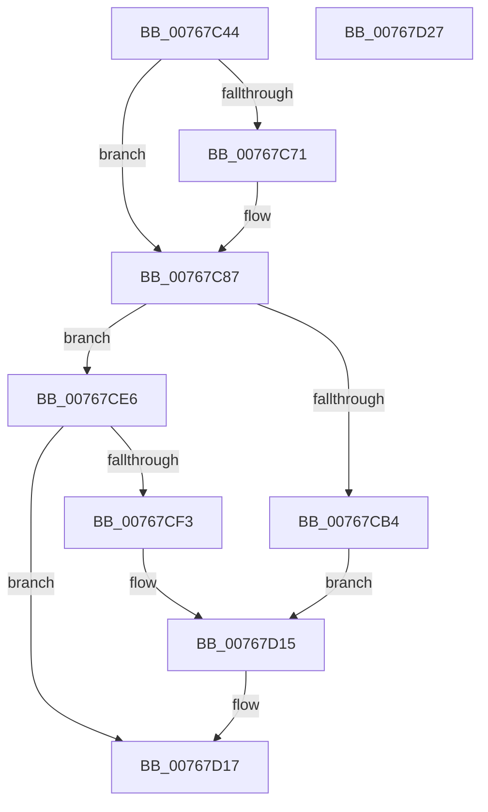

# PopPowerAdapterQueryStatus

- RVA: `0x00767C44`–`0x00767D28` (길이 `228` bytes)
- VA: `0x0000000140767C44`
- 실행 섹션: `PAGE`
- PDB 이름 있음: `예`; PDB Function 태그: `아니요`
- unwind 정보 RVA: `0x000794E0`
- 디코드: `57`개 명령, `228/228` bytes 표시
- 미해석 바이트: `0` (있으면 어셈블리에 `.byte`로 보존)

> 이 문서는 커널 이미지의 기계어와 PDB 기호를 분석해 생성했습니다. 4번과 5번은 함수 원형과 자료형을 바이너리 사용 방식에서 추정한 C 해석이며 원본 소스 복구 결과는 아닙니다.

## 1. Dependencies

- 직접 호출 지점: **4**; 고유 호출 대상: **4**
- 직접 호출자로 확인된 함수: **3**
- RIP 상대 이미지 참조: **2**

### Outgoing calls
- `0x00767CA6` → [PopPrepareIoctl](../A7/PopPrepareIoctl_function_00A74A98.md) (function, `0x00A74A98`)
- `0x00767CD2` → [KeResetEvent](../../text/24/KeResetEvent_function_00248350.md) (function, `0x00248350`)
- `0x00767CDF` → [IofCallDriver](../../text/29/IofCallDriver_function_0029B4B0.md) (function, `0x0029B4B0`)
- `0x00767CEA` → [IoSynchronousCallDriver](../../text/48/IoSynchronousCallDriver_function_00484050.md) (function, `0x00484050`)

### Direct callers
- [PopPowerAdapterAdd](PopPowerAdapterAdd_function_00767430.md) at `0x00767619`
- [PopPowerAdapterAdd](PopPowerAdapterAdd_function_00767430.md) at `0x00767828`
- [PopPowerAdapterReinitialize](PopPowerAdapterReinitialize_function_00767E48.md) at `0x00767FEB`
- [PopBatteryWorker](../AE/PopBatteryWorker_function_00AE1650.md) at `0x00AE1C1D`
- [PopBatteryWorker](../AE/PopBatteryWorker_function_00AE1650.md) at `0x00AE23E9`

### Static image references
- `0x00767C7E` → RVA `0x00FC5344` (`ALMOSTRO`; read)
- `0x00767CBB` → RVA `0x004E9630` (`PopPowerAdapterIrpComplete`; read)

## 2. Other-region calls and transfers

- 다른 실행 섹션으로 향하는 call: **3**
  - `0x00767CD2` → [KeResetEvent](../../text/24/KeResetEvent_function_00248350.md) (`PAGE` → `.text`)
  - `0x00767CDF` → [IofCallDriver](../../text/29/IofCallDriver_function_0029B4B0.md) (`PAGE` → `.text`)
  - `0x00767CEA` → [IoSynchronousCallDriver](../../text/48/IoSynchronousCallDriver_function_00484050.md) (`PAGE` → `.text`)
- 별도 외부 분기/꼬리 이동을 확인하지 못했습니다.

## 3. Assembly (complete function range)

```asm
00767C44  48 89 5C 24 08                  mov qword ptr [rsp + 8], rbx
00767C49  48 89 74 24 10                  mov qword ptr [rsp + 0x10], rsi
00767C4E  57                              push rdi
00767C4F  48 83 EC 30                     sub rsp, 0x30
00767C53  48 8D 79 40                     lea rdi, [rcx + 0x40]
00767C57  0F 57 C0                        xorps xmm0, xmm0
00767C5A  33 C0                           xor eax, eax
00767C5C  40 8A F2                        mov sil, dl
00767C5F  48 8B D9                        mov rbx, rcx
00767C62  0F 11 07                        movups xmmword ptr [rdi], xmm0
00767C65  0F 11 47 10                     movups xmmword ptr [rdi + 0x10], xmm0
00767C69  48 89 47 20                     mov qword ptr [rdi + 0x20], rax
00767C6D  84 D2                           test dl, dl
00767C6F  75 16                           jne 0x140767c87
00767C71  8B 81 B4 00 00 00               mov eax, dword ptr [rcx + 0xb4]
00767C77  83 49 44 FF                     or dword ptr [rcx + 0x44], 0xffffffff
00767C7B  89 41 48                        mov dword ptr [rcx + 0x48], eax
00767C7E  8B 05 C0 D6 85 00               mov eax, dword ptr [rip + 0x85d6c0]
00767C84  89 41 4C                        mov dword ptr [rcx + 0x4c], eax
00767C87  48 8B 49 38                     mov rcx, qword ptr [rcx + 0x38]
00767C8B  4C 8B CF                        mov r9, rdi
00767C8E  C7 44 24 28 28 00 00 00         mov dword ptr [rsp + 0x28], 0x28
00767C96  45 33 C0                        xor r8d, r8d
00767C99  BA 6C 40 29 00                  mov edx, 0x29406c
00767C9E  C7 44 24 20 10 00 00 00         mov dword ptr [rsp + 0x20], 0x10
00767CA6  E8 ED CD 30 00                  call 0x140a74a98
00767CAB  48 8B 53 38                     mov rdx, qword ptr [rbx + 0x38]
00767CAF  40 84 F6                        test sil, sil
00767CB2  75 32                           jne 0x140767ce6
00767CB4  48 8B 82 B8 00 00 00            mov rax, qword ptr [rdx + 0xb8]
00767CBB  48 8D 0D 6E 19 D8 FF            lea rcx, [rip - 0x27e692]
00767CC2  48 89 48 F0                     mov qword ptr [rax - 0x10], rcx
00767CC6  48 8D 4B 68                     lea rcx, [rbx + 0x68]
00767CCA  48 89 58 F8                     mov qword ptr [rax - 8], rbx
00767CCE  C6 40 BB E0                     mov byte ptr [rax - 0x45], 0xe0
00767CD2  E8 79 06 AE FF                  call 0x140248350
00767CD7  48 8B 53 38                     mov rdx, qword ptr [rbx + 0x38]
00767CDB  48 8B 4B 30                     mov rcx, qword ptr [rbx + 0x30]
00767CDF  E8 CC 37 B3 FF                  call 0x14029b4b0
00767CE4  EB 2F                           jmp 0x140767d15
00767CE6  48 8B 4B 30                     mov rcx, qword ptr [rbx + 0x30]
00767CEA  E8 61 C3 D1 FF                  call 0x140484050
00767CEF  85 C0                           test eax, eax
00767CF1  78 24                           js 0x140767d17
00767CF3  0F 10 07                        movups xmm0, xmmword ptr [rdi]
00767CF6  0F 10 4F 10                     movups xmm1, xmmword ptr [rdi + 0x10]
00767CFA  0F 11 83 B0 00 00 00            movups xmmword ptr [rbx + 0xb0], xmm0
00767D01  F2 0F 10 47 20                  movsd xmm0, qword ptr [rdi + 0x20]
00767D06  0F 11 8B C0 00 00 00            movups xmmword ptr [rbx + 0xc0], xmm1
00767D0D  F2 0F 11 83 D0 00 00 00         movsd qword ptr [rbx + 0xd0], xmm0
00767D15  33 C0                           xor eax, eax
00767D17  48 8B 5C 24 40                  mov rbx, qword ptr [rsp + 0x40]
00767D1C  48 8B 74 24 48                  mov rsi, qword ptr [rsp + 0x48]
00767D21  48 83 C4 30                     add rsp, 0x30
00767D25  5F                              pop rdi
00767D26  C3                              ret
00767D27  CC                              int3
```

## 4. C-style interpretation (structured pseudocode)

```c
__int64 __fastcall PopPowerAdapterQueryStatus(__int64 a1, unsigned __int8 a2, int a3)
{
    __int64 result;
    __int64 v_rsp;
    unsigned int v_stack_m10;
    unsigned int v_stack_m18;
    unsigned __int64 v_stack_p10;
    unsigned __int64 v_stack_p8;

    v_stack_p8 = v_rbx;
    v_stack_p10 = v_rsi;
    v_rsp = (v_rsp) - (48);
    result = 0;
    *(unsigned __int64 *)(a1 + 64) = v_xmm0;
    *(unsigned __int64 *)(a1 + 64 + 16) = v_xmm0;
    *(unsigned __int64 *)(a1 + 64 + 32) = 0;
    if (a2 == 0) {
        result = *(unsigned int *)(a1 + 180);
        *(unsigned int *)(a1 + 72) = (unsigned int)(result);
        result = *(unsigned int *)(v_rip + 8771264);
        *(unsigned int *)(a1 + 76) = (unsigned int)(result);
    }
    v_stack_m10 = 40;
    a3 = 0;
    v_stack_m18 = 16;
    result = PopPrepareIoctl(*(unsigned __int64 *)(a1 + 56), (unsigned int)(0x29406CULL), a3, a1 + 64);
    if (a2 != 0) goto loc_00767CE6;
    *(unsigned __int64 *)(*(unsigned __int64 *)(*(unsigned __int64 *)(a1 + 56) + 184) - 16) = v_rip - 2614930;
    *(unsigned __int64 *)(*(unsigned __int64 *)(*(unsigned __int64 *)(a1 + 56) + 184) - 8) = a1;
    *(unsigned __int8 *)(*(unsigned __int64 *)(*(unsigned __int64 *)(a1 + 56) + 184) - 69) = 224;
    result = KeResetEvent(a1 + 104, *(unsigned __int64 *)(a1 + 56), a3, a1 + 64);
    result = IofCallDriver(*(unsigned __int64 *)(a1 + 48), *(unsigned __int64 *)(a1 + 56), a3, a1 + 64);
    goto loc_00767D15;
loc_00767CE6:
    result = IoSynchronousCallDriver(*(unsigned __int64 *)(a1 + 48), *(unsigned __int64 *)(a1 + 56), a3, a1 + 64);
    if (sign_flag) goto loc_00767D17;
    *(unsigned __int64 *)(a1 + 176) = v_xmm0;
    *(unsigned __int64 *)(a1 + 192) = v_xmm1;
    *(unsigned __int64 *)(a1 + 208) = v_xmm0;
loc_00767D15:
    result = 0;
loc_00767D17:
    v_rsp = (v_rsp) + (48);
    return result;
}
```

## 5. (Beta) C Style

```c
int64_t PopPowerAdapterQueryStatus(void *Arg1, uint8_t Arg2, int32_t Arg3)
{
    uint8_t *arg1 = (uint8_t *)Arg1;

    int64_t result;
    int64_t local_rsp;
    uint32_t v_stack_m10;
    uint32_t v_stack_m18;
    uint64_t v_stack_p10;
    uint64_t v_stack_p8;

    v_stack_p8 = local_rbx;
    v_stack_p10 = local_rsi;
    local_rsp = (local_rsp) - (48);
    result = 0;
    *(uint64_t *)(arg1 + 0x40) = v_xmm0;
    *(uint64_t *)(arg1 + 0x40 + 0x10) = v_xmm0;
    *(uint64_t *)(arg1 + 0x40 + 0x20) = 0;
    if (Arg2 == 0) {
        result = *(uint32_t *)(arg1 + 0xB4);
        *(uint32_t *)(arg1 + 0x48) = (uint32_t)(result);
        result = *(uint32_t *)(v_rip + 0x85D6C0);
        *(uint32_t *)(arg1 + 0x4C) = (uint32_t)(result);
    }
    v_stack_m10 = 40;
    Arg3 = 0;
    v_stack_m18 = 16;
    result = PopPrepareIoctl(*(uint64_t *)(arg1 + 0x38), (uint32_t)(0x29406CULL), Arg3, Arg1 + 64);
    if (Arg2 != 0) goto loc_00767CE6;
    *(uint64_t *)(*(uint64_t *)(*(uint64_t *)(arg1 + 0x38) + 0xB8) - 0x10) = v_rip - 2614930;
    *(void **)(*(uint64_t *)(*(uint64_t *)(arg1 + 0x38) + 0xB8) - 0x8) = Arg1;
    *(uint8_t *)(*(uint64_t *)(*(uint64_t *)(arg1 + 0x38) + 0xB8) - 0x45) = 224;
    result = KeResetEvent(Arg1 + 104, *(uint64_t *)(arg1 + 0x38), Arg3, Arg1 + 64);
    result = IofCallDriver(*(uint64_t *)(arg1 + 0x30), *(uint64_t *)(arg1 + 0x38), Arg3, Arg1 + 64);
    goto loc_00767D15;
loc_00767CE6:
    result = IoSynchronousCallDriver(*(uint64_t *)(arg1 + 0x30), *(uint64_t *)(arg1 + 0x38), Arg3, Arg1 + 64);
    if (sign_flag) goto loc_00767D17;
    *(uint64_t *)(arg1 + 0xB0) = v_xmm0;
    *(uint64_t *)(arg1 + 0xC0) = v_xmm1;
    *(uint64_t *)(arg1 + 0xD0) = v_xmm0;
loc_00767D15:
    result = 0;
loc_00767D17:
    local_rsp = (local_rsp) + (48);
    return result;
}
```

### 관측된 메모리 오프셋

구조체 형식이 확인되지 않은 접근은 인자 기준의 오프셋으로만 기록했습니다.

| 기준 인자 | 오프셋 표현 | 폭 (bit) | 접근 |
|---|---:|---:|---|
| `Arg1` | `+ 0x0` | `128` | `R` |
| `Arg1` | `+ 0x10` | `128` | `R` |
| `Arg1` | `+ 0x20` | `64` | `R` |
| `Arg1` | `+ 0x20` | `64` | `W` |
| `Arg1` | `+ 0x30` | `64` | `R` |
| `Arg1` | `+ 0x38` | `64` | `R` |
| `Arg1` | `+ 0x40` | `64` | `R` |
| `Arg1` | `+ 0x44` | `32` | `R/W` |
| `Arg1` | `+ 0x48` | `32` | `W` |
| `Arg1` | `+ 0x4C` | `32` | `W` |
| `Arg1` | `+ 0x68` | `64` | `R` |
| `Arg1` | `+ 0xB0` | `128` | `R` |
| `Arg1` | `+ 0xB4` | `32` | `R` |
| `Arg1` | `+ 0xC0` | `128` | `R` |
| `Arg1` | `+ 0xD0` | `64` | `W` |

## 6. Execution-region graph

[열기: 2D/3D 그래프와 함수 탐색 컨트롤 패널](../../../control-panel.html?section=page&rva=0x00767C44&view=graph)

- 2D 그래프는 위에서 아래로 흐르고, 3D 그래프는 빈 공간을 드래그해 회전합니다. Shift+드래그는 이동, 휠은 확대·축소, 함수 노드 선택은 대상 보고서 이동입니다.

### Static fallback


