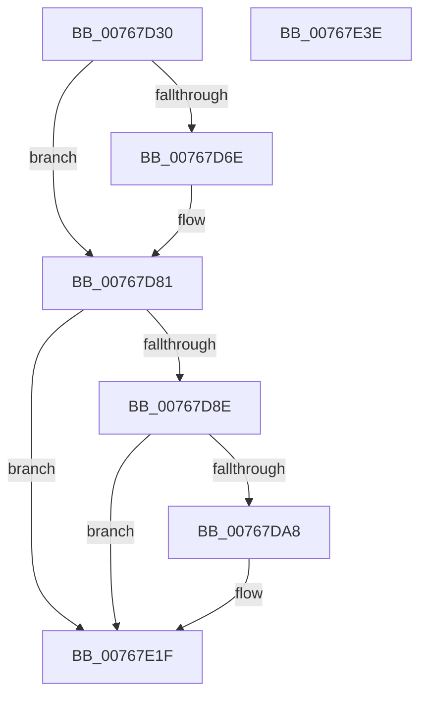

# PopPowerAdapterRecOverrideWnfCallback

- RVA: `0x00767D30`–`0x00767E3F` (길이 `271` bytes)
- VA: `0x0000000140767D30`
- 실행 섹션: `PAGE`
- PDB 이름 있음: `예`; PDB Function 태그: `아니요`
- unwind 정보 RVA: `0x000C6AD4`
- 디코드: `59`개 명령, `271/271` bytes 표시
- 미해석 바이트: `0` (있으면 어셈블리에 `.byte`로 보존)

> 이 문서는 커널 이미지의 기계어와 PDB 기호를 분석해 생성했습니다. 4번과 5번은 함수 원형과 자료형을 바이너리 사용 방식에서 추정한 C 해석이며 원본 소스 복구 결과는 아닙니다.

## 1. Dependencies

- 직접 호출 지점: **5**; 고유 호출 대상: **5**
- 직접 호출자로 확인된 함수: **0**
- RIP 상대 이미지 참조: **5**

### Outgoing calls
- `0x00767D63` → [ExQueryWnfStateData](../A4/ExQueryWnfStateData_function_00A4A480.md) (function, `0x00A4A480`)
- `0x00767D7C` → [PopBatteryQueueWork](../../text/4A/PopBatteryQueueWork_function_004AE3DC.md) (function, `0x004AE3DC`)
- `0x00767D9F` → [tlgKeywordOn](../../text/42/tlgKeywordOn_function_0042EAA0.md) (function, `0x0042EAA0`)
- `0x00767E1A` → [tlgWriteTransfer_EtwWriteTransfer](../../text/42/tlgWriteTransfer_EtwWriteTransfer_function_004260E0.md) (function, `0x004260E0`)
- `0x00767E28` → [_security_check_cookie](../../text/6A/_security_check_cookie_function_006AC640.md) (function, `0x006AC640`)

### Direct callers
- 이 함수 시작 RVA로 연결되는 직접 call은 확인되지 않았습니다. 간접 호출은 완전히 역산할 수 없습니다.

### Static image references
- `0x00767D42` → RVA `0x00E0A740` (`.data`; read)
- `0x00767D71` → RVA `0x00E678B0` (`.data`; read/write)
- `0x00767D81` → RVA `0x00E07748` (`.data`; read)
- `0x00767DA8` → RVA `0x00E678B0` (`.data`; read)
- `0x00767DAE` → RVA `0x0004CA50` (`.rdata`; read)

## 2. Other-region calls and transfers

- 다른 실행 섹션으로 향하는 call: **4**
  - `0x00767D7C` → [PopBatteryQueueWork](../../text/4A/PopBatteryQueueWork_function_004AE3DC.md) (`PAGE` → `.text`)
  - `0x00767D9F` → [tlgKeywordOn](../../text/42/tlgKeywordOn_function_0042EAA0.md) (`PAGE` → `.text`)
  - `0x00767E1A` → [tlgWriteTransfer_EtwWriteTransfer](../../text/42/tlgWriteTransfer_EtwWriteTransfer_function_004260E0.md) (`PAGE` → `.text`)
  - `0x00767E28` → [_security_check_cookie](../../text/6A/_security_check_cookie_function_006AC640.md) (`PAGE` → `.text`)
- 별도 외부 분기/꼬리 이동을 확인하지 못했습니다.

## 3. Assembly (complete function range)

```asm
00767D30  48 89 5C 24 10                  mov qword ptr [rsp + 0x10], rbx
00767D35  55                              push rbp
00767D36  48 8D 6C 24 B9                  lea rbp, [rsp - 0x47]
00767D3B  48 81 EC A0 00 00 00            sub rsp, 0xa0
00767D42  48 8B 05 F7 29 6A 00            mov rax, qword ptr [rip + 0x6a29f7]
00767D49  48 33 C4                        xor rax, rsp
00767D4C  48 89 45 37                     mov qword ptr [rbp + 0x37], rax
00767D50  4C 8D 4D DB                     lea r9, [rbp - 0x25]
00767D54  C7 45 DB 01 00 00 00            mov dword ptr [rbp - 0x25], 1
00767D5B  4C 8D 45 D7                     lea r8, [rbp - 0x29]
00767D5F  48 8D 55 DF                     lea rdx, [rbp - 0x21]
00767D63  E8 18 27 2E 00                  call 0x140a4a480
00767D68  8B D8                           mov ebx, eax
00767D6A  85 C0                           test eax, eax
00767D6C  78 13                           js 0x140767d81
00767D6E  8A 4D D7                        mov cl, byte ptr [rbp - 0x29]
00767D71  86 0D 39 FB 6F 00               xchg byte ptr [rip + 0x6ffb39], cl
00767D77  B9 80 00 00 00                  mov ecx, 0x80
00767D7C  E8 5B 66 D4 FF                  call 0x1404ae3dc
00767D81  83 3D C0 F9 69 00 05            cmp dword ptr [rip + 0x69f9c0], 5
00767D88  0F 86 91 00 00 00               jbe 0x140767e1f
00767D8E  48 BA 00 00 00 00 00 40 00 00   movabs rdx, 0x400000000000
00767D98  48 8D 0D A9 F9 69 00            lea rcx, [rip + 0x69f9a9]
00767D9F  E8 FC 6C CC FF                  call 0x14042eaa0
00767DA4  84 C0                           test al, al
00767DA6  74 77                           je 0x140767e1f
00767DA8  8A 05 02 FB 6F 00               mov al, byte ptr [rip + 0x6ffb02]
00767DAE  48 8D 15 9B 4C 8E FF            lea rdx, [rip - 0x71b365]
00767DB5  83 65 13 00                     and dword ptr [rbp + 0x13], 0
00767DB9  48 8D 0D 88 F9 69 00            lea rcx, [rip + 0x69f988]
00767DC0  83 65 23 00                     and dword ptr [rbp + 0x23], 0
00767DC4  45 33 C9                        xor r9d, r9d
00767DC7  83 65 33 00                     and dword ptr [rbp + 0x33], 0
00767DCB  45 33 C0                        xor r8d, r8d
00767DCE  88 45 D7                        mov byte ptr [rbp - 0x29], al
00767DD1  48 8D 45 D7                     lea rax, [rbp - 0x29]
00767DD5  48 89 45 07                     mov qword ptr [rbp + 7], rax
00767DD9  48 8D 45 DB                     lea rax, [rbp - 0x25]
00767DDD  48 89 45 17                     mov qword ptr [rbp + 0x17], rax
00767DE1  48 8D 45 DF                     lea rax, [rbp - 0x21]
00767DE5  48 89 45 27                     mov qword ptr [rbp + 0x27], rax
00767DE9  48 8D 45 E7                     lea rax, [rbp - 0x19]
00767DED  48 89 44 24 28                  mov qword ptr [rsp + 0x28], rax
00767DF2  C7 44 24 20 05 00 00 00         mov dword ptr [rsp + 0x20], 5
00767DFA  C7 45 0F 01 00 00 00            mov dword ptr [rbp + 0xf], 1
00767E01  89 5D DB                        mov dword ptr [rbp - 0x25], ebx
00767E04  C7 45 1F 04 00 00 00            mov dword ptr [rbp + 0x1f], 4
00767E0B  48 C7 45 DF 00 00 00 01         mov qword ptr [rbp - 0x21], 0x1000000
00767E13  C7 45 2F 08 00 00 00            mov dword ptr [rbp + 0x2f], 8
00767E1A  E8 C1 E2 CB FF                  call 0x1404260e0
00767E1F  8B C3                           mov eax, ebx
00767E21  48 8B 4D 37                     mov rcx, qword ptr [rbp + 0x37]
00767E25  48 33 CC                        xor rcx, rsp
00767E28  E8 13 48 F4 FF                  call 0x1406ac640
00767E2D  48 8B 9C 24 B8 00 00 00         mov rbx, qword ptr [rsp + 0xb8]
00767E35  48 81 C4 A0 00 00 00            add rsp, 0xa0
00767E3C  5D                              pop rbp
00767E3D  C3                              ret
00767E3E  CC                              int3
```

## 4. C-style interpretation (structured pseudocode)

```c
__int64 __fastcall PopPowerAdapterRecOverrideWnfCallback(void)
{
    __int64 result;
    __int64 v_rsp;
    unsigned __int64 v_stack_m18;
    unsigned int v_stack_m1C;
    unsigned int v_stack_m20;
    unsigned __int64 v_stack_m28;
    unsigned int v_stack_m2C;
    unsigned int v_stack_m30;
    unsigned __int64 v_stack_m38;
    unsigned int v_stack_m3C;
    unsigned int v_stack_m40;
    unsigned __int64 v_stack_m48;
    unsigned __int64 v_stack_m4F;
    unsigned __int64 v_stack_m68;
    unsigned __int64 v_stack_m70;
    unsigned __int64 v_stack_m74;
    unsigned __int64 v_stack_m78;
    unsigned __int64 v_stack_m80;
    unsigned int v_stack_m88;
    unsigned __int64 v_stack_p10;

    v_stack_p10 = v_rbx;
    v_rsp = (v_rsp) - (160);
    result = (*(unsigned __int64 *)(v_rip + 6957559)) ^ (v_rsp);
    v_stack_m18 = result;
    v_stack_m74 = 1;
    result = ExQueryWnfStateData(a1, v_stack_m70, v_stack_m78, v_stack_m74);
    if (!(sign_flag)) {
        a1 = v_stack_m78;
        a1 = 128;
        result = PopBatteryQueueWork(a1, v_stack_m70, v_stack_m78, v_stack_m74);
    }
    if ((*(unsigned int *)(v_rip + 6945216)) <= 5) goto loc_00767E1F;
    result = tlgKeywordOn(v_rip + 6945193, v_stack_m70, v_stack_m78, v_stack_m74);
    if ((unsigned __int8)(result) != 0) {
        result = *(unsigned __int8 *)(v_rip + 7338754);
        a2 = v_rip - 7451493;
        a1 = v_rip + 6945160;
        a4 = 0;
        a3 = 0;
        v_stack_m78 = (unsigned __int8)(result);
        result = v_stack_m78;
        v_stack_m48 = result;
        result = v_stack_m74;
        v_stack_m38 = result;
        result = v_stack_m70;
        v_stack_m28 = result;
        result = v_stack_m68;
        v_stack_m80 = result;
        v_stack_m88 = 5;
        v_stack_m40 = 1;
        v_stack_m74 = (unsigned int)((unsigned int)((unsigned int)(result)));
        v_stack_m30 = 4;
        v_stack_m70 = 0x1000000ULL;
        v_stack_m20 = 8;
        result = tlgWriteTransfer_EtwWriteTransfer(a1, a2, a3, a4);
    }
    a1 = (v_stack_m18) ^ (v_rsp);
    result = _security_check_cookie(a1, a2, a3, a4);
    v_rsp = (v_rsp) + (160);
    return result;
}
```

## 5. (Beta) C Style

```c
void PopPowerAdapterRecOverrideWnfCallback(void)
{
    int64_t result;
    int64_t local_rsp;
    uint64_t v_stack_m18;
    uint32_t v_stack_m1C;
    uint32_t v_stack_m20;
    uint64_t v_stack_m28;
    uint32_t v_stack_m2C;
    uint32_t v_stack_m30;
    uint64_t v_stack_m38;
    uint32_t v_stack_m3C;
    uint32_t v_stack_m40;
    uint64_t v_stack_m48;
    uint64_t v_stack_m4F;
    uint64_t v_stack_m68;
    uint64_t v_stack_m70;
    uint64_t v_stack_m74;
    uint64_t v_stack_m78;
    uint64_t v_stack_m80;
    uint32_t v_stack_m88;
    uint64_t v_stack_p10;

    v_stack_p10 = local_rbx;
    local_rsp = (local_rsp) - (160);
    result = (*(uint64_t *)(v_rip + 0x6A29F7)) ^ (local_rsp);
    v_stack_m18 = result;
    v_stack_m74 = 1;
    result = ExQueryWnfStateData(a1, v_stack_m70, v_stack_m78, v_stack_m74);
    if (!(sign_flag)) {
        a1 = v_stack_m78;
        a1 = 128;
        result = PopBatteryQueueWork(a1, v_stack_m70, v_stack_m78, v_stack_m74);
    }
    if ((*(uint32_t *)(v_rip + 0x69F9C0)) <= 5) goto loc_00767E1F;
    result = tlgKeywordOn(v_rip + 6945193, v_stack_m70, v_stack_m78, v_stack_m74);
    if ((uint8_t)(result) != 0) {
        result = *(uint8_t *)(v_rip + 0x6FFB02);
        a2 = v_rip - 7451493;
        a1 = v_rip + 6945160;
        a4 = 0;
        a3 = 0;
        v_stack_m78 = (uint8_t)(result);
        result = v_stack_m78;
        v_stack_m48 = result;
        result = v_stack_m74;
        v_stack_m38 = result;
        result = v_stack_m70;
        v_stack_m28 = result;
        result = v_stack_m68;
        v_stack_m80 = result;
        v_stack_m88 = 5;
        v_stack_m40 = 1;
        v_stack_m74 = (uint32_t)((uint32_t)((uint32_t)(result)));
        v_stack_m30 = 4;
        v_stack_m70 = 0x1000000ULL;
        v_stack_m20 = 8;
        result = tlgWriteTransfer_EtwWriteTransfer(a1, a2, a3, a4);
    }
    a1 = (v_stack_m18) ^ (local_rsp);
    result = _security_check_cookie(a1, a2, a3, a4);
    local_rsp = (local_rsp) + (160);
    return result;
}
```

## 6. Execution-region graph

[열기: 2D/3D 그래프와 함수 탐색 컨트롤 패널](../../../control-panel.html?section=page&rva=0x00767D30&view=graph)

- 2D 그래프는 위에서 아래로 흐르고, 3D 그래프는 빈 공간을 드래그해 회전합니다. Shift+드래그는 이동, 휠은 확대·축소, 함수 노드 선택은 대상 보고서 이동입니다.

### Static fallback


