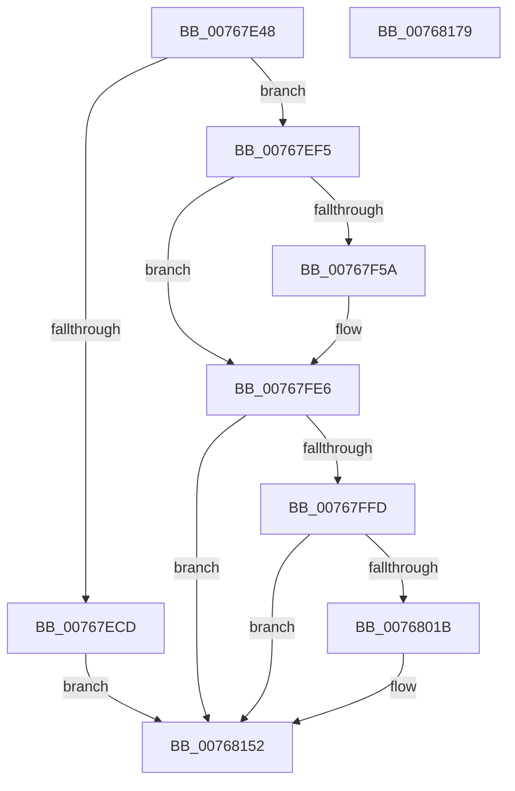

# PopPowerAdapterReinitialize

- RVA: `0x00767E48`–`0x0076817A` (길이 `818` bytes)
- VA: `0x0000000140767E48`
- 실행 섹션: `PAGE`
- PDB 이름 있음: `예`; PDB Function 태그: `아니요`
- unwind 정보 RVA: `0x000CCE58`
- 디코드: `173`개 명령, `818/818` bytes 표시
- 미해석 바이트: `0` (있으면 어셈블리에 `.byte`로 보존)

> 이 문서는 커널 이미지의 기계어와 PDB 기호를 분석해 생성했습니다. 4번과 5번은 함수 원형과 자료형을 바이너리 사용 방식에서 추정한 C 해석이며 원본 소스 복구 결과는 아닙니다.

## 1. Dependencies

- 직접 호출 지점: **10**; 고유 호출 대상: **9**
- 직접 호출자로 확인된 함수: **1**
- RIP 상대 이미지 참조: **8**

### Outgoing calls
- `0x00767EB4` → [PopPrepareIoctl](../A7/PopPrepareIoctl_function_00A74A98.md) (function, `0x00A74A98`)
- `0x00767EC1` → [IoSynchronousCallDriver](../../text/48/IoSynchronousCallDriver_function_00484050.md) (function, `0x00484050`)
- `0x00767EEB` → [PopPowerAdapterTraceFailure](PopPowerAdapterTraceFailure_function_007682B8.md) (function, `0x007682B8`)
- `0x00767F46` → [ZwUpdateWnfStateData](../../text/6B/ZwUpdateWnfStateData_function_006B0D10.md) (function, `0x006B0D10`)
- `0x00767FE1` → [tlgWriteTransfer_EtwWriteTransfer](../../text/42/tlgWriteTransfer_EtwWriteTransfer_function_004260E0.md) (function, `0x004260E0`)
- `0x00767FEB` → [PopPowerAdapterQueryStatus](PopPowerAdapterQueryStatus_function_00767C44.md) (function, `0x00767C44`)
- `0x0076800E` → [tlgKeywordOn](../../text/42/tlgKeywordOn_function_0042EAA0.md) (function, `0x0042EAA0`)
- `0x00768051` → [tlgCreate1Sz_char](../../text/42/tlgCreate1Sz_char_function_00427304.md) (function, `0x00427304`)
- `0x0076814D` → [tlgWriteTransfer_EtwWriteTransfer](../../text/42/tlgWriteTransfer_EtwWriteTransfer_function_004260E0.md) (function, `0x004260E0`)
- `0x0076815C` → [_security_check_cookie](../../text/6A/_security_check_cookie_function_006AC640.md) (function, `0x006AC640`)

### Direct callers
- [PopBatteryUpdateTestExempt](PopBatteryUpdateTestExempt_function_00766F54.md) at `0x00767205`

### Static image references
- `0x00767E65` → RVA `0x00E0A740` (`.data`; read)
- `0x00767F05` → RVA `0x00020A10` (`.rdata`; read)
- `0x00767F0C` → RVA `0x00F0C2D8` (`.data`; write)
- `0x00767F4B` → RVA `0x00E07748` (`.data`; read)
- `0x00767FB4` → RVA `0x0004C6B2` (`.rdata`; read)
- `0x00768021` → RVA `0x00B02500` (` ?? ::NNGAKEGL::`string'`; read)
- `0x00768046` → RVA `0x00B028B0` (` ?? ::NNGAKEGL::`string'`; read)
- `0x00768065` → RVA `0x0004C47C` (`.rdata`; read)

## 2. Other-region calls and transfers

- 다른 실행 섹션으로 향하는 call: **7**
  - `0x00767EC1` → [IoSynchronousCallDriver](../../text/48/IoSynchronousCallDriver_function_00484050.md) (`PAGE` → `.text`)
  - `0x00767F46` → [ZwUpdateWnfStateData](../../text/6B/ZwUpdateWnfStateData_function_006B0D10.md) (`PAGE` → `.text`)
  - `0x00767FE1` → [tlgWriteTransfer_EtwWriteTransfer](../../text/42/tlgWriteTransfer_EtwWriteTransfer_function_004260E0.md) (`PAGE` → `.text`)
  - `0x0076800E` → [tlgKeywordOn](../../text/42/tlgKeywordOn_function_0042EAA0.md) (`PAGE` → `.text`)
  - `0x00768051` → [tlgCreate1Sz_char](../../text/42/tlgCreate1Sz_char_function_00427304.md) (`PAGE` → `.text`)
  - `0x0076814D` → [tlgWriteTransfer_EtwWriteTransfer](../../text/42/tlgWriteTransfer_EtwWriteTransfer_function_004260E0.md) (`PAGE` → `.text`)
  - `0x0076815C` → [_security_check_cookie](../../text/6A/_security_check_cookie_function_006AC640.md) (`PAGE` → `.text`)
- 별도 외부 분기/꼬리 이동을 확인하지 못했습니다.

## 3. Assembly (complete function range)

```asm
00767E48  48 89 5C 24 10                  mov qword ptr [rsp + 0x10], rbx
00767E4D  48 89 74 24 18                  mov qword ptr [rsp + 0x18], rsi
00767E52  55                              push rbp
00767E53  57                              push rdi
00767E54  41 56                           push r14
00767E56  48 8D AC 24 40 FF FF FF         lea rbp, [rsp - 0xc0]
00767E5E  48 81 EC C0 01 00 00            sub rsp, 0x1c0
00767E65  48 8B 05 D4 28 6A 00            mov rax, qword ptr [rip + 0x6a28d4]
00767E6C  48 33 C4                        xor rax, rsp
00767E6F  48 89 85 B0 00 00 00            mov qword ptr [rbp + 0xb0], rax
00767E76  4C 8D 89 84 00 00 00            lea r9, [rcx + 0x84]
00767E7D  C7 44 24 28 2C 00 00 00         mov dword ptr [rsp + 0x28], 0x2c
00767E85  0F 57 C0                        xorps xmm0, xmm0
00767E88  33 C0                           xor eax, eax
00767E8A  41 0F 11 01                     movups xmmword ptr [r9], xmm0
00767E8E  48 8B D9                        mov rbx, rcx
00767E91  33 F6                           xor esi, esi
00767E93  41 0F 11 41 10                  movups xmmword ptr [r9 + 0x10], xmm0
00767E98  49 89 41 20                     mov qword ptr [r9 + 0x20], rax
00767E9C  45 33 C0                        xor r8d, r8d
00767E9F  41 89 41 28                     mov dword ptr [r9 + 0x28], eax
00767EA3  BA 70 40 29 00                  mov edx, 0x294070
00767EA8  48 8B 49 38                     mov rcx, qword ptr [rcx + 0x38]
00767EAC  89 74 24 40                     mov dword ptr [rsp + 0x40], esi
00767EB0  89 74 24 20                     mov dword ptr [rsp + 0x20], esi
00767EB4  E8 DF CB 30 00                  call 0x140a74a98
00767EB9  48 8B 53 38                     mov rdx, qword ptr [rbx + 0x38]
00767EBD  48 8B 4B 30                     mov rcx, qword ptr [rbx + 0x30]
00767EC1  E8 8A C1 D1 FF                  call 0x140484050
00767EC6  8D 7E 01                        lea edi, [rsi + 1]
00767EC9  85 C0                           test eax, eax
00767ECB  79 28                           jns 0x140767ef5
00767ECD  44 8B C0                        mov r8d, eax
00767ED0  C7 83 80 00 00 00 02 00 00 00   mov dword ptr [rbx + 0x80], 2
00767EDA  8B D7                           mov edx, edi
00767EDC  89 BB DC 00 00 00               mov dword ptr [rbx + 0xdc], edi
00767EE2  48 8B CB                        mov rcx, rbx
00767EE5  89 B3 E4 00 00 00               mov dword ptr [rbx + 0xe4], esi
00767EEB  E8 C8 03 00 00                  call 0x1407682b8
00767EF0  E9 5D 02 00 00                  jmp 0x140768152
00767EF5  0F B6 44 24 42                  movzx eax, byte ptr [rsp + 0x42]
00767EFA  48 8D 54 24 40                  lea rdx, [rsp + 0x40]
00767EFF  89 BB 80 00 00 00               mov dword ptr [rbx + 0x80], edi
00767F05  48 8D 0D 04 8B 8B FF            lea rcx, [rip - 0x7474fc]
00767F0C  48 89 1D C5 43 7A 00            mov qword ptr [rip + 0x7a43c5], rbx
00767F13  40 84 BB 8C 00 00 00            test byte ptr [rbx + 0x8c], dil
00767F1A  89 74 24 30                     mov dword ptr [rsp + 0x30], esi
00767F1E  0F 45 C7                        cmovne eax, edi
00767F21  89 74 24 28                     mov dword ptr [rsp + 0x28], esi
00767F25  45 33 C9                        xor r9d, r9d
00767F28  40 88 B3 D8 00 00 00            mov byte ptr [rbx + 0xd8], sil
00767F2F  88 44 24 42                     mov byte ptr [rsp + 0x42], al
00767F33  66 C7 44 24 40 00 01            mov word ptr [rsp + 0x40], 0x100
00767F3A  48 89 74 24 20                  mov qword ptr [rsp + 0x20], rsi
00767F3F  45 8D 71 04                     lea r14d, [r9 + 4]
00767F43  45 8B C6                        mov r8d, r14d
00767F46  E8 C5 8D F4 FF                  call 0x1406b0d10
00767F4B  83 3D F6 F7 69 00 05            cmp dword ptr [rip + 0x69f7f6], 5
00767F52  8B D0                           mov edx, eax
00767F54  0F 86 8C 00 00 00               jbe 0x140767fe6
00767F5A  8A 4C 24 40                     mov cl, byte ptr [rsp + 0x40]
00767F5E  48 8D 44 24 44                  lea rax, [rsp + 0x44]
00767F63  48 89 45 70                     mov qword ptr [rbp + 0x70], rax
00767F67  45 33 C9                        xor r9d, r9d
00767F6A  48 8D 44 24 45                  lea rax, [rsp + 0x45]
00767F6F  88 4C 24 44                     mov byte ptr [rsp + 0x44], cl
00767F73  8A 4C 24 41                     mov cl, byte ptr [rsp + 0x41]
00767F77  45 33 C0                        xor r8d, r8d
00767F7A  48 89 85 80 00 00 00            mov qword ptr [rbp + 0x80], rax
00767F81  8A 44 24 42                     mov al, byte ptr [rsp + 0x42]
00767F85  88 44 24 46                     mov byte ptr [rsp + 0x46], al
00767F89  48 8D 44 24 46                  lea rax, [rsp + 0x46]
00767F8E  48 89 85 90 00 00 00            mov qword ptr [rbp + 0x90], rax
00767F95  48 8D 44 24 48                  lea rax, [rsp + 0x48]
00767F9A  48 89 85 A0 00 00 00            mov qword ptr [rbp + 0xa0], rax
00767FA1  48 8D 45 50                     lea rax, [rbp + 0x50]
00767FA5  88 4C 24 45                     mov byte ptr [rsp + 0x45], cl
00767FA9  48 8D 0D 98 F7 69 00            lea rcx, [rip + 0x69f798]
00767FB0  89 54 24 48                     mov dword ptr [rsp + 0x48], edx
00767FB4  48 8D 15 F7 46 8E FF            lea rdx, [rip - 0x71b909]
00767FBB  48 89 44 24 28                  mov qword ptr [rsp + 0x28], rax
00767FC0  C7 44 24 20 06 00 00 00         mov dword ptr [rsp + 0x20], 6
00767FC8  48 89 7D 78                     mov qword ptr [rbp + 0x78], rdi
00767FCC  48 89 BD 88 00 00 00            mov qword ptr [rbp + 0x88], rdi
00767FD3  48 89 BD 98 00 00 00            mov qword ptr [rbp + 0x98], rdi
00767FDA  4C 89 B5 A8 00 00 00            mov qword ptr [rbp + 0xa8], r14
00767FE1  E8 FA E0 CB FF                  call 0x1404260e0
00767FE6  33 D2                           xor edx, edx
00767FE8  48 8B CB                        mov rcx, rbx
00767FEB  E8 54 FC FF FF                  call 0x140767c44
00767FF0  83 3D 51 F7 69 00 05            cmp dword ptr [rip + 0x69f751], 5
00767FF7  0F 86 55 01 00 00               jbe 0x140768152
00767FFD  48 BA 00 00 00 00 00 40 00 00   movabs rdx, 0x400000000000
00768007  48 8D 0D 3A F7 69 00            lea rcx, [rip + 0x69f73a]
0076800E  E8 8D 6A CC FF                  call 0x14042eaa0
00768013  84 C0                           test al, al
00768015  0F 84 37 01 00 00               je 0x140768152
0076801B  8B 83 88 00 00 00               mov eax, dword ptr [rbx + 0x88]
00768021  48 8D 15 D8 A4 39 00            lea rdx, [rip + 0x39a4d8]
00768028  89 44 24 48                     mov dword ptr [rsp + 0x48], eax
0076802C  48 8D 4D B0                     lea rcx, [rbp - 0x50]
00768030  48 8D 44 24 48                  lea rax, [rsp + 0x48]
00768035  4C 89 75 A8                     mov qword ptr [rbp - 0x58], r14
00768039  48 89 45 A0                     mov qword ptr [rbp - 0x60], rax
0076803D  8B 83 8C 00 00 00               mov eax, dword ptr [rbx + 0x8c]
00768043  40 84 C7                        test dil, al
00768046  48 8D 05 63 A8 39 00            lea rax, [rip + 0x39a863]
0076804D  48 0F 44 D0                     cmove rdx, rax
00768051  E8 AE F2 CB FF                  call 0x140427304
00768056  8B 8B 90 00 00 00               mov ecx, dword ptr [rbx + 0x90]
0076805C  48 8D 44 24 4C                  lea rax, [rsp + 0x4c]
00768061  48 89 45 C0                     mov qword ptr [rbp - 0x40], rax
00768065  48 8D 15 10 44 8E FF            lea rdx, [rip - 0x71bbf0]
0076806C  8B 83 94 00 00 00               mov eax, dword ptr [rbx + 0x94]
00768072  45 33 C9                        xor r9d, r9d
00768075  89 44 24 50                     mov dword ptr [rsp + 0x50], eax
00768079  45 33 C0                        xor r8d, r8d
0076807C  48 8D 44 24 50                  lea rax, [rsp + 0x50]
00768081  89 4C 24 4C                     mov dword ptr [rsp + 0x4c], ecx
00768085  48 89 45 D0                     mov qword ptr [rbp - 0x30], rax
00768089  48 8D 0D B8 F6 69 00            lea rcx, [rip + 0x69f6b8]
00768090  8B 83 98 00 00 00               mov eax, dword ptr [rbx + 0x98]
00768096  89 44 24 54                     mov dword ptr [rsp + 0x54], eax
0076809A  48 8D 44 24 54                  lea rax, [rsp + 0x54]
0076809F  48 89 45 E0                     mov qword ptr [rbp - 0x20], rax
007680A3  8B 83 9C 00 00 00               mov eax, dword ptr [rbx + 0x9c]
007680A9  89 44 24 58                     mov dword ptr [rsp + 0x58], eax
007680AD  48 8D 44 24 58                  lea rax, [rsp + 0x58]
007680B2  48 89 45 F0                     mov qword ptr [rbp - 0x10], rax
007680B6  8B 83 A0 00 00 00               mov eax, dword ptr [rbx + 0xa0]
007680BC  89 44 24 5C                     mov dword ptr [rsp + 0x5c], eax
007680C0  48 8D 44 24 5C                  lea rax, [rsp + 0x5c]
007680C5  48 89 45 00                     mov qword ptr [rbp], rax
007680C9  8B 83 A4 00 00 00               mov eax, dword ptr [rbx + 0xa4]
007680CF  89 44 24 60                     mov dword ptr [rsp + 0x60], eax
007680D3  48 8D 44 24 60                  lea rax, [rsp + 0x60]
007680D8  48 89 45 10                     mov qword ptr [rbp + 0x10], rax
007680DC  8B 83 A8 00 00 00               mov eax, dword ptr [rbx + 0xa8]
007680E2  89 44 24 64                     mov dword ptr [rsp + 0x64], eax
007680E6  48 8D 44 24 64                  lea rax, [rsp + 0x64]
007680EB  48 89 45 20                     mov qword ptr [rbp + 0x20], rax
007680EF  8B 83 AC 00 00 00               mov eax, dword ptr [rbx + 0xac]
007680F5  89 44 24 68                     mov dword ptr [rsp + 0x68], eax
007680F9  48 8D 44 24 68                  lea rax, [rsp + 0x68]
007680FE  48 89 45 30                     mov qword ptr [rbp + 0x30], rax
00768102  48 8D 44 24 70                  lea rax, [rsp + 0x70]
00768107  48 89 45 40                     mov qword ptr [rbp + 0x40], rax
0076810B  48 8D 45 80                     lea rax, [rbp - 0x80]
0076810F  48 89 44 24 28                  mov qword ptr [rsp + 0x28], rax
00768114  C7 44 24 20 0D 00 00 00         mov dword ptr [rsp + 0x20], 0xd
0076811C  4C 89 75 C8                     mov qword ptr [rbp - 0x38], r14
00768120  4C 89 75 D8                     mov qword ptr [rbp - 0x28], r14
00768124  4C 89 75 E8                     mov qword ptr [rbp - 0x18], r14
00768128  4C 89 75 F8                     mov qword ptr [rbp - 8], r14
0076812C  4C 89 75 08                     mov qword ptr [rbp + 8], r14
00768130  4C 89 75 18                     mov qword ptr [rbp + 0x18], r14
00768134  4C 89 75 28                     mov qword ptr [rbp + 0x28], r14
00768138  4C 89 75 38                     mov qword ptr [rbp + 0x38], r14
0076813C  48 C7 44 24 70 00 00 00 01      mov qword ptr [rsp + 0x70], 0x1000000
00768145  48 C7 45 48 08 00 00 00         mov qword ptr [rbp + 0x48], 8
0076814D  E8 8E DF CB FF                  call 0x1404260e0
00768152  48 8B 8D B0 00 00 00            mov rcx, qword ptr [rbp + 0xb0]
00768159  48 33 CC                        xor rcx, rsp
0076815C  E8 DF 44 F4 FF                  call 0x1406ac640
00768161  4C 8D 9C 24 C0 01 00 00         lea r11, [rsp + 0x1c0]
00768169  49 8B 5B 28                     mov rbx, qword ptr [r11 + 0x28]
0076816D  49 8B 73 30                     mov rsi, qword ptr [r11 + 0x30]
00768171  49 8B E3                        mov rsp, r11
00768174  41 5E                           pop r14
00768176  5F                              pop rdi
00768177  5D                              pop rbp
00768178  C3                              ret
00768179  CC                              int3
```

## 4. C-style interpretation (structured pseudocode)

```c
__int64 __fastcall PopPowerAdapterReinitialize(__int64 a1, __int64 a2, int a3)
{
    __int64 result;
    __int64 v_rsi;
    __int64 v_rsp;
    unsigned __int64 v_stack_m100;
    unsigned __int64 v_stack_m108;
    unsigned __int64 v_stack_m110;
    unsigned __int64 v_stack_m118;
    unsigned __int64 v_stack_m128;
    unsigned __int64 v_stack_m130;
    unsigned __int64 v_stack_m138;
    unsigned __int64 v_stack_m158;
    unsigned __int64 v_stack_m168;
    unsigned int v_stack_m170;
    unsigned int v_stack_m174;
    unsigned int v_stack_m178;
    unsigned int v_stack_m17C;
    unsigned __int64 v_stack_m18;
    unsigned int v_stack_m180;
    unsigned int v_stack_m184;
    unsigned int v_stack_m188;
    unsigned __int64 v_stack_m18C;
    unsigned __int64 v_stack_m190;
    unsigned __int8 v_stack_m192;
    unsigned __int64 v_stack_m193;
    unsigned __int64 v_stack_m194;
    unsigned __int8 v_stack_m196;
    unsigned __int8 v_stack_m197;
    unsigned int v_stack_m198;
    unsigned int v_stack_m1A8;
    unsigned int v_stack_m1B0;
    unsigned int v_stack_m1B8;
    unsigned __int64 v_stack_m28;
    unsigned __int64 v_stack_m30;
    unsigned __int64 v_stack_m38;
    unsigned __int64 v_stack_m40;
    unsigned __int64 v_stack_m48;
    unsigned __int64 v_stack_m50;
    unsigned __int64 v_stack_m58;
    unsigned __int64 v_stack_m60;
    unsigned __int64 v_stack_m68;
    unsigned __int64 v_stack_m88;
    unsigned __int64 v_stack_m90;
    unsigned __int64 v_stack_m98;
    unsigned __int64 v_stack_mA0;
    unsigned __int64 v_stack_mA8;
    unsigned __int64 v_stack_mB0;
    unsigned __int64 v_stack_mB8;
    unsigned __int64 v_stack_mC0;
    unsigned __int64 v_stack_mC8;
    unsigned __int64 v_stack_mD0;
    unsigned __int64 v_stack_mD8;
    unsigned __int64 v_stack_mE0;
    unsigned __int64 v_stack_mE8;
    unsigned __int64 v_stack_mF0;
    unsigned __int64 v_stack_mF8;
    unsigned __int64 v_stack_p10;
    unsigned __int64 v_stack_p18;

    v_stack_p10 = v_rbx;
    v_stack_p18 = v_rsi;
    v_rsp = (v_rsp) - (448);
    result = (*(unsigned __int64 *)(v_rip + 6957268)) ^ (v_rsp);
    v_stack_m28 = result;
    v_stack_m1B0 = 44;
    result = 0;
    *(unsigned __int64 *)(a1 + 132) = v_xmm0;
    v_rsi = 0;
    *(unsigned __int64 *)(a1 + 132 + 16) = v_xmm0;
    *(unsigned __int64 *)(a1 + 132 + 32) = 0;
    a3 = 0;
    *(unsigned int *)(a1 + 132 + 40) = 0;
    v_stack_m198 = 0;
    v_stack_m1B8 = 0;
    result = PopPrepareIoctl(*(unsigned __int64 *)(a1 + 56), (unsigned int)(0x294070ULL), a3, a1 + 132);
    result = IoSynchronousCallDriver(*(unsigned __int64 *)(a1 + 48), *(unsigned __int64 *)(a1 + 56), a3, a1 + 132);
    if (!sign_flag) goto loc_00767EF5;
    *(unsigned int *)(a1 + 128) = 2;
    *(unsigned int *)(a1 + 220) = (unsigned int)(v_rsi + 1);
    *(unsigned int *)(a1 + 228) = 0;
    result = PopPowerAdapterTraceFailure(a1, (unsigned int)((unsigned int)(v_rsi + 1)), (unsigned int)((unsigned int)(result)), a1 + 132);
    goto loc_00768152;
loc_00767EF5:
    *(unsigned int *)(a1 + 128) = (unsigned int)(v_rsi + 1);
    *(unsigned __int64 *)(v_rip + 8012741) = a1;
    v_stack_m1A8 = 0;
    result = v_stack_m196;
    if (((*(unsigned __int8 *)(a1 + 140)) & ((unsigned __int8)(v_rsi + 1))) != 0) { result = (unsigned int)(v_rsi + 1); }
    v_stack_m1B0 = 0;
    a4 = 0;
    *(unsigned __int8 *)(a1 + 216) = 0;
    v_stack_m196 = (unsigned __int8)(result);
    v_stack_m198 = 256;
    v_stack_m1B8 = 0;
    result = ZwUpdateWnfStateData(v_rip - 7632124, v_stack_m198, (unsigned int)((unsigned int)(a4 + 4)), a4);
    if ((*(unsigned int *)(v_rip + 6944758)) >= = 5) {
        a1 = v_stack_m198;
        result = v_stack_m194;
        v_stack_m68 = result;
        a4 = 0;
        result = v_stack_m193;
        v_stack_m194 = (unsigned __int8)(a1);
        a1 = v_stack_m197;
        a3 = 0;
        v_stack_m58 = result;
        result = v_stack_m196;
        v_stack_m192 = (unsigned __int8)(result);
        result = v_stack_m192;
        v_stack_m48 = result;
        result = v_stack_m190;
        v_stack_m38 = result;
        result = v_stack_m88;
        v_stack_m193 = (unsigned __int8)(a1);
        a1 = v_rip + 6944664;
        v_stack_m190 = (unsigned int)((unsigned int)((unsigned int)(result)));
        a2 = v_rip - 7452937;
        v_stack_m1B0 = result;
        v_stack_m1B8 = 6;
        v_stack_m60 = v_rsi + 1;
        v_stack_m50 = v_rsi + 1;
        v_stack_m40 = v_rsi + 1;
        v_stack_m30 = a4 + 4;
        result = tlgWriteTransfer_EtwWriteTransfer(a1, a2, a3, a4);
    }
    a2 = 0;
    result = PopPowerAdapterQueryStatus(a1, a2, a3, a4);
    if ((*(unsigned int *)(v_rip + 6944593)) <= 5) goto loc_00768152;
    result = tlgKeywordOn(v_rip + 6944570, a2, a3, a4);
    if ((unsigned __int8)(result) != 0) {
        result = *(unsigned int *)(a1 + 136);
        a2 = v_rip + 3777752;
        v_stack_m190 = (unsigned int)(result);
        a1 = v_stack_m128;
        result = v_stack_m190;
        v_stack_m130 = a4 + 4;
        v_stack_m138 = result;
        result = *(unsigned int *)(a1 + 140);
        result = v_rip + 3778659;
        if ((((unsigned __int8)(v_rsi + 1)) & ((unsigned __int8)(result))) == 0) { a2 = result; }
        result = tlgCreate1Sz_char(a1, a2, a3, a4);
        a1 = *(unsigned int *)(a1 + 144);
        result = v_stack_m18C;
        v_stack_m118 = result;
        a2 = v_rip - 7453680;
        result = *(unsigned int *)(a1 + 148);
        a4 = 0;
        v_stack_m188 = (unsigned int)(result);
        a3 = 0;
        result = v_stack_m188;
        v_stack_m18C = (unsigned int)(a1);
        v_stack_m108 = result;
        a1 = v_rip + 6944440;
        result = *(unsigned int *)(a1 + 152);
        v_stack_m184 = (unsigned int)(result);
        result = v_stack_m184;
        v_stack_mF8 = result;
        result = *(unsigned int *)(a1 + 156);
        v_stack_m180 = (unsigned int)(result);
        result = v_stack_m180;
        v_stack_mE8 = result;
        result = *(unsigned int *)(a1 + 160);
        v_stack_m17C = (unsigned int)(result);
        result = v_stack_m17C;
        v_stack_mD8 = result;
        result = *(unsigned int *)(a1 + 164);
        v_stack_m178 = (unsigned int)(result);
        result = v_stack_m178;
        v_stack_mC8 = result;
        result = *(unsigned int *)(a1 + 168);
        v_stack_m174 = (unsigned int)(result);
        result = v_stack_m174;
        v_stack_mB8 = result;
        result = *(unsigned int *)(a1 + 172);
        v_stack_m170 = (unsigned int)(result);
        result = v_stack_m170;
        v_stack_mA8 = result;
        result = v_stack_m168;
        v_stack_m98 = result;
        result = v_stack_m158;
        v_stack_m1B0 = result;
        v_stack_m1B8 = 13;
        v_stack_m110 = a4 + 4;
        v_stack_m100 = a4 + 4;
        v_stack_mF0 = a4 + 4;
        v_stack_mE0 = a4 + 4;
        v_stack_mD0 = a4 + 4;
        v_stack_mC0 = a4 + 4;
        v_stack_mB0 = a4 + 4;
        v_stack_mA0 = a4 + 4;
        v_stack_m168 = 0x1000000ULL;
        v_stack_m90 = 8;
        result = tlgWriteTransfer_EtwWriteTransfer(a1, a2, a3, a4);
    }
    a1 = (v_stack_m28) ^ (v_rsp);
    result = _security_check_cookie(a1, a2, a3, a4);
    return result;
}
```

## 5. (Beta) C Style

```c
int64_t PopPowerAdapterReinitialize(void *Arg1, int64_t Arg2, int32_t Arg3)
{
    uint8_t *arg1 = (uint8_t *)Arg1;

    int64_t result;
    int64_t local_rsi;
    int64_t local_rsp;
    uint64_t v_stack_m100;
    uint64_t v_stack_m108;
    uint64_t v_stack_m110;
    uint64_t v_stack_m118;
    uint64_t v_stack_m128;
    uint64_t v_stack_m130;
    uint64_t v_stack_m138;
    uint64_t v_stack_m158;
    uint64_t v_stack_m168;
    uint32_t v_stack_m170;
    uint32_t v_stack_m174;
    uint32_t v_stack_m178;
    uint32_t v_stack_m17C;
    uint64_t v_stack_m18;
    uint32_t v_stack_m180;
    uint32_t v_stack_m184;
    uint32_t v_stack_m188;
    uint64_t v_stack_m18C;
    uint64_t v_stack_m190;
    uint8_t v_stack_m192;
    uint64_t v_stack_m193;
    uint64_t v_stack_m194;
    uint8_t v_stack_m196;
    uint8_t v_stack_m197;
    uint32_t v_stack_m198;
    uint32_t v_stack_m1A8;
    uint32_t v_stack_m1B0;
    uint32_t v_stack_m1B8;
    uint64_t v_stack_m28;
    uint64_t v_stack_m30;
    uint64_t v_stack_m38;
    uint64_t v_stack_m40;
    uint64_t v_stack_m48;
    uint64_t v_stack_m50;
    uint64_t v_stack_m58;
    uint64_t v_stack_m60;
    uint64_t v_stack_m68;
    uint64_t v_stack_m88;
    uint64_t v_stack_m90;
    uint64_t v_stack_m98;
    uint64_t v_stack_mA0;
    uint64_t v_stack_mA8;
    uint64_t v_stack_mB0;
    uint64_t v_stack_mB8;
    uint64_t v_stack_mC0;
    uint64_t v_stack_mC8;
    uint64_t v_stack_mD0;
    uint64_t v_stack_mD8;
    uint64_t v_stack_mE0;
    uint64_t v_stack_mE8;
    uint64_t v_stack_mF0;
    uint64_t v_stack_mF8;
    uint64_t v_stack_p10;
    uint64_t v_stack_p18;

    v_stack_p10 = local_rbx;
    v_stack_p18 = local_rsi;
    local_rsp = (local_rsp) - (448);
    result = (*(uint64_t *)(v_rip + 0x6A28D4)) ^ (local_rsp);
    v_stack_m28 = result;
    v_stack_m1B0 = 44;
    result = 0;
    *(uint64_t *)(arg1 + 0x84) = v_xmm0;
    local_rsi = 0;
    *(uint64_t *)(arg1 + 0x84 + 0x10) = v_xmm0;
    *(uint64_t *)(arg1 + 0x84 + 0x20) = 0;
    Arg3 = 0;
    *(uint32_t *)(arg1 + 0x84 + 0x28) = 0;
    v_stack_m198 = 0;
    v_stack_m1B8 = 0;
    result = PopPrepareIoctl(*(uint64_t *)(arg1 + 0x38), (uint32_t)(0x294070ULL), Arg3, Arg1 + 132);
    result = IoSynchronousCallDriver(*(uint64_t *)(arg1 + 0x30), *(uint64_t *)(arg1 + 0x38), Arg3, Arg1 + 132);
    if (!sign_flag) goto loc_00767EF5;
    *(uint32_t *)(arg1 + 0x80) = 2;
    *(uint32_t *)(arg1 + 0xDC) = (uint32_t)(local_rsi + 1);
    *(uint32_t *)(arg1 + 0xE4) = 0;
    result = PopPowerAdapterTraceFailure(Arg1, (uint32_t)((uint32_t)(local_rsi + 1)), (uint32_t)((uint32_t)(result)), Arg1 + 132);
    goto loc_00768152;
loc_00767EF5:
    *(uint32_t *)(arg1 + 0x80) = (uint32_t)(local_rsi + 1);
    *(void **)(v_rip + 0x7A43C5) = Arg1;
    v_stack_m1A8 = 0;
    result = v_stack_m196;
    if (((*(uint8_t *)(arg1 + 0x8C)) & ((uint8_t)(local_rsi + 1))) != 0) { result = (uint32_t)(local_rsi + 1); }
    v_stack_m1B0 = 0;
    a4 = 0;
    *(uint8_t *)(arg1 + 0xD8) = 0;
    v_stack_m196 = (uint8_t)(result);
    v_stack_m198 = 256;
    v_stack_m1B8 = 0;
    result = ZwUpdateWnfStateData(v_rip - 7632124, v_stack_m198, (uint32_t)((uint32_t)(a4 + 4)), a4);
    if ((*(uint32_t *)(v_rip + 0x69F7F6)) >= = 5) {
        Arg1 = v_stack_m198;
        result = v_stack_m194;
        v_stack_m68 = result;
        a4 = 0;
        result = v_stack_m193;
        v_stack_m194 = (uint8_t)(Arg1);
        Arg1 = v_stack_m197;
        Arg3 = 0;
        v_stack_m58 = result;
        result = v_stack_m196;
        v_stack_m192 = (uint8_t)(result);
        result = v_stack_m192;
        v_stack_m48 = result;
        result = v_stack_m190;
        v_stack_m38 = result;
        result = v_stack_m88;
        v_stack_m193 = (uint8_t)(Arg1);
        Arg1 = v_rip + 6944664;
        v_stack_m190 = (uint32_t)((uint32_t)((uint32_t)(result)));
        Arg2 = v_rip - 7452937;
        v_stack_m1B0 = result;
        v_stack_m1B8 = 6;
        v_stack_m60 = local_rsi + 1;
        v_stack_m50 = local_rsi + 1;
        v_stack_m40 = local_rsi + 1;
        v_stack_m30 = a4 + 4;
        result = tlgWriteTransfer_EtwWriteTransfer(Arg1, Arg2, Arg3, a4);
    }
    Arg2 = 0;
    result = PopPowerAdapterQueryStatus(Arg1, Arg2, Arg3, a4);
    if ((*(uint32_t *)(v_rip + 0x69F751)) <= 5) goto loc_00768152;
    result = tlgKeywordOn(v_rip + 6944570, Arg2, Arg3, a4);
    if ((uint8_t)(result) != 0) {
        result = *(uint32_t *)(arg1 + 0x88);
        Arg2 = v_rip + 3777752;
        v_stack_m190 = (uint32_t)(result);
        Arg1 = v_stack_m128;
        result = v_stack_m190;
        v_stack_m130 = a4 + 4;
        v_stack_m138 = result;
        result = *(uint32_t *)(arg1 + 0x8C);
        result = v_rip + 3778659;
        if ((((uint8_t)(local_rsi + 1)) & ((uint8_t)(result))) == 0) { Arg2 = result; }
        result = tlgCreate1Sz_char(Arg1, Arg2, Arg3, a4);
        Arg1 = *(uint32_t *)(arg1 + 0x90);
        result = v_stack_m18C;
        v_stack_m118 = result;
        Arg2 = v_rip - 7453680;
        result = *(uint32_t *)(arg1 + 0x94);
        a4 = 0;
        v_stack_m188 = (uint32_t)(result);
        Arg3 = 0;
        result = v_stack_m188;
        v_stack_m18C = (uint32_t)(Arg1);
        v_stack_m108 = result;
        Arg1 = v_rip + 6944440;
        result = *(uint32_t *)(arg1 + 0x98);
        v_stack_m184 = (uint32_t)(result);
        result = v_stack_m184;
        v_stack_mF8 = result;
        result = *(uint32_t *)(arg1 + 0x9C);
        v_stack_m180 = (uint32_t)(result);
        result = v_stack_m180;
        v_stack_mE8 = result;
        result = *(uint32_t *)(arg1 + 0xA0);
        v_stack_m17C = (uint32_t)(result);
        result = v_stack_m17C;
        v_stack_mD8 = result;
        result = *(uint32_t *)(arg1 + 0xA4);
        v_stack_m178 = (uint32_t)(result);
        result = v_stack_m178;
        v_stack_mC8 = result;
        result = *(uint32_t *)(arg1 + 0xA8);
        v_stack_m174 = (uint32_t)(result);
        result = v_stack_m174;
        v_stack_mB8 = result;
        result = *(uint32_t *)(arg1 + 0xAC);
        v_stack_m170 = (uint32_t)(result);
        result = v_stack_m170;
        v_stack_mA8 = result;
        result = v_stack_m168;
        v_stack_m98 = result;
        result = v_stack_m158;
        v_stack_m1B0 = result;
        v_stack_m1B8 = 13;
        v_stack_m110 = a4 + 4;
        v_stack_m100 = a4 + 4;
        v_stack_mF0 = a4 + 4;
        v_stack_mE0 = a4 + 4;
        v_stack_mD0 = a4 + 4;
        v_stack_mC0 = a4 + 4;
        v_stack_mB0 = a4 + 4;
        v_stack_mA0 = a4 + 4;
        v_stack_m168 = 0x1000000ULL;
        v_stack_m90 = 8;
        result = tlgWriteTransfer_EtwWriteTransfer(Arg1, Arg2, Arg3, a4);
    }
    Arg1 = (v_stack_m28) ^ (local_rsp);
    result = _security_check_cookie(Arg1, Arg2, Arg3, a4);
    return result;
}
```

### 관측된 메모리 오프셋

구조체 형식이 확인되지 않은 접근은 인자 기준의 오프셋으로만 기록했습니다.

| 기준 인자 | 오프셋 표현 | 폭 (bit) | 접근 |
|---|---:|---:|---|
| `Arg1` | `+ 0x0` | `128` | `R` |
| `Arg1` | `+ 0x10` | `128` | `R` |
| `Arg1` | `+ 0x20` | `64` | `W` |
| `Arg1` | `+ 0x28` | `32` | `W` |
| `Arg1` | `+ 0x30` | `64` | `R` |
| `Arg1` | `+ 0x38` | `64` | `R` |
| `Arg1` | `+ 0x80` | `32` | `W` |
| `Arg1` | `+ 0x84` | `64` | `R` |
| `Arg1` | `+ 0x88` | `32` | `R` |
| `Arg1` | `+ 0x8C` | `8` | `R` |
| `Arg1` | `+ 0x8C` | `32` | `R` |
| `Arg1` | `+ 0x90` | `32` | `R` |
| `Arg1` | `+ 0x94` | `32` | `R` |
| `Arg1` | `+ 0x98` | `32` | `R` |
| `Arg1` | `+ 0x9C` | `32` | `R` |
| `Arg1` | `+ 0xA0` | `32` | `R` |
| `Arg1` | `+ 0xA4` | `32` | `R` |
| `Arg1` | `+ 0xA8` | `32` | `R` |
| `Arg1` | `+ 0xAC` | `32` | `R` |
| `Arg1` | `+ 0xD8` | `8` | `W` |
| `Arg1` | `+ 0xDC` | `32` | `W` |
| `Arg1` | `+ 0xE4` | `32` | `W` |

## 6. Execution-region graph

[열기: 2D/3D 그래프와 함수 탐색 컨트롤 패널](../../../control-panel.html?section=page&rva=0x00767E48&view=graph)

- 2D 그래프는 위에서 아래로 흐르고, 3D 그래프는 빈 공간을 드래그해 회전합니다. Shift+드래그는 이동, 휠은 확대·축소, 함수 노드 선택은 대상 보고서 이동입니다.

### Static fallback


