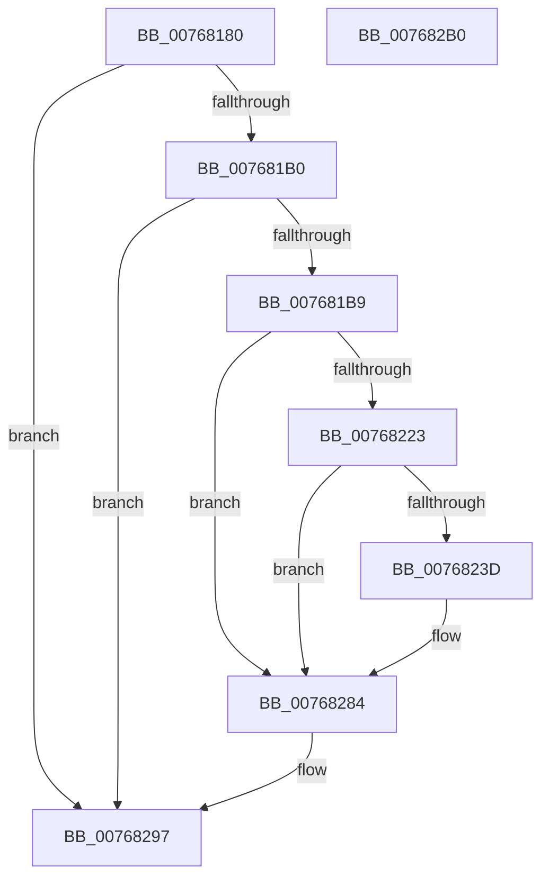

# PopPowerAdapterRemove

- RVA: `0x00768180`–`0x007682B1` (길이 `305` bytes)
- VA: `0x0000000140768180`
- 실행 섹션: `PAGE`
- PDB 이름 있음: `예`; PDB Function 태그: `아니요`
- unwind 정보 RVA: `0x000986F8`
- 디코드: `62`개 명령, `305/305` bytes 표시
- 미해석 바이트: `0` (있으면 어셈블리에 `.byte`로 보존)

> 이 문서는 커널 이미지의 기계어와 PDB 기호를 분석해 생성했습니다. 4번과 5번은 함수 원형과 자료형을 바이너리 사용 방식에서 추정한 C 해석이며 원본 소스 복구 결과는 아닙니다.

## 1. Dependencies

- 직접 호출 지점: **9**; 고유 호출 대상: **9**
- 직접 호출자로 확인된 함수: **0**
- RIP 상대 이미지 참조: **7**

### Outgoing calls
- `0x007681BD` → [IoCancelIrp](../../text/27/IoCancelIrp_function_002720E0.md) (function, `0x002720E0`)
- `0x007681D4` → [KeWaitForSingleObject](../../text/20/KeWaitForSingleObject_function_0020E6B0.md) (function, `0x0020E6B0`)
- `0x007681E0` → [PopAcquireRwLockExclusive](../../text/43/PopAcquireRwLockExclusive_function_00430B44.md) (function, `0x00430B44`)
- `0x00768210` → [ZwUpdateWnfStateData](../../text/6B/ZwUpdateWnfStateData_function_006B0D10.md) (function, `0x006B0D10`)
- `0x00768234` → [tlgKeywordOn](../../text/42/tlgKeywordOn_function_0042EAA0.md) (function, `0x0042EAA0`)
- `0x0076827F` → [tlgWriteTransfer_EtwWriteTransfer](../../text/42/tlgWriteTransfer_EtwWriteTransfer_function_004260E0.md) (function, `0x004260E0`)
- `0x00768286` → [PopBatteryQueueWork](../../text/4A/PopBatteryQueueWork_function_004AE3DC.md) (function, `0x004AE3DC`)
- `0x00768292` → [PopReleaseRwLock](../../text/2D/PopReleaseRwLock_function_002DFBBC.md) (function, `0x002DFBBC`)
- `0x007682A2` → [_security_check_cookie](../../text/6A/_security_check_cookie_function_006AC640.md) (function, `0x006AC640`)

### Direct callers
- 이 함수 시작 RVA로 연결되는 직접 call은 확인되지 않았습니다. 간접 호출은 완전히 역산할 수 없습니다.

### Static image references
- `0x00768189` → RVA `0x00E0A740` (`.data`; read)
- `0x007681A0` → RVA `0x00F0C2D8` (`.data`; read)
- `0x007681D9` → RVA `0x00F0C020` (`.data`; read)
- `0x007681F4` → RVA `0x00020A10` (`.rdata`; read)
- `0x007681FB` → RVA `0x00F0C2D8` (`.data`; read/write)
- `0x00768215` → RVA `0x00E07748` (`.data`; read)
- `0x0076824C` → RVA `0x0004C786` (`.rdata`; read)

## 2. Other-region calls and transfers

- 다른 실행 섹션으로 향하는 call: **9**
  - `0x007681BD` → [IoCancelIrp](../../text/27/IoCancelIrp_function_002720E0.md) (`PAGE` → `.text`)
  - `0x007681D4` → [KeWaitForSingleObject](../../text/20/KeWaitForSingleObject_function_0020E6B0.md) (`PAGE` → `.text`)
  - `0x007681E0` → [PopAcquireRwLockExclusive](../../text/43/PopAcquireRwLockExclusive_function_00430B44.md) (`PAGE` → `.text`)
  - `0x00768210` → [ZwUpdateWnfStateData](../../text/6B/ZwUpdateWnfStateData_function_006B0D10.md) (`PAGE` → `.text`)
  - `0x00768234` → [tlgKeywordOn](../../text/42/tlgKeywordOn_function_0042EAA0.md) (`PAGE` → `.text`)
  - `0x0076827F` → [tlgWriteTransfer_EtwWriteTransfer](../../text/42/tlgWriteTransfer_EtwWriteTransfer_function_004260E0.md) (`PAGE` → `.text`)
  - `0x00768286` → [PopBatteryQueueWork](../../text/4A/PopBatteryQueueWork_function_004AE3DC.md) (`PAGE` → `.text`)
  - `0x00768292` → [PopReleaseRwLock](../../text/2D/PopReleaseRwLock_function_002DFBBC.md) (`PAGE` → `.text`)
  - `0x007682A2` → [_security_check_cookie](../../text/6A/_security_check_cookie_function_006AC640.md) (`PAGE` → `.text`)
- 별도 외부 분기/꼬리 이동을 확인하지 못했습니다.

## 3. Assembly (complete function range)

```asm
00768180  40 53                           push rbx
00768182  48 81 EC 90 00 00 00            sub rsp, 0x90
00768189  48 8B 05 B0 25 6A 00            mov rax, qword ptr [rip + 0x6a25b0]
00768190  48 33 C4                        xor rax, rsp
00768193  48 89 84 24 80 00 00 00         mov qword ptr [rsp + 0x80], rax
0076819B  83 64 24 40 00                  and dword ptr [rsp + 0x40], 0
007681A0  48 8B 1D 31 41 7A 00            mov rbx, qword ptr [rip + 0x7a4131]
007681A7  48 85 DB                        test rbx, rbx
007681AA  0F 84 E7 00 00 00               je 0x140768297
007681B0  48 3B D9                        cmp rbx, rcx
007681B3  0F 85 DE 00 00 00               jne 0x140768297
007681B9  48 8B 4B 38                     mov rcx, qword ptr [rbx + 0x38]
007681BD  E8 1E 9F B0 FF                  call 0x1402720e0
007681C2  48 83 64 24 20 00               and qword ptr [rsp + 0x20], 0
007681C8  48 8D 4B 68                     lea rcx, [rbx + 0x68]
007681CC  45 33 C9                        xor r9d, r9d
007681CF  45 33 C0                        xor r8d, r8d
007681D2  33 D2                           xor edx, edx
007681D4  E8 D7 64 AA FF                  call 0x14020e6b0
007681D9  48 8D 0D 40 3E 7A 00            lea rcx, [rip + 0x7a3e40]
007681E0  E8 5F 89 CC FF                  call 0x140430b44
007681E5  83 64 24 30 00                  and dword ptr [rsp + 0x30], 0
007681EA  48 8D 54 24 40                  lea rdx, [rsp + 0x40]
007681EF  83 64 24 28 00                  and dword ptr [rsp + 0x28], 0
007681F4  48 8D 0D 15 88 8B FF            lea rcx, [rip - 0x7477eb]
007681FB  48 83 25 D5 40 7A 00 00         and qword ptr [rip + 0x7a40d5], 0
00768203  45 33 C9                        xor r9d, r9d
00768206  48 83 64 24 20 00               and qword ptr [rsp + 0x20], 0
0076820C  45 8D 41 04                     lea r8d, [r9 + 4]
00768210  E8 FB 8A F4 FF                  call 0x1406b0d10
00768215  83 3D 2C F5 69 00 05            cmp dword ptr [rip + 0x69f52c], 5
0076821C  BB 08 00 00 00                  mov ebx, 8
00768221  76 61                           jbe 0x140768284
00768223  48 BA 00 00 00 00 00 40 00 00   movabs rdx, 0x400000000000
0076822D  48 8D 0D 14 F5 69 00            lea rcx, [rip + 0x69f514]
00768234  E8 67 68 CC FF                  call 0x14042eaa0
00768239  84 C0                           test al, al
0076823B  74 47                           je 0x140768284
0076823D  83 64 24 7C 00                  and dword ptr [rsp + 0x7c], 0
00768242  48 8D 44 24 48                  lea rax, [rsp + 0x48]
00768247  48 89 44 24 70                  mov qword ptr [rsp + 0x70], rax
0076824C  48 8D 15 33 45 8E FF            lea rdx, [rip - 0x71bacd]
00768253  48 8D 44 24 50                  lea rax, [rsp + 0x50]
00768258  48 C7 44 24 48 00 00 00 01      mov qword ptr [rsp + 0x48], 0x1000000
00768261  48 89 44 24 28                  mov qword ptr [rsp + 0x28], rax
00768266  48 8D 0D DB F4 69 00            lea rcx, [rip + 0x69f4db]
0076826D  45 33 C9                        xor r9d, r9d
00768270  C7 44 24 20 03 00 00 00         mov dword ptr [rsp + 0x20], 3
00768278  45 33 C0                        xor r8d, r8d
0076827B  89 5C 24 78                     mov dword ptr [rsp + 0x78], ebx
0076827F  E8 5C DE CB FF                  call 0x1404260e0
00768284  8B CB                           mov ecx, ebx
00768286  E8 51 61 D4 FF                  call 0x1404ae3dc
0076828B  48 8D 0D 8E 3D 7A 00            lea rcx, [rip + 0x7a3d8e]
00768292  E8 25 79 B7 FF                  call 0x1402dfbbc
00768297  48 8B 8C 24 80 00 00 00         mov rcx, qword ptr [rsp + 0x80]
0076829F  48 33 CC                        xor rcx, rsp
007682A2  E8 99 43 F4 FF                  call 0x1406ac640
007682A7  48 81 C4 90 00 00 00            add rsp, 0x90
007682AE  5B                              pop rbx
007682AF  C3                              ret
007682B0  CC                              int3
```

## 4. C-style interpretation (structured pseudocode)

```c
__int64 __fastcall PopPowerAdapterRemove(__int64 a1, int a2, int a3, int a4)
{
    __int64 result;
    __int64 v_rsp;
    unsigned __int64 v_stack_m18;
    unsigned int v_stack_m1C;
    unsigned int v_stack_m20;
    unsigned __int64 v_stack_m28;
    unsigned __int64 v_stack_m48;
    unsigned __int64 v_stack_m50;
    unsigned int v_stack_m58;
    unsigned int v_stack_m68;
    unsigned int v_stack_m70;
    unsigned __int64 v_stack_m78;

    v_rsp = (v_rsp) - (144);
    result = (*(unsigned __int64 *)(v_rip + 6956464)) ^ (v_rsp);
    v_stack_m18 = result;
    if (*(unsigned __int64 *)(v_rip + 8012081) == 0) goto loc_00768297;
    if ((*(unsigned __int64 *)(v_rip + 8012081)) != a1) goto loc_00768297;
    result = IoCancelIrp(*(unsigned __int64 *)(*(unsigned __int64 *)(v_rip + 8012081) + 56), a2, a3, a4);
    a4 = 0;
    a3 = 0;
    a2 = 0;
    result = KeWaitForSingleObject(*(unsigned __int64 *)(v_rip + 8012081) + 104, a2, a3, a4);
    result = PopAcquireRwLockExclusive(v_rip + 8011328, a2, a3, a4);
    a4 = 0;
    result = ZwUpdateWnfStateData(v_rip - 7632875, v_stack_m58, a4 + 4, a4);
    if ((*(unsigned int *)(v_rip + 6944044)) <= 5) goto loc_00768284;
    result = tlgKeywordOn(v_rip + 6944020, v_stack_m58, a4 + 4, a4);
    if ((unsigned __int8)(result) != 0) {
        result = v_stack_m50;
        v_stack_m28 = result;
        a2 = v_rip - 7453389;
        result = v_stack_m48;
        v_stack_m50 = 0x1000000ULL;
        v_stack_m70 = result;
        a1 = v_rip + 6943963;
        a4 = 0;
        v_stack_m78 = 3;
        a3 = 0;
        v_stack_m20 = 8;
        result = tlgWriteTransfer_EtwWriteTransfer(a1, a2, a3, a4);
    }
    result = PopBatteryQueueWork(8, a2, a3, a4);
    result = PopReleaseRwLock(v_rip + 8011150, a2, a3, a4);
loc_00768297:
    a1 = (v_stack_m18) ^ (v_rsp);
    result = _security_check_cookie(a1, a2, a3, a4);
    v_rsp = (v_rsp) + (144);
    return result;
}
```

## 5. (Beta) C Style

```c
int64_t PopPowerAdapterRemove(int64_t Arg1, int32_t Arg2, int32_t Arg3, int32_t Arg4)
{
    int64_t result;
    int64_t local_rsp;
    uint64_t v_stack_m18;
    uint32_t v_stack_m1C;
    uint32_t v_stack_m20;
    uint64_t v_stack_m28;
    uint64_t v_stack_m48;
    uint64_t v_stack_m50;
    uint32_t v_stack_m58;
    uint32_t v_stack_m68;
    uint32_t v_stack_m70;
    uint64_t v_stack_m78;

    local_rsp = (local_rsp) - (144);
    result = (*(uint64_t *)(v_rip + 0x6A25B0)) ^ (local_rsp);
    v_stack_m18 = result;
    if (*(uint64_t *)(v_rip + 0x7A4131) == 0) goto loc_00768297;
    if ((*(uint64_t *)(v_rip + 0x7A4131)) != Arg1) goto loc_00768297;
    result = IoCancelIrp(*(uint64_t *)(*(uint64_t *)(v_rip + 0x7A4131) + 0x38), Arg2, Arg3, Arg4);
    Arg4 = 0;
    Arg3 = 0;
    Arg2 = 0;
    result = KeWaitForSingleObject(*(uint64_t *)(v_rip + 0x7A4131) + 104, Arg2, Arg3, Arg4);
    result = PopAcquireRwLockExclusive(v_rip + 8011328, Arg2, Arg3, Arg4);
    Arg4 = 0;
    result = ZwUpdateWnfStateData(v_rip - 7632875, v_stack_m58, Arg4 + 4, Arg4);
    if ((*(uint32_t *)(v_rip + 0x69F52C)) <= 5) goto loc_00768284;
    result = tlgKeywordOn(v_rip + 6944020, v_stack_m58, Arg4 + 4, Arg4);
    if ((uint8_t)(result) != 0) {
        result = v_stack_m50;
        v_stack_m28 = result;
        Arg2 = v_rip - 7453389;
        result = v_stack_m48;
        v_stack_m50 = 0x1000000ULL;
        v_stack_m70 = result;
        Arg1 = v_rip + 6943963;
        Arg4 = 0;
        v_stack_m78 = 3;
        Arg3 = 0;
        v_stack_m20 = 8;
        result = tlgWriteTransfer_EtwWriteTransfer(Arg1, Arg2, Arg3, Arg4);
    }
    result = PopBatteryQueueWork(8, Arg2, Arg3, Arg4);
    result = PopReleaseRwLock(v_rip + 8011150, Arg2, Arg3, Arg4);
loc_00768297:
    Arg1 = (v_stack_m18) ^ (local_rsp);
    result = _security_check_cookie(Arg1, Arg2, Arg3, Arg4);
    local_rsp = (local_rsp) + (144);
    return result;
}
```

## 6. Execution-region graph

[열기: 2D/3D 그래프와 함수 탐색 컨트롤 패널](../../../control-panel.html?section=page&rva=0x00768180&view=graph)

- 2D 그래프는 위에서 아래로 흐르고, 3D 그래프는 빈 공간을 드래그해 회전합니다. Shift+드래그는 이동, 휠은 확대·축소, 함수 노드 선택은 대상 보고서 이동입니다.

### Static fallback


