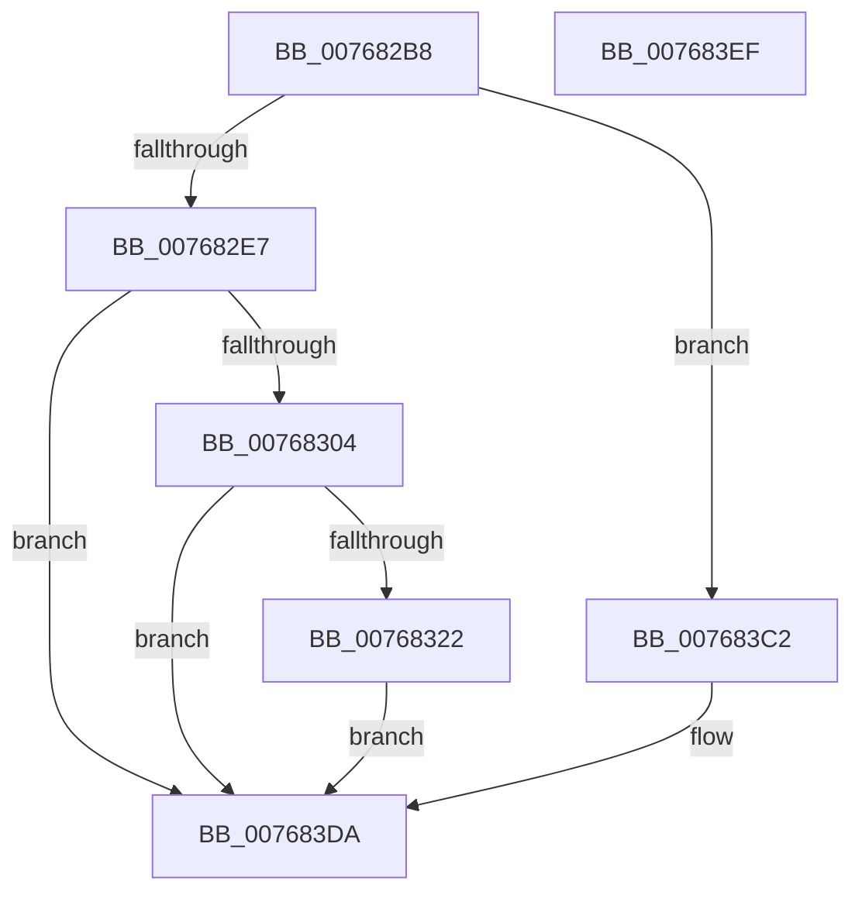

# PopPowerAdapterTraceFailure

- RVA: `0x007682B8`–`0x007683F0` (길이 `312` bytes)
- VA: `0x00000001407682B8`
- 실행 섹션: `PAGE`
- PDB 이름 있음: `예`; PDB Function 태그: `아니요`
- unwind 정보 RVA: `0x000BAEE4`
- 디코드: `60`개 명령, `312/312` bytes 표시
- 미해석 바이트: `0` (있으면 어셈블리에 `.byte`로 보존)

> 이 문서는 커널 이미지의 기계어와 PDB 기호를 분석해 생성했습니다. 4번과 5번은 함수 원형과 자료형을 바이너리 사용 방식에서 추정한 C 해석이며 원본 소스 복구 결과는 아닙니다.

## 1. Dependencies

- 직접 호출 지점: **3**; 고유 호출 대상: **3**
- 직접 호출자로 확인된 함수: **4**
- RIP 상대 이미지 참조: **3**

### Outgoing calls
- `0x00768315` → [tlgKeywordOn](../../text/42/tlgKeywordOn_function_0042EAA0.md) (function, `0x0042EAA0`)
- `0x007683BB` → [tlgWriteTransfer_EtwWriteTransfer](../../text/42/tlgWriteTransfer_EtwWriteTransfer_function_004260E0.md) (function, `0x004260E0`)
- `0x007683E1` → [_security_check_cookie](../../text/6A/_security_check_cookie_function_006AC640.md) (function, `0x006AC640`)

### Direct callers
- [PopPowerAdapterIrpComplete](../../text/4E/PopPowerAdapterIrpComplete_function_004E9630.md) at `0x004E9661`
- [PopPowerAdapterAdd](PopPowerAdapterAdd_function_00767430.md) at `0x007674F6`
- [PopPowerAdapterReinitialize](PopPowerAdapterReinitialize_function_00767E48.md) at `0x00767EEB`
- [PopBatteryWorker](../AE/PopBatteryWorker_function_00AE1650.md) at `0x00AE1BCF`

### Static image references
- `0x007682C6` → RVA `0x00E0A740` (`.data`; read)
- `0x007682F7` → RVA `0x00E07748` (`.data`; read)
- `0x0076832E` → RVA `0x0004C5FB` (`.rdata`; read)

## 2. Other-region calls and transfers

- 다른 실행 섹션으로 향하는 call: **3**
  - `0x00768315` → [tlgKeywordOn](../../text/42/tlgKeywordOn_function_0042EAA0.md) (`PAGE` → `.text`)
  - `0x007683BB` → [tlgWriteTransfer_EtwWriteTransfer](../../text/42/tlgWriteTransfer_EtwWriteTransfer_function_004260E0.md) (`PAGE` → `.text`)
  - `0x007683E1` → [_security_check_cookie](../../text/6A/_security_check_cookie_function_006AC640.md) (`PAGE` → `.text`)
- 별도 외부 분기/꼬리 이동을 확인하지 못했습니다.

## 3. Assembly (complete function range)

```asm
007682B8  40 55                           push rbp
007682BA  48 8D 6C 24 A9                  lea rbp, [rsp - 0x57]
007682BF  48 81 EC D0 00 00 00            sub rsp, 0xd0
007682C6  48 8B 05 73 24 6A 00            mov rax, qword ptr [rip + 0x6a2473]
007682CD  48 33 C4                        xor rax, rsp
007682D0  48 89 45 47                     mov qword ptr [rbp + 0x47], rax
007682D4  83 B9 80 00 00 00 02            cmp dword ptr [rcx + 0x80], 2
007682DB  44 8B D2                        mov r10d, edx
007682DE  4C 8B C9                        mov r9, rcx
007682E1  0F 85 DB 00 00 00               jne 0x1407683c2
007682E7  C7 81 80 00 00 00 03 00 00 00   mov dword ptr [rcx + 0x80], 3
007682F1  89 91 E0 00 00 00               mov dword ptr [rcx + 0xe0], edx
007682F7  83 3D 4A F4 69 00 05            cmp dword ptr [rip + 0x69f44a], 5
007682FE  0F 86 D6 00 00 00               jbe 0x1407683da
00768304  48 BA 00 00 00 00 00 40 00 00   movabs rdx, 0x400000000000
0076830E  48 8D 0D 33 F4 69 00            lea rcx, [rip + 0x69f433]
00768315  E8 86 67 CC FF                  call 0x14042eaa0
0076831A  84 C0                           test al, al
0076831C  0F 84 B8 00 00 00               je 0x1407683da
00768322  48 8D 45 B7                     lea rax, [rbp - 0x49]
00768326  44 89 45 BF                     mov dword ptr [rbp - 0x41], r8d
0076832A  48 89 45 F7                     mov qword ptr [rbp - 9], rax
0076832E  48 8D 15 C6 42 8E FF            lea rdx, [rip - 0x71bd3a]
00768335  41 8B 81 DC 00 00 00            mov eax, dword ptr [r9 + 0xdc]
0076833C  48 8D 0D 05 F4 69 00            lea rcx, [rip + 0x69f405]
00768343  89 45 BB                        mov dword ptr [rbp - 0x45], eax
00768346  45 33 C0                        xor r8d, r8d
00768349  48 8D 45 BB                     lea rax, [rbp - 0x45]
0076834D  44 89 55 B7                     mov dword ptr [rbp - 0x49], r10d
00768351  48 89 45 07                     mov qword ptr [rbp + 7], rax
00768355  48 8D 45 BF                     lea rax, [rbp - 0x41]
00768359  48 89 45 17                     mov qword ptr [rbp + 0x17], rax
0076835D  41 8B 81 E4 00 00 00            mov eax, dword ptr [r9 + 0xe4]
00768364  45 33 C9                        xor r9d, r9d
00768367  89 45 C3                        mov dword ptr [rbp - 0x3d], eax
0076836A  48 8D 45 C3                     lea rax, [rbp - 0x3d]
0076836E  48 89 45 27                     mov qword ptr [rbp + 0x27], rax
00768372  48 8D 45 C7                     lea rax, [rbp - 0x39]
00768376  48 89 45 37                     mov qword ptr [rbp + 0x37], rax
0076837A  48 8D 45 D7                     lea rax, [rbp - 0x29]
0076837E  48 89 44 24 28                  mov qword ptr [rsp + 0x28], rax
00768383  C7 44 24 20 07 00 00 00         mov dword ptr [rsp + 0x20], 7
0076838B  48 C7 45 FF 04 00 00 00         mov qword ptr [rbp - 1], 4
00768393  48 C7 45 0F 04 00 00 00         mov qword ptr [rbp + 0xf], 4
0076839B  48 C7 45 1F 04 00 00 00         mov qword ptr [rbp + 0x1f], 4
007683A3  48 C7 45 2F 04 00 00 00         mov qword ptr [rbp + 0x2f], 4
007683AB  48 C7 45 C7 00 00 00 01         mov qword ptr [rbp - 0x39], 0x1000000
007683B3  48 C7 45 3F 08 00 00 00         mov qword ptr [rbp + 0x3f], 8
007683BB  E8 20 DD CB FF                  call 0x1404260e0
007683C0  EB 18                           jmp 0x1407683da
007683C2  C7 81 80 00 00 00 02 00 00 00   mov dword ptr [rcx + 0x80], 2
007683CC  44 89 91 DC 00 00 00            mov dword ptr [rcx + 0xdc], r10d
007683D3  44 89 81 E4 00 00 00            mov dword ptr [rcx + 0xe4], r8d
007683DA  48 8B 4D 47                     mov rcx, qword ptr [rbp + 0x47]
007683DE  48 33 CC                        xor rcx, rsp
007683E1  E8 5A 42 F4 FF                  call 0x1406ac640
007683E6  48 81 C4 D0 00 00 00            add rsp, 0xd0
007683ED  5D                              pop rbp
007683EE  C3                              ret
007683EF  CC                              int3
```

## 4. C-style interpretation (structured pseudocode)

```c
__int64 __fastcall PopPowerAdapterTraceFailure(__int64 a1, int a2, int a3)
{
    __int64 result;
    __int64 v_rsp;
    unsigned __int64 v_stack_m18;
    unsigned __int64 v_stack_m20;
    unsigned __int64 v_stack_m28;
    unsigned __int64 v_stack_m30;
    unsigned __int64 v_stack_m38;
    unsigned __int64 v_stack_m40;
    unsigned __int64 v_stack_m48;
    unsigned __int64 v_stack_m50;
    unsigned __int64 v_stack_m58;
    unsigned __int64 v_stack_m5F;
    unsigned __int64 v_stack_m60;
    unsigned __int64 v_stack_m68;
    unsigned __int64 v_stack_m88;
    unsigned __int64 v_stack_m98;
    unsigned int v_stack_m9C;
    unsigned int v_stack_mA0;
    unsigned int v_stack_mA4;
    unsigned __int64 v_stack_mA8;
    unsigned __int64 v_stack_mB0;
    unsigned int v_stack_mB8;

    v_rsp = (v_rsp) - (208);
    result = (*(unsigned __int64 *)(v_rip + 6956147)) ^ (v_rsp);
    v_stack_m18 = result;
    if ((*(unsigned int *)(a1 + 128)) != 2) goto loc_007683C2;
    *(unsigned int *)(a1 + 128) = 3;
    *(unsigned int *)(a1 + 224) = a2;
    if ((*(unsigned int *)(v_rip + 6943818)) <= 5) goto loc_007683DA;
    result = tlgKeywordOn(v_rip + 6943795, a2, a3, a1);
    if ((unsigned __int8)(result) == 0) goto loc_007683DA;
    v_stack_mA0 = a3;
    v_stack_m68 = v_stack_mA8;
    v_stack_mA4 = (unsigned int)((unsigned int)(*(unsigned int *)(a1 + 220)));
    a3 = 0;
    v_stack_mA8 = (unsigned int)((unsigned int)(a2));
    v_stack_m58 = v_stack_mA4;
    v_stack_m48 = v_stack_mA0;
    a4 = 0;
    v_stack_m9C = (unsigned int)((unsigned int)(*(unsigned int *)(a1 + 228)));
    v_stack_m38 = v_stack_m9C;
    v_stack_m28 = v_stack_m98;
    v_stack_mB0 = v_stack_m88;
    v_stack_mB8 = 7;
    v_stack_m60 = 4;
    v_stack_m50 = 4;
    v_stack_m40 = 4;
    v_stack_m30 = 4;
    v_stack_m98 = 0x1000000ULL;
    v_stack_m20 = 8;
    result = tlgWriteTransfer_EtwWriteTransfer(v_rip + 6943749, v_rip - 7454010, a3, a4);
    goto loc_007683DA;
loc_007683C2:
    *(unsigned int *)(v_rip + 6943749 + 128) = 2;
    *(unsigned int *)(v_rip + 6943749 + 220) = (unsigned int)((unsigned int)(a2));
    *(unsigned int *)(v_rip + 6943749 + 228) = 0;
loc_007683DA:
    a1 = (v_stack_m18) ^ (v_rsp);
    result = _security_check_cookie(a1, v_rip - 7454010, a3, a4);
    v_rsp = (v_rsp) + (208);
    return result;
}
```

## 5. (Beta) C Style

```c
int64_t PopPowerAdapterTraceFailure(void *Arg1, int32_t Arg2, int32_t Arg3)
{
    uint8_t *arg1 = (uint8_t *)Arg1;

    int64_t result;
    int64_t local_rsp;
    uint64_t v_stack_m18;
    uint64_t v_stack_m20;
    uint64_t v_stack_m28;
    uint64_t v_stack_m30;
    uint64_t v_stack_m38;
    uint64_t v_stack_m40;
    uint64_t v_stack_m48;
    uint64_t v_stack_m50;
    uint64_t v_stack_m58;
    uint64_t v_stack_m5F;
    uint64_t v_stack_m60;
    uint64_t v_stack_m68;
    uint64_t v_stack_m88;
    uint64_t v_stack_m98;
    uint32_t v_stack_m9C;
    uint32_t v_stack_mA0;
    uint32_t v_stack_mA4;
    uint64_t v_stack_mA8;
    uint64_t v_stack_mB0;
    uint32_t v_stack_mB8;

    local_rsp = (local_rsp) - (208);
    result = (*(uint64_t *)(v_rip + 0x6A2473)) ^ (local_rsp);
    v_stack_m18 = result;
    if ((*(uint32_t *)(arg1 + 0x80)) != 2) goto loc_007683C2;
    *(uint32_t *)(arg1 + 0x80) = 3;
    *(uint32_t *)(arg1 + 0xE0) = Arg2;
    if ((*(uint32_t *)(v_rip + 0x69F44A)) <= 5) goto loc_007683DA;
    result = tlgKeywordOn(v_rip + 6943795, Arg2, Arg3, Arg1);
    if ((uint8_t)(result) == 0) goto loc_007683DA;
    v_stack_mA0 = Arg3;
    v_stack_m68 = v_stack_mA8;
    v_stack_mA4 = (uint32_t)((uint32_t)(*(uint32_t *)(arg1 + 0xDC)));
    Arg3 = 0;
    v_stack_mA8 = (uint32_t)((uint32_t)(Arg2));
    v_stack_m58 = v_stack_mA4;
    v_stack_m48 = v_stack_mA0;
    a4 = 0;
    v_stack_m9C = (uint32_t)((uint32_t)(*(uint32_t *)(arg1 + 0xE4)));
    v_stack_m38 = v_stack_m9C;
    v_stack_m28 = v_stack_m98;
    v_stack_mB0 = v_stack_m88;
    v_stack_mB8 = 7;
    v_stack_m60 = 4;
    v_stack_m50 = 4;
    v_stack_m40 = 4;
    v_stack_m30 = 4;
    v_stack_m98 = 0x1000000ULL;
    v_stack_m20 = 8;
    result = tlgWriteTransfer_EtwWriteTransfer(v_rip + 6943749, v_rip - 7454010, Arg3, a4);
    goto loc_007683DA;
loc_007683C2:
    *(uint32_t *)(v_rip + 0x69F405 + 0x80) = 2;
    *(uint32_t *)(v_rip + 0x69F405 + 0xDC) = (uint32_t)((uint32_t)(Arg2));
    *(uint32_t *)(v_rip + 0x69F405 + 0xE4) = 0;
loc_007683DA:
    Arg1 = (v_stack_m18) ^ (local_rsp);
    result = _security_check_cookie(Arg1, v_rip - 7454010, Arg3, a4);
    local_rsp = (local_rsp) + (208);
    return result;
}
```

### 관측된 메모리 오프셋

구조체 형식이 확인되지 않은 접근은 인자 기준의 오프셋으로만 기록했습니다.

| 기준 인자 | 오프셋 표현 | 폭 (bit) | 접근 |
|---|---:|---:|---|
| `Arg1` | `+ 0x80` | `32` | `R` |
| `Arg1` | `+ 0x80` | `32` | `W` |
| `Arg1` | `+ 0xDC` | `32` | `W` |
| `Arg1` | `+ 0xE0` | `32` | `W` |
| `Arg1` | `+ 0xE4` | `32` | `W` |

## 6. Execution-region graph

[열기: 2D/3D 그래프와 함수 탐색 컨트롤 패널](../../../control-panel.html?section=page&rva=0x007682B8&view=graph)

- 2D 그래프는 위에서 아래로 흐르고, 3D 그래프는 빈 공간을 드래그해 회전합니다. Shift+드래그는 이동, 휠은 확대·축소, 함수 노드 선택은 대상 보고서 이동입니다.

### Static fallback


