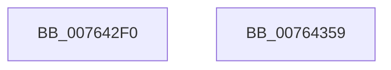

# PopPowerAggregatorActiveToScreenOffStateHandler

- RVA: `0x007642F0`–`0x0076435A` (길이 `106` bytes)
- VA: `0x00000001407642F0`
- 실행 섹션: `PAGE`
- PDB 이름 있음: `예`; PDB Function 태그: `아니요`
- unwind 정보 RVA: `0x0007F554`
- 디코드: `27`개 명령, `106/106` bytes 표시
- 미해석 바이트: `0` (있으면 어셈블리에 `.byte`로 보존)

> 이 문서는 커널 이미지의 기계어와 PDB 기호를 분석해 생성했습니다. 4번과 5번은 함수 원형과 자료형을 바이너리 사용 방식에서 추정한 C 해석이며 원본 소스 복구 결과는 아닙니다.

## 1. Dependencies

- 직접 호출 지점: **5**; 고유 호출 대상: **5**
- 직접 호출자로 확인된 함수: **0**
- RIP 상대 이미지 참조: **1**

### Outgoing calls
- `0x00764311` → [PopPowerAggregatorSetCurrentState](../98/PopPowerAggregatorSetCurrentState_function_0098A3B0.md) (function, `0x0098A3B0`)
- `0x00764320` → [PopGetMonitorReasonFromPowerEventId](../../text/4B/PopGetMonitorReasonFromPowerEventId_function_004BB2D8.md) (function, `0x004BB2D8`)
- `0x00764334` → [PopReleaseRwLock](../../text/2D/PopReleaseRwLock_function_002DFBBC.md) (function, `0x002DFBBC`)
- `0x00764340` → [PopSleepstudyStartNextSession](../AC/PopSleepstudyStartNextSession_function_00AC4720.md) (function, `0x00AC4720`)
- `0x0076434C` → [PopAcquireRwLockExclusive](../../text/43/PopAcquireRwLockExclusive_function_00430B44.md) (function, `0x00430B44`)

### Direct callers
- 이 함수 시작 RVA로 연결되는 직접 call은 확인되지 않았습니다. 간접 호출은 완전히 역산할 수 없습니다.

### Static image references
- `0x00764327` → RVA `0x00F09710` (`.data`; read)

## 2. Other-region calls and transfers

- 다른 실행 섹션으로 향하는 call: **3**
  - `0x00764320` → [PopGetMonitorReasonFromPowerEventId](../../text/4B/PopGetMonitorReasonFromPowerEventId_function_004BB2D8.md) (`PAGE` → `.text`)
  - `0x00764334` → [PopReleaseRwLock](../../text/2D/PopReleaseRwLock_function_002DFBBC.md) (`PAGE` → `.text`)
  - `0x0076434C` → [PopAcquireRwLockExclusive](../../text/43/PopAcquireRwLockExclusive_function_00430B44.md) (`PAGE` → `.text`)
- 별도 외부 분기/꼬리 이동을 확인하지 못했습니다.

## 3. Assembly (complete function range)

```asm
007642F0  48 8B C4                        mov rax, rsp
007642F3  53                              push rbx
007642F4  48 83 EC 40                     sub rsp, 0x40
007642F8  0F 57 C0                        xorps xmm0, xmm0
007642FB  48 8D 50 D8                     lea rdx, [rax - 0x28]
007642FF  0F 11 40 D8                     movups xmmword ptr [rax - 0x28], xmm0
00764303  C7 40 D8 03 00 00 00            mov dword ptr [rax - 0x28], 3
0076430A  48 8B D9                        mov rbx, rcx
0076430D  0F 11 40 E8                     movups xmmword ptr [rax - 0x18], xmm0
00764311  E8 9A 60 22 00                  call 0x14098a3b0
00764316  8B 4B 18                        mov ecx, dword ptr [rbx + 0x18]
00764319  83 A3 30 01 00 00 00            and dword ptr [rbx + 0x130], 0
00764320  E8 B3 6F D5 FF                  call 0x1404bb2d8
00764325  8B D8                           mov ebx, eax
00764327  48 8D 0D E2 53 7A 00            lea rcx, [rip + 0x7a53e2]
0076432E  81 E3 FF FF FF 00               and ebx, 0xffffff
00764334  E8 83 B8 B7 FF                  call 0x1402dfbbc
00764339  8B D3                           mov edx, ebx
0076433B  B9 01 00 00 00                  mov ecx, 1
00764340  E8 DB 03 36 00                  call 0x140ac4720
00764345  48 8D 0D C4 53 7A 00            lea rcx, [rip + 0x7a53c4]
0076434C  E8 F3 C7 CC FF                  call 0x140430b44
00764351  33 C0                           xor eax, eax
00764353  48 83 C4 40                     add rsp, 0x40
00764357  5B                              pop rbx
00764358  C3                              ret
00764359  CC                              int3
```

## 4. C-style interpretation (structured pseudocode)

```c
__int64 __fastcall PopPowerAggregatorActiveToScreenOffStateHandler(__int64 a1)
{
    __int64 result;
    __int64 v_rbx;
    __int64 v_rsp;

    v_rsp = (v_rsp) - (64);
    *(unsigned __int64 *)(v_rsp - 40) = v_xmm0;
    *(unsigned int *)(v_rsp - 40) = 3;
    *(unsigned __int64 *)(v_rsp - 24) = v_xmm0;
    result = PopPowerAggregatorSetCurrentState(a1, v_rsp - 40, a3, a4);
    result = PopGetMonitorReasonFromPowerEventId((unsigned int)(*(unsigned int *)(a1 + 24)), v_rsp - 40, a3, a4);
    v_rbx = (unsigned int)(((unsigned int)((unsigned int)(result))) & (0xFFFFFFULL));
    result = PopReleaseRwLock(v_rip + 8016866, v_rsp - 40, a3, a4);
    result = PopSleepstudyStartNextSession(1, (unsigned int)((unsigned int)(v_rbx)), a3, a4);
    result = PopAcquireRwLockExclusive(v_rip + 8016836, (unsigned int)((unsigned int)(v_rbx)), a3, a4);
    result = 0;
    v_rsp = (v_rsp) + (64);
    return result;
}
```

## 5. (Beta) C Style

```c
int64_t PopPowerAggregatorActiveToScreenOffStateHandler(void *Arg1)
{
    uint8_t *arg1 = (uint8_t *)Arg1;

    int64_t result;
    int64_t local_rbx;
    int64_t local_rsp;

    local_rsp = (local_rsp) - (64);
    *(uint64_t *)(local_rsp - 0x28) = v_xmm0;
    *(uint32_t *)(local_rsp - 0x28) = 3;
    *(uint64_t *)(local_rsp - 0x18) = v_xmm0;
    result = PopPowerAggregatorSetCurrentState(Arg1, local_rsp - 40, a3, a4);
    result = PopGetMonitorReasonFromPowerEventId((uint32_t)(*(uint32_t *)(arg1 + 0x18)), local_rsp - 40, a3, a4);
    local_rbx = (uint32_t)(((uint32_t)((uint32_t)(result))) & (0xFFFFFFULL));
    result = PopReleaseRwLock(v_rip + 8016866, local_rsp - 40, a3, a4);
    result = PopSleepstudyStartNextSession(1, (uint32_t)((uint32_t)(local_rbx)), a3, a4);
    result = PopAcquireRwLockExclusive(v_rip + 8016836, (uint32_t)((uint32_t)(local_rbx)), a3, a4);
    result = 0;
    local_rsp = (local_rsp) + (64);
    return result;
}
```

### 관측된 메모리 오프셋

구조체 형식이 확인되지 않은 접근은 인자 기준의 오프셋으로만 기록했습니다.

| 기준 인자 | 오프셋 표현 | 폭 (bit) | 접근 |
|---|---:|---:|---|
| `Arg1` | `+ 0x18` | `32` | `R` |
| `Arg1` | `+ 0x130` | `32` | `R/W` |

## 6. Execution-region graph

[열기: 2D/3D 그래프와 함수 탐색 컨트롤 패널](../../../control-panel.html?section=page&rva=0x007642F0&view=graph)

- 2D 그래프는 위에서 아래로 흐르고, 3D 그래프는 빈 공간을 드래그해 회전합니다. Shift+드래그는 이동, 휠은 확대·축소, 함수 노드 선택은 대상 보고서 이동입니다.

### Static fallback


