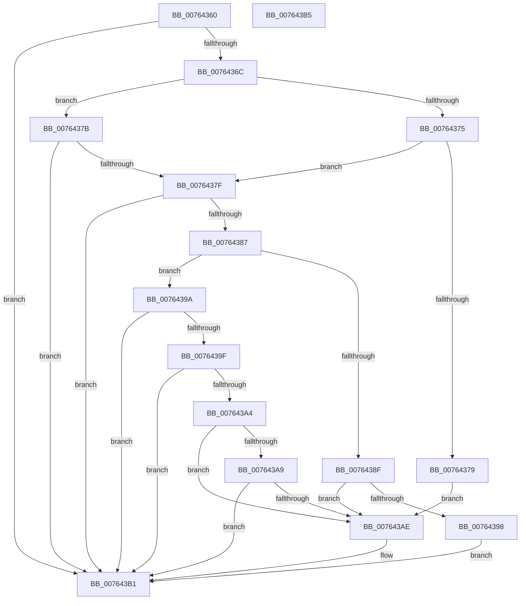

# PopPowerAggregatorAllowModernStandbyPromotion

- RVA: `0x00764360`–`0x007643B6` (길이 `86` bytes)
- VA: `0x0000000140764360`
- 실행 섹션: `PAGE`
- PDB 이름 있음: `예`; PDB Function 태그: `아니요`
- unwind 정보 RVA: `0x000DB714`
- 디코드: `32`개 명령, `86/86` bytes 표시
- 미해석 바이트: `0` (있으면 어셈블리에 `.byte`로 보존)

> 이 문서는 커널 이미지의 기계어와 PDB 기호를 분석해 생성했습니다. 4번과 5번은 함수 원형과 자료형을 바이너리 사용 방식에서 추정한 C 해석이며 원본 소스 복구 결과는 아닙니다.

## 1. Dependencies

- 직접 호출 지점: **0**; 고유 호출 대상: **0**
- 직접 호출자로 확인된 함수: **1**
- RIP 상대 이미지 참조: **1**

### Outgoing calls
- 직접 디코드된 call 명령이 없습니다.

### Direct callers
- [PopPowerAggregatorHandleModernStandbyIntent](PopPowerAggregatorHandleModernStandbyIntent_function_007649F0.md) at `0x00764AEB`

### Static image references
- `0x0076438F` → RVA `0x00F0CD4C` (`.data`; read)

## 2. Other-region calls and transfers

- 다른 실행 섹션으로 향하는 call: **0**
- 별도 외부 분기/꼬리 이동을 확인하지 못했습니다.

## 3. Assembly (complete function range)

```asm
00764360  41 B8 01 00 00 00               mov r8d, 1
00764366  44 39 41 10                     cmp dword ptr [rcx + 0x10], r8d
0076436A  75 45                           jne 0x1407643b1
0076436C  80 79 28 00                     cmp byte ptr [rcx + 0x28], 0
00764370  8A 42 18                        mov al, byte ptr [rdx + 0x18]
00764373  75 06                           jne 0x14076437b
00764375  84 C0                           test al, al
00764377  74 06                           je 0x14076437f
00764379  EB 33                           jmp 0x1407643ae
0076437B  84 C0                           test al, al
0076437D  74 32                           je 0x1407643b1
0076437F  8A 42 1B                        mov al, byte ptr [rdx + 0x1b]
00764382  38 41 2B                        cmp byte ptr [rcx + 0x2b], al
00764385  75 2A                           jne 0x1407643b1
00764387  8B 42 08                        mov eax, dword ptr [rdx + 8]
0076438A  83 F8 04                        cmp eax, 4
0076438D  75 0B                           jne 0x14076439a
0076438F  83 3D B6 89 7A 00 00            cmp dword ptr [rip + 0x7a89b6], 0
00764396  74 16                           je 0x1407643ae
00764398  EB 17                           jmp 0x1407643b1
0076439A  83 F8 2B                        cmp eax, 0x2b
0076439D  74 12                           je 0x1407643b1
0076439F  83 F8 2E                        cmp eax, 0x2e
007643A2  74 0D                           je 0x1407643b1
007643A4  83 F8 2D                        cmp eax, 0x2d
007643A7  75 05                           jne 0x1407643ae
007643A9  39 41 18                        cmp dword ptr [rcx + 0x18], eax
007643AC  75 03                           jne 0x1407643b1
007643AE  45 32 C0                        xor r8b, r8b
007643B1  41 8A C0                        mov al, r8b
007643B4  C3                              ret
007643B5  CC                              int3
```

## 4. C-style interpretation (structured pseudocode)

```c
__int64 __fastcall PopPowerAggregatorAllowModernStandbyPromotion(__int64 a1, __int64 a2)
{
    if ((*(unsigned int *)(a1 + 16)) != 1) goto loc_007643B1;
    if ((*(unsigned __int8 *)(a1 + 40)) != 0) goto loc_0076437B;
    if ((unsigned __int8)(*(unsigned __int8 *)(a2 + 24)) == 0) goto loc_0076437F;
    goto loc_007643AE;
loc_0076437B:
    if ((unsigned __int8)(*(unsigned __int8 *)(a2 + 24)) == 0) goto loc_007643B1;
loc_0076437F:
    if ((*(unsigned __int8 *)(a1 + 43)) != ((unsigned __int8)(*(unsigned __int8 *)(a2 + 27)))) goto loc_007643B1;
    if (((unsigned int)((unsigned int)(*(unsigned int *)(a2 + 8)))) != 4) goto loc_0076439A;
    if ((*(unsigned int *)(v_rip + 8030646)) == 0) goto loc_007643AE;
    goto loc_007643B1;
loc_0076439A:
    if (((unsigned int)((unsigned int)(*(unsigned int *)(a2 + 8)))) == 43) goto loc_007643B1;
    if (((unsigned int)((unsigned int)(*(unsigned int *)(a2 + 8)))) == 46) goto loc_007643B1;
    if (((unsigned int)((unsigned int)(*(unsigned int *)(a2 + 8)))) != 45) goto loc_007643AE;
    if ((*(unsigned int *)(a1 + 24)) == ((unsigned int)((unsigned int)(*(unsigned int *)(a2 + 8))))) {
        a3 = 0;
    }
    return 0;
}
```

## 5. (Beta) C Style

```c
int64_t PopPowerAggregatorAllowModernStandbyPromotion(void *Arg1, void *Arg2)
{
    uint8_t *arg1 = (uint8_t *)Arg1;
    uint8_t *arg2 = (uint8_t *)Arg2;

    if ((*(uint32_t *)(arg1 + 0x10)) != 1) goto loc_007643B1;
    if ((*(uint8_t *)(arg1 + 0x28)) != 0) goto loc_0076437B;
    if ((uint8_t)(*(uint8_t *)(arg2 + 0x18)) == 0) goto loc_0076437F;
    goto loc_007643AE;
loc_0076437B:
    if ((uint8_t)(*(uint8_t *)(arg2 + 0x18)) == 0) goto loc_007643B1;
loc_0076437F:
    if ((*(uint8_t *)(arg1 + 0x2B)) != ((uint8_t)(*(uint8_t *)(arg2 + 0x1B)))) goto loc_007643B1;
    if (((uint32_t)((uint32_t)(*(uint32_t *)(arg2 + 0x8)))) != 4) goto loc_0076439A;
    if ((*(uint32_t *)(v_rip + 0x7A89B6)) == 0) goto loc_007643AE;
    goto loc_007643B1;
loc_0076439A:
    if (((uint32_t)((uint32_t)(*(uint32_t *)(arg2 + 0x8)))) == 43) goto loc_007643B1;
    if (((uint32_t)((uint32_t)(*(uint32_t *)(arg2 + 0x8)))) == 46) goto loc_007643B1;
    if (((uint32_t)((uint32_t)(*(uint32_t *)(arg2 + 0x8)))) != 45) goto loc_007643AE;
    if ((*(uint32_t *)(arg1 + 0x18)) == ((uint32_t)((uint32_t)(*(uint32_t *)(arg2 + 0x8))))) {
        a3 = 0;
    }
    return 0;
}
```

### 관측된 메모리 오프셋

구조체 형식이 확인되지 않은 접근은 인자 기준의 오프셋으로만 기록했습니다.

| 기준 인자 | 오프셋 표현 | 폭 (bit) | 접근 |
|---|---:|---:|---|
| `Arg1` | `+ 0x10` | `32` | `R` |
| `Arg1` | `+ 0x18` | `32` | `R` |
| `Arg1` | `+ 0x28` | `8` | `R` |
| `Arg1` | `+ 0x2B` | `8` | `R` |
| `Arg2` | `+ 0x8` | `32` | `R` |
| `Arg2` | `+ 0x18` | `8` | `R` |
| `Arg2` | `+ 0x1B` | `8` | `R` |

## 6. Execution-region graph

[열기: 2D/3D 그래프와 함수 탐색 컨트롤 패널](../../../control-panel.html?section=page&rva=0x00764360&view=graph)

- 2D 그래프는 위에서 아래로 흐르고, 3D 그래프는 빈 공간을 드래그해 회전합니다. Shift+드래그는 이동, 휠은 확대·축소, 함수 노드 선택은 대상 보고서 이동입니다.

### Static fallback


