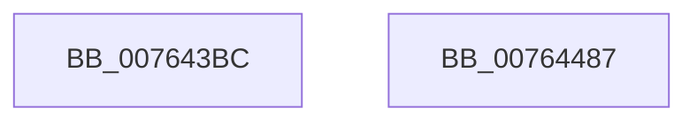

# PopPowerAggregatorDozeTimerArm

- RVA: `0x007643BC`–`0x00764488` (길이 `204` bytes)
- VA: `0x00000001407643BC`
- 실행 섹션: `PAGE`
- PDB 이름 있음: `예`; PDB Function 태그: `아니요`
- unwind 정보 RVA: `0x000CCD10`
- 디코드: `49`개 명령, `204/204` bytes 표시
- 미해석 바이트: `0` (있으면 어셈블리에 `.byte`로 보존)

> 이 문서는 커널 이미지의 기계어와 PDB 기호를 분석해 생성했습니다. 4번과 5번은 함수 원형과 자료형을 바이너리 사용 방식에서 추정한 C 해석이며 원본 소스 복구 결과는 아닙니다.

## 1. Dependencies

- 직접 호출 지점: **4**; 고유 호출 대상: **4**
- 직접 호출자로 확인된 함수: **1**
- RIP 상대 이미지 참조: **2**

### Outgoing calls
- `0x007643E9` → [PopPowerAggregatorDozeTimerDisarm](../6F/PopPowerAggregatorDozeTimerDisarm_function_006FE548.md) (function, `0x006FE548`)
- `0x0076444D` → [PopPowerAggregatorDiagTraceEvent](../91/PopPowerAggregatorDiagTraceEvent_function_00912184.md) (function, `0x00912184`)
- `0x00764465` → [KeSetTimer2](../../text/3A/KeSetTimer2_function_003A08E0.md) (function, `0x003A08E0`)
- `0x00764472` → [_security_check_cookie](../../text/6A/_security_check_cookie_function_006AC640.md) (function, `0x006AC640`)

### Direct callers
- [PopPowerAggregatorEvaluateDozeTimers](../6F/PopPowerAggregatorEvaluateDozeTimers_function_006FE460.md) at `0x006FE506`
- [PopPowerAggregatorEvaluateDozeTimers](../6F/PopPowerAggregatorEvaluateDozeTimers_function_006FE460.md) at `0x006FE533`

### Static image references
- `0x007643C8` → RVA `0x00E0A740` (`.data`; read)
- `0x007643FD` → RVA `0x000226A8` (`.rdata`; read)

## 2. Other-region calls and transfers

- 다른 실행 섹션으로 향하는 call: **2**
  - `0x00764465` → [KeSetTimer2](../../text/3A/KeSetTimer2_function_003A08E0.md) (`PAGE` → `.text`)
  - `0x00764472` → [_security_check_cookie](../../text/6A/_security_check_cookie_function_006AC640.md) (`PAGE` → `.text`)
- 별도 외부 분기/꼬리 이동을 확인하지 못했습니다.

## 3. Assembly (complete function range)

```asm
007643BC  48 89 5C 24 20                  mov qword ptr [rsp + 0x20], rbx
007643C1  55                              push rbp
007643C2  56                              push rsi
007643C3  57                              push rdi
007643C4  48 83 EC 60                     sub rsp, 0x60
007643C8  48 8B 05 71 63 6A 00            mov rax, qword ptr [rip + 0x6a6371]
007643CF  48 33 C4                        xor rax, rsp
007643D2  48 89 44 24 50                  mov qword ptr [rsp + 0x50], rax
007643D7  48 63 DA                        movsxd rbx, edx
007643DA  49 8B E8                        mov rbp, r8
007643DD  8B D3                           mov edx, ebx
007643DF  48 8B F1                        mov rsi, rcx
007643E2  48 69 FB C8 00 00 00            imul rdi, rbx, 0xc8
007643E9  E8 5A A1 F9 FF                  call 0x1406fe548
007643EE  8B 84 37 E0 01 00 00            mov eax, dword ptr [rdi + rsi + 0x1e0]
007643F5  4C 8D 44 24 30                  lea r8, [rsp + 0x30]
007643FA  83 E0 FC                        and eax, 0xfffffffc
007643FD  48 8D 0D A4 E2 8B FF            lea rcx, [rip - 0x741d5c]
00764404  83 C0 04                        add eax, 4
00764407  BA 02 00 00 00                  mov edx, 2
0076440C  83 C8 01                        or eax, 1
0076440F  87 84 37 E0 01 00 00            xchg dword ptr [rdi + rsi + 0x1e0], eax
00764416  83 64 24 3C 00                  and dword ptr [rsp + 0x3c], 0
0076441B  48 8D 44 24 20                  lea rax, [rsp + 0x20]
00764420  83 64 24 4C 00                  and dword ptr [rsp + 0x4c], 0
00764425  48 89 44 24 30                  mov qword ptr [rsp + 0x30], rax
0076442A  48 8D 44 24 28                  lea rax, [rsp + 0x28]
0076442F  48 89 44 24 40                  mov qword ptr [rsp + 0x40], rax
00764434  48 89 6C 24 28                  mov qword ptr [rsp + 0x28], rbp
00764439  89 5C 24 20                     mov dword ptr [rsp + 0x20], ebx
0076443D  C7 44 24 38 04 00 00 00         mov dword ptr [rsp + 0x38], 4
00764445  C7 44 24 48 08 00 00 00         mov dword ptr [rsp + 0x48], 8
0076444D  E8 32 DD 1A 00                  call 0x140912184
00764452  48 8D 8E 58 01 00 00            lea rcx, [rsi + 0x158]
00764459  45 33 C9                        xor r9d, r9d
0076445C  48 03 CF                        add rcx, rdi
0076445F  45 33 C0                        xor r8d, r8d
00764462  48 8B D5                        mov rdx, rbp
00764465  E8 76 C4 C3 FF                  call 0x1403a08e0
0076446A  48 8B 4C 24 50                  mov rcx, qword ptr [rsp + 0x50]
0076446F  48 33 CC                        xor rcx, rsp
00764472  E8 C9 81 F4 FF                  call 0x1406ac640
00764477  48 8B 9C 24 98 00 00 00         mov rbx, qword ptr [rsp + 0x98]
0076447F  48 83 C4 60                     add rsp, 0x60
00764483  5F                              pop rdi
00764484  5E                              pop rsi
00764485  5D                              pop rbp
00764486  C3                              ret
00764487  CC                              int3
```

## 4. C-style interpretation (structured pseudocode)

```c
__int64 __fastcall PopPowerAggregatorDozeTimerArm(__int64 a1, int a2, __int64 a3, int a4)
{
    __int64 result;
    __int64 v_rdi;
    __int64 v_rsp;
    unsigned __int64 v_stack_m28;
    unsigned int v_stack_m2C;
    unsigned int v_stack_m30;
    unsigned __int64 v_stack_m38;
    unsigned int v_stack_m3C;
    unsigned int v_stack_m40;
    unsigned __int64 v_stack_m48;
    unsigned __int64 v_stack_m50;
    unsigned __int64 v_stack_m58;
    unsigned __int64 v_stack_p20;

    v_stack_p20 = v_rbx;
    v_rsp = (v_rsp) - (96);
    result = (*(unsigned __int64 *)(v_rip + 6972273)) ^ (v_rsp);
    v_stack_m28 = result;
    v_rdi = (v_rdi) * ((int)(a2));
    result = PopPowerAggregatorDozeTimerDisarm(a1, (unsigned int)((unsigned int)((int)(a2))), a3, a4);
    result = (unsigned int)(((unsigned int)(*(unsigned int *)(v_rdi + a1 * 1 + 480))) & (0xFFFFFFFCULL));
    result = (unsigned int)((result) + (4));
    result = (unsigned int)((result) | (1));
    v_stack_m48 = v_stack_m58;
    v_stack_m38 = v_stack_m50;
    v_stack_m50 = a3;
    v_stack_m58 = (unsigned int)((int)(a2));
    v_stack_m40 = 4;
    v_stack_m30 = 8;
    result = PopPowerAggregatorDiagTraceEvent(v_rip - 7609692, 2, v_stack_m48, a4);
    a4 = 0;
    a1 = (a1 + 344) + (v_rdi);
    a3 = 0;
    result = KeSetTimer2(a1, 0, a3, a4);
    a1 = (v_stack_m28) ^ (v_rsp);
    result = _security_check_cookie(a1, 0, a3, a4);
    v_rsp = (v_rsp) + (96);
    return result;
}
```

## 5. (Beta) C Style

```c
int64_t PopPowerAggregatorDozeTimerArm(void *Arg1, int32_t Arg2, int64_t Arg3, int32_t Arg4)
{
    uint8_t *arg1 = (uint8_t *)Arg1;

    int64_t result;
    int64_t local_rdi;
    int64_t local_rsp;
    uint64_t v_stack_m28;
    uint32_t v_stack_m2C;
    uint32_t v_stack_m30;
    uint64_t v_stack_m38;
    uint32_t v_stack_m3C;
    uint32_t v_stack_m40;
    uint64_t v_stack_m48;
    uint64_t v_stack_m50;
    uint64_t v_stack_m58;
    uint64_t v_stack_p20;

    v_stack_p20 = local_rbx;
    local_rsp = (local_rsp) - (96);
    result = (*(uint64_t *)(v_rip + 0x6A6371)) ^ (local_rsp);
    v_stack_m28 = result;
    local_rdi = (local_rdi) * ((int32_t)(Arg2));
    result = PopPowerAggregatorDozeTimerDisarm(Arg1, (uint32_t)((uint32_t)((int32_t)(Arg2))), Arg3, Arg4);
    result = (uint32_t)(((uint32_t)(*(uint32_t *)(local_rdi + arg1 * 1 + 0x1E0))) & (0xFFFFFFFCULL));
    result = (uint32_t)((result) + (4));
    result = (uint32_t)((result) | (1));
    v_stack_m48 = v_stack_m58;
    v_stack_m38 = v_stack_m50;
    v_stack_m50 = Arg3;
    v_stack_m58 = (uint32_t)((int32_t)(Arg2));
    v_stack_m40 = 4;
    v_stack_m30 = 8;
    result = PopPowerAggregatorDiagTraceEvent(v_rip - 7609692, 2, v_stack_m48, Arg4);
    Arg4 = 0;
    Arg1 = (Arg1 + 344) + (local_rdi);
    Arg3 = 0;
    result = KeSetTimer2(Arg1, 0, Arg3, Arg4);
    Arg1 = (v_stack_m28) ^ (local_rsp);
    result = _security_check_cookie(Arg1, 0, Arg3, Arg4);
    local_rsp = (local_rsp) + (96);
    return result;
}
```

### 관측된 메모리 오프셋

구조체 형식이 확인되지 않은 접근은 인자 기준의 오프셋으로만 기록했습니다.

| 기준 인자 | 오프셋 표현 | 폭 (bit) | 접근 |
|---|---:|---:|---|
| `Arg1` | `+ 0x158` | `64` | `R` |

## 6. Execution-region graph

[열기: 2D/3D 그래프와 함수 탐색 컨트롤 패널](../../../control-panel.html?section=page&rva=0x007643BC&view=graph)

- 2D 그래프는 위에서 아래로 흐르고, 3D 그래프는 빈 공간을 드래그해 회전합니다. Shift+드래그는 이동, 휠은 확대·축소, 함수 노드 선택은 대상 보고서 이동입니다.

### Static fallback


