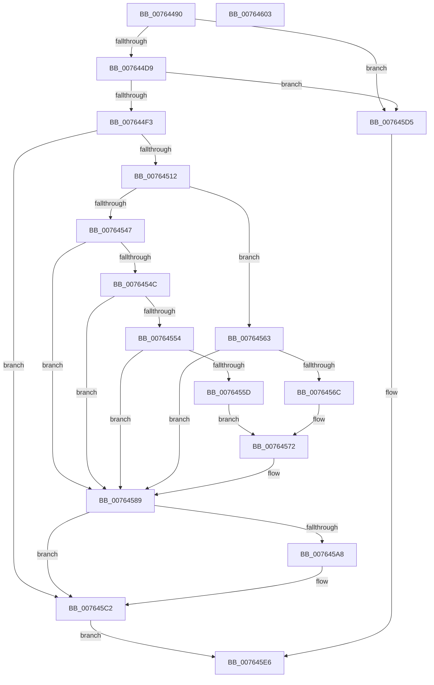

# PopPowerAggregatorDozeTimerWorker

- RVA: `0x00764490`–`0x00764604` (길이 `372` bytes)
- VA: `0x0000000140764490`
- 실행 섹션: `PAGE`
- PDB 이름 있음: `예`; PDB Function 태그: `아니요`
- unwind 정보 RVA: `0x000C4144`
- 디코드: `90`개 명령, `372/372` bytes 표시
- 미해석 바이트: `0` (있으면 어셈블리에 `.byte`로 보존)

> 이 문서는 커널 이미지의 기계어와 PDB 기호를 분석해 생성했습니다. 4번과 5번은 함수 원형과 자료형을 바이너리 사용 방식에서 추정한 C 해석이며 원본 소스 복구 결과는 아닙니다.

## 1. Dependencies

- 직접 호출 지점: **13**; 고유 호출 대상: **12**
- 직접 호출자로 확인된 함수: **0**
- RIP 상대 이미지 참조: **7**

### Outgoing calls
- `0x007644F3` → [PopAcquirePolicyLock](../../pagelk/B7/PopAcquirePolicyLock_function_00B783C0.md) (function, `0x00B783C0`)
- `0x007644FF` → [PopAcquireRwLockExclusive](../../text/43/PopAcquireRwLockExclusive_function_00430B44.md) (function, `0x00430B44`)
- `0x0076453E` → [PopPowerAggregatorDiagTraceEvent](../91/PopPowerAggregatorDiagTraceEvent_function_00912184.md) (function, `0x00912184`)
- `0x00764584` → [PopPowerAggregatorHandleIntentUnsafe](../91/PopPowerAggregatorHandleIntentUnsafe_function_009146D8.md) (function, `0x009146D8`)
- `0x0076459E` → [KeSetEvent](../../text/33/KeSetEvent_function_0033F310.md) (function, `0x0033F310`)
- `0x007645AB` → [PopSmartSuspendMakePredictions](../AD/PopSmartSuspendMakePredictions_function_00AD9168.md) (function, `0x00AD9168`)
- `0x007645B0` → [PopPowerAggregatorEvaluateDozeTimers](../6F/PopPowerAggregatorEvaluateDozeTimers_function_006FE460.md) (function, `0x006FE460`)
- `0x007645B8` → [PopIdleCancelAoAcDozeS4Timer](../../text/4B/PopIdleCancelAoAcDozeS4Timer_function_004BC9C4.md) (function, `0x004BC9C4`)
- `0x007645BD` → [PopIdleArmAoAcDozeS4Timer](../../text/4E/PopIdleArmAoAcDozeS4Timer_function_004E03A8.md) (function, `0x004E03A8`)
- `0x007645C9` → [PopReleaseRwLock](../../text/2D/PopReleaseRwLock_function_002DFBBC.md) (function, `0x002DFBBC`)
- `0x007645CE` → [PopReleasePolicyLock](../../pagelk/B7/PopReleasePolicyLock_function_00B78410.md) (function, `0x00B78410`)
- `0x007645E1` → [KeSetEvent](../../text/33/KeSetEvent_function_0033F310.md) (function, `0x0033F310`)
- `0x007645EE` → [_security_check_cookie](../../text/6A/_security_check_cookie_function_006AC640.md) (function, `0x006AC640`)

### Direct callers
- 이 함수 시작 RVA로 연결되는 직접 call은 확인되지 않았습니다. 간접 호출은 완전히 역산할 수 없습니다.

### Static image references
- `0x0076449F` → RVA `0x00E0A740` (`.data`; read)
- `0x007644BB` → RVA `0x00F09878` (`.data`; read)
- `0x007644F8` → RVA `0x00F09710` (`.data`; read)
- `0x0076452F` → RVA `0x00023368` (`.rdata`; read)
- `0x0076454C` → RVA `0x00F09750` (`.data`; read)
- `0x00764554` → RVA `0x00F0976B` (`.data`; read)
- `0x00764572` → RVA `0x00F09768` (`.data`; read)

## 2. Other-region calls and transfers

- 다른 실행 섹션으로 향하는 call: **9**
  - `0x007644F3` → [PopAcquirePolicyLock](../../pagelk/B7/PopAcquirePolicyLock_function_00B783C0.md) (`PAGE` → `PAGELK`)
  - `0x007644FF` → [PopAcquireRwLockExclusive](../../text/43/PopAcquireRwLockExclusive_function_00430B44.md) (`PAGE` → `.text`)
  - `0x0076459E` → [KeSetEvent](../../text/33/KeSetEvent_function_0033F310.md) (`PAGE` → `.text`)
  - `0x007645B8` → [PopIdleCancelAoAcDozeS4Timer](../../text/4B/PopIdleCancelAoAcDozeS4Timer_function_004BC9C4.md) (`PAGE` → `.text`)
  - `0x007645BD` → [PopIdleArmAoAcDozeS4Timer](../../text/4E/PopIdleArmAoAcDozeS4Timer_function_004E03A8.md) (`PAGE` → `.text`)
  - `0x007645C9` → [PopReleaseRwLock](../../text/2D/PopReleaseRwLock_function_002DFBBC.md) (`PAGE` → `.text`)
  - `0x007645CE` → [PopReleasePolicyLock](../../pagelk/B7/PopReleasePolicyLock_function_00B78410.md) (`PAGE` → `PAGELK`)
  - `0x007645E1` → [KeSetEvent](../../text/33/KeSetEvent_function_0033F310.md) (`PAGE` → `.text`)
  - `0x007645EE` → [_security_check_cookie](../../text/6A/_security_check_cookie_function_006AC640.md) (`PAGE` → `.text`)
- 별도 외부 분기/꼬리 이동을 확인하지 못했습니다.

## 3. Assembly (complete function range)

```asm
00764490  48 89 5C 24 10                  mov qword ptr [rsp + 0x10], rbx
00764495  48 89 74 24 18                  mov qword ptr [rsp + 0x18], rsi
0076449A  57                              push rdi
0076449B  48 83 EC 40                     sub rsp, 0x40
0076449F  48 8B 05 9A 62 6A 00            mov rax, qword ptr [rip + 0x6a629a]
007644A6  48 33 C4                        xor rax, rsp
007644A9  48 89 44 24 38                  mov qword ptr [rsp + 0x38], rax
007644AE  48 63 C1                        movsxd rax, ecx
007644B1  48 8B F1                        mov rsi, rcx
007644B4  48 69 F8 C8 00 00 00            imul rdi, rax, 0xc8
007644BB  48 8D 05 B6 53 7A 00            lea rax, [rip + 0x7a53b6]
007644C2  48 03 F8                        add rdi, rax
007644C5  8B 87 A8 00 00 00               mov eax, dword ptr [rdi + 0xa8]
007644CB  8B C8                           mov ecx, eax
007644CD  80 E1 03                        and cl, 3
007644D0  80 F9 01                        cmp cl, 1
007644D3  0F 85 FC 00 00 00               jne 0x1407645d5
007644D9  8B D8                           mov ebx, eax
007644DB  83 E3 FE                        and ebx, 0xfffffffe
007644DE  83 CB 02                        or ebx, 2
007644E1  F0 0F B1 9F A8 00 00 00         lock cmpxchg dword ptr [rdi + 0xa8], ebx
007644E9  24 03                           and al, 3
007644EB  3A C1                           cmp al, cl
007644ED  0F 85 E2 00 00 00               jne 0x1407645d5
007644F3  E8 C8 3E 41 00                  call 0x140b783c0
007644F8  48 8D 0D 11 52 7A 00            lea rcx, [rip + 0x7a5211]
007644FF  E8 40 C6 CC FF                  call 0x140430b44
00764504  8B 87 A8 00 00 00               mov eax, dword ptr [rdi + 0xa8]
0076450A  3B C3                           cmp eax, ebx
0076450C  0F 85 B0 00 00 00               jne 0x1407645c2
00764512  83 64 24 34 00                  and dword ptr [rsp + 0x34], 0
00764517  48 8D 44 24 20                  lea rax, [rsp + 0x20]
0076451C  4C 8D 44 24 28                  lea r8, [rsp + 0x28]
00764521  48 89 44 24 28                  mov qword ptr [rsp + 0x28], rax
00764526  BA 01 00 00 00                  mov edx, 1
0076452B  89 74 24 20                     mov dword ptr [rsp + 0x20], esi
0076452F  48 8D 0D 32 EE 8B FF            lea rcx, [rip - 0x7411ce]
00764536  C7 44 24 30 04 00 00 00         mov dword ptr [rsp + 0x30], 4
0076453E  E8 41 DC 1A 00                  call 0x140912184
00764543  85 F6                           test esi, esi
00764545  74 1C                           je 0x140764563
00764547  83 FE 01                        cmp esi, 1
0076454A  75 3D                           jne 0x140764589
0076454C  39 35 FE 51 7A 00               cmp dword ptr [rip + 0x7a51fe], esi
00764552  75 35                           jne 0x140764589
00764554  80 3D 10 52 7A 00 00            cmp byte ptr [rip + 0x7a5210], 0
0076455B  74 2C                           je 0x140764589
0076455D  44 8D 4E 36                     lea r9d, [rsi + 0x36]
00764561  EB 0F                           jmp 0x140764572
00764563  83 3D E6 51 7A 00 01            cmp dword ptr [rip + 0x7a51e6], 1
0076456A  75 1D                           jne 0x140764589
0076456C  41 B9 36 00 00 00               mov r9d, 0x36
00764572  8A 05 F0 51 7A 00               mov al, byte ptr [rip + 0x7a51f0]
00764578  F6 D8                           neg al
0076457A  1B C9                           sbb ecx, ecx
0076457C  45 33 C0                        xor r8d, r8d
0076457F  83 C1 03                        add ecx, 3
00764582  33 D2                           xor edx, edx
00764584  E8 4F 01 1B 00                  call 0x1409146d8
00764589  83 E3 FC                        and ebx, 0xfffffffc
0076458C  48 8D 8F B0 00 00 00            lea rcx, [rdi + 0xb0]
00764593  87 9F A8 00 00 00               xchg dword ptr [rdi + 0xa8], ebx
00764599  45 33 C0                        xor r8d, r8d
0076459C  33 D2                           xor edx, edx
0076459E  E8 6D AD BD FF                  call 0x14033f310
007645A3  83 FE 01                        cmp esi, 1
007645A6  75 1A                           jne 0x1407645c2
007645A8  8D 4E 01                        lea ecx, [rsi + 1]
007645AB  E8 B8 4B 37 00                  call 0x140ad9168
007645B0  E8 AB 9E F9 FF                  call 0x1406fe460
007645B5  8D 4E 02                        lea ecx, [rsi + 2]
007645B8  E8 07 84 D5 FF                  call 0x1404bc9c4
007645BD  E8 E6 BD D7 FF                  call 0x1404e03a8
007645C2  48 8D 0D 47 51 7A 00            lea rcx, [rip + 0x7a5147]
007645C9  E8 EE B5 B7 FF                  call 0x1402dfbbc
007645CE  E8 3D 3E 41 00                  call 0x140b78410
007645D3  EB 11                           jmp 0x1407645e6
007645D5  48 8D 8F B0 00 00 00            lea rcx, [rdi + 0xb0]
007645DC  45 33 C0                        xor r8d, r8d
007645DF  33 D2                           xor edx, edx
007645E1  E8 2A AD BD FF                  call 0x14033f310
007645E6  48 8B 4C 24 38                  mov rcx, qword ptr [rsp + 0x38]
007645EB  48 33 CC                        xor rcx, rsp
007645EE  E8 4D 80 F4 FF                  call 0x1406ac640
007645F3  48 8B 5C 24 58                  mov rbx, qword ptr [rsp + 0x58]
007645F8  48 8B 74 24 60                  mov rsi, qword ptr [rsp + 0x60]
007645FD  48 83 C4 40                     add rsp, 0x40
00764601  5F                              pop rdi
00764602  C3                              ret
00764603  CC                              int3
```

## 4. C-style interpretation (structured pseudocode)

```c
__int64 __fastcall PopPowerAggregatorDozeTimerWorker(__int64 a1)
{
    __int64 result;
    __int64 v_rbx;
    __int64 v_rdi;
    __int64 v_rsp;
    unsigned __int64 v_stack_m10;
    unsigned int v_stack_m14;
    unsigned int v_stack_m18;
    unsigned __int64 v_stack_m20;
    unsigned __int64 v_stack_m28;
    unsigned __int64 v_stack_p10;
    unsigned __int64 v_stack_p18;

    v_stack_p10 = v_rbx;
    v_stack_p18 = v_rsi;
    v_rsp = (v_rsp) - (64);
    result = (*(unsigned __int64 *)(v_rip + 6972058)) ^ (v_rsp);
    v_stack_m10 = result;
    v_rdi = (v_rdi) * ((int)((unsigned int)(a1)));
    v_rdi = (v_rdi) + (v_rip + 8016822);
    a1 = (unsigned __int8)(((unsigned int)((unsigned int)((unsigned int)(*(unsigned int *)(v_rdi + 168))))) & (3));
    if (((unsigned __int8)(a1)) != 1) goto loc_007645D5;
    v_rbx = (unsigned int)(((unsigned int)((unsigned int)((unsigned int)(*(unsigned int *)(v_rdi + 168))))) & (0xFFFFFFFEULL));
    v_rbx = (unsigned int)((v_rbx) | (2));
    result = (unsigned __int8)(((unsigned int)(*(unsigned int *)(v_rdi + 168))) & (3));
    if (((unsigned __int8)(result)) != ((unsigned __int8)(a1))) goto loc_007645D5;
    result = PopAcquirePolicyLock(a1, a2, a3, a4);
    result = PopAcquireRwLockExclusive(v_rip + 8016401, a2, a3, a4);
    if (((unsigned int)((unsigned int)(*(unsigned int *)(v_rdi + 168)))) != ((unsigned int)(v_rbx))) goto loc_007645C2;
    v_stack_m20 = v_stack_m28;
    v_stack_m28 = (unsigned int)(a1);
    v_stack_m18 = 4;
    result = PopPowerAggregatorDiagTraceEvent(v_rip - 7606734, 1, v_stack_m20, a4);
    if ((unsigned int)(a1) == 0) goto loc_00764563;
    if (((unsigned int)(a1)) != 1) goto loc_00764589;
    if ((*(unsigned int *)(v_rip + 8016382)) != ((unsigned int)(a1))) goto loc_00764589;
    if ((*(unsigned __int8 *)(v_rip + 8016400)) == 0) goto loc_00764589;
    goto loc_00764572;
loc_00764563:
    if ((*(unsigned int *)(v_rip + 8016358)) != 1) goto loc_00764589;
loc_00764572:
    result = (unsigned __int8)(-(*(unsigned __int8 *)(v_rip + 8016368)));
    a3 = 0;
    a1 = (unsigned int)((v_rip - 7606734) + (3));
    a2 = 0;
    result = PopPowerAggregatorHandleIntentUnsafe(a1, a2, a3, 54);
loc_00764589:
    v_rbx = (unsigned int)((v_rbx) & (0xFFFFFFFCULL));
    a3 = 0;
    a2 = 0;
    result = KeSetEvent(v_rdi + 176, a2, a3, 54);
    if (((unsigned int)(a1)) == 1) {
        a1 = a1 + 1;
        result = PopSmartSuspendMakePredictions(a1, a2, a3, 54);
        result = PopPowerAggregatorEvaluateDozeTimers(a1, a2, a3, 54);
        a1 = a1 + 2;
        result = PopIdleCancelAoAcDozeS4Timer(a1, a2, a3, 54);
        result = PopIdleArmAoAcDozeS4Timer(a1, a2, a3, 54);
    }
    result = PopReleaseRwLock(v_rip + 8016199, a2, a3, 54);
    result = PopReleasePolicyLock(v_rip + 8016199, a2, a3, 54);
    goto loc_007645E6;
loc_007645D5:
    a3 = 0;
    a2 = 0;
    result = KeSetEvent(v_rdi + 176, a2, a3, 54);
loc_007645E6:
    a1 = (v_stack_m10) ^ (v_rsp);
    result = _security_check_cookie(a1, a2, a3, 54);
    v_rsp = (v_rsp) + (64);
    return result;
}
```

## 5. (Beta) C Style

```c
int64_t PopPowerAggregatorDozeTimerWorker(int64_t Arg1)
{
    int64_t result;
    int64_t local_rbx;
    int64_t local_rdi;
    int64_t local_rsp;
    uint64_t v_stack_m10;
    uint32_t v_stack_m14;
    uint32_t v_stack_m18;
    uint64_t v_stack_m20;
    uint64_t v_stack_m28;
    uint64_t v_stack_p10;
    uint64_t v_stack_p18;

    v_stack_p10 = local_rbx;
    v_stack_p18 = local_rsi;
    local_rsp = (local_rsp) - (64);
    result = (*(uint64_t *)(v_rip + 0x6A629A)) ^ (local_rsp);
    v_stack_m10 = result;
    local_rdi = (local_rdi) * ((int32_t)((uint32_t)(Arg1)));
    local_rdi = (local_rdi) + (v_rip + 8016822);
    Arg1 = (uint8_t)(((uint32_t)((uint32_t)((uint32_t)(*(uint32_t *)(local_rdi + 0xA8))))) & (3));
    if (((uint8_t)(Arg1)) != 1) goto loc_007645D5;
    local_rbx = (uint32_t)(((uint32_t)((uint32_t)((uint32_t)(*(uint32_t *)(local_rdi + 0xA8))))) & (0xFFFFFFFEULL));
    local_rbx = (uint32_t)((local_rbx) | (2));
    result = (uint8_t)(((uint32_t)(*(uint32_t *)(local_rdi + 0xA8))) & (3));
    if (((uint8_t)(result)) != ((uint8_t)(Arg1))) goto loc_007645D5;
    result = PopAcquirePolicyLock(Arg1, a2, a3, a4);
    result = PopAcquireRwLockExclusive(v_rip + 8016401, a2, a3, a4);
    if (((uint32_t)((uint32_t)(*(uint32_t *)(local_rdi + 0xA8)))) != ((uint32_t)(local_rbx))) goto loc_007645C2;
    v_stack_m20 = v_stack_m28;
    v_stack_m28 = (uint32_t)(Arg1);
    v_stack_m18 = 4;
    result = PopPowerAggregatorDiagTraceEvent(v_rip - 7606734, 1, v_stack_m20, a4);
    if ((uint32_t)(Arg1) == 0) goto loc_00764563;
    if (((uint32_t)(Arg1)) != 1) goto loc_00764589;
    if ((*(uint32_t *)(v_rip + 0x7A51FE)) != ((uint32_t)(Arg1))) goto loc_00764589;
    if ((*(uint8_t *)(v_rip + 0x7A5210)) == 0) goto loc_00764589;
    goto loc_00764572;
loc_00764563:
    if ((*(uint32_t *)(v_rip + 0x7A51E6)) != 1) goto loc_00764589;
loc_00764572:
    result = (uint8_t)(-(*(uint8_t *)(v_rip + 0x7A51F0)));
    a3 = 0;
    Arg1 = (uint32_t)((v_rip - 7606734) + (3));
    a2 = 0;
    result = PopPowerAggregatorHandleIntentUnsafe(Arg1, a2, a3, 54);
loc_00764589:
    local_rbx = (uint32_t)((local_rbx) & (0xFFFFFFFCULL));
    a3 = 0;
    a2 = 0;
    result = KeSetEvent(local_rdi + 176, a2, a3, 54);
    if (((uint32_t)(Arg1)) == 1) {
        Arg1 = Arg1 + 1;
        result = PopSmartSuspendMakePredictions(Arg1, a2, a3, 54);
        result = PopPowerAggregatorEvaluateDozeTimers(Arg1, a2, a3, 54);
        Arg1 = Arg1 + 2;
        result = PopIdleCancelAoAcDozeS4Timer(Arg1, a2, a3, 54);
        result = PopIdleArmAoAcDozeS4Timer(Arg1, a2, a3, 54);
    }
    result = PopReleaseRwLock(v_rip + 8016199, a2, a3, 54);
    result = PopReleasePolicyLock(v_rip + 8016199, a2, a3, 54);
    goto loc_007645E6;
loc_007645D5:
    a3 = 0;
    a2 = 0;
    result = KeSetEvent(local_rdi + 176, a2, a3, 54);
loc_007645E6:
    Arg1 = (v_stack_m10) ^ (local_rsp);
    result = _security_check_cookie(Arg1, a2, a3, 54);
    local_rsp = (local_rsp) + (64);
    return result;
}
```

## 6. Execution-region graph

[열기: 2D/3D 그래프와 함수 탐색 컨트롤 패널](../../../control-panel.html?section=page&rva=0x00764490&view=graph)

- 2D 그래프는 위에서 아래로 흐르고, 3D 그래프는 빈 공간을 드래그해 회전합니다. Shift+드래그는 이동, 휠은 확대·축소, 함수 노드 선택은 대상 보고서 이동입니다.

### Static fallback


