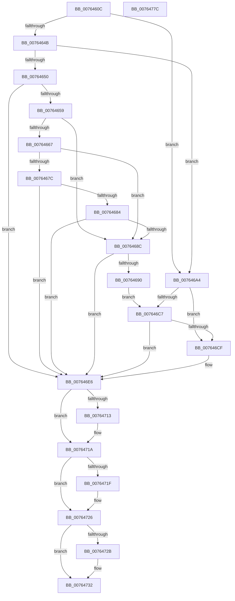

# PopPowerAggregatorEngageAggressiveStandbyActions

- RVA: `0x0076460C`–`0x0076477D` (길이 `369` bytes)
- VA: `0x000000014076460C`
- 실행 섹션: `PAGE`
- PDB 이름 있음: `예`; PDB Function 태그: `아니요`
- unwind 정보 RVA: `0x00083688`
- 디코드: `99`개 명령, `369/369` bytes 표시
- 미해석 바이트: `0` (있으면 어셈블리에 `.byte`로 보존)

> 이 문서는 커널 이미지의 기계어와 PDB 기호를 분석해 생성했습니다. 4번과 5번은 함수 원형과 자료형을 바이너리 사용 방식에서 추정한 C 해석이며 원본 소스 복구 결과는 아닙니다.

## 1. Dependencies

- 직접 호출 지점: **6**; 고유 호출 대상: **5**
- 직접 호출자로 확인된 함수: **1**
- RIP 상대 이미지 참조: **18**

### Outgoing calls
- `0x0076462A` → [PopAcquirePolicyLock](../../pagelk/B7/PopAcquirePolicyLock_function_00B783C0.md) (function, `0x00B783C0`)
- `0x00764636` → [PopIsRemoteDesktopEnabled](../AD/PopIsRemoteDesktopEnabled_function_00AD6E64.md) (function, `0x00AD6E64`)
- `0x00764698` → [PopNetSetConnectivityConstraint](PopNetSetConnectivityConstraint_function_00768E90.md) (function, `0x00768E90`)
- `0x007646AB` → [PopNetSetConnectivityConstraint](PopNetSetConnectivityConstraint_function_00768E90.md) (function, `0x00768E90`)
- `0x00764759` → [PopReleasePolicyLock](../../pagelk/B7/PopReleasePolicyLock_function_00B78410.md) (function, `0x00B78410`)
- `0x00764760` → [PopPdcEngagePhases](PopPdcEngagePhases_function_007697B4.md) (function, `0x007697B4`)

### Direct callers
- [PopPowerAggregatorEngageModernStandby](PopPowerAggregatorEngageModernStandby_function_00764784.md) at `0x00764897`

### Static image references
- `0x0076462F` → RVA `0x00F08888` (`.data`; read)
- `0x0076463B` → RVA `0x00F0CE58` (`.data`; read)
- `0x00764667` → RVA `0x00E679D0` (`.data`; read)
- `0x00764673` → RVA `0x00F0CE0C` (`.data`; read)
- `0x0076467C` → RVA `0x00E679C4` (`.data`; read)
- `0x00764684` → RVA `0x00E679C8` (`.data`; read)
- `0x007646C7` → RVA `0x00F0CE5C` (`.data`; read)
- `0x007646CF` → RVA `0x00F0C9D8` (`.data`; read)
- `0x007646D8` → RVA `0x00F0CFA8` (`.data`; read)
- `0x007646E0` → RVA `0x00F0C9D8` (`.data`; read/write)
- `0x007646F5` → RVA `0x00FC6AFA` (`ALMOSTRO`; write)
- `0x00764702` → RVA `0x00FC532C` (`ALMOSTRO`; read)
- `0x00764708` → RVA `0x00FC536C` (`ALMOSTRO`; write)
- `0x00764713` → RVA `0x00E27DD9` (`.data`; read/write)
- `0x00764732` → RVA `0x00E27DD9` (`.data`; read)
- `0x0076473C` → RVA `0x00E27E20` (`.data`; read/write)
- `0x0076474C` → RVA `0x00E27D24` (`.data`; write)
- `0x00764752` → RVA `0x00E27DD9` (`.data`; write)

## 2. Other-region calls and transfers

- 다른 실행 섹션으로 향하는 call: **2**
  - `0x0076462A` → [PopAcquirePolicyLock](../../pagelk/B7/PopAcquirePolicyLock_function_00B783C0.md) (`PAGE` → `PAGELK`)
  - `0x00764759` → [PopReleasePolicyLock](../../pagelk/B7/PopReleasePolicyLock_function_00B78410.md) (`PAGE` → `PAGELK`)
- 별도 외부 분기/꼬리 이동을 확인하지 못했습니다.

## 3. Assembly (complete function range)

```asm
0076460C  48 89 5C 24 10                  mov qword ptr [rsp + 0x10], rbx
00764611  48 89 6C 24 18                  mov qword ptr [rsp + 0x18], rbp
00764616  56                              push rsi
00764617  57                              push rdi
00764618  41 54                           push r12
0076461A  41 56                           push r14
0076461C  41 57                           push r15
0076461E  48 83 EC 20                     sub rsp, 0x20
00764622  40 8A E9                        mov bpl, cl
00764625  BE 3A 00 00 00                  mov esi, 0x3a
0076462A  E8 91 3D 41 00                  call 0x140b783c0
0076462F  44 8A 25 52 42 7A 00            mov r12b, byte ptr [rip + 0x7a4252]
00764636  E8 29 28 37 00                  call 0x140ad6e64
0076463B  8B 3D 17 88 7A 00               mov edi, dword ptr [rip + 0x7a8817]
00764641  45 32 F6                        xor r14b, r14b
00764644  44 8A F8                        mov r15b, al
00764647  85 FF                           test edi, edi
00764649  74 59                           je 0x1407646a4
0076464B  40 84 ED                        test bpl, bpl
0076464E  75 54                           jne 0x1407646a4
00764650  83 FF 02                        cmp edi, 2
00764653  0F 85 8D 00 00 00               jne 0x1407646e6
00764659  45 84 E4                        test r12b, r12b
0076465C  8D 5E C7                        lea ebx, [rsi - 0x39]
0076465F  0F 95 C0                        setne al
00764662  45 84 FF                        test r15b, r15b
00764665  74 25                           je 0x14076468c
00764667  39 1D 63 33 70 00               cmp dword ptr [rip + 0x703363], ebx
0076466D  0F B6 C0                        movzx eax, al
00764670  0F 44 C3                        cmove eax, ebx
00764673  83 3D 92 87 7A 00 00            cmp dword ptr [rip + 0x7a8792], 0
0076467A  75 10                           jne 0x14076468c
0076467C  39 1D 42 33 70 00               cmp dword ptr [rip + 0x703342], ebx
00764682  74 62                           je 0x1407646e6
00764684  39 1D 3E 33 70 00               cmp dword ptr [rip + 0x70333e], ebx
0076468A  74 5A                           je 0x1407646e6
0076468C  84 C0                           test al, al
0076468E  75 56                           jne 0x1407646e6
00764690  B9 07 00 00 00                  mov ecx, 7
00764695  44 8A F3                        mov r14b, bl
00764698  E8 F3 47 00 00                  call 0x140768e90
0076469D  BE 32 00 00 00                  mov esi, 0x32
007646A2  EB 23                           jmp 0x1407646c7
007646A4  BB 01 00 00 00                  mov ebx, 1
007646A9  8B CB                           mov ecx, ebx
007646AB  E8 E0 47 00 00                  call 0x140768e90
007646B0  40 8A C5                        mov al, bpl
007646B3  44 8A F3                        mov r14b, bl
007646B6  F6 D8                           neg al
007646B8  1B C9                           sbb ecx, ecx
007646BA  83 E1 E0                        and ecx, 0xffffffe0
007646BD  03 F1                           add esi, ecx
007646BF  83 E6 F7                        and esi, 0xfffffff7
007646C2  40 84 ED                        test bpl, bpl
007646C5  75 08                           jne 0x1407646cf
007646C7  39 1D 8F 87 7A 00               cmp dword ptr [rip + 0x7a878f], ebx
007646CD  75 17                           jne 0x1407646e6
007646CF  8B 0D 03 83 7A 00               mov ecx, dword ptr [rip + 0x7a8303]
007646D5  83 E6 ED                        and esi, 0xffffffed
007646D8  33 0D CA 88 7A 00               xor ecx, dword ptr [rip + 0x7a88ca]
007646DE  23 CB                           and ecx, ebx
007646E0  31 0D F2 82 7A 00               xor dword ptr [rip + 0x7a82f2], ecx
007646E6  8B 0D EC 82 7A 00               mov ecx, dword ptr [rip + 0x7a82ec]
007646EC  33 0D B6 88 7A 00               xor ecx, dword ptr [rip + 0x7a88b6]
007646F2  83 E1 04                        and ecx, 4
007646F5  C6 05 FE 23 86 00 00            mov byte ptr [rip + 0x8623fe], 0
007646FC  31 0D D6 82 7A 00               xor dword ptr [rip + 0x7a82d6], ecx
00764702  8B 0D 24 0C 86 00               mov ecx, dword ptr [rip + 0x860c24]
00764708  89 0D 5E 0C 86 00               mov dword ptr [rip + 0x860c5e], ecx
0076470E  45 84 F6                        test r14b, r14b
00764711  74 07                           je 0x14076471a
00764713  80 0D BF 36 6C 00 02            or byte ptr [rip + 0x6c36bf], 2
0076471A  45 84 FF                        test r15b, r15b
0076471D  74 07                           je 0x140764726
0076471F  80 0D B3 36 6C 00 08            or byte ptr [rip + 0x6c36b3], 8
00764726  45 84 E4                        test r12b, r12b
00764729  74 07                           je 0x140764732
0076472B  80 0D A7 36 6C 00 10            or byte ptr [rip + 0x6c36a7], 0x10
00764732  8A 05 A1 36 6C 00               mov al, byte ptr [rip + 0x6c36a1]
00764738  40 80 E7 03                     and dil, 3
0076473C  83 25 DD 36 6C 00 00            and dword ptr [rip + 0x6c36dd], 0
00764743  24 9F                           and al, 0x9f
00764745  40 C0 E7 05                     shl dil, 5
00764749  40 0A F8                        or dil, al
0076474C  89 0D D2 35 6C 00               mov dword ptr [rip + 0x6c35d2], ecx
00764752  40 88 3D 80 36 6C 00            mov byte ptr [rip + 0x6c3680], dil
00764759  E8 B2 3C 41 00                  call 0x140b78410
0076475E  8B CE                           mov ecx, esi
00764760  E8 4F 50 00 00                  call 0x1407697b4
00764765  48 8B 5C 24 58                  mov rbx, qword ptr [rsp + 0x58]
0076476A  48 8B 6C 24 60                  mov rbp, qword ptr [rsp + 0x60]
0076476F  48 83 C4 20                     add rsp, 0x20
00764773  41 5F                           pop r15
00764775  41 5E                           pop r14
00764777  41 5C                           pop r12
00764779  5F                              pop rdi
0076477A  5E                              pop rsi
0076477B  C3                              ret
0076477C  CC                              int3
```

## 4. C-style interpretation (structured pseudocode)

```c
__int64 __fastcall PopPowerAggregatorEngageAggressiveStandbyActions(unsigned __int8 a1)
{
    __int64 result;
    __int64 v_r14;
    __int64 v_rdi;
    __int64 v_rsi;
    __int64 v_rsp;
    unsigned __int64 v_stack_p10;
    unsigned __int64 v_stack_p18;

    v_stack_p10 = v_rbx;
    v_stack_p18 = v_rbp;
    v_rsp = (v_rsp) - (32);
    result = PopAcquirePolicyLock(a1, a2, a3, a4);
    result = PopIsRemoteDesktopEnabled(a1, a2, a3, a4);
    v_r14 = 0;
    if ((unsigned int)((unsigned int)(*(unsigned int *)(v_rip + 8030231))) == 0) goto loc_007646A4;
    if (a1 != 0) goto loc_007646A4;
    if (((unsigned int)((unsigned int)(*(unsigned int *)(v_rip + 8030231)))) != 2) goto loc_007646E6;
    result = ((unsigned __int8)(*(unsigned __int8 *)(v_rip + 8012370)) != 0) ? 1 : 0;
    if ((unsigned __int8)((unsigned __int8)(result)) == 0) goto loc_0076468C;
    result = (unsigned __int8)(result);
    if ((*(unsigned int *)(v_rip + 7353187)) == ((unsigned int)(58 - 57))) { result = (unsigned int)(58 - 57); }
    if ((*(unsigned int *)(v_rip + 8030098)) != 0) goto loc_0076468C;
    if ((*(unsigned int *)(v_rip + 7353154)) == ((unsigned int)(58 - 57))) goto loc_007646E6;
    if ((*(unsigned int *)(v_rip + 7353150)) == ((unsigned int)(58 - 57))) goto loc_007646E6;
loc_0076468C:
    if ((unsigned __int8)(result) != 0) goto loc_007646E6;
    result = PopNetSetConnectivityConstraint(7, a2, a3, a4);
    goto loc_007646C7;
loc_007646A4:
    result = PopNetSetConnectivityConstraint(1, a2, a3, a4);
    result = (unsigned __int8)(-(a1));
    a1 = (unsigned int)((1) & (0xFFFFFFE0ULL));
    v_rsi = (unsigned int)((50) + (a1));
    v_rsi = (unsigned int)((v_rsi) & (0xFFFFFFF7ULL));
    if (a1 != 0) goto loc_007646CF;
loc_007646C7:
    if ((*(unsigned int *)(v_rip + 8030095)) == 1) {
        a1 = *(unsigned int *)(v_rip + 8028931);
        v_rsi = (unsigned int)((v_rsi) & (0xFFFFFFEDULL));
        a1 = (unsigned int)((a1) ^ (*(unsigned int *)(v_rip + 8030410)));
        a1 = (unsigned int)((a1) & (1));
    }
    a1 = (unsigned int)(((unsigned int)(*(unsigned int *)(v_rip + 8028908))) ^ (*(unsigned int *)(v_rip + 8030390)));
    a1 = (unsigned int)((a1) & (4));
    *(unsigned __int8 *)(v_rip + 8791038) = 0;
    *(unsigned int *)(v_rip + 8784990) = (unsigned int)((unsigned int)(*(unsigned int *)(v_rip + 8784932)));
    if (1 != 0) {
    }
    if ((unsigned __int8)((unsigned __int8)(result)) != 0) {
    }
    if ((unsigned __int8)(*(unsigned __int8 *)(v_rip + 8012370)) != 0) {
    }
    v_rdi = (unsigned __int8)(((unsigned int)(*(unsigned int *)(v_rip + 8030231))) & (3));
    result = (unsigned __int8)((*(unsigned __int8 *)(v_rip + 7091873)) & (159));
    v_rdi = (unsigned __int8)((v_rdi) << (5));
    v_rdi = (unsigned __int8)((v_rdi) | ((unsigned __int8)(result)));
    *(unsigned int *)(v_rip + 7091666) = (unsigned int)((unsigned int)(*(unsigned int *)(v_rip + 8784932)));
    *(unsigned __int8 *)(v_rip + 7091840) = (unsigned __int8)(v_rdi);
    result = PopReleasePolicyLock((unsigned int)(*(unsigned int *)(v_rip + 8784932)), a2, a3, a4);
    result = PopPdcEngagePhases((unsigned int)((unsigned int)(v_rsi)), a2, a3, a4);
    v_rsp = (v_rsp) + (32);
    return result;
}
```

## 5. (Beta) C Style

```c
int64_t PopPowerAggregatorEngageAggressiveStandbyActions(uint8_t Arg1)
{
    int64_t result;
    int64_t local_r14;
    int64_t local_rdi;
    int64_t local_rsi;
    int64_t local_rsp;
    uint64_t v_stack_p10;
    uint64_t v_stack_p18;

    v_stack_p10 = local_rbx;
    v_stack_p18 = local_rbp;
    local_rsp = (local_rsp) - (32);
    result = PopAcquirePolicyLock(Arg1, a2, a3, a4);
    result = PopIsRemoteDesktopEnabled(Arg1, a2, a3, a4);
    local_r14 = 0;
    if ((uint32_t)((uint32_t)(*(uint32_t *)(v_rip + 0x7A8817))) == 0) goto loc_007646A4;
    if (Arg1 != 0) goto loc_007646A4;
    if (((uint32_t)((uint32_t)(*(uint32_t *)(v_rip + 0x7A8817)))) != 2) goto loc_007646E6;
    result = ((uint8_t)(*(uint8_t *)(v_rip + 0x7A4252)) != 0) ? 1 : 0;
    if ((uint8_t)((uint8_t)(result)) == 0) goto loc_0076468C;
    result = (uint8_t)(result);
    if ((*(uint32_t *)(v_rip + 0x703363)) == ((uint32_t)(58 - 57))) { result = (uint32_t)(58 - 57); }
    if ((*(uint32_t *)(v_rip + 0x7A8792)) != 0) goto loc_0076468C;
    if ((*(uint32_t *)(v_rip + 0x703342)) == ((uint32_t)(58 - 57))) goto loc_007646E6;
    if ((*(uint32_t *)(v_rip + 0x70333E)) == ((uint32_t)(58 - 57))) goto loc_007646E6;
loc_0076468C:
    if ((uint8_t)(result) != 0) goto loc_007646E6;
    result = PopNetSetConnectivityConstraint(7, a2, a3, a4);
    goto loc_007646C7;
loc_007646A4:
    result = PopNetSetConnectivityConstraint(1, a2, a3, a4);
    result = (uint8_t)(-(Arg1));
    Arg1 = (uint32_t)((1) & (0xFFFFFFE0ULL));
    local_rsi = (uint32_t)((50) + (Arg1));
    local_rsi = (uint32_t)((local_rsi) & (0xFFFFFFF7ULL));
    if (Arg1 != 0) goto loc_007646CF;
loc_007646C7:
    if ((*(uint32_t *)(v_rip + 0x7A878F)) == 1) {
        Arg1 = *(uint32_t *)(v_rip + 0x7A8303);
        local_rsi = (uint32_t)((local_rsi) & (0xFFFFFFEDULL));
        Arg1 = (uint32_t)((Arg1) ^ (*(uint32_t *)(v_rip + 0x7A88CA)));
        Arg1 = (uint32_t)((Arg1) & (1));
    }
    Arg1 = (uint32_t)(((uint32_t)(*(uint32_t *)(v_rip + 0x7A82EC))) ^ (*(uint32_t *)(v_rip + 0x7A88B6)));
    Arg1 = (uint32_t)((Arg1) & (4));
    *(uint8_t *)(v_rip + 0x8623FE) = 0;
    *(uint32_t *)(v_rip + 0x860C5E) = (uint32_t)((uint32_t)(*(uint32_t *)(v_rip + 0x860C24)));
    if (1 != 0) {
    }
    if ((uint8_t)((uint8_t)(result)) != 0) {
    }
    if ((uint8_t)(*(uint8_t *)(v_rip + 0x7A4252)) != 0) {
    }
    local_rdi = (uint8_t)(((uint32_t)(*(uint32_t *)(v_rip + 0x7A8817))) & (3));
    result = (uint8_t)((*(uint8_t *)(v_rip + 0x6C36A1)) & (159));
    local_rdi = (uint8_t)((local_rdi) << (5));
    local_rdi = (uint8_t)((local_rdi) | ((uint8_t)(result)));
    *(uint32_t *)(v_rip + 0x6C35D2) = (uint32_t)((uint32_t)(*(uint32_t *)(v_rip + 0x860C24)));
    *(uint8_t *)(v_rip + 0x6C3680) = (uint8_t)(local_rdi);
    result = PopReleasePolicyLock((uint32_t)(*(uint32_t *)(v_rip + 0x860C24)), a2, a3, a4);
    result = PopPdcEngagePhases((uint32_t)((uint32_t)(local_rsi)), a2, a3, a4);
    local_rsp = (local_rsp) + (32);
    return result;
}
```

## 6. Execution-region graph

[열기: 2D/3D 그래프와 함수 탐색 컨트롤 패널](../../../control-panel.html?section=page&rva=0x0076460C&view=graph)

- 2D 그래프는 위에서 아래로 흐르고, 3D 그래프는 빈 공간을 드래그해 회전합니다. Shift+드래그는 이동, 휠은 확대·축소, 함수 노드 선택은 대상 보고서 이동입니다.

### Static fallback


