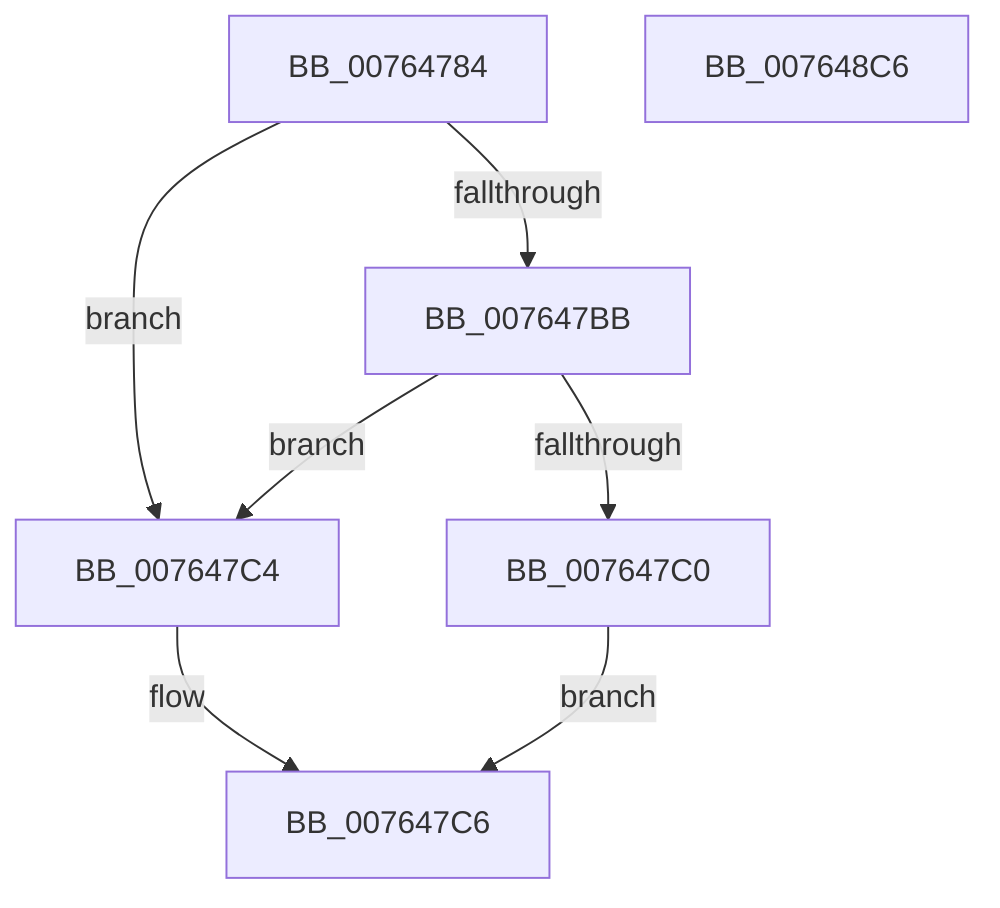

# PopPowerAggregatorEngageModernStandby

- RVA: `0x00764784`–`0x007648C7` (길이 `323` bytes)
- VA: `0x0000000140764784`
- 실행 섹션: `PAGE`
- PDB 이름 있음: `예`; PDB Function 태그: `아니요`
- unwind 정보 RVA: `0x000CCCFC`
- 디코드: `73`개 명령, `323/323` bytes 표시
- 미해석 바이트: `0` (있으면 어셈블리에 `.byte`로 보존)

> 이 문서는 커널 이미지의 기계어와 PDB 기호를 분석해 생성했습니다. 4번과 5번은 함수 원형과 자료형을 바이너리 사용 방식에서 추정한 C 해석이며 원본 소스 복구 결과는 아닙니다.

## 1. Dependencies

- 직접 호출 지점: **14**; 고유 호출 대상: **14**
- 직접 호출자로 확인된 함수: **1**
- RIP 상대 이미지 참조: **8**

### Outgoing calls
- `0x00764796` → [PopGetMonitorReasonFromPowerEventId](../../text/4B/PopGetMonitorReasonFromPowerEventId_function_004BB2D8.md) (function, `0x004BB2D8`)
- `0x007647E6` → [PopPowerAggregatorSetCurrentState](../98/PopPowerAggregatorSetCurrentState_function_0098A3B0.md) (function, `0x0098A3B0`)
- `0x007647F2` → [PopReleaseRwLock](../../text/2D/PopReleaseRwLock_function_002DFBBC.md) (function, `0x002DFBBC`)
- `0x007647FE` → [PopSleepstudyStartNextSession](../AC/PopSleepstudyStartNextSession_function_00AC4720.md) (function, `0x00AC4720`)
- `0x00764829` → [ZwUpdateWnfStateData](../../text/6B/ZwUpdateWnfStateData_function_006B0D10.md) (function, `0x006B0D10`)
- `0x0076482E` → [PopPowerRequestRevokeRequestsForSleep](../AC/PopPowerRequestRevokeRequestsForSleep_function_00AC68AC.md) (function, `0x00AC68AC`)
- `0x0076483A` → [PiDmObjectManagerAcquireExclusiveLock](../95/PiDmObjectManagerAcquireExclusiveLock_function_00951334.md) (function, `0x00951334`)
- `0x0076485B` → [PopDirectedDripsClearDisengageReason](../../text/47/PopDirectedDripsClearDisengageReason_function_00477EA4.md) (function, `0x00477EA4`)
- `0x00764867` → [ExReleaseResourceLite](../../text/25/ExReleaseResourceLite_function_0025FA10.md) (function, `0x0025FA10`)
- `0x0076486C` → [KeLeaveCriticalRegion](../../text/25/KeLeaveCriticalRegion_function_0025D8B0.md) (function, `0x0025D8B0`)
- `0x0076488F` → [PopDirectedDripsNotify](../A8/PopDirectedDripsNotify_function_00A80850.md) (function, `0x00A80850`)
- `0x00764897` → [PopPowerAggregatorEngageAggressiveStandbyActions](PopPowerAggregatorEngageAggressiveStandbyActions_function_0076460C.md) (function, `0x0076460C`)
- `0x007648A5` → [guard_dispatch_icall](../../text/6B/guard_dispatch_icall_function_006BAAD0.md) (function, `0x006BAAD0`)
- `0x007648B1` → [PopAcquireRwLockExclusive](../../text/43/PopAcquireRwLockExclusive_function_00430B44.md) (function, `0x00430B44`)

### Direct callers
- [PopPowerAggregatorScreenOffEnterStateHandler](PopPowerAggregatorScreenOffEnterStateHandler_function_00764E90.md) at `0x00764ECE`

### Static image references
- `0x007647EB` → RVA `0x00F09710` (`.data`; read)
- `0x00764815` → RVA `0x00013340` (`.rdata`; read)
- `0x00764833` → RVA `0x00F07EA0` (`.data`; read)
- `0x0076483F` → RVA `0x00F07E90` (`.data`; read)
- `0x00764847` → RVA `0x00F07FD4` (`.data`; read/write)
- `0x0076484E` → RVA `0x00F07FD8` (`.data`; write)
- `0x00764854` → RVA `0x00F07FF0` (`.data`; write)
- `0x0076489C` → RVA `0x00E67808` (`.data`; read)

## 2. Other-region calls and transfers

- 다른 실행 섹션으로 향하는 call: **8**
  - `0x00764796` → [PopGetMonitorReasonFromPowerEventId](../../text/4B/PopGetMonitorReasonFromPowerEventId_function_004BB2D8.md) (`PAGE` → `.text`)
  - `0x007647F2` → [PopReleaseRwLock](../../text/2D/PopReleaseRwLock_function_002DFBBC.md) (`PAGE` → `.text`)
  - `0x00764829` → [ZwUpdateWnfStateData](../../text/6B/ZwUpdateWnfStateData_function_006B0D10.md) (`PAGE` → `.text`)
  - `0x0076485B` → [PopDirectedDripsClearDisengageReason](../../text/47/PopDirectedDripsClearDisengageReason_function_00477EA4.md) (`PAGE` → `.text`)
  - `0x00764867` → [ExReleaseResourceLite](../../text/25/ExReleaseResourceLite_function_0025FA10.md) (`PAGE` → `.text`)
  - `0x0076486C` → [KeLeaveCriticalRegion](../../text/25/KeLeaveCriticalRegion_function_0025D8B0.md) (`PAGE` → `.text`)
  - `0x007648A5` → [guard_dispatch_icall](../../text/6B/guard_dispatch_icall_function_006BAAD0.md) (`PAGE` → `.text`)
  - `0x007648B1` → [PopAcquireRwLockExclusive](../../text/43/PopAcquireRwLockExclusive_function_00430B44.md) (`PAGE` → `.text`)
- 별도 외부 분기/꼬리 이동을 확인하지 못했습니다.

## 3. Assembly (complete function range)

```asm
00764784  48 89 5C 24 18                  mov qword ptr [rsp + 0x18], rbx
00764789  55                              push rbp
0076478A  56                              push rsi
0076478B  57                              push rdi
0076478C  48 83 EC 60                     sub rsp, 0x60
00764790  4C 8B D1                        mov r10, rcx
00764793  8B 49 3C                        mov ecx, dword ptr [rcx + 0x3c]
00764796  E8 3D 6B D5 FF                  call 0x1404bb2d8
0076479B  41 8A 7A 2B                     mov dil, byte ptr [r10 + 0x2b]
0076479F  8B D8                           mov ebx, eax
007647A1  41 8A 72 2A                     mov sil, byte ptr [r10 + 0x2a]
007647A5  81 E3 FF FF FF 00               and ebx, 0xffffff
007647AB  41 80 7A 28 00                  cmp byte ptr [r10 + 0x28], 0
007647B0  B9 01 00 00 00                  mov ecx, 1
007647B5  41 8B 6A 4C                     mov ebp, dword ptr [r10 + 0x4c]
007647B9  74 09                           je 0x1407647c4
007647BB  40 84 FF                        test dil, dil
007647BE  75 04                           jne 0x1407647c4
007647C0  8B C1                           mov eax, ecx
007647C2  EB 02                           jmp 0x1407647c6
007647C4  33 C0                           xor eax, eax
007647C6  0F 57 C0                        xorps xmm0, xmm0
007647C9  89 84 24 80 00 00 00            mov dword ptr [rsp + 0x80], eax
007647D0  0F 11 44 24 40                  movups xmmword ptr [rsp + 0x40], xmm0
007647D5  89 4C 24 40                     mov dword ptr [rsp + 0x40], ecx
007647D9  48 8D 54 24 40                  lea rdx, [rsp + 0x40]
007647DE  49 8B CA                        mov rcx, r10
007647E1  0F 11 44 24 50                  movups xmmword ptr [rsp + 0x50], xmm0
007647E6  E8 C5 5B 22 00                  call 0x14098a3b0
007647EB  48 8D 0D 1E 4F 7A 00            lea rcx, [rip + 0x7a4f1e]
007647F2  E8 C5 B3 B7 FF                  call 0x1402dfbbc
007647F7  8B D3                           mov edx, ebx
007647F9  B9 02 00 00 00                  mov ecx, 2
007647FE  E8 1D FF 35 00                  call 0x140ac4720
00764803  83 64 24 30 00                  and dword ptr [rsp + 0x30], 0
00764808  48 8D 94 24 80 00 00 00         lea rdx, [rsp + 0x80]
00764810  83 64 24 28 00                  and dword ptr [rsp + 0x28], 0
00764815  48 8D 0D 24 EB 8A FF            lea rcx, [rip - 0x7514dc]
0076481C  48 83 64 24 20 00               and qword ptr [rsp + 0x20], 0
00764822  45 33 C9                        xor r9d, r9d
00764825  45 8D 41 04                     lea r8d, [r9 + 4]
00764829  E8 E2 C4 F4 FF                  call 0x1406b0d10
0076482E  E8 79 20 36 00                  call 0x140ac68ac
00764833  48 8D 0D 66 36 7A 00            lea rcx, [rip + 0x7a3666]
0076483A  E8 F5 CA 1E 00                  call 0x140951334
0076483F  8B 05 4B 36 7A 00               mov eax, dword ptr [rip + 0x7a364b]
00764845  33 C9                           xor ecx, ecx
00764847  83 25 86 37 7A 00 00            and dword ptr [rip + 0x7a3786], 0
0076484E  89 05 84 37 7A 00               mov dword ptr [rip + 0x7a3784], eax
00764854  40 88 35 95 37 7A 00            mov byte ptr [rip + 0x7a3795], sil
0076485B  E8 44 36 D1 FF                  call 0x140477ea4
00764860  48 8D 0D 39 36 7A 00            lea rcx, [rip + 0x7a3639]
00764867  E8 A4 B1 AF FF                  call 0x14025fa10
0076486C  E8 3F 90 AF FF                  call 0x14025d8b0
00764871  48 83 A4 24 88 00 00 00 00      and qword ptr [rsp + 0x88], 0
0076487A  48 8D 94 24 88 00 00 00         lea rdx, [rsp + 0x88]
00764882  B9 06 00 00 00                  mov ecx, 6
00764887  40 88 B4 24 88 00 00 00         mov byte ptr [rsp + 0x88], sil
0076488F  E8 BC BF 31 00                  call 0x140a80850
00764894  40 8A CF                        mov cl, dil
00764897  E8 70 FD FF FF                  call 0x14076460c
0076489C  48 8B 05 65 2F 70 00            mov rax, qword ptr [rip + 0x702f65]
007648A3  8B CD                           mov ecx, ebp
007648A5  E8 26 62 F5 FF                  call 0x1406baad0
007648AA  48 8D 0D 5F 4E 7A 00            lea rcx, [rip + 0x7a4e5f]
007648B1  E8 8E C2 CC FF                  call 0x140430b44
007648B6  48 8B 9C 24 90 00 00 00         mov rbx, qword ptr [rsp + 0x90]
007648BE  48 83 C4 60                     add rsp, 0x60
007648C2  5F                              pop rdi
007648C3  5E                              pop rsi
007648C4  5D                              pop rbp
007648C5  C3                              ret
007648C6  CC                              int3
```

## 4. C-style interpretation (structured pseudocode)

```c
__int64 __fastcall PopPowerAggregatorEngageModernStandby(__int64 a1, __int64 a2, __int64 a3, int a4)
{
    __int64 result;
    __int64 v_rbx;
    __int64 v_rsp;
    unsigned __int64 v_stack_m28;
    unsigned __int64 v_stack_m38;
    unsigned int v_stack_m48;
    unsigned int v_stack_m50;
    unsigned __int64 v_stack_m58;
    unsigned __int64 v_stack_p10;
    unsigned __int64 v_stack_p18;
    unsigned int v_stack_p8;

    v_stack_p18 = v_rbx;
    v_rsp = (v_rsp) - (96);
    result = PopGetMonitorReasonFromPowerEventId((unsigned int)(*(unsigned int *)(a1 + 60)), a2, a3, a4);
    v_rbx = (unsigned int)(((unsigned int)((unsigned int)(result))) & (0xFFFFFFULL));
    if ((*(unsigned __int8 *)(a1 + 40)) == 0) goto loc_007647C4;
    if ((unsigned __int8)(*(unsigned __int8 *)(a1 + 43)) != 0) goto loc_007647C4;
    goto loc_007647C6;
loc_007647C4:
    result = 0;
loc_007647C6:
    v_stack_p8 = 0;
    v_stack_m38 = v_xmm0;
    v_stack_m38 = 1;
    v_stack_m28 = v_xmm0;
    result = PopPowerAggregatorSetCurrentState(a1, v_stack_m38, a3, a4);
    result = PopReleaseRwLock(v_rip + 8015646, v_stack_m38, a3, a4);
    result = PopSleepstudyStartNextSession(2, (unsigned int)((unsigned int)(v_rbx)), a3, a4);
    a4 = 0;
    result = ZwUpdateWnfStateData(v_rip - 7673052, v_stack_p8, a4 + 4, a4);
    result = PopPowerRequestRevokeRequestsForSleep(v_rip - 7673052, v_stack_p8, a4 + 4, a4);
    result = PiDmObjectManagerAcquireExclusiveLock(v_rip + 8009318, v_stack_p8, a4 + 4, a4);
    a1 = 0;
    *(unsigned int *)(v_rip + 8009604) = (unsigned int)((unsigned int)(*(unsigned int *)(v_rip + 8009291)));
    *(unsigned __int8 *)(v_rip + 8009621) = (unsigned __int8)(*(unsigned __int8 *)(a1 + 42));
    result = PopDirectedDripsClearDisengageReason(a1, v_stack_p8, a4 + 4, a4);
    result = ExReleaseResourceLite(v_rip + 8009273, v_stack_p8, a4 + 4, a4);
    result = KeLeaveCriticalRegion(v_rip + 8009273, v_stack_p8, a4 + 4, a4);
    v_stack_p10 = (unsigned __int8)(*(unsigned __int8 *)(a1 + 42));
    result = PopDirectedDripsNotify(6, v_stack_p10, a4 + 4, a4);
    result = PopPowerAggregatorEngageAggressiveStandbyActions((unsigned __int8)(*(unsigned __int8 *)(a1 + 43)), v_stack_p10, a4 + 4, a4);
    result = guard_dispatch_icall((unsigned int)((unsigned int)((unsigned int)(*(unsigned int *)(a1 + 76)))), v_stack_p10, a4 + 4, a4);
    result = PopAcquireRwLockExclusive(v_rip + 8015455, v_stack_p10, a4 + 4, a4);
    v_rsp = (v_rsp) + (96);
    return result;
}
```

## 5. (Beta) C Style

```c
int64_t PopPowerAggregatorEngageModernStandby(void *Arg1, int64_t Arg2, int64_t Arg3, int32_t Arg4)
{
    uint8_t *arg1 = (uint8_t *)Arg1;

    int64_t result;
    int64_t local_rbx;
    int64_t local_rsp;
    uint64_t v_stack_m28;
    uint64_t v_stack_m38;
    uint32_t v_stack_m48;
    uint32_t v_stack_m50;
    uint64_t v_stack_m58;
    uint64_t v_stack_p10;
    uint64_t v_stack_p18;
    uint32_t v_stack_p8;

    v_stack_p18 = local_rbx;
    local_rsp = (local_rsp) - (96);
    result = PopGetMonitorReasonFromPowerEventId((uint32_t)(*(uint32_t *)(arg1 + 0x3C)), Arg2, Arg3, Arg4);
    local_rbx = (uint32_t)(((uint32_t)((uint32_t)(result))) & (0xFFFFFFULL));
    if ((*(uint8_t *)(arg1 + 0x28)) == 0) goto loc_007647C4;
    if ((uint8_t)(*(uint8_t *)(arg1 + 0x2B)) != 0) goto loc_007647C4;
    goto loc_007647C6;
loc_007647C4:
    result = 0;
loc_007647C6:
    v_stack_p8 = 0;
    v_stack_m38 = v_xmm0;
    v_stack_m38 = 1;
    v_stack_m28 = v_xmm0;
    result = PopPowerAggregatorSetCurrentState(Arg1, v_stack_m38, Arg3, Arg4);
    result = PopReleaseRwLock(v_rip + 8015646, v_stack_m38, Arg3, Arg4);
    result = PopSleepstudyStartNextSession(2, (uint32_t)((uint32_t)(local_rbx)), Arg3, Arg4);
    Arg4 = 0;
    result = ZwUpdateWnfStateData(v_rip - 7673052, v_stack_p8, Arg4 + 4, Arg4);
    result = PopPowerRequestRevokeRequestsForSleep(v_rip - 7673052, v_stack_p8, Arg4 + 4, Arg4);
    result = PiDmObjectManagerAcquireExclusiveLock(v_rip + 8009318, v_stack_p8, Arg4 + 4, Arg4);
    Arg1 = 0;
    *(uint32_t *)(v_rip + 0x7A3784) = (uint32_t)((uint32_t)(*(uint32_t *)(v_rip + 0x7A364B)));
    *(uint8_t *)(v_rip + 0x7A3795) = (uint8_t)(*(uint8_t *)(arg1 + 0x2A));
    result = PopDirectedDripsClearDisengageReason(Arg1, v_stack_p8, Arg4 + 4, Arg4);
    result = ExReleaseResourceLite(v_rip + 8009273, v_stack_p8, Arg4 + 4, Arg4);
    result = KeLeaveCriticalRegion(v_rip + 8009273, v_stack_p8, Arg4 + 4, Arg4);
    v_stack_p10 = (uint8_t)(*(uint8_t *)(arg1 + 0x2A));
    result = PopDirectedDripsNotify(6, v_stack_p10, Arg4 + 4, Arg4);
    result = PopPowerAggregatorEngageAggressiveStandbyActions((uint8_t)(*(uint8_t *)(arg1 + 0x2B)), v_stack_p10, Arg4 + 4, Arg4);
    result = guard_dispatch_icall((uint32_t)((uint32_t)((uint32_t)(*(uint32_t *)(arg1 + 0x4C)))), v_stack_p10, Arg4 + 4, Arg4);
    result = PopAcquireRwLockExclusive(v_rip + 8015455, v_stack_p10, Arg4 + 4, Arg4);
    local_rsp = (local_rsp) + (96);
    return result;
}
```

### 관측된 메모리 오프셋

구조체 형식이 확인되지 않은 접근은 인자 기준의 오프셋으로만 기록했습니다.

| 기준 인자 | 오프셋 표현 | 폭 (bit) | 접근 |
|---|---:|---:|---|
| `Arg1` | `+ 0x3C` | `32` | `R` |

## 6. Execution-region graph

[열기: 2D/3D 그래프와 함수 탐색 컨트롤 패널](../../../control-panel.html?section=page&rva=0x00764784&view=graph)

- 2D 그래프는 위에서 아래로 흐르고, 3D 그래프는 빈 공간을 드래그해 회전합니다. Shift+드래그는 이동, 휠은 확대·축소, 함수 노드 선택은 대상 보고서 이동입니다.

### Static fallback


