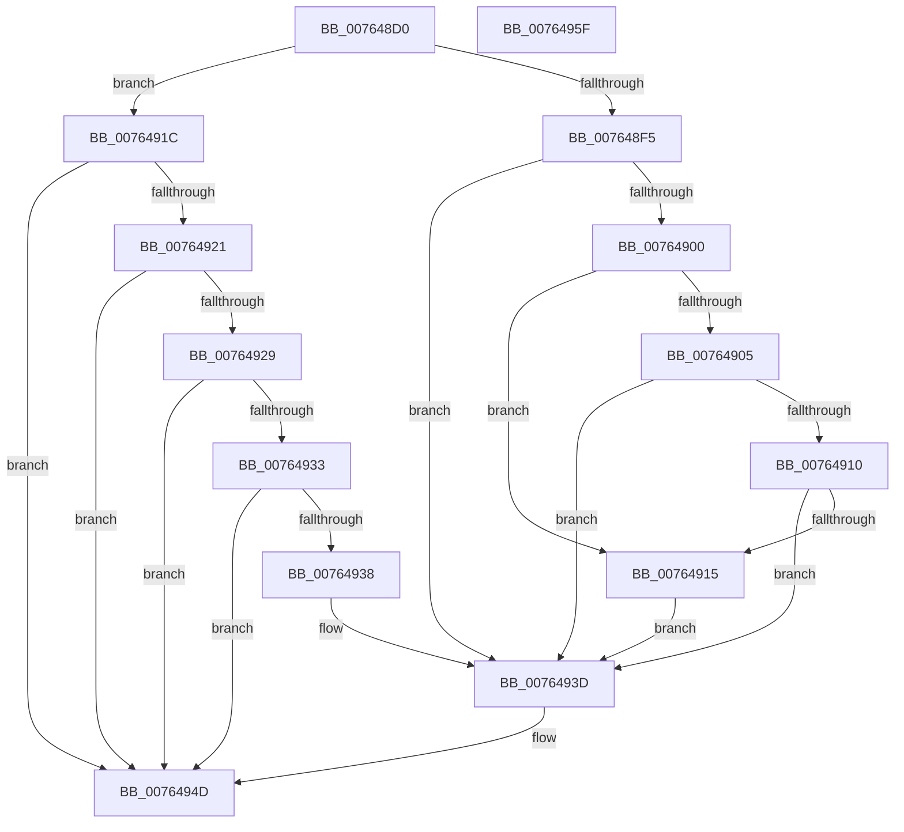

# PopPowerAggregatorForceSessionSwitch

- RVA: `0x007648D0`–`0x00764960` (길이 `144` bytes)
- VA: `0x00000001407648D0`
- 실행 섹션: `PAGE`
- PDB 이름 있음: `예`; PDB Function 태그: `아니요`
- unwind 정보 RVA: `0x0005CF00`
- 디코드: `42`개 명령, `144/144` bytes 표시
- 미해석 바이트: `0` (있으면 어셈블리에 `.byte`로 보존)

> 이 문서는 커널 이미지의 기계어와 PDB 기호를 분석해 생성했습니다. 4번과 5번은 함수 원형과 자료형을 바이너리 사용 방식에서 추정한 C 해석이며 원본 소스 복구 결과는 아닙니다.

## 1. Dependencies

- 직접 호출 지점: **3**; 고유 호출 대상: **3**
- 직접 호출자로 확인된 함수: **3**
- RIP 상대 이미지 참조: **4**

### Outgoing calls
- `0x007648DF` → [PopAcquireRwLockExclusive](../../text/43/PopAcquireRwLockExclusive_function_00430B44.md) (function, `0x00430B44`)
- `0x00764948` → [PopPowerAggregatorHandleIntentUnsafe](../91/PopPowerAggregatorHandleIntentUnsafe_function_009146D8.md) (function, `0x009146D8`)
- `0x00764954` → [PopReleaseRwLock](../../text/2D/PopReleaseRwLock_function_002DFBBC.md) (function, `0x002DFBBC`)

### Direct callers
- [PopPowerSourceChangeCallback](../../text/4C/PopPowerSourceChangeCallback_function_004C3A60.md) at `0x004C3C43`
- [PopPreCriticalBatteryNotify](PopPreCriticalBatteryNotify_function_007639C0.md) at `0x007639CE`
- [PopNotifyLidStateChange](../AC/PopNotifyLidStateChange_function_00AC34A8.md) at `0x00AC34DD`

### Static image references
- `0x007648D8` → RVA `0x00F09710` (`.data`; read)
- `0x007648E4` → RVA `0x00F09750` (`.data`; read)
- `0x007648F5` → RVA `0x00F09768` (`.data`; read)
- `0x00764905` → RVA `0x00F09868` (`.data`; read)

## 2. Other-region calls and transfers

- 다른 실행 섹션으로 향하는 call: **2**
  - `0x007648DF` → [PopAcquireRwLockExclusive](../../text/43/PopAcquireRwLockExclusive_function_00430B44.md) (`PAGE` → `.text`)
  - `0x00764954` → [PopReleaseRwLock](../../text/2D/PopReleaseRwLock_function_002DFBBC.md) (`PAGE` → `.text`)
- 별도 외부 분기/꼬리 이동을 확인하지 못했습니다.

## 3. Assembly (complete function range)

```asm
007648D0  40 53                           push rbx
007648D2  48 83 EC 20                     sub rsp, 0x20
007648D6  8B D9                           mov ebx, ecx
007648D8  48 8D 0D 31 4E 7A 00            lea rcx, [rip + 0x7a4e31]
007648DF  E8 60 C2 CC FF                  call 0x140430b44
007648E4  8B 05 66 4E 7A 00               mov eax, dword ptr [rip + 0x7a4e66]
007648EA  33 D2                           xor edx, edx
007648EC  89 54 24 38                     mov dword ptr [rsp + 0x38], edx
007648F0  83 F8 01                        cmp eax, 1
007648F3  75 27                           jne 0x14076491c
007648F5  38 15 6D 4E 7A 00               cmp byte ptr [rip + 0x7a4e6d], dl
007648FB  8D 4A 03                        lea ecx, [rdx + 3]
007648FE  74 3D                           je 0x14076493d
00764900  83 FB 04                        cmp ebx, 4
00764903  75 10                           jne 0x140764915
00764905  8B 05 5D 4F 7A 00               mov eax, dword ptr [rip + 0x7a4f5d]
0076490B  83 F8 08                        cmp eax, 8
0076490E  74 2D                           je 0x14076493d
00764910  83 F8 02                        cmp eax, 2
00764913  74 28                           je 0x14076493d
00764915  B9 02 00 00 00                  mov ecx, 2
0076491A  EB 21                           jmp 0x14076493d
0076491C  83 F8 04                        cmp eax, 4
0076491F  75 2C                           jne 0x14076494d
00764921  38 15 41 4E 7A 00               cmp byte ptr [rip + 0x7a4e41], dl
00764927  74 24                           je 0x14076494d
00764929  8D 43 D5                        lea eax, [rbx - 0x2b]
0076492C  A9 FC FF FF FF                  test eax, 0xfffffffc
00764931  75 1A                           jne 0x14076494d
00764933  83 FB 2C                        cmp ebx, 0x2c
00764936  74 15                           je 0x14076494d
00764938  B9 0A 00 00 00                  mov ecx, 0xa
0076493D  44 8B CB                        mov r9d, ebx
00764940  48 8D 54 24 38                  lea rdx, [rsp + 0x38]
00764945  45 33 C0                        xor r8d, r8d
00764948  E8 8B FD 1A 00                  call 0x1409146d8
0076494D  48 8D 0D BC 4D 7A 00            lea rcx, [rip + 0x7a4dbc]
00764954  E8 63 B2 B7 FF                  call 0x1402dfbbc
00764959  48 83 C4 20                     add rsp, 0x20
0076495D  5B                              pop rbx
0076495E  C3                              ret
0076495F  CC                              int3
```

## 4. C-style interpretation (structured pseudocode)

```c
__int64 __fastcall PopPowerAggregatorForceSessionSwitch(int a1, int a2, int a3)
{
    __int64 result;
    __int64 v_rsp;
    unsigned int v_stack_p10;

    v_rsp = (v_rsp) - (32);
    result = PopAcquireRwLockExclusive(v_rip + 8015409, a2, a3, a4);
    a2 = 0;
    v_stack_p10 = 0;
    if (((unsigned int)((unsigned int)(*(unsigned int *)(v_rip + 8015462)))) != 1) goto loc_0076491C;
    if ((*(unsigned __int8 *)(v_rip + 8015469)) == 0) goto loc_0076493D;
    if (((unsigned int)((unsigned int)(a1))) != 4) goto loc_00764915;
    if (((unsigned int)((unsigned int)(*(unsigned int *)(v_rip + 8015709)))) == 8) goto loc_0076493D;
    if (((unsigned int)((unsigned int)(*(unsigned int *)(v_rip + 8015709)))) == 2) goto loc_0076493D;
loc_00764915:
    goto loc_0076493D;
loc_0076491C:
    if (((unsigned int)((unsigned int)(*(unsigned int *)(v_rip + 8015709)))) != 4) goto loc_0076494D;
    if ((*(unsigned __int8 *)(v_rip + 8015425)) == 0) goto loc_0076494D;
    if ((((unsigned int)((unsigned int)(a1) - 43)) & (0xFFFFFFFCULL)) != 0) goto loc_0076494D;
    if (((unsigned int)((unsigned int)(a1))) == 44) goto loc_0076494D;
loc_0076493D:
    a3 = 0;
    result = PopPowerAggregatorHandleIntentUnsafe(10, v_stack_p10, a3, (unsigned int)((unsigned int)((unsigned int)(a1))));
loc_0076494D:
    result = PopReleaseRwLock(v_rip + 8015292, v_stack_p10, a3, (unsigned int)((unsigned int)((unsigned int)(a1))));
    v_rsp = (v_rsp) + (32);
    return result;
}
```

## 5. (Beta) C Style

```c
int64_t PopPowerAggregatorForceSessionSwitch(void *Arg1, int32_t Arg2, int32_t Arg3)
{
    uint8_t *arg1 = (uint8_t *)Arg1;

    int64_t result;
    int64_t local_rsp;
    uint32_t v_stack_p10;

    local_rsp = (local_rsp) - (32);
    result = PopAcquireRwLockExclusive(v_rip + 8015409, Arg2, Arg3, a4);
    Arg2 = 0;
    v_stack_p10 = 0;
    if (((uint32_t)((uint32_t)(*(uint32_t *)(v_rip + 0x7A4E66)))) != 1) goto loc_0076491C;
    if ((*(uint8_t *)(v_rip + 0x7A4E6D)) == 0) goto loc_0076493D;
    if (((uint32_t)((uint32_t)(Arg1))) != 4) goto loc_00764915;
    if (((uint32_t)((uint32_t)(*(uint32_t *)(v_rip + 0x7A4F5D)))) == 8) goto loc_0076493D;
    if (((uint32_t)((uint32_t)(*(uint32_t *)(v_rip + 0x7A4F5D)))) == 2) goto loc_0076493D;
loc_00764915:
    goto loc_0076493D;
loc_0076491C:
    if (((uint32_t)((uint32_t)(*(uint32_t *)(v_rip + 0x7A4F5D)))) != 4) goto loc_0076494D;
    if ((*(uint8_t *)(v_rip + 0x7A4E41)) == 0) goto loc_0076494D;
    if ((((uint32_t)((uint32_t)(Arg1) - 43)) & (0xFFFFFFFCULL)) != 0) goto loc_0076494D;
    if (((uint32_t)((uint32_t)(Arg1))) == 44) goto loc_0076494D;
loc_0076493D:
    Arg3 = 0;
    result = PopPowerAggregatorHandleIntentUnsafe(10, v_stack_p10, Arg3, (uint32_t)((uint32_t)((uint32_t)(Arg1))));
loc_0076494D:
    result = PopReleaseRwLock(v_rip + 8015292, v_stack_p10, Arg3, (uint32_t)((uint32_t)((uint32_t)(Arg1))));
    local_rsp = (local_rsp) + (32);
    return result;
}
```

### 관측된 메모리 오프셋

구조체 형식이 확인되지 않은 접근은 인자 기준의 오프셋으로만 기록했습니다.

| 기준 인자 | 오프셋 표현 | 폭 (bit) | 접근 |
|---|---:|---:|---|
| `Arg1` | `- 0x2B` | `32` | `R` |

## 6. Execution-region graph

[열기: 2D/3D 그래프와 함수 탐색 컨트롤 패널](../../../control-panel.html?section=page&rva=0x007648D0&view=graph)

- 2D 그래프는 위에서 아래로 흐르고, 3D 그래프는 빈 공간을 드래그해 회전합니다. Shift+드래그는 이동, 휠은 확대·축소, 함수 노드 선택은 대상 보고서 이동입니다.

### Static fallback


