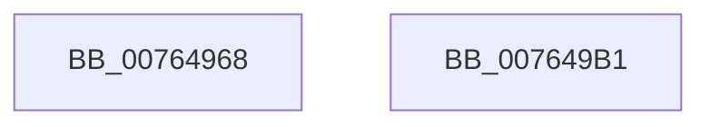

# PopPowerAggregatorGetCurrentTargetState

- RVA: `0x00764968`–`0x007649B2` (길이 `74` bytes)
- VA: `0x0000000140764968`
- 실행 섹션: `PAGE`
- PDB 이름 있음: `예`; PDB Function 태그: `아니요`
- unwind 정보 RVA: `0x0005CF00`
- 디코드: `17`개 명령, `74/74` bytes 표시
- 미해석 바이트: `0` (있으면 어셈블리에 `.byte`로 보존)

> 이 문서는 커널 이미지의 기계어와 PDB 기호를 분석해 생성했습니다. 4번과 5번은 함수 원형과 자료형을 바이너리 사용 방식에서 추정한 C 해석이며 원본 소스 복구 결과는 아닙니다.

## 1. Dependencies

- 직접 호출 지점: **2**; 고유 호출 대상: **2**
- 직접 호출자로 확인된 함수: **1**
- RIP 상대 이미지 참조: **4**

### Outgoing calls
- `0x00764978` → [PopAcquireRwLockExclusive](../../text/43/PopAcquireRwLockExclusive_function_00430B44.md) (function, `0x00430B44`)
- `0x007649A6` → [PopReleaseRwLock](../../text/2D/PopReleaseRwLock_function_002DFBBC.md) (function, `0x002DFBBC`)

### Direct callers
- [PopAdaptiveGetSystemInitiatedRebootTargetState](../70/PopAdaptiveGetSystemInitiatedRebootTargetState_function_00701398.md) at `0x00701431`

### Static image references
- `0x00764971` → RVA `0x00F09710` (`.data`; read)
- `0x0076497D` → RVA `0x00F09750` (`.data`; read)
- `0x0076498B` → RVA `0x00F09760` (`.data`; read)
- `0x00764995` → RVA `0x00F09770` (`.data`; read)

## 2. Other-region calls and transfers

- 다른 실행 섹션으로 향하는 call: **2**
  - `0x00764978` → [PopAcquireRwLockExclusive](../../text/43/PopAcquireRwLockExclusive_function_00430B44.md) (`PAGE` → `.text`)
  - `0x007649A6` → [PopReleaseRwLock](../../text/2D/PopReleaseRwLock_function_002DFBBC.md) (`PAGE` → `.text`)
- 별도 외부 분기/꼬리 이동을 확인하지 못했습니다.

## 3. Assembly (complete function range)

```asm
00764968  40 53                           push rbx
0076496A  48 83 EC 20                     sub rsp, 0x20
0076496E  48 8B D9                        mov rbx, rcx
00764971  48 8D 0D 98 4D 7A 00            lea rcx, [rip + 0x7a4d98]
00764978  E8 C7 C1 CC FF                  call 0x140430b44
0076497D  0F 10 05 CC 4D 7A 00            movups xmm0, xmmword ptr [rip + 0x7a4dcc]
00764984  48 8D 0D 85 4D 7A 00            lea rcx, [rip + 0x7a4d85]
0076498B  0F 10 0D CE 4D 7A 00            movups xmm1, xmmword ptr [rip + 0x7a4dce]
00764992  0F 11 03                        movups xmmword ptr [rbx], xmm0
00764995  F2 0F 10 05 D3 4D 7A 00         movsd xmm0, qword ptr [rip + 0x7a4dd3]
0076499D  0F 11 4B 10                     movups xmmword ptr [rbx + 0x10], xmm1
007649A1  F2 0F 11 43 20                  movsd qword ptr [rbx + 0x20], xmm0
007649A6  E8 11 B2 B7 FF                  call 0x1402dfbbc
007649AB  48 83 C4 20                     add rsp, 0x20
007649AF  5B                              pop rbx
007649B0  C3                              ret
007649B1  CC                              int3
```

## 4. C-style interpretation (structured pseudocode)

```c
__int64 __fastcall PopPowerAggregatorGetCurrentTargetState(__int64 a1)
{
    __int64 result;
    __int64 v_rsp;

    v_rsp = (v_rsp) - (32);
    result = PopAcquireRwLockExclusive(v_rip + 8015256, a2, a3, a4);
    *(unsigned __int64 *)(a1) = v_xmm0;
    *(unsigned __int64 *)(a1 + 16) = v_xmm1;
    *(unsigned __int64 *)(a1 + 32) = v_xmm0;
    result = PopReleaseRwLock(v_rip + 8015237, a2, a3, a4);
    v_rsp = (v_rsp) + (32);
    return result;
}
```

## 5. (Beta) C Style

```c
int64_t PopPowerAggregatorGetCurrentTargetState(void *Arg1)
{
    uint8_t *arg1 = (uint8_t *)Arg1;

    int64_t result;
    int64_t local_rsp;

    local_rsp = (local_rsp) - (32);
    result = PopAcquireRwLockExclusive(v_rip + 8015256, a2, a3, a4);
    *(uint64_t *)(arg1) = v_xmm0;
    *(uint64_t *)(arg1 + 0x10) = v_xmm1;
    *(uint64_t *)(arg1 + 0x20) = v_xmm0;
    result = PopReleaseRwLock(v_rip + 8015237, a2, a3, a4);
    local_rsp = (local_rsp) + (32);
    return result;
}
```

### 관측된 메모리 오프셋

구조체 형식이 확인되지 않은 접근은 인자 기준의 오프셋으로만 기록했습니다.

| 기준 인자 | 오프셋 표현 | 폭 (bit) | 접근 |
|---|---:|---:|---|
| `Arg1` | `+ 0x0` | `128` | `R` |
| `Arg1` | `+ 0x10` | `128` | `R` |
| `Arg1` | `+ 0x20` | `64` | `W` |

## 6. Execution-region graph

[열기: 2D/3D 그래프와 함수 탐색 컨트롤 패널](../../../control-panel.html?section=page&rva=0x00764968&view=graph)

- 2D 그래프는 위에서 아래로 흐르고, 3D 그래프는 빈 공간을 드래그해 회전합니다. Shift+드래그는 이동, 휠은 확대·축소, 함수 노드 선택은 대상 보고서 이동입니다.

### Static fallback


