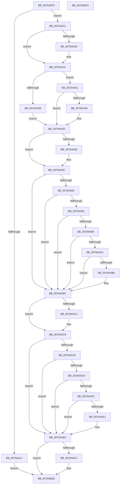

# PopPowerAggregatorHandleModernStandbyIntent

- RVA: `0x007649F0`–`0x00764B25` (길이 `309` bytes)
- VA: `0x00000001407649F0`
- 실행 섹션: `PAGE`
- PDB 이름 있음: `예`; PDB Function 태그: `아니요`
- unwind 정보 RVA: `0x0007D3C0`
- 디코드: `90`개 명령, `309/309` bytes 표시
- 미해석 바이트: `0` (있으면 어셈블리에 `.byte`로 보존)

> 이 문서는 커널 이미지의 기계어와 PDB 기호를 분석해 생성했습니다. 4번과 5번은 함수 원형과 자료형을 바이너리 사용 방식에서 추정한 C 해석이며 원본 소스 복구 결과는 아닙니다.

## 1. Dependencies

- 직접 호출 지점: **5**; 고유 호출 대상: **5**
- 직접 호출자로 확인된 함수: **0**
- RIP 상대 이미지 참조: **4**

### Outgoing calls
- `0x00764A5C` → [Feature_AdaptiveHibernateEnhancements__private_IsEnabledDeviceUsageNoInline](../../text/4F/Feature_AdaptiveHibernateEnhancements__private_IsEnabledDeviceUsageNoInline_function_004F78F0.md) (function, `0x004F78F0`)
- `0x00764A6A` → [PopCurrentPowerState](../A3/PopCurrentPowerState_function_00A356D8.md) (function, `0x00A356D8`)
- `0x00764A76` → [PopAcquireRwLockShared](../../text/2D/PopAcquireRwLockShared_function_002D9A40.md) (function, `0x002D9A40`)
- `0x00764A88` → [PopReleaseRwLock](../../text/2D/PopReleaseRwLock_function_002DFBBC.md) (function, `0x002DFBBC`)
- `0x00764AEB` → [PopPowerAggregatorAllowModernStandbyPromotion](PopPowerAggregatorAllowModernStandbyPromotion_function_00764360.md) (function, `0x00764360`)

### Direct callers
- 이 함수 시작 RVA로 연결되는 직접 call은 확인되지 않았습니다. 간접 호출은 완전히 역산할 수 없습니다.

### Static image references
- `0x00764A41` → RVA `0x00F09728` (`.data`; read)
- `0x00764A6F` → RVA `0x00F07E80` (`.data`; read)
- `0x00764A7B` → RVA `0x00F07C9C` (`.data`; read)
- `0x00764ABC` → RVA `0x00FC6FA0` (`ALMOSTRO`; read)

## 2. Other-region calls and transfers

- 다른 실행 섹션으로 향하는 call: **3**
  - `0x00764A5C` → [Feature_AdaptiveHibernateEnhancements__private_IsEnabledDeviceUsageNoInline](../../text/4F/Feature_AdaptiveHibernateEnhancements__private_IsEnabledDeviceUsageNoInline_function_004F78F0.md) (`PAGE` → `.text`)
  - `0x00764A76` → [PopAcquireRwLockShared](../../text/2D/PopAcquireRwLockShared_function_002D9A40.md) (`PAGE` → `.text`)
  - `0x00764A88` → [PopReleaseRwLock](../../text/2D/PopReleaseRwLock_function_002DFBBC.md) (`PAGE` → `.text`)
- 별도 외부 분기/꼬리 이동을 확인하지 못했습니다.

## 3. Assembly (complete function range)

```asm
007649F0  48 8B C4                        mov rax, rsp
007649F3  48 89 58 08                     mov qword ptr [rax + 8], rbx
007649F7  48 89 68 10                     mov qword ptr [rax + 0x10], rbp
007649FB  48 89 70 18                     mov qword ptr [rax + 0x18], rsi
007649FF  57                              push rdi
00764A00  48 83 EC 40                     sub rsp, 0x40
00764A04  83 79 10 02                     cmp dword ptr [rcx + 0x10], 2
00764A08  0F 57 C0                        xorps xmm0, xmm0
00764A0B  0F 11 40 D8                     movups xmmword ptr [rax - 0x28], xmm0
00764A0F  48 8B FA                        mov rdi, rdx
00764A12  48 8B E9                        mov rbp, rcx
00764A15  76 0A                           jbe 0x140764a21
00764A17  BE 03 A0 00 C0                  mov esi, 0xc000a003
00764A1C  E9 EC 00 00 00                  jmp 0x140764b0d
00764A21  C7 02 01 00 00 00               mov dword ptr [rdx], 1
00764A27  41 83 F8 02                     cmp r8d, 2
00764A2B  75 04                           jne 0x140764a31
00764A2D  C6 42 18 01                     mov byte ptr [rdx + 0x18], 1
00764A31  33 F6                           xor esi, esi
00764A33  83 79 10 01                     cmp dword ptr [rcx + 0x10], 1
00764A37  75 08                           jne 0x140764a41
00764A39  8A 41 29                        mov al, byte ptr [rcx + 0x29]
00764A3C  88 42 19                        mov byte ptr [rdx + 0x19], al
00764A3F  EB 0C                           jmp 0x140764a4d
00764A41  39 35 E1 4C 7A 00               cmp dword ptr [rip + 0x7a4ce1], esi
00764A47  74 04                           je 0x140764a4d
00764A49  C6 42 19 01                     mov byte ptr [rdx + 0x19], 1
00764A4D  8B 42 08                        mov eax, dword ptr [rdx + 8]
00764A50  83 E8 35                        sub eax, 0x35
00764A53  83 F8 01                        cmp eax, 1
00764A56  77 04                           ja 0x140764a5c
00764A58  C6 42 1B 01                     mov byte ptr [rdx + 0x1b], 1
00764A5C  E8 8F 2E D9 FF                  call 0x1404f78f0
00764A61  85 C0                           test eax, eax
00764A63  74 57                           je 0x140764abc
00764A65  48 8D 4C 24 20                  lea rcx, [rsp + 0x20]
00764A6A  E8 69 0C 2D 00                  call 0x140a356d8
00764A6F  48 8D 0D 0A 34 7A 00            lea rcx, [rip + 0x7a340a]
00764A76  E8 C5 4F B7 FF                  call 0x1402d9a40
00764A7B  8A 1D 1B 32 7A 00               mov bl, byte ptr [rip + 0x7a321b]
00764A81  48 8D 0D F8 33 7A 00            lea rcx, [rip + 0x7a33f8]
00764A88  E8 2F B1 B7 FF                  call 0x1402dfbbc
00764A8D  84 DB                           test bl, bl
00764A8F  75 2B                           jne 0x140764abc
00764A91  40 38 74 24 20                  cmp byte ptr [rsp + 0x20], sil
00764A96  75 24                           jne 0x140764abc
00764A98  44 8B 44 24 28                  mov r8d, dword ptr [rsp + 0x28]
00764A9D  45 85 C0                        test r8d, r8d
00764AA0  74 1A                           je 0x140764abc
00764AA2  6B 44 24 2C 64                  imul eax, dword ptr [rsp + 0x2c], 0x64
00764AA7  33 D2                           xor edx, edx
00764AA9  41 8B C8                        mov ecx, r8d
00764AAC  D1 E9                           shr ecx, 1
00764AAE  03 C1                           add eax, ecx
00764AB0  41 F7 F0                        div r8d
00764AB3  83 F8 14                        cmp eax, 0x14
00764AB6  77 04                           ja 0x140764abc
00764AB8  C6 47 1B 01                     mov byte ptr [rdi + 0x1b], 1
00764ABC  39 35 DE 24 86 00               cmp dword ptr [rip + 0x8624de], esi
00764AC2  74 04                           je 0x140764ac8
00764AC4  C6 47 1B 01                     mov byte ptr [rdi + 0x1b], 1
00764AC8  83 7D 10 01                     cmp dword ptr [rbp + 0x10], 1
00764ACC  75 17                           jne 0x140764ae5
00764ACE  40 38 75 2B                     cmp byte ptr [rbp + 0x2b], sil
00764AD2  74 11                           je 0x140764ae5
00764AD4  8B 47 08                        mov eax, dword ptr [rdi + 8]
00764AD7  83 F8 2B                        cmp eax, 0x2b
00764ADA  74 09                           je 0x140764ae5
00764ADC  83 F8 37                        cmp eax, 0x37
00764ADF  74 04                           je 0x140764ae5
00764AE1  C6 47 1B 01                     mov byte ptr [rdi + 0x1b], 1
00764AE5  48 8B D7                        mov rdx, rdi
00764AE8  48 8B CD                        mov rcx, rbp
00764AEB  E8 70 F8 FF FF                  call 0x140764360
00764AF0  84 C0                           test al, al
00764AF2  75 19                           jne 0x140764b0d
00764AF4  0F 10 45 10                     movups xmm0, xmmword ptr [rbp + 0x10]
00764AF8  0F 11 07                        movups xmmword ptr [rdi], xmm0
00764AFB  0F 10 4D 20                     movups xmm1, xmmword ptr [rbp + 0x20]
00764AFF  0F 11 4F 10                     movups xmmword ptr [rdi + 0x10], xmm1
00764B03  F2 0F 10 45 30                  movsd xmm0, qword ptr [rbp + 0x30]
00764B08  F2 0F 11 47 20                  movsd qword ptr [rdi + 0x20], xmm0
00764B0D  48 8B 5C 24 50                  mov rbx, qword ptr [rsp + 0x50]
00764B12  8B C6                           mov eax, esi
00764B14  48 8B 74 24 60                  mov rsi, qword ptr [rsp + 0x60]
00764B19  48 8B 6C 24 58                  mov rbp, qword ptr [rsp + 0x58]
00764B1E  48 83 C4 40                     add rsp, 0x40
00764B22  5F                              pop rdi
00764B23  C3                              ret
00764B24  CC                              int3
```

## 4. C-style interpretation (structured pseudocode)

```c
__int64 __fastcall PopPowerAggregatorHandleModernStandbyIntent(__int64 a1, __int64 a2, int a3)
{
    __int64 result;
    __int64 v_rsi;
    __int64 v_rsp;
    unsigned int v_stack_m1C;
    unsigned int v_stack_m20;
    unsigned __int64 v_stack_m28;
    unsigned __int64 v_stack_p10;
    unsigned __int64 v_stack_p18;
    unsigned __int64 v_stack_p8;

    *(unsigned __int64 *)(v_rsp + 8) = v_rbx;
    *(unsigned __int64 *)(v_rsp + 16) = v_rbp;
    *(unsigned __int64 *)(v_rsp + 24) = v_rsi;
    v_rsp = (v_rsp) - (64);
    *(unsigned __int64 *)(v_rsp - 40) = v_xmm0;
    if ((*(unsigned int *)(a1 + 16)) <= 2) goto loc_00764A21;
    goto loc_00764B0D;
loc_00764A21:
    *(unsigned int *)(a2) = 1;
    if (a3 == 2) {
        *(unsigned __int8 *)(a2 + 24) = 1;
    }
    v_rsi = 0;
    if ((*(unsigned int *)(a1 + 16)) != 1) goto loc_00764A41;
    *(unsigned __int8 *)(a2 + 25) = (unsigned __int8)(*(unsigned __int8 *)(a1 + 41));
    goto loc_00764A4D;
loc_00764A41:
    if ((*(unsigned int *)(v_rip + 8015073)) != 0) {
        *(unsigned __int8 *)(a2 + 25) = 1;
    }
    result = (unsigned int)(((unsigned int)(*(unsigned int *)(a2 + 8))) - (53));
    if (((unsigned int)(result)) <= 1) {
        *(unsigned __int8 *)(a2 + 27) = 1;
    }
    result = Feature_AdaptiveHibernateEnhancements__private_IsEnabledDeviceUsageNoInline(a1, a2, a3, a4);
    if ((unsigned int)(result) == 0) goto loc_00764ABC;
    result = PopCurrentPowerState(v_stack_m28, a2, a3, a4);
    result = PopAcquireRwLockShared(v_rip + 8008714, a2, a3, a4);
    result = PopReleaseRwLock(v_rip + 8008696, a2, a3, a4);
    if ((unsigned __int8)(*(unsigned __int8 *)(v_rip + 8008219)) != 0) goto loc_00764ABC;
    if (v_stack_m28 != 0) goto loc_00764ABC;
    if ((unsigned int)((unsigned int)(v_stack_m20)) == 0) goto loc_00764ABC;
    result = (unsigned int)((result) * (v_stack_m1C));
    a2 = 0;
    a1 = (unsigned int)(((unsigned int)((unsigned int)((unsigned int)(v_stack_m20)))) >> (1));
    result = (unsigned int)((result) + ((unsigned int)(a1)));
    if (((unsigned int)(result)) <= 20) {
        *(unsigned __int8 *)(a2 + 27) = 1;
    }
    if ((*(unsigned int *)(v_rip + 8791262)) != 0) {
        *(unsigned __int8 *)(a2 + 27) = 1;
    }
    if ((*(unsigned int *)(a1 + 16)) != 1) goto loc_00764AE5;
    if ((*(unsigned __int8 *)(a1 + 43)) == 0) goto loc_00764AE5;
    if (((unsigned int)((unsigned int)(*(unsigned int *)(a2 + 8)))) == 43) goto loc_00764AE5;
    if (((unsigned int)((unsigned int)(*(unsigned int *)(a2 + 8)))) != 55) {
        *(unsigned __int8 *)(a2 + 27) = 1;
    }
    result = PopPowerAggregatorAllowModernStandbyPromotion(a1, 0, (unsigned int)(v_stack_m20), a4);
    if ((unsigned __int8)(result) == 0) {
        *(unsigned __int64 *)(a2) = v_xmm0;
        *(unsigned __int64 *)(a2 + 16) = v_xmm1;
        *(unsigned __int64 *)(a2 + 32) = v_xmm0;
    }
    v_rsp = (v_rsp) + (64);
    return 0;
}
```

## 5. (Beta) C Style

```c
int64_t PopPowerAggregatorHandleModernStandbyIntent(void *Arg1, void *Arg2, int32_t Arg3)
{
    uint8_t *arg1 = (uint8_t *)Arg1;
    uint8_t *arg2 = (uint8_t *)Arg2;

    int64_t result;
    int64_t local_rsi;
    int64_t local_rsp;
    uint32_t v_stack_m1C;
    uint32_t v_stack_m20;
    uint64_t v_stack_m28;
    uint64_t v_stack_p10;
    uint64_t v_stack_p18;
    uint64_t v_stack_p8;

    *(uint64_t *)(local_rsp + 0x8) = local_rbx;
    *(uint64_t *)(local_rsp + 0x10) = local_rbp;
    *(uint64_t *)(local_rsp + 0x18) = local_rsi;
    local_rsp = (local_rsp) - (64);
    *(uint64_t *)(local_rsp - 0x28) = v_xmm0;
    if ((*(uint32_t *)(arg1 + 0x10)) <= 2) goto loc_00764A21;
    goto loc_00764B0D;
loc_00764A21:
    *(uint32_t *)(arg2) = 1;
    if (Arg3 == 2) {
        *(uint8_t *)(arg2 + 0x18) = 1;
    }
    local_rsi = 0;
    if ((*(uint32_t *)(arg1 + 0x10)) != 1) goto loc_00764A41;
    *(uint8_t *)(arg2 + 0x19) = (uint8_t)(*(uint8_t *)(arg1 + 0x29));
    goto loc_00764A4D;
loc_00764A41:
    if ((*(uint32_t *)(v_rip + 0x7A4CE1)) != 0) {
        *(uint8_t *)(arg2 + 0x19) = 1;
    }
    result = (uint32_t)(((uint32_t)(*(uint32_t *)(arg2 + 0x8))) - (53));
    if (((uint32_t)(result)) <= 1) {
        *(uint8_t *)(arg2 + 0x1B) = 1;
    }
    result = Feature_AdaptiveHibernateEnhancements__private_IsEnabledDeviceUsageNoInline(Arg1, Arg2, Arg3, a4);
    if ((uint32_t)(result) == 0) goto loc_00764ABC;
    result = PopCurrentPowerState(v_stack_m28, Arg2, Arg3, a4);
    result = PopAcquireRwLockShared(v_rip + 8008714, Arg2, Arg3, a4);
    result = PopReleaseRwLock(v_rip + 8008696, Arg2, Arg3, a4);
    if ((uint8_t)(*(uint8_t *)(v_rip + 0x7A321B)) != 0) goto loc_00764ABC;
    if (v_stack_m28 != 0) goto loc_00764ABC;
    if ((uint32_t)((uint32_t)(v_stack_m20)) == 0) goto loc_00764ABC;
    result = (uint32_t)((result) * (v_stack_m1C));
    Arg2 = 0;
    Arg1 = (uint32_t)(((uint32_t)((uint32_t)((uint32_t)(v_stack_m20)))) >> (1));
    result = (uint32_t)((result) + ((uint32_t)(Arg1)));
    if (((uint32_t)(result)) <= 20) {
        *(uint8_t *)(arg2 + 0x1B) = 1;
    }
    if ((*(uint32_t *)(v_rip + 0x8624DE)) != 0) {
        *(uint8_t *)(arg2 + 0x1B) = 1;
    }
    if ((*(uint32_t *)(arg1 + 0x10)) != 1) goto loc_00764AE5;
    if ((*(uint8_t *)(arg1 + 0x2B)) == 0) goto loc_00764AE5;
    if (((uint32_t)((uint32_t)(*(uint32_t *)(arg2 + 0x8)))) == 43) goto loc_00764AE5;
    if (((uint32_t)((uint32_t)(*(uint32_t *)(arg2 + 0x8)))) != 55) {
        *(uint8_t *)(arg2 + 0x1B) = 1;
    }
    result = PopPowerAggregatorAllowModernStandbyPromotion(Arg1, 0, (uint32_t)(v_stack_m20), a4);
    if ((uint8_t)(result) == 0) {
        *(uint64_t *)(arg2) = v_xmm0;
        *(uint64_t *)(arg2 + 0x10) = v_xmm1;
        *(uint64_t *)(arg2 + 0x20) = v_xmm0;
    }
    local_rsp = (local_rsp) + (64);
    return 0;
}
```

### 관측된 메모리 오프셋

구조체 형식이 확인되지 않은 접근은 인자 기준의 오프셋으로만 기록했습니다.

| 기준 인자 | 오프셋 표현 | 폭 (bit) | 접근 |
|---|---:|---:|---|
| `Arg1` | `+ 0x10` | `32` | `R` |
| `Arg1` | `+ 0x10` | `128` | `R` |
| `Arg1` | `+ 0x20` | `128` | `R` |
| `Arg1` | `+ 0x29` | `8` | `R` |
| `Arg1` | `+ 0x2B` | `8` | `R` |
| `Arg1` | `+ 0x30` | `64` | `R` |
| `Arg2` | `+ 0x0` | `32` | `W` |
| `Arg2` | `+ 0x0` | `128` | `R` |
| `Arg2` | `+ 0x8` | `32` | `R` |
| `Arg2` | `+ 0x10` | `128` | `R` |
| `Arg2` | `+ 0x18` | `8` | `W` |
| `Arg2` | `+ 0x19` | `8` | `W` |
| `Arg2` | `+ 0x1B` | `8` | `W` |
| `Arg2` | `+ 0x20` | `64` | `W` |

## 6. Execution-region graph

[열기: 2D/3D 그래프와 함수 탐색 컨트롤 패널](../../../control-panel.html?section=page&rva=0x007649F0&view=graph)

- 2D 그래프는 위에서 아래로 흐르고, 3D 그래프는 빈 공간을 드래그해 회전합니다. Shift+드래그는 이동, 휠은 확대·축소, 함수 노드 선택은 대상 보고서 이동입니다.

### Static fallback


