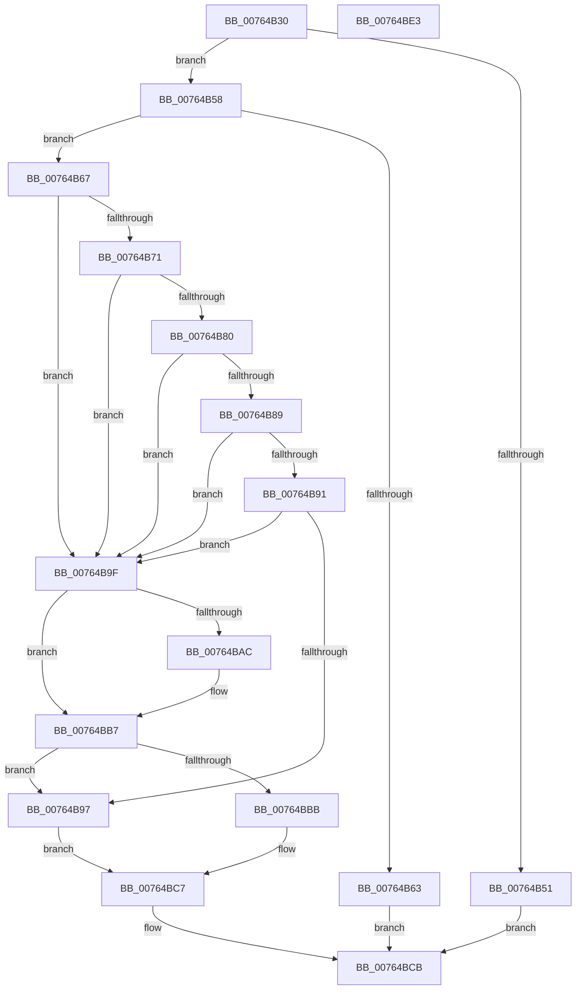

# PopPowerAggregatorHandleSystemTransitionEndIntent

- RVA: `0x00764B30`–`0x00764BE4` (길이 `180` bytes)
- VA: `0x0000000140764B30`
- 실행 섹션: `PAGE`
- PDB 이름 있음: `예`; PDB Function 태그: `아니요`
- unwind 정보 RVA: `0x0006F978`
- 디코드: `55`개 명령, `180/180` bytes 표시
- 미해석 바이트: `0` (있으면 어셈블리에 `.byte`로 보존)

> 이 문서는 커널 이미지의 기계어와 PDB 기호를 분석해 생성했습니다. 4번과 5번은 함수 원형과 자료형을 바이너리 사용 방식에서 추정한 C 해석이며 원본 소스 복구 결과는 아닙니다.

## 1. Dependencies

- 직접 호출 지점: **6**; 고유 호출 대상: **4**
- 직접 호출자로 확인된 함수: **0**
- RIP 상대 이미지 참조: **1**

### Outgoing calls
- `0x00764B58` → [TtmIsEnabled](../91/TtmIsEnabled_function_009143D8.md) (function, `0x009143D8`)
- `0x00764B67` → [PopGetMostRecentWakeInfo](../../text/4B/PopGetMostRecentWakeInfo_function_004BE4F8.md) (function, `0x004BE4F8`)
- `0x00764B77` → [PopWakeInfoDereference](../../text/4C/PopWakeInfoDereference_function_004C74AC.md) (function, `0x004C74AC`)
- `0x00764B80` → [PopIsMostRecentWakeAttended](../../pagelk/B7/PopIsMostRecentWakeAttended_function_00B7D6C8.md) (function, `0x00B7D6C8`)
- `0x00764BA2` → [PopGetMostRecentWakeInfo](../../text/4B/PopGetMostRecentWakeInfo_function_004BE4F8.md) (function, `0x004BE4F8`)
- `0x00764BB2` → [PopWakeInfoDereference](../../text/4C/PopWakeInfoDereference_function_004C74AC.md) (function, `0x004C74AC`)

### Direct callers
- 이 함수 시작 RVA로 연결되는 직접 call은 확인되지 않았습니다. 간접 호출은 완전히 역산할 수 없습니다.

### Static image references
- `0x00764B89` → RVA `0x00F0CE0C` (`.data`; read)

## 2. Other-region calls and transfers

- 다른 실행 섹션으로 향하는 call: **5**
  - `0x00764B67` → [PopGetMostRecentWakeInfo](../../text/4B/PopGetMostRecentWakeInfo_function_004BE4F8.md) (`PAGE` → `.text`)
  - `0x00764B77` → [PopWakeInfoDereference](../../text/4C/PopWakeInfoDereference_function_004C74AC.md) (`PAGE` → `.text`)
  - `0x00764B80` → [PopIsMostRecentWakeAttended](../../pagelk/B7/PopIsMostRecentWakeAttended_function_00B7D6C8.md) (`PAGE` → `PAGELK`)
  - `0x00764BA2` → [PopGetMostRecentWakeInfo](../../text/4B/PopGetMostRecentWakeInfo_function_004BE4F8.md) (`PAGE` → `.text`)
  - `0x00764BB2` → [PopWakeInfoDereference](../../text/4C/PopWakeInfoDereference_function_004C74AC.md) (`PAGE` → `.text`)
- 별도 외부 분기/꼬리 이동을 확인하지 못했습니다.

## 3. Assembly (complete function range)

```asm
00764B30  48 89 5C 24 08                  mov qword ptr [rsp + 8], rbx
00764B35  48 89 74 24 10                  mov qword ptr [rsp + 0x10], rsi
00764B3A  48 89 7C 24 18                  mov qword ptr [rsp + 0x18], rdi
00764B3F  41 56                           push r14
00764B41  48 83 EC 20                     sub rsp, 0x20
00764B45  83 79 10 03                     cmp dword ptr [rcx + 0x10], 3
00764B49  4D 8B F1                        mov r14, r9
00764B4C  48 8B F2                        mov rsi, rdx
00764B4F  74 07                           je 0x140764b58
00764B51  BF 03 A0 00 C0                  mov edi, 0xc000a003
00764B56  EB 73                           jmp 0x140764bcb
00764B58  E8 7B F8 1A 00                  call 0x1409143d8
00764B5D  33 FF                           xor edi, edi
00764B5F  84 C0                           test al, al
00764B61  74 04                           je 0x140764b67
00764B63  89 3E                           mov dword ptr [rsi], edi
00764B65  EB 64                           jmp 0x140764bcb
00764B67  E8 8C 99 D5 FF                  call 0x1404be4f8
00764B6C  48 85 C0                        test rax, rax
00764B6F  74 2E                           je 0x140764b9f
00764B71  8A 58 51                        mov bl, byte ptr [rax + 0x51]
00764B74  48 8B C8                        mov rcx, rax
00764B77  E8 30 29 D6 FF                  call 0x1404c74ac
00764B7C  84 DB                           test bl, bl
00764B7E  74 1F                           je 0x140764b9f
00764B80  E8 43 8B 41 00                  call 0x140b7d6c8
00764B85  84 C0                           test al, al
00764B87  75 16                           jne 0x140764b9f
00764B89  39 3D 7D 82 7A 00               cmp dword ptr [rip + 0x7a827d], edi
00764B8F  75 0E                           jne 0x140764b9f
00764B91  41 83 3E 05                     cmp dword ptr [r14], 5
00764B95  75 08                           jne 0x140764b9f
00764B97  C7 06 01 00 00 00               mov dword ptr [rsi], 1
00764B9D  EB 28                           jmp 0x140764bc7
00764B9F  40 8A DF                        mov bl, dil
00764BA2  E8 51 99 D5 FF                  call 0x1404be4f8
00764BA7  48 85 C0                        test rax, rax
00764BAA  74 0B                           je 0x140764bb7
00764BAC  8A 58 52                        mov bl, byte ptr [rax + 0x52]
00764BAF  48 8B C8                        mov rcx, rax
00764BB2  E8 F5 28 D6 FF                  call 0x1404c74ac
00764BB7  84 DB                           test bl, bl
00764BB9  75 DC                           jne 0x140764b97
00764BBB  C7 06 04 00 00 00               mov dword ptr [rsi], 4
00764BC1  41 8B 0E                        mov ecx, dword ptr [r14]
00764BC4  89 4E 1C                        mov dword ptr [rsi + 0x1c], ecx
00764BC7  C6 46 18 01                     mov byte ptr [rsi + 0x18], 1
00764BCB  48 8B 5C 24 30                  mov rbx, qword ptr [rsp + 0x30]
00764BD0  8B C7                           mov eax, edi
00764BD2  48 8B 7C 24 40                  mov rdi, qword ptr [rsp + 0x40]
00764BD7  48 8B 74 24 38                  mov rsi, qword ptr [rsp + 0x38]
00764BDC  48 83 C4 20                     add rsp, 0x20
00764BE0  41 5E                           pop r14
00764BE2  C3                              ret
00764BE3  CC                              int3
```

## 4. C-style interpretation (structured pseudocode)

```c
__int64 __fastcall PopPowerAggregatorHandleSystemTransitionEndIntent(__int64 a1, __int64 a2, __int64 a3, __int64 a4)
{
    __int64 result;
    __int64 v_rbx;
    __int64 v_rdi;
    __int64 v_rsp;
    unsigned __int64 v_stack_p10;
    unsigned __int64 v_stack_p18;
    unsigned __int64 v_stack_p8;

    v_stack_p8 = v_rbx;
    v_stack_p10 = v_rsi;
    v_stack_p18 = v_rdi;
    v_rsp = (v_rsp) - (32);
    if ((*(unsigned int *)(a1 + 16)) == 3) goto loc_00764B58;
    goto loc_00764BCB;
loc_00764B58:
    result = TtmIsEnabled(a1, a2, a3, a4);
    v_rdi = 0;
    if ((unsigned __int8)(result) == 0) goto loc_00764B67;
    *(unsigned int *)(a2) = 0;
    goto loc_00764BCB;
loc_00764B67:
    result = PopGetMostRecentWakeInfo(a1, a2, a3, a4);
    if (result == 0) goto loc_00764B9F;
    result = PopWakeInfoDereference(result, a2, a3, a4);
    if ((unsigned __int8)(*(unsigned __int8 *)(result + 81)) == 0) goto loc_00764B9F;
    result = PopIsMostRecentWakeAttended(result, a2, a3, a4);
    if ((unsigned __int8)(result) != 0) goto loc_00764B9F;
    if ((*(unsigned int *)(v_rip + 8028797)) != 0) goto loc_00764B9F;
    if ((*(unsigned int *)(a4)) != 5) goto loc_00764B9F;
loc_00764B97:
    *(unsigned int *)(a2) = 1;
    goto loc_00764BC7;
loc_00764B9F:
    result = PopGetMostRecentWakeInfo(result, a2, a3, a4);
    v_rbx = 0;
    if (result != 0) {
        v_rbx = *(unsigned __int8 *)(result + 82);
        a1 = result;
        result = PopWakeInfoDereference(a1, a2, a3, a4);
    }
    if ((unsigned __int8)(v_rbx) != 0) goto loc_00764B97;
    *(unsigned int *)(a2) = 4;
    *(unsigned int *)(a2 + 28) = (unsigned int)((unsigned int)(*(unsigned int *)(a4)));
loc_00764BC7:
    *(unsigned __int8 *)(a2 + 24) = 1;
loc_00764BCB:
    v_rsp = (v_rsp) + (32);
    return 0;
}
```

## 5. (Beta) C Style

```c
int64_t PopPowerAggregatorHandleSystemTransitionEndIntent(void *Arg1, void *Arg2, int64_t Arg3, void *Arg4)
{
    uint8_t *arg1 = (uint8_t *)Arg1;
    uint8_t *arg2 = (uint8_t *)Arg2;
    uint8_t *arg4 = (uint8_t *)Arg4;

    int64_t result;
    int64_t local_rbx;
    int64_t local_rdi;
    int64_t local_rsp;
    uint64_t v_stack_p10;
    uint64_t v_stack_p18;
    uint64_t v_stack_p8;

    v_stack_p8 = local_rbx;
    v_stack_p10 = local_rsi;
    v_stack_p18 = local_rdi;
    local_rsp = (local_rsp) - (32);
    if ((*(uint32_t *)(arg1 + 0x10)) == 3) goto loc_00764B58;
    goto loc_00764BCB;
loc_00764B58:
    result = TtmIsEnabled(Arg1, Arg2, Arg3, Arg4);
    local_rdi = 0;
    if ((uint8_t)(result) == 0) goto loc_00764B67;
    *(uint32_t *)(arg2) = 0;
    goto loc_00764BCB;
loc_00764B67:
    result = PopGetMostRecentWakeInfo(Arg1, Arg2, Arg3, Arg4);
    if (result == 0) goto loc_00764B9F;
    result = PopWakeInfoDereference(result, Arg2, Arg3, Arg4);
    if ((uint8_t)(*(uint8_t *)(result + 0x51)) == 0) goto loc_00764B9F;
    result = PopIsMostRecentWakeAttended(result, Arg2, Arg3, Arg4);
    if ((uint8_t)(result) != 0) goto loc_00764B9F;
    if ((*(uint32_t *)(v_rip + 0x7A827D)) != 0) goto loc_00764B9F;
    if ((*(uint32_t *)(arg4)) != 5) goto loc_00764B9F;
loc_00764B97:
    *(uint32_t *)(arg2) = 1;
    goto loc_00764BC7;
loc_00764B9F:
    result = PopGetMostRecentWakeInfo(result, Arg2, Arg3, Arg4);
    local_rbx = 0;
    if (result != 0) {
        local_rbx = *(uint8_t *)(result + 0x52);
        Arg1 = result;
        result = PopWakeInfoDereference(Arg1, Arg2, Arg3, Arg4);
    }
    if ((uint8_t)(local_rbx) != 0) goto loc_00764B97;
    *(uint32_t *)(arg2) = 4;
    *(uint32_t *)(arg2 + 0x1C) = (uint32_t)((uint32_t)(*(uint32_t *)(arg4)));
loc_00764BC7:
    *(uint8_t *)(arg2 + 0x18) = 1;
loc_00764BCB:
    local_rsp = (local_rsp) + (32);
    return 0;
}
```

### 관측된 메모리 오프셋

구조체 형식이 확인되지 않은 접근은 인자 기준의 오프셋으로만 기록했습니다.

| 기준 인자 | 오프셋 표현 | 폭 (bit) | 접근 |
|---|---:|---:|---|
| `Arg1` | `+ 0x10` | `32` | `R` |
| `Arg2` | `+ 0x0` | `32` | `W` |
| `Arg2` | `+ 0x18` | `8` | `W` |
| `Arg2` | `+ 0x1C` | `32` | `W` |
| `Arg4` | `+ 0x0` | `32` | `R` |

## 6. Execution-region graph

[열기: 2D/3D 그래프와 함수 탐색 컨트롤 패널](../../../control-panel.html?section=page&rva=0x00764B30&view=graph)

- 2D 그래프는 위에서 아래로 흐르고, 3D 그래프는 빈 공간을 드래그해 회전합니다. Shift+드래그는 이동, 휠은 확대·축소, 함수 노드 선택은 대상 보고서 이동입니다.

### Static fallback


