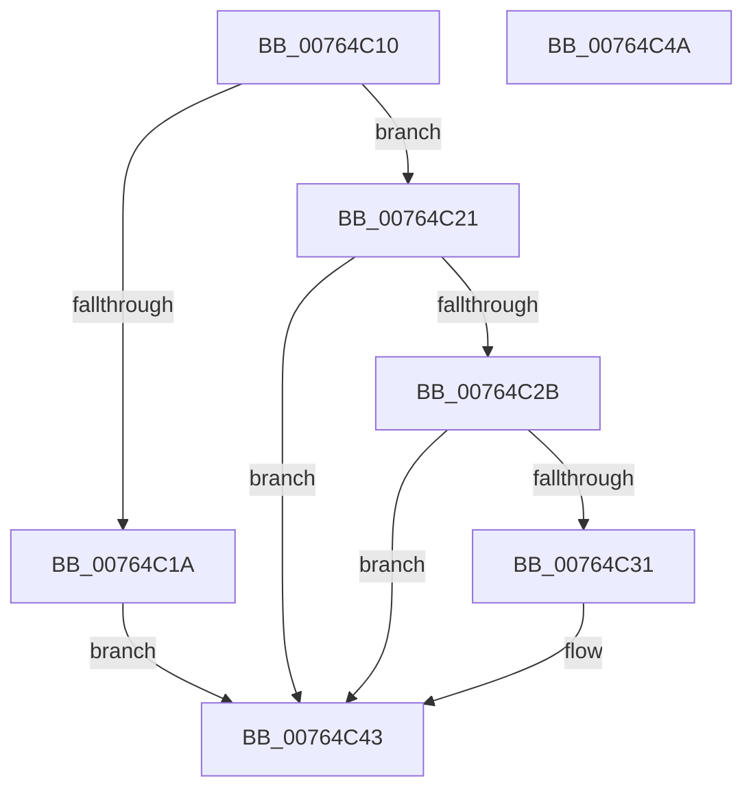

# PopPowerAggregatorModernStandbyEnterStateHandler

- RVA: `0x00764C10`–`0x00764C4B` (길이 `59` bytes)
- VA: `0x0000000140764C10`
- 실행 섹션: `PAGE`
- PDB 이름 있음: `예`; PDB Function 태그: `아니요`
- unwind 정보 RVA: `0x0005C788`
- 디코드: `18`개 명령, `59/59` bytes 표시
- 미해석 바이트: `0` (있으면 어셈블리에 `.byte`로 보존)

> 이 문서는 커널 이미지의 기계어와 PDB 기호를 분석해 생성했습니다. 4번과 5번은 함수 원형과 자료형을 바이너리 사용 방식에서 추정한 C 해석이며 원본 소스 복구 결과는 아닙니다.

## 1. Dependencies

- 직접 호출 지점: **2**; 고유 호출 대상: **2**
- 직접 호출자로 확인된 함수: **0**
- RIP 상대 이미지 참조: **0**

### Outgoing calls
- `0x00764C1A` → [PopPowerAggregatorDisengageModernStandby](../98/PopPowerAggregatorDisengageModernStandby_function_00989DD8.md) (function, `0x00989DD8`)
- `0x00764C3E` → [ExQueueWorkItem](../../text/2F/ExQueueWorkItem_function_002F9520.md) (function, `0x002F9520`)

### Direct callers
- 이 함수 시작 RVA로 연결되는 직접 call은 확인되지 않았습니다. 간접 호출은 완전히 역산할 수 없습니다.

### Static image references
- 디코드된 RIP-relative 메모리 참조가 없습니다.

## 2. Other-region calls and transfers

- 다른 실행 섹션으로 향하는 call: **1**
  - `0x00764C3E` → [ExQueueWorkItem](../../text/2F/ExQueueWorkItem_function_002F9520.md) (`PAGE` → `.text`)
- 별도 외부 분기/꼬리 이동을 확인하지 못했습니다.

## 3. Assembly (complete function range)

```asm
00764C10  48 83 EC 28                     sub rsp, 0x28
00764C14  80 79 48 00                     cmp byte ptr [rcx + 0x48], 0
00764C18  74 07                           je 0x140764c21
00764C1A  E8 B9 51 22 00                  call 0x140989dd8
00764C1F  EB 22                           jmp 0x140764c43
00764C21  48 8B 41 20                     mov rax, qword ptr [rcx + 0x20]
00764C25  48 39 41 40                     cmp qword ptr [rcx + 0x40], rax
00764C29  74 18                           je 0x140764c43
00764C2B  80 79 58 00                     cmp byte ptr [rcx + 0x58], 0
00764C2F  75 12                           jne 0x140764c43
00764C31  C6 41 58 01                     mov byte ptr [rcx + 0x58], 1
00764C35  BA 01 00 00 00                  mov edx, 1
00764C3A  48 83 C1 60                     add rcx, 0x60
00764C3E  E8 DD 48 B9 FF                  call 0x1402f9520
00764C43  33 C0                           xor eax, eax
00764C45  48 83 C4 28                     add rsp, 0x28
00764C49  C3                              ret
00764C4A  CC                              int3
```

## 4. C-style interpretation (structured pseudocode)

```c
__int64 __fastcall PopPowerAggregatorModernStandbyEnterStateHandler(__int64 a1)
{
    __int64 result;
    __int64 v_rsp;

    v_rsp = (v_rsp) - (40);
    if ((*(unsigned __int8 *)(a1 + 72)) == 0) goto loc_00764C21;
    result = PopPowerAggregatorDisengageModernStandby(a1, a2, a3, a4);
    goto loc_00764C43;
loc_00764C21:
    if ((*(unsigned __int64 *)(a1 + 64)) == (*(unsigned __int64 *)(a1 + 32))) goto loc_00764C43;
    result = *(unsigned __int64 *)(a1 + 32);
    if ((*(unsigned __int8 *)(a1 + 88)) == 0) {
        *(unsigned __int8 *)(a1 + 88) = 1;
        a2 = 1;
        a1 = (a1) + (96);
        result = ExQueueWorkItem(a1, a2, a3, a4);
    }
    result = 0;
    v_rsp = (v_rsp) + (40);
    return result;
}
```

## 5. (Beta) C Style

```c
int64_t PopPowerAggregatorModernStandbyEnterStateHandler(void *Arg1)
{
    uint8_t *arg1 = (uint8_t *)Arg1;

    int64_t result;
    int64_t local_rsp;

    local_rsp = (local_rsp) - (40);
    if ((*(uint8_t *)(arg1 + 0x48)) == 0) goto loc_00764C21;
    result = PopPowerAggregatorDisengageModernStandby(Arg1, a2, a3, a4);
    goto loc_00764C43;
loc_00764C21:
    if ((*(uint64_t *)(arg1 + 0x40)) == (*(uint64_t *)(arg1 + 0x20))) goto loc_00764C43;
    result = *(uint64_t *)(arg1 + 0x20);
    if ((*(uint8_t *)(arg1 + 0x58)) == 0) {
        *(uint8_t *)(arg1 + 0x58) = 1;
        a2 = 1;
        Arg1 = (Arg1) + (96);
        result = ExQueueWorkItem(Arg1, a2, a3, a4);
    }
    result = 0;
    local_rsp = (local_rsp) + (40);
    return result;
}
```

### 관측된 메모리 오프셋

구조체 형식이 확인되지 않은 접근은 인자 기준의 오프셋으로만 기록했습니다.

| 기준 인자 | 오프셋 표현 | 폭 (bit) | 접근 |
|---|---:|---:|---|
| `Arg1` | `+ 0x20` | `64` | `R` |
| `Arg1` | `+ 0x40` | `64` | `R` |
| `Arg1` | `+ 0x48` | `8` | `R` |
| `Arg1` | `+ 0x58` | `8` | `R` |
| `Arg1` | `+ 0x58` | `8` | `W` |

## 6. Execution-region graph

[열기: 2D/3D 그래프와 함수 탐색 컨트롤 패널](../../../control-panel.html?section=page&rva=0x00764C10&view=graph)

- 2D 그래프는 위에서 아래로 흐르고, 3D 그래프는 빈 공간을 드래그해 회전합니다. Shift+드래그는 이동, 휠은 확대·축소, 함수 노드 선택은 대상 보고서 이동입니다.

### Static fallback


