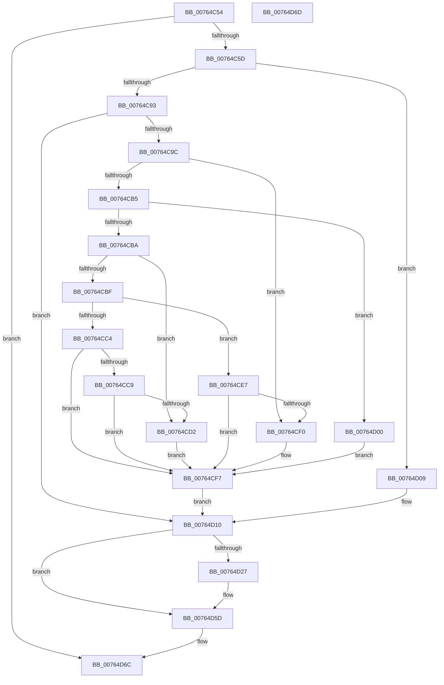

# PopPowerAggregatorNotifyPdcPhaseState

- RVA: `0x00764C54`–`0x00764D6E` (길이 `282` bytes)
- VA: `0x0000000140764C54`
- 실행 섹션: `PAGE`
- PDB 이름 있음: `예`; PDB Function 태그: `아니요`
- unwind 정보 RVA: `0x000CCCEC`
- 디코드: `70`개 명령, `282/282` bytes 표시
- 미해석 바이트: `0` (있으면 어셈블리에 `.byte`로 보존)

> 이 문서는 커널 이미지의 기계어와 PDB 기호를 분석해 생성했습니다. 4번과 5번은 함수 원형과 자료형을 바이너리 사용 방식에서 추정한 C 해석이며 원본 소스 복구 결과는 아닙니다.

## 1. Dependencies

- 직접 호출 지점: **9**; 고유 호출 대상: **8**
- 직접 호출자로 확인된 함수: **1**
- RIP 상대 이미지 참조: **6**

### Outgoing calls
- `0x00764C7E` → [PopAcquirePolicyLock](../../pagelk/B7/PopAcquirePolicyLock_function_00B783C0.md) (function, `0x00B783C0`)
- `0x00764C8A` → [PopAcquireRwLockExclusive](../../text/43/PopAcquireRwLockExclusive_function_00430B44.md) (function, `0x00430B44`)
- `0x00764CC9` → [Feature_AdaptiveHibernateEnhancements__private_IsEnabledDeviceUsageNoInline](../../text/4F/Feature_AdaptiveHibernateEnhancements__private_IsEnabledDeviceUsageNoInline_function_004F78F0.md) (function, `0x004F78F0`)
- `0x00764CE0` → [PopPowerAggregatorHandleIntentUnsafe](../91/PopPowerAggregatorHandleIntentUnsafe_function_009146D8.md) (function, `0x009146D8`)
- `0x00764CE7` → [Feature_AdaptiveHibernateEnhancements__private_IsEnabledDeviceUsageNoInline](../../text/4F/Feature_AdaptiveHibernateEnhancements__private_IsEnabledDeviceUsageNoInline_function_004F78F0.md) (function, `0x004F78F0`)
- `0x00764D10` → [PopPowerAggregatorEvaluateDozeTimers](../6F/PopPowerAggregatorEvaluateDozeTimers_function_006FE460.md) (function, `0x006FE460`)
- `0x00764D1C` → [PopReleaseRwLock](../../text/2D/PopReleaseRwLock_function_002DFBBC.md) (function, `0x002DFBBC`)
- `0x00764D58` → [PopExecutePowerAction](../75/PopExecutePowerAction_function_0075E6B4.md) (function, `0x0075E6B4`)
- `0x00764D5D` → [PopReleasePolicyLock](../../pagelk/B7/PopReleasePolicyLock_function_00B78410.md) (function, `0x00B78410`)

### Direct callers
- [PdcPoCurrentPdcPhase](../../text/5D/PdcPoCurrentPdcPhase_function_005D9E70.md) at `0x005D9F70`

### Static image references
- `0x00764C83` → RVA `0x00F09710` (`.data`; read)
- `0x00764C93` → RVA `0x00F09750` (`.data`; read)
- `0x00764C9C` → RVA `0x00F09870` (`.data`; read)
- `0x00764CA2` → RVA `0x00F0BD22` (`.data`; write)
- `0x00764CA9` → RVA `0x00F0986C` (`.data`; write)
- `0x00764CF7` → RVA `0x00F09870` (`.data`; read/write)

## 2. Other-region calls and transfers

- 다른 실행 섹션으로 향하는 call: **6**
  - `0x00764C7E` → [PopAcquirePolicyLock](../../pagelk/B7/PopAcquirePolicyLock_function_00B783C0.md) (`PAGE` → `PAGELK`)
  - `0x00764C8A` → [PopAcquireRwLockExclusive](../../text/43/PopAcquireRwLockExclusive_function_00430B44.md) (`PAGE` → `.text`)
  - `0x00764CC9` → [Feature_AdaptiveHibernateEnhancements__private_IsEnabledDeviceUsageNoInline](../../text/4F/Feature_AdaptiveHibernateEnhancements__private_IsEnabledDeviceUsageNoInline_function_004F78F0.md) (`PAGE` → `.text`)
  - `0x00764CE7` → [Feature_AdaptiveHibernateEnhancements__private_IsEnabledDeviceUsageNoInline](../../text/4F/Feature_AdaptiveHibernateEnhancements__private_IsEnabledDeviceUsageNoInline_function_004F78F0.md) (`PAGE` → `.text`)
  - `0x00764D1C` → [PopReleaseRwLock](../../text/2D/PopReleaseRwLock_function_002DFBBC.md) (`PAGE` → `.text`)
  - `0x00764D5D` → [PopReleasePolicyLock](../../pagelk/B7/PopReleasePolicyLock_function_00B78410.md) (`PAGE` → `PAGELK`)
- 별도 외부 분기/꼬리 이동을 확인하지 못했습니다.

## 3. Assembly (complete function range)

```asm
00764C54  83 F9 02                        cmp ecx, 2
00764C57  0F 85 0F 01 00 00               jne 0x140764d6c
00764C5D  48 89 5C 24 08                  mov qword ptr [rsp + 8], rbx
00764C62  55                              push rbp
00764C63  48 8B EC                        mov rbp, rsp
00764C66  48 83 EC 60                     sub rsp, 0x60
00764C6A  0F 57 C0                        xorps xmm0, xmm0
00764C6D  8A DA                           mov bl, dl
00764C6F  0F 11 45 E0                     movups xmmword ptr [rbp - 0x20], xmm0
00764C73  C7 45 E0 11 00 00 00            mov dword ptr [rbp - 0x20], 0x11
00764C7A  0F 11 45 F0                     movups xmmword ptr [rbp - 0x10], xmm0
00764C7E  E8 3D 37 41 00                  call 0x140b783c0
00764C83  48 8D 0D 86 4A 7A 00            lea rcx, [rip + 0x7a4a86]
00764C8A  E8 B5 BE CC FF                  call 0x140430b44
00764C8F  84 DB                           test bl, bl
00764C91  74 76                           je 0x140764d09
00764C93  83 3D B6 4A 7A 00 01            cmp dword ptr [rip + 0x7a4ab6], 1
00764C9A  75 74                           jne 0x140764d10
00764C9C  8B 0D CE 4B 7A 00               mov ecx, dword ptr [rip + 0x7a4bce]
00764CA2  C6 05 79 70 7A 00 01            mov byte ptr [rip + 0x7a7079], 1
00764CA9  C6 05 BC 4B 7A 00 01            mov byte ptr [rip + 0x7a4bbc], 1
00764CB0  83 E9 01                        sub ecx, 1
00764CB3  74 3B                           je 0x140764cf0
00764CB5  83 E9 01                        sub ecx, 1
00764CB8  74 46                           je 0x140764d00
00764CBA  83 E9 01                        sub ecx, 1
00764CBD  74 13                           je 0x140764cd2
00764CBF  83 E9 01                        sub ecx, 1
00764CC2  74 23                           je 0x140764ce7
00764CC4  83 F9 01                        cmp ecx, 1
00764CC7  75 2E                           jne 0x140764cf7
00764CC9  E8 22 2C D9 FF                  call 0x1404f78f0
00764CCE  85 C0                           test eax, eax
00764CD0  74 25                           je 0x140764cf7
00764CD2  33 D2                           xor edx, edx
00764CD4  41 B9 35 00 00 00               mov r9d, 0x35
00764CDA  45 33 C0                        xor r8d, r8d
00764CDD  8D 4A 03                        lea ecx, [rdx + 3]
00764CE0  E8 F3 F9 1A 00                  call 0x1409146d8
00764CE5  EB 10                           jmp 0x140764cf7
00764CE7  E8 04 2C D9 FF                  call 0x1404f78f0
00764CEC  85 C0                           test eax, eax
00764CEE  74 07                           je 0x140764cf7
00764CF0  C7 45 E0 0D 00 00 00            mov dword ptr [rbp - 0x20], 0xd
00764CF7  83 25 72 4B 7A 00 00            and dword ptr [rip + 0x7a4b72], 0
00764CFE  EB 10                           jmp 0x140764d10
00764D00  C7 45 E0 0E 00 00 00            mov dword ptr [rbp - 0x20], 0xe
00764D07  EB EE                           jmp 0x140764cf7
00764D09  C6 05 5C 4B 7A 00 00            mov byte ptr [rip + 0x7a4b5c], 0
00764D10  E8 4B 97 F9 FF                  call 0x1406fe460
00764D15  48 8D 0D F4 49 7A 00            lea rcx, [rip + 0x7a49f4]
00764D1C  E8 9B AE B7 FF                  call 0x1402dfbbc
00764D21  83 7D E0 11                     cmp dword ptr [rbp - 0x20], 0x11
00764D25  74 36                           je 0x140764d5d
00764D27  83 65 D8 00                     and dword ptr [rbp - 0x28], 0
00764D2B  4C 8D 45 D0                     lea r8, [rbp - 0x30]
00764D2F  41 B9 05 00 00 00               mov r9d, 5
00764D35  C7 45 E4 80 00 00 00            mov dword ptr [rbp - 0x1c], 0x80
00764D3C  33 D2                           xor edx, edx
00764D3E  C7 45 D0 03 00 00 00            mov dword ptr [rbp - 0x30], 3
00764D45  48 8D 4D E0                     lea rcx, [rbp - 0x20]
00764D49  C7 45 D4 24 00 00 80            mov dword ptr [rbp - 0x2c], 0x80000024
00764D50  C7 44 24 20 01 00 00 00         mov dword ptr [rsp + 0x20], 1
00764D58  E8 57 99 FF FF                  call 0x14075e6b4
00764D5D  E8 AE 36 41 00                  call 0x140b78410
00764D62  48 8B 5C 24 70                  mov rbx, qword ptr [rsp + 0x70]
00764D67  48 83 C4 60                     add rsp, 0x60
00764D6B  5D                              pop rbp
00764D6C  C3                              ret
00764D6D  CC                              int3
```

## 4. C-style interpretation (structured pseudocode)

```c
__int64 __fastcall PopPowerAggregatorNotifyPdcPhaseState(int a1, int a2, int a3)
{
    __int64 result;
    __int64 v_rsp;
    unsigned __int64 v_stack_m18;
    unsigned int v_stack_m24;
    unsigned __int64 v_stack_m28;
    unsigned int v_stack_m30;
    unsigned int v_stack_m34;
    unsigned __int64 v_stack_m38;
    unsigned int v_stack_m48;
    unsigned __int64 v_stack_p8;

    if (a1 != 2) goto loc_00764D6C;
    v_stack_p8 = v_rbx;
    v_rsp = (v_rsp) - (96);
    v_stack_m28 = v_xmm0;
    v_stack_m28 = 17;
    v_stack_m18 = v_xmm0;
    result = PopAcquirePolicyLock(a1, a2, a3, a4);
    result = PopAcquireRwLockExclusive(v_rip + 8014470, a2, a3, a4);
    if ((unsigned __int8)((unsigned __int8)(a2)) == 0) goto loc_00764D09;
    if ((*(unsigned int *)(v_rip + 8014518)) != 1) goto loc_00764D10;
    *(unsigned __int8 *)(v_rip + 8024185) = 1;
    *(unsigned __int8 *)(v_rip + 8014780) = 1;
    a1 = (unsigned int)(((unsigned int)(*(unsigned int *)(v_rip + 8014798))) - (1));
    if (condition_is_equal) goto loc_00764CF0;
    a1 = (unsigned int)((a1) - (1));
    if (condition_is_equal) goto loc_00764D00;
    a1 = (unsigned int)((a1) - (1));
    if (condition_is_equal) goto loc_00764CD2;
    a1 = (unsigned int)((a1) - (1));
    if (condition_is_equal) goto loc_00764CE7;
    if (a1 != 1) goto loc_00764CF7;
    result = Feature_AdaptiveHibernateEnhancements__private_IsEnabledDeviceUsageNoInline(a1, a2, a3, a4);
    if ((unsigned int)(result) == 0) goto loc_00764CF7;
loc_00764CD2:
    a2 = 0;
    a3 = 0;
    result = PopPowerAggregatorHandleIntentUnsafe(a2 + 3, a2, a3, 53);
    goto loc_00764CF7;
loc_00764CE7:
    result = Feature_AdaptiveHibernateEnhancements__private_IsEnabledDeviceUsageNoInline(a2 + 3, a2, a3, 53);
    if ((unsigned int)(result) != 0) {
        v_stack_m28 = 13;
    }
    goto loc_00764D10;
loc_00764D00:
    v_stack_m28 = 14;
    goto loc_00764CF7;
loc_00764D09:
    *(unsigned __int8 *)(v_rip + 8014684) = 0;
loc_00764D10:
    result = PopPowerAggregatorEvaluateDozeTimers(a2 + 3, a2, a3, 53);
    result = PopReleaseRwLock(v_rip + 8014324, a2, a3, 53);
    if (v_stack_m28 != 17) {
        a3 = v_stack_m38;
        a4 = 5;
        v_stack_m24 = 128;
        a2 = 0;
        v_stack_m38 = 3;
        a1 = v_stack_m28;
        v_stack_m34 = 0x80000024ULL;
        v_stack_m48 = 1;
        result = PopExecutePowerAction(a1, a2, a3, a4);
    }
    result = PopReleasePolicyLock(a1, a2, a3, a4);
    v_rsp = (v_rsp) + (96);
loc_00764D6C:
    return result;
}
```

## 5. (Beta) C Style

```c
int64_t PopPowerAggregatorNotifyPdcPhaseState(int32_t Arg1, int32_t Arg2, int32_t Arg3)
{
    int64_t result;
    int64_t local_rsp;
    uint64_t v_stack_m18;
    uint32_t v_stack_m24;
    uint64_t v_stack_m28;
    uint32_t v_stack_m30;
    uint32_t v_stack_m34;
    uint64_t v_stack_m38;
    uint32_t v_stack_m48;
    uint64_t v_stack_p8;

    if (Arg1 != 2) goto loc_00764D6C;
    v_stack_p8 = local_rbx;
    local_rsp = (local_rsp) - (96);
    v_stack_m28 = v_xmm0;
    v_stack_m28 = 17;
    v_stack_m18 = v_xmm0;
    result = PopAcquirePolicyLock(Arg1, Arg2, Arg3, a4);
    result = PopAcquireRwLockExclusive(v_rip + 8014470, Arg2, Arg3, a4);
    if ((uint8_t)((uint8_t)(Arg2)) == 0) goto loc_00764D09;
    if ((*(uint32_t *)(v_rip + 0x7A4AB6)) != 1) goto loc_00764D10;
    *(uint8_t *)(v_rip + 0x7A7079) = 1;
    *(uint8_t *)(v_rip + 0x7A4BBC) = 1;
    Arg1 = (uint32_t)(((uint32_t)(*(uint32_t *)(v_rip + 0x7A4BCE))) - (1));
    if (condition_is_equal) goto loc_00764CF0;
    Arg1 = (uint32_t)((Arg1) - (1));
    if (condition_is_equal) goto loc_00764D00;
    Arg1 = (uint32_t)((Arg1) - (1));
    if (condition_is_equal) goto loc_00764CD2;
    Arg1 = (uint32_t)((Arg1) - (1));
    if (condition_is_equal) goto loc_00764CE7;
    if (Arg1 != 1) goto loc_00764CF7;
    result = Feature_AdaptiveHibernateEnhancements__private_IsEnabledDeviceUsageNoInline(Arg1, Arg2, Arg3, a4);
    if ((uint32_t)(result) == 0) goto loc_00764CF7;
loc_00764CD2:
    Arg2 = 0;
    Arg3 = 0;
    result = PopPowerAggregatorHandleIntentUnsafe(Arg2 + 3, Arg2, Arg3, 53);
    goto loc_00764CF7;
loc_00764CE7:
    result = Feature_AdaptiveHibernateEnhancements__private_IsEnabledDeviceUsageNoInline(Arg2 + 3, Arg2, Arg3, 53);
    if ((uint32_t)(result) != 0) {
        v_stack_m28 = 13;
    }
    goto loc_00764D10;
loc_00764D00:
    v_stack_m28 = 14;
    goto loc_00764CF7;
loc_00764D09:
    *(uint8_t *)(v_rip + 0x7A4B5C) = 0;
loc_00764D10:
    result = PopPowerAggregatorEvaluateDozeTimers(Arg2 + 3, Arg2, Arg3, 53);
    result = PopReleaseRwLock(v_rip + 8014324, Arg2, Arg3, 53);
    if (v_stack_m28 != 17) {
        Arg3 = v_stack_m38;
        a4 = 5;
        v_stack_m24 = 128;
        Arg2 = 0;
        v_stack_m38 = 3;
        Arg1 = v_stack_m28;
        v_stack_m34 = 0x80000024ULL;
        v_stack_m48 = 1;
        result = PopExecutePowerAction(Arg1, Arg2, Arg3, a4);
    }
    result = PopReleasePolicyLock(Arg1, Arg2, Arg3, a4);
    local_rsp = (local_rsp) + (96);
loc_00764D6C:
    return result;
}
```

## 6. Execution-region graph

[열기: 2D/3D 그래프와 함수 탐색 컨트롤 패널](../../../control-panel.html?section=page&rva=0x00764C54&view=graph)

- 2D 그래프는 위에서 아래로 흐르고, 3D 그래프는 빈 공간을 드래그해 회전합니다. Shift+드래그는 이동, 휠은 확대·축소, 함수 노드 선택은 대상 보고서 이동입니다.

### Static fallback


