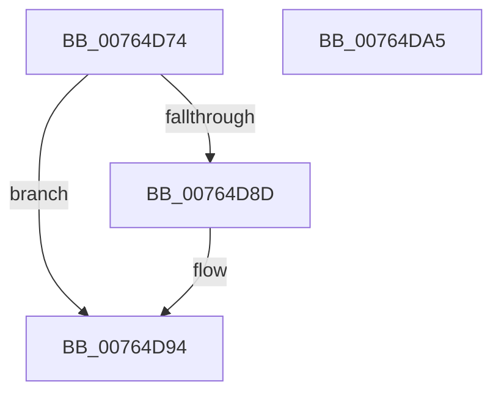

# PopPowerAggregatorNotifyResiliencyReached

- RVA: `0x00764D74`–`0x00764DA6` (길이 `50` bytes)
- VA: `0x0000000140764D74`
- 실행 섹션: `PAGE`
- PDB 이름 있음: `예`; PDB Function 태그: `아니요`
- unwind 정보 RVA: `0x0005C788`
- 디코드: `11`개 명령, `50/50` bytes 표시
- 미해석 바이트: `0` (있으면 어셈블리에 `.byte`로 보존)

> 이 문서는 커널 이미지의 기계어와 PDB 기호를 분석해 생성했습니다. 4번과 5번은 함수 원형과 자료형을 바이너리 사용 방식에서 추정한 C 해석이며 원본 소스 복구 결과는 아닙니다.

## 1. Dependencies

- 직접 호출 지점: **2**; 고유 호출 대상: **2**
- 직접 호출자로 확인된 함수: **1**
- RIP 상대 이미지 참조: **3**

### Outgoing calls
- `0x00764D7F` → [PopAcquireRwLockExclusive](../../text/43/PopAcquireRwLockExclusive_function_00430B44.md) (function, `0x00430B44`)
- `0x00764D9B` → [PopReleaseRwLock](../../text/2D/PopReleaseRwLock_function_002DFBBC.md) (function, `0x002DFBBC`)

### Direct callers
- [PdcPoCurrentPdcPhase](../../text/5D/PdcPoCurrentPdcPhase_function_005D9E70.md) at `0x005D9EDA`

### Static image references
- `0x00764D78` → RVA `0x00F09710` (`.data`; read)
- `0x00764D84` → RVA `0x00F09750` (`.data`; read)
- `0x00764D8D` → RVA `0x00F09769` (`.data`; write)

## 2. Other-region calls and transfers

- 다른 실행 섹션으로 향하는 call: **2**
  - `0x00764D7F` → [PopAcquireRwLockExclusive](../../text/43/PopAcquireRwLockExclusive_function_00430B44.md) (`PAGE` → `.text`)
  - `0x00764D9B` → [PopReleaseRwLock](../../text/2D/PopReleaseRwLock_function_002DFBBC.md) (`PAGE` → `.text`)
- 별도 외부 분기/꼬리 이동을 확인하지 못했습니다.

## 3. Assembly (complete function range)

```asm
00764D74  48 83 EC 28                     sub rsp, 0x28
00764D78  48 8D 0D 91 49 7A 00            lea rcx, [rip + 0x7a4991]
00764D7F  E8 C0 BD CC FF                  call 0x140430b44
00764D84  83 3D C5 49 7A 00 01            cmp dword ptr [rip + 0x7a49c5], 1
00764D8B  75 07                           jne 0x140764d94
00764D8D  C6 05 D5 49 7A 00 00            mov byte ptr [rip + 0x7a49d5], 0
00764D94  48 8D 0D 75 49 7A 00            lea rcx, [rip + 0x7a4975]
00764D9B  E8 1C AE B7 FF                  call 0x1402dfbbc
00764DA0  48 83 C4 28                     add rsp, 0x28
00764DA4  C3                              ret
00764DA5  CC                              int3
```

## 4. C-style interpretation (structured pseudocode)

```c
__int64 __fastcall PopPowerAggregatorNotifyResiliencyReached(void)
{
    __int64 result;
    __int64 v_rsp;

    v_rsp = (v_rsp) - (40);
    result = PopAcquireRwLockExclusive(v_rip + 8014225, a2, a3, a4);
    if ((*(unsigned int *)(v_rip + 8014277)) == 1) {
        *(unsigned __int8 *)(v_rip + 8014293) = 0;
    }
    result = PopReleaseRwLock(v_rip + 8014197, a2, a3, a4);
    v_rsp = (v_rsp) + (40);
    return result;
}
```

## 5. (Beta) C Style

```c
void PopPowerAggregatorNotifyResiliencyReached(void)
{
    int64_t result;
    int64_t local_rsp;

    local_rsp = (local_rsp) - (40);
    result = PopAcquireRwLockExclusive(v_rip + 8014225, a2, a3, a4);
    if ((*(uint32_t *)(v_rip + 0x7A49C5)) == 1) {
        *(uint8_t *)(v_rip + 0x7A49D5) = 0;
    }
    result = PopReleaseRwLock(v_rip + 8014197, a2, a3, a4);
    local_rsp = (local_rsp) + (40);
    return result;
}
```

## 6. Execution-region graph

[열기: 2D/3D 그래프와 함수 탐색 컨트롤 패널](../../../control-panel.html?section=page&rva=0x00764D74&view=graph)

- 2D 그래프는 위에서 아래로 흐르고, 3D 그래프는 빈 공간을 드래그해 회전합니다. Shift+드래그는 이동, 휠은 확대·축소, 함수 노드 선택은 대상 보고서 이동입니다.

### Static fallback


