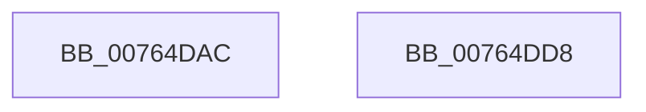

# PopPowerAggregatorNotifySystemWake

- RVA: `0x00764DAC`–`0x00764DD9` (길이 `45` bytes)
- VA: `0x0000000140764DAC`
- 실행 섹션: `PAGE`
- PDB 이름 있음: `예`; PDB Function 태그: `아니요`
- unwind 정보 RVA: `0x0005CF00`
- 디코드: `12`개 명령, `45/45` bytes 표시
- 미해석 바이트: `0` (있으면 어셈블리에 `.byte`로 보존)

> 이 문서는 커널 이미지의 기계어와 PDB 기호를 분석해 생성했습니다. 4번과 5번은 함수 원형과 자료형을 바이너리 사용 방식에서 추정한 C 해석이며 원본 소스 복구 결과는 아닙니다.

## 1. Dependencies

- 직접 호출 지점: **2**; 고유 호출 대상: **2**
- 직접 호출자로 확인된 함수: **1**
- RIP 상대 이미지 참조: **2**

### Outgoing calls
- `0x00764DBB` → [PopAcquireRwLockExclusive](../../text/43/PopAcquireRwLockExclusive_function_00430B44.md) (function, `0x00430B44`)
- `0x00764DCD` → [PopReleaseRwLock](../../text/2D/PopReleaseRwLock_function_002DFBBC.md) (function, `0x002DFBBC`)

### Direct callers
- [PopTransitionSystemPowerStateEx](../../pagelk/B7/PopTransitionSystemPowerStateEx_function_00B7E8C0.md) at `0x00B7F993`

### Static image references
- `0x00764DB4` → RVA `0x00F09710` (`.data`; read)
- `0x00764DC7` → RVA `0x00F09864` (`.data`; write)

## 2. Other-region calls and transfers

- 다른 실행 섹션으로 향하는 call: **2**
  - `0x00764DBB` → [PopAcquireRwLockExclusive](../../text/43/PopAcquireRwLockExclusive_function_00430B44.md) (`PAGE` → `.text`)
  - `0x00764DCD` → [PopReleaseRwLock](../../text/2D/PopReleaseRwLock_function_002DFBBC.md) (`PAGE` → `.text`)
- 별도 외부 분기/꼬리 이동을 확인하지 못했습니다.

## 3. Assembly (complete function range)

```asm
00764DAC  40 53                           push rbx
00764DAE  48 83 EC 20                     sub rsp, 0x20
00764DB2  8B D9                           mov ebx, ecx
00764DB4  48 8D 0D 55 49 7A 00            lea rcx, [rip + 0x7a4955]
00764DBB  E8 84 BD CC FF                  call 0x140430b44
00764DC0  48 8D 0D 49 49 7A 00            lea rcx, [rip + 0x7a4949]
00764DC7  89 1D 97 4A 7A 00               mov dword ptr [rip + 0x7a4a97], ebx
00764DCD  E8 EA AD B7 FF                  call 0x1402dfbbc
00764DD2  48 83 C4 20                     add rsp, 0x20
00764DD6  5B                              pop rbx
00764DD7  C3                              ret
00764DD8  CC                              int3
```

## 4. C-style interpretation (structured pseudocode)

```c
__int64 __fastcall PopPowerAggregatorNotifySystemWake(int a1)
{
    __int64 result;
    __int64 v_rsp;

    v_rsp = (v_rsp) - (32);
    result = PopAcquireRwLockExclusive(v_rip + 8014165, a2, a3, a4);
    *(unsigned int *)(v_rip + 8014487) = (unsigned int)((unsigned int)(a1));
    result = PopReleaseRwLock(v_rip + 8014153, a2, a3, a4);
    v_rsp = (v_rsp) + (32);
    return result;
}
```

## 5. (Beta) C Style

```c
int64_t PopPowerAggregatorNotifySystemWake(int32_t Arg1)
{
    int64_t result;
    int64_t local_rsp;

    local_rsp = (local_rsp) - (32);
    result = PopAcquireRwLockExclusive(v_rip + 8014165, a2, a3, a4);
    *(uint32_t *)(v_rip + 0x7A4A97) = (uint32_t)((uint32_t)(Arg1));
    result = PopReleaseRwLock(v_rip + 8014153, a2, a3, a4);
    local_rsp = (local_rsp) + (32);
    return result;
}
```

## 6. Execution-region graph

[열기: 2D/3D 그래프와 함수 탐색 컨트롤 패널](../../../control-panel.html?section=page&rva=0x00764DAC&view=graph)

- 2D 그래프는 위에서 아래로 흐르고, 3D 그래프는 빈 공간을 드래그해 회전합니다. Shift+드래그는 이동, 휠은 확대·축소, 함수 노드 선택은 대상 보고서 이동입니다.

### Static fallback


