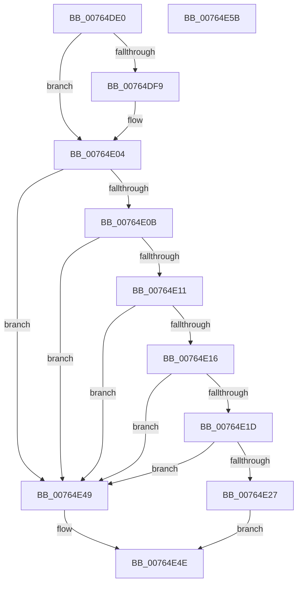

# PopPowerAggregatorPowerSettingCallback

- RVA: `0x00764DE0`–`0x00764E5C` (길이 `124` bytes)
- VA: `0x0000000140764DE0`
- 실행 섹션: `PAGE`
- PDB 이름 있음: `예`; PDB Function 태그: `아니요`
- unwind 정보 RVA: `0x0005CAAC`
- 디코드: `36`개 명령, `124/124` bytes 표시
- 미해석 바이트: `0` (있으면 어셈블리에 `.byte`로 보존)

> 이 문서는 커널 이미지의 기계어와 PDB 기호를 분석해 생성했습니다. 4번과 5번은 함수 원형과 자료형을 바이너리 사용 방식에서 추정한 C 해석이며 원본 소스 복구 결과는 아닙니다.

## 1. Dependencies

- 직접 호출 지점: **2**; 고유 호출 대상: **2**
- 직접 호출자로 확인된 함수: **0**
- RIP 상대 이미지 참조: **4**

### Outgoing calls
- `0x00764E2E` → [PopAcquireRwLockExclusive](../../text/43/PopAcquireRwLockExclusive_function_00430B44.md) (function, `0x00430B44`)
- `0x00764E42` → [PopReleaseRwLock](../../text/2D/PopReleaseRwLock_function_002DFBBC.md) (function, `0x002DFBBC`)

### Direct callers
- 이 함수 시작 RVA로 연결되는 직접 call은 확인되지 않았습니다. 간접 호출은 완전히 역산할 수 없습니다.

### Static image references
- `0x00764DEA` → RVA `0x00024C18` (`.rdata`; read)
- `0x00764DF9` → RVA `0x00024C20` (`.rdata`; read)
- `0x00764E27` → RVA `0x00F09710` (`.data`; read)
- `0x00764E3C` → RVA `0x00F09868` (`.data`; write)

## 2. Other-region calls and transfers

- 다른 실행 섹션으로 향하는 call: **2**
  - `0x00764E2E` → [PopAcquireRwLockExclusive](../../text/43/PopAcquireRwLockExclusive_function_00430B44.md) (`PAGE` → `.text`)
  - `0x00764E42` → [PopReleaseRwLock](../../text/2D/PopReleaseRwLock_function_002DFBBC.md) (`PAGE` → `.text`)
- 별도 외부 분기/꼬리 이동을 확인하지 못했습니다.

## 3. Assembly (complete function range)

```asm
00764DE0  48 89 5C 24 08                  mov qword ptr [rsp + 8], rbx
00764DE5  57                              push rdi
00764DE6  48 83 EC 20                     sub rsp, 0x20
00764DEA  4C 8B 0D 27 FE 8B FF            mov r9, qword ptr [rip - 0x7401d9]
00764DF1  48 8B FA                        mov rdi, rdx
00764DF4  4C 2B 09                        sub r9, qword ptr [rcx]
00764DF7  75 0B                           jne 0x140764e04
00764DF9  4C 8B 0D 20 FE 8B FF            mov r9, qword ptr [rip - 0x7401e0]
00764E00  4C 2B 49 08                     sub r9, qword ptr [rcx + 8]
00764E04  33 DB                           xor ebx, ebx
00764E06  4D 85 C9                        test r9, r9
00764E09  75 3E                           jne 0x140764e49
00764E0B  41 83 F8 04                     cmp r8d, 4
00764E0F  75 38                           jne 0x140764e49
00764E11  48 85 FF                        test rdi, rdi
00764E14  74 33                           je 0x140764e49
00764E16  8B 02                           mov eax, dword ptr [rdx]
00764E18  83 F8 08                        cmp eax, 8
00764E1B  77 2C                           ja 0x140764e49
00764E1D  B9 4D 01 00 00                  mov ecx, 0x14d
00764E22  0F A3 C1                        bt ecx, eax
00764E25  73 22                           jae 0x140764e49
00764E27  48 8D 0D E2 48 7A 00            lea rcx, [rip + 0x7a48e2]
00764E2E  E8 11 BD CC FF                  call 0x140430b44
00764E33  8B 07                           mov eax, dword ptr [rdi]
00764E35  48 8D 0D D4 48 7A 00            lea rcx, [rip + 0x7a48d4]
00764E3C  89 05 26 4A 7A 00               mov dword ptr [rip + 0x7a4a26], eax
00764E42  E8 75 AD B7 FF                  call 0x1402dfbbc
00764E47  EB 05                           jmp 0x140764e4e
00764E49  BB 0D 00 00 C0                  mov ebx, 0xc000000d
00764E4E  8B C3                           mov eax, ebx
00764E50  48 8B 5C 24 30                  mov rbx, qword ptr [rsp + 0x30]
00764E55  48 83 C4 20                     add rsp, 0x20
00764E59  5F                              pop rdi
00764E5A  C3                              ret
00764E5B  CC                              int3
```

## 4. C-style interpretation (structured pseudocode)

```c
__int64 __fastcall PopPowerAggregatorPowerSettingCallback(__int64 a1, __int64 a2, int a3)
{
    __int64 result;
    __int64 v_rbx;
    __int64 v_rsp;
    unsigned __int64 v_stack_p8;

    v_stack_p8 = v_rbx;
    v_rsp = (v_rsp) - (32);
    a4 = (*(unsigned __int64 *)(v_rip - 7602649)) - (*(unsigned __int64 *)(a1));
    if (!(condition_is_not_equal)) {
        a4 = *(unsigned __int64 *)(v_rip - 7602656);
        a4 = (a4) - (*(unsigned __int64 *)(a1 + 8));
    }
    v_rbx = 0;
    if (a4 != 0) goto loc_00764E49;
    if (a3 != 4) goto loc_00764E49;
    if (a2 == 0) goto loc_00764E49;
    if (((unsigned int)((unsigned int)(*(unsigned int *)(a2)))) > 8) goto loc_00764E49;
    if (((unsigned int)((unsigned int)(*(unsigned int *)(a2)))) >= 8) goto loc_00764E49;
    result = PopAcquireRwLockExclusive(v_rip + 8014050, a2, a3, a4);
    *(unsigned int *)(v_rip + 8014374) = (unsigned int)((unsigned int)(*(unsigned int *)(a2)));
    result = PopReleaseRwLock(v_rip + 8014036, a2, a3, a4);
    goto loc_00764E4E;
loc_00764E49:
loc_00764E4E:
    v_rsp = (v_rsp) + (32);
    return (unsigned int)((unsigned int)((unsigned int)(0xC000000DULL)));
}
```

## 5. (Beta) C Style

```c
int64_t PopPowerAggregatorPowerSettingCallback(void *Arg1, void *Arg2, int32_t Arg3)
{
    uint8_t *arg1 = (uint8_t *)Arg1;
    uint8_t *arg2 = (uint8_t *)Arg2;

    int64_t result;
    int64_t local_rbx;
    int64_t local_rsp;
    uint64_t v_stack_p8;

    v_stack_p8 = local_rbx;
    local_rsp = (local_rsp) - (32);
    a4 = (*(uint64_t *)(v_rip - 0x7401D9)) - (*(uint64_t *)(arg1));
    if (!(condition_is_not_equal)) {
        a4 = *(uint64_t *)(v_rip - 0x7401E0);
        a4 = (a4) - (*(uint64_t *)(arg1 + 0x8));
    }
    local_rbx = 0;
    if (a4 != 0) goto loc_00764E49;
    if (Arg3 != 4) goto loc_00764E49;
    if (Arg2 == NULL) goto loc_00764E49;
    if (((uint32_t)((uint32_t)(*(uint32_t *)(arg2)))) > 8) goto loc_00764E49;
    if (((uint32_t)((uint32_t)(*(uint32_t *)(arg2)))) >= 8) goto loc_00764E49;
    result = PopAcquireRwLockExclusive(v_rip + 8014050, Arg2, Arg3, a4);
    *(uint32_t *)(v_rip + 0x7A4A26) = (uint32_t)((uint32_t)(*(uint32_t *)(arg2)));
    result = PopReleaseRwLock(v_rip + 8014036, Arg2, Arg3, a4);
    goto loc_00764E4E;
loc_00764E49:
loc_00764E4E:
    local_rsp = (local_rsp) + (32);
    return (uint32_t)((uint32_t)((uint32_t)(0xC000000DULL)));
}
```

### 관측된 메모리 오프셋

구조체 형식이 확인되지 않은 접근은 인자 기준의 오프셋으로만 기록했습니다.

| 기준 인자 | 오프셋 표현 | 폭 (bit) | 접근 |
|---|---:|---:|---|
| `Arg1` | `+ 0x0` | `64` | `R` |
| `Arg1` | `+ 0x8` | `64` | `R` |
| `Arg2` | `+ 0x0` | `32` | `R` |

## 6. Execution-region graph

[열기: 2D/3D 그래프와 함수 탐색 컨트롤 패널](../../../control-panel.html?section=page&rva=0x00764DE0&view=graph)

- 2D 그래프는 위에서 아래로 흐르고, 3D 그래프는 빈 공간을 드래그해 회전합니다. Shift+드래그는 이동, 휠은 확대·축소, 함수 노드 선택은 대상 보고서 이동입니다.

### Static fallback


