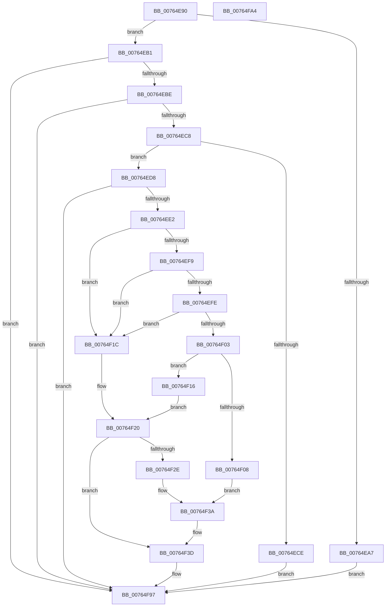

# PopPowerAggregatorScreenOffEnterStateHandler

- RVA: `0x00764E90`–`0x00764FA5` (길이 `277` bytes)
- VA: `0x0000000140764E90`
- 실행 섹션: `PAGE`
- PDB 이름 있음: `예`; PDB Function 태그: `아니요`
- unwind 정보 RVA: `0x0009EAB4`
- 디코드: `72`개 명령, `277/277` bytes 표시
- 미해석 바이트: `0` (있으면 어셈블리에 `.byte`로 보존)

> 이 문서는 커널 이미지의 기계어와 PDB 기호를 분석해 생성했습니다. 4번과 5번은 함수 원형과 자료형을 바이너리 사용 방식에서 추정한 C 해석이며 원본 소스 복구 결과는 아닙니다.

## 1. Dependencies

- 직접 호출 지점: **7**; 고유 호출 대상: **7**
- 직접 호출자로 확인된 함수: **0**
- RIP 상대 이미지 참조: **1**

### Outgoing calls
- `0x00764EA7` → [PopPowerAggregatorEnterScreenOff](../98/PopPowerAggregatorEnterScreenOff_function_00989F38.md) (function, `0x00989F38`)
- `0x00764ECE` → [PopPowerAggregatorEngageModernStandby](PopPowerAggregatorEngageModernStandby_function_00764784.md) (function, `0x00764784`)
- `0x00764F62` → [PopReleaseRwLock](../../text/2D/PopReleaseRwLock_function_002DFBBC.md) (function, `0x002DFBBC`)
- `0x00764F67` → [PopAcquirePolicyLock](../../pagelk/B7/PopAcquirePolicyLock_function_00B783C0.md) (function, `0x00B783C0`)
- `0x00764F81` → [PopExecutePowerAction](../75/PopExecutePowerAction_function_0075E6B4.md) (function, `0x0075E6B4`)
- `0x00764F86` → [PopReleasePolicyLock](../../pagelk/B7/PopReleasePolicyLock_function_00B78410.md) (function, `0x00B78410`)
- `0x00764F92` → [PopAcquireRwLockExclusive](../../text/43/PopAcquireRwLockExclusive_function_00430B44.md) (function, `0x00430B44`)

### Direct callers
- 이 함수 시작 RVA로 연결되는 직접 call은 확인되지 않았습니다. 간접 호출은 완전히 역산할 수 없습니다.

### Static image references
- `0x00764F44` → RVA `0x00F09710` (`.data`; read)

## 2. Other-region calls and transfers

- 다른 실행 섹션으로 향하는 call: **4**
  - `0x00764F62` → [PopReleaseRwLock](../../text/2D/PopReleaseRwLock_function_002DFBBC.md) (`PAGE` → `.text`)
  - `0x00764F67` → [PopAcquirePolicyLock](../../pagelk/B7/PopAcquirePolicyLock_function_00B783C0.md) (`PAGE` → `PAGELK`)
  - `0x00764F86` → [PopReleasePolicyLock](../../pagelk/B7/PopReleasePolicyLock_function_00B78410.md) (`PAGE` → `PAGELK`)
  - `0x00764F92` → [PopAcquireRwLockExclusive](../../text/43/PopAcquireRwLockExclusive_function_00430B44.md) (`PAGE` → `.text`)
- 별도 외부 분기/꼬리 이동을 확인하지 못했습니다.

## 3. Assembly (complete function range)

```asm
00764E90  48 89 5C 24 08                  mov qword ptr [rsp + 8], rbx
00764E95  55                              push rbp
00764E96  48 8B EC                        mov rbp, rsp
00764E99  48 83 EC 60                     sub rsp, 0x60
00764E9D  48 8B 41 40                     mov rax, qword ptr [rcx + 0x40]
00764EA1  48 39 41 20                     cmp qword ptr [rcx + 0x20], rax
00764EA5  74 0A                           je 0x140764eb1
00764EA7  E8 8C 50 22 00                  call 0x140989f38
00764EAC  E9 E6 00 00 00                  jmp 0x140764f97
00764EB1  45 33 C9                        xor r9d, r9d
00764EB4  44 38 49 58                     cmp byte ptr [rcx + 0x58], r9b
00764EB8  0F 85 D9 00 00 00               jne 0x140764f97
00764EBE  44 38 49 48                     cmp byte ptr [rcx + 0x48], r9b
00764EC2  0F 84 CF 00 00 00               je 0x140764f97
00764EC8  83 79 10 01                     cmp dword ptr [rcx + 0x10], 1
00764ECC  75 0A                           jne 0x140764ed8
00764ECE  E8 B1 F8 FF FF                  call 0x140764784
00764ED3  E9 BF 00 00 00                  jmp 0x140764f97
00764ED8  44 38 49 34                     cmp byte ptr [rcx + 0x34], r9b
00764EDC  0F 85 B5 00 00 00               jne 0x140764f97
00764EE2  8B 59 2C                        mov ebx, dword ptr [rcx + 0x2c]
00764EE5  33 C0                           xor eax, eax
00764EE7  8B D3                           mov edx, ebx
00764EE9  48 89 45 D0                     mov qword ptr [rbp - 0x30], rax
00764EED  89 45 D8                        mov dword ptr [rbp - 0x28], eax
00764EF0  44 8D 40 02                     lea r8d, [rax + 2]
00764EF4  41 2B D0                        sub edx, r8d
00764EF7  74 23                           je 0x140764f1c
00764EF9  83 EA 01                        sub edx, 1
00764EFC  74 1E                           je 0x140764f1c
00764EFE  83 EA 01                        sub edx, 1
00764F01  74 19                           je 0x140764f1c
00764F03  83 FA 01                        cmp edx, 1
00764F06  75 0E                           jne 0x140764f16
00764F08  C7 45 D0 03 00 00 00            mov dword ptr [rbp - 0x30], 3
00764F0F  B8 04 00 00 80                  mov eax, 0x80000004
00764F14  EB 24                           jmp 0x140764f3a
00764F16  44 8B 45 D0                     mov r8d, dword ptr [rbp - 0x30]
00764F1A  EB 04                           jmp 0x140764f20
00764F1C  44 89 45 D0                     mov dword ptr [rbp - 0x30], r8d
00764F20  B8 04 00 00 80                  mov eax, 0x80000004
00764F25  89 45 D4                        mov dword ptr [rbp - 0x2c], eax
00764F28  41 83 F8 05                     cmp r8d, 5
00764F2C  75 0F                           jne 0x140764f3d
00764F2E  44 38 49 28                     cmp byte ptr [rcx + 0x28], r9b
00764F32  BA 24 00 00 80                  mov edx, 0x80000024
00764F37  0F 45 C2                        cmovne eax, edx
00764F3A  89 45 D4                        mov dword ptr [rbp - 0x2c], eax
00764F3D  0F 57 C0                        xorps xmm0, xmm0
00764F40  C6 41 34 01                     mov byte ptr [rcx + 0x34], 1
00764F44  48 8D 0D C5 47 7A 00            lea rcx, [rip + 0x7a47c5]
00764F4B  4C 89 4D F8                     mov qword ptr [rbp - 8], r9
00764F4F  F3 0F 7F 45 E8                  movdqu xmmword ptr [rbp - 0x18], xmm0
00764F54  C7 45 E0 07 00 00 00            mov dword ptr [rbp - 0x20], 7
00764F5B  C7 45 E4 80 00 00 00            mov dword ptr [rbp - 0x1c], 0x80
00764F62  E8 55 AC B7 FF                  call 0x1402dfbbc
00764F67  E8 54 34 41 00                  call 0x140b783c0
00764F6C  44 8B CB                        mov r9d, ebx
00764F6F  C7 44 24 20 01 00 00 00         mov dword ptr [rsp + 0x20], 1
00764F77  4C 8D 45 D0                     lea r8, [rbp - 0x30]
00764F7B  33 D2                           xor edx, edx
00764F7D  48 8D 4D E0                     lea rcx, [rbp - 0x20]
00764F81  E8 2E 97 FF FF                  call 0x14075e6b4
00764F86  E8 85 34 41 00                  call 0x140b78410
00764F8B  48 8D 0D 7E 47 7A 00            lea rcx, [rip + 0x7a477e]
00764F92  E8 AD BB CC FF                  call 0x140430b44
00764F97  48 8B 5C 24 70                  mov rbx, qword ptr [rsp + 0x70]
00764F9C  33 C0                           xor eax, eax
00764F9E  48 83 C4 60                     add rsp, 0x60
00764FA2  5D                              pop rbp
00764FA3  C3                              ret
00764FA4  CC                              int3
```

## 4. C-style interpretation (structured pseudocode)

```c
__int64 __fastcall PopPowerAggregatorScreenOffEnterStateHandler(__int64 a1, __int64 a2, __int64 a3, int a4)
{
    __int64 result;
    __int64 v_rsp;
    unsigned __int64 v_stack_m10;
    unsigned __int64 v_stack_m20;
    unsigned int v_stack_m24;
    unsigned int v_stack_m28;
    unsigned int v_stack_m30;
    unsigned int v_stack_m34;
    unsigned __int64 v_stack_m38;
    unsigned int v_stack_m48;
    unsigned __int64 v_stack_p8;

    v_stack_p8 = v_rbx;
    v_rsp = (v_rsp) - (96);
    if ((*(unsigned __int64 *)(a1 + 32)) == (*(unsigned __int64 *)(a1 + 64))) goto loc_00764EB1;
    result = PopPowerAggregatorEnterScreenOff(a1, a2, a3, a4);
    goto loc_00764F97;
loc_00764EB1:
    a4 = 0;
    if ((*(unsigned __int8 *)(a1 + 88)) != 0) goto loc_00764F97;
    if ((*(unsigned __int8 *)(a1 + 72)) == 0) goto loc_00764F97;
    if ((*(unsigned int *)(a1 + 16)) != 1) goto loc_00764ED8;
    result = PopPowerAggregatorEngageModernStandby(a1, a2, a3, a4);
    goto loc_00764F97;
loc_00764ED8:
    if ((*(unsigned __int8 *)(a1 + 52)) != 0) goto loc_00764F97;
    result = 0;
    v_stack_m38 = 0;
    v_stack_m30 = 0;
    a2 = (unsigned int)(((unsigned int)((unsigned int)((unsigned int)(*(unsigned int *)(a1 + 44))))) - ((unsigned int)(result + 2)));
    if (condition_is_equal) goto loc_00764F1C;
    a2 = (unsigned int)((a2) - (1));
    if (condition_is_equal) goto loc_00764F1C;
    a2 = (unsigned int)((a2) - (1));
    if (condition_is_equal) goto loc_00764F1C;
    if (((unsigned int)(a2)) != 1) goto loc_00764F16;
    v_stack_m38 = 3;
    goto loc_00764F3A;
loc_00764F16:
    goto loc_00764F20;
loc_00764F1C:
    v_stack_m38 = (unsigned int)((unsigned int)(v_stack_m38));
loc_00764F20:
    v_stack_m34 = (unsigned int)((unsigned int)(0x80000004ULL));
    if (((unsigned int)((unsigned int)(v_stack_m38))) != 5) goto loc_00764F3D;
    result = (unsigned int)(0x80000004ULL);
    if ((*(unsigned __int8 *)(a1 + 40)) != 0) { result = (unsigned int)((unsigned int)(0x80000024ULL)); }
loc_00764F3A:
    v_stack_m34 = (unsigned int)(result);
loc_00764F3D:
    *(unsigned __int8 *)(a1 + 52) = 1;
    v_stack_m10 = 0;
    v_stack_m20 = v_xmm0;
    v_stack_m28 = 7;
    v_stack_m24 = 128;
    result = PopReleaseRwLock(v_rip + 8013765, (unsigned int)(0x80000024ULL), (unsigned int)(v_stack_m38), a4);
    result = PopAcquirePolicyLock(v_rip + 8013765, (unsigned int)(0x80000024ULL), (unsigned int)(v_stack_m38), a4);
    v_stack_m48 = 1;
    a2 = 0;
    result = PopExecutePowerAction(v_stack_m28, a2, v_stack_m38, (unsigned int)((unsigned int)((unsigned int)(*(unsigned int *)(a1 + 44)))));
    result = PopReleasePolicyLock(v_stack_m28, a2, v_stack_m38, (unsigned int)((unsigned int)((unsigned int)(*(unsigned int *)(a1 + 44)))));
    result = PopAcquireRwLockExclusive(v_rip + 8013694, a2, v_stack_m38, (unsigned int)((unsigned int)((unsigned int)(*(unsigned int *)(a1 + 44)))));
loc_00764F97:
    result = 0;
    v_rsp = (v_rsp) + (96);
    return result;
}
```

## 5. (Beta) C Style

```c
int64_t PopPowerAggregatorScreenOffEnterStateHandler(void *Arg1, int64_t Arg2, int64_t Arg3, int32_t Arg4)
{
    uint8_t *arg1 = (uint8_t *)Arg1;

    int64_t result;
    int64_t local_rsp;
    uint64_t v_stack_m10;
    uint64_t v_stack_m20;
    uint32_t v_stack_m24;
    uint32_t v_stack_m28;
    uint32_t v_stack_m30;
    uint32_t v_stack_m34;
    uint64_t v_stack_m38;
    uint32_t v_stack_m48;
    uint64_t v_stack_p8;

    v_stack_p8 = local_rbx;
    local_rsp = (local_rsp) - (96);
    if ((*(uint64_t *)(arg1 + 0x20)) == (*(uint64_t *)(arg1 + 0x40))) goto loc_00764EB1;
    result = PopPowerAggregatorEnterScreenOff(Arg1, Arg2, Arg3, Arg4);
    goto loc_00764F97;
loc_00764EB1:
    Arg4 = 0;
    if ((*(uint8_t *)(arg1 + 0x58)) != 0) goto loc_00764F97;
    if ((*(uint8_t *)(arg1 + 0x48)) == 0) goto loc_00764F97;
    if ((*(uint32_t *)(arg1 + 0x10)) != 1) goto loc_00764ED8;
    result = PopPowerAggregatorEngageModernStandby(Arg1, Arg2, Arg3, Arg4);
    goto loc_00764F97;
loc_00764ED8:
    if ((*(uint8_t *)(arg1 + 0x34)) != 0) goto loc_00764F97;
    result = 0;
    v_stack_m38 = 0;
    v_stack_m30 = 0;
    Arg2 = (uint32_t)(((uint32_t)((uint32_t)((uint32_t)(*(uint32_t *)(arg1 + 0x2C))))) - ((uint32_t)(result + 2)));
    if (condition_is_equal) goto loc_00764F1C;
    Arg2 = (uint32_t)((Arg2) - (1));
    if (condition_is_equal) goto loc_00764F1C;
    Arg2 = (uint32_t)((Arg2) - (1));
    if (condition_is_equal) goto loc_00764F1C;
    if (((uint32_t)(Arg2)) != 1) goto loc_00764F16;
    v_stack_m38 = 3;
    goto loc_00764F3A;
loc_00764F16:
    goto loc_00764F20;
loc_00764F1C:
    v_stack_m38 = (uint32_t)((uint32_t)(v_stack_m38));
loc_00764F20:
    v_stack_m34 = (uint32_t)((uint32_t)(0x80000004ULL));
    if (((uint32_t)((uint32_t)(v_stack_m38))) != 5) goto loc_00764F3D;
    result = (uint32_t)(0x80000004ULL);
    if ((*(uint8_t *)(arg1 + 0x28)) != 0) { result = (uint32_t)((uint32_t)(0x80000024ULL)); }
loc_00764F3A:
    v_stack_m34 = (uint32_t)(result);
loc_00764F3D:
    *(uint8_t *)(arg1 + 0x34) = 1;
    v_stack_m10 = 0;
    v_stack_m20 = v_xmm0;
    v_stack_m28 = 7;
    v_stack_m24 = 128;
    result = PopReleaseRwLock(v_rip + 8013765, (uint32_t)(0x80000024ULL), (uint32_t)(v_stack_m38), Arg4);
    result = PopAcquirePolicyLock(v_rip + 8013765, (uint32_t)(0x80000024ULL), (uint32_t)(v_stack_m38), Arg4);
    v_stack_m48 = 1;
    Arg2 = 0;
    result = PopExecutePowerAction(v_stack_m28, Arg2, v_stack_m38, (uint32_t)((uint32_t)((uint32_t)(*(uint32_t *)(arg1 + 0x2C)))));
    result = PopReleasePolicyLock(v_stack_m28, Arg2, v_stack_m38, (uint32_t)((uint32_t)((uint32_t)(*(uint32_t *)(arg1 + 0x2C)))));
    result = PopAcquireRwLockExclusive(v_rip + 8013694, Arg2, v_stack_m38, (uint32_t)((uint32_t)((uint32_t)(*(uint32_t *)(arg1 + 0x2C)))));
loc_00764F97:
    result = 0;
    local_rsp = (local_rsp) + (96);
    return result;
}
```

### 관측된 메모리 오프셋

구조체 형식이 확인되지 않은 접근은 인자 기준의 오프셋으로만 기록했습니다.

| 기준 인자 | 오프셋 표현 | 폭 (bit) | 접근 |
|---|---:|---:|---|
| `Arg1` | `+ 0x10` | `32` | `R` |
| `Arg1` | `+ 0x20` | `64` | `R` |
| `Arg1` | `+ 0x28` | `8` | `R` |
| `Arg1` | `+ 0x2C` | `32` | `R` |
| `Arg1` | `+ 0x34` | `8` | `R` |
| `Arg1` | `+ 0x34` | `8` | `W` |
| `Arg1` | `+ 0x40` | `64` | `R` |
| `Arg1` | `+ 0x48` | `8` | `R` |
| `Arg1` | `+ 0x58` | `8` | `R` |

## 6. Execution-region graph

[열기: 2D/3D 그래프와 함수 탐색 컨트롤 패널](../../../control-panel.html?section=page&rva=0x00764E90&view=graph)

- 2D 그래프는 위에서 아래로 흐르고, 3D 그래프는 빈 공간을 드래그해 회전합니다. Shift+드래그는 이동, 휠은 확대·축소, 함수 노드 선택은 대상 보고서 이동입니다.

### Static fallback


