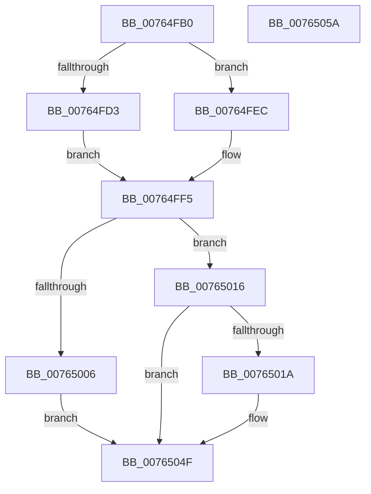

# PopPowerAggregatorSessionSwitchWorker

- RVA: `0x00764FB0`–`0x0076505B` (길이 `171` bytes)
- VA: `0x0000000140764FB0`
- 실행 섹션: `PAGE`
- PDB 이름 있음: `예`; PDB Function 태그: `아니요`
- unwind 정보 RVA: `0x0006E5F8`
- 디코드: `41`개 명령, `171/171` bytes 표시
- 미해석 바이트: `0` (있으면 어셈블리에 `.byte`로 보존)

> 이 문서는 커널 이미지의 기계어와 PDB 기호를 분석해 생성했습니다. 4번과 5번은 함수 원형과 자료형을 바이너리 사용 방식에서 추정한 C 해석이며 원본 소스 복구 결과는 아닙니다.

## 1. Dependencies

- 직접 호출 지점: **6**; 고유 호출 대상: **5**
- 직접 호출자로 확인된 함수: **0**
- RIP 상대 이미지 참조: **7**

### Outgoing calls
- `0x00764FC6` → [PopAcquireRwLockExclusive](../../text/43/PopAcquireRwLockExclusive_function_00430B44.md) (function, `0x00430B44`)
- `0x00764FE5` → [PopPowerAggregatorScheduleWorker](../91/PopPowerAggregatorScheduleWorker_function_00912B9C.md) (function, `0x00912B9C`)
- `0x00764FFC` → [PopReleaseRwLock](../../text/2D/PopReleaseRwLock_function_002DFBBC.md) (function, `0x002DFBBC`)
- `0x0076500F` → [PdcTaskClientRequest](../AA/PdcTaskClientRequest_function_00AA37E4.md) (function, `0x00AA37E4`)
- `0x00765023` → [PdcTaskClientRequest](../AA/PdcTaskClientRequest_function_00AA37E4.md) (function, `0x00AA37E4`)
- `0x0076504A` → [KeSetTimer2](../../text/3A/KeSetTimer2_function_003A08E0.md) (function, `0x003A08E0`)

### Direct callers
- 이 함수 시작 RVA로 연결되는 직접 call은 확인되지 않았습니다. 간접 호출은 완전히 역산할 수 없습니다.

### Static image references
- `0x00764FBA` → RVA `0x00F09710` (`.data`; read)
- `0x00764FCB` → RVA `0x00F09799` (`.data`; read)
- `0x00764FD3` → RVA `0x00F09798` (`.data`; read/write)
- `0x00764FDB` → RVA `0x00F09740` (`.data`; read)
- `0x00764FEC` → RVA `0x00F09799` (`.data`; write)
- `0x00765006` → RVA `0x00F0B460` (`.data`; read)
- `0x00765039` → RVA `0x00F097C0` (`.data`; read)

## 2. Other-region calls and transfers

- 다른 실행 섹션으로 향하는 call: **3**
  - `0x00764FC6` → [PopAcquireRwLockExclusive](../../text/43/PopAcquireRwLockExclusive_function_00430B44.md) (`PAGE` → `.text`)
  - `0x00764FFC` → [PopReleaseRwLock](../../text/2D/PopReleaseRwLock_function_002DFBBC.md) (`PAGE` → `.text`)
  - `0x0076504A` → [KeSetTimer2](../../text/3A/KeSetTimer2_function_003A08E0.md) (`PAGE` → `.text`)
- 별도 외부 분기/꼬리 이동을 확인하지 못했습니다.

## 3. Assembly (complete function range)

```asm
00764FB0  48 89 5C 24 08                  mov qword ptr [rsp + 8], rbx
00764FB5  57                              push rdi
00764FB6  48 83 EC 30                     sub rsp, 0x30
00764FBA  48 8D 0D 4F 47 7A 00            lea rcx, [rip + 0x7a474f]
00764FC1  40 32 FF                        xor dil, dil
00764FC4  32 DB                           xor bl, bl
00764FC6  E8 79 BB CC FF                  call 0x140430b44
00764FCB  38 1D C8 47 7A 00               cmp byte ptr [rip + 0x7a47c8], bl
00764FD1  74 19                           je 0x140764fec
00764FD3  66 83 25 BD 47 7A 00 00         and word ptr [rip + 0x7a47bd], 0
00764FDB  48 8D 0D 5E 47 7A 00            lea rcx, [rip + 0x7a475e]
00764FE2  40 B7 01                        mov dil, 1
00764FE5  E8 B2 DB 1A 00                  call 0x140912b9c
00764FEA  EB 09                           jmp 0x140764ff5
00764FEC  C6 05 A6 47 7A 00 01            mov byte ptr [rip + 0x7a47a6], 1
00764FF3  B3 01                           mov bl, 1
00764FF5  48 8D 0D 14 47 7A 00            lea rcx, [rip + 0x7a4714]
00764FFC  E8 BB AB B7 FF                  call 0x1402dfbbc
00765001  40 84 FF                        test dil, dil
00765004  74 10                           je 0x140765016
00765006  48 8B 0D 53 64 7A 00            mov rcx, qword ptr [rip + 0x7a6453]
0076500D  33 D2                           xor edx, edx
0076500F  E8 D0 E7 33 00                  call 0x140aa37e4
00765014  EB 39                           jmp 0x14076504f
00765016  84 DB                           test bl, bl
00765018  74 35                           je 0x14076504f
0076501A  48 8B 0D 3F 64 7A 00            mov rcx, qword ptr [rip + 0x7a643f]
00765021  B2 01                           mov dl, 1
00765023  E8 BC E7 33 00                  call 0x140aa37e4
00765028  48 83 64 24 20 00               and qword ptr [rsp + 0x20], 0
0076502E  4C 8D 4C 24 20                  lea r9, [rsp + 0x20]
00765033  48 83 4C 24 28 FF               or qword ptr [rsp + 0x28], 0xffffffffffffffff
00765039  48 8D 0D 80 47 7A 00            lea rcx, [rip + 0x7a4780]
00765040  45 33 C0                        xor r8d, r8d
00765043  48 C7 C2 80 0F 05 FD            mov rdx, 0xfffffffffd050f80
0076504A  E8 91 B8 C3 FF                  call 0x1403a08e0
0076504F  48 8B 5C 24 40                  mov rbx, qword ptr [rsp + 0x40]
00765054  48 83 C4 30                     add rsp, 0x30
00765058  5F                              pop rdi
00765059  C3                              ret
0076505A  CC                              int3
```

## 4. C-style interpretation (structured pseudocode)

```c
__int64 __fastcall PopPowerAggregatorSessionSwitchWorker(__int64 a1, int a2, int a3)
{
    __int64 result;
    __int64 v_rbx;
    __int64 v_rdi;
    __int64 v_rsp;
    unsigned __int64 v_stack_m10;
    unsigned __int64 v_stack_m18;
    unsigned __int64 v_stack_p8;

    v_stack_p8 = v_rbx;
    v_rsp = (v_rsp) - (48);
    v_rdi = 0;
    v_rbx = 0;
    result = PopAcquireRwLockExclusive(v_rip + 8013647, a2, a3, a4);
    if ((*(unsigned __int8 *)(v_rip + 8013768)) == 0) goto loc_00764FEC;
    result = PopPowerAggregatorScheduleWorker(v_rip + 8013662, a2, a3, a4);
    goto loc_00764FF5;
loc_00764FEC:
    *(unsigned __int8 *)(v_rip + 8013734) = 1;
loc_00764FF5:
    result = PopReleaseRwLock(v_rip + 8013588, a2, a3, a4);
    if (1 == 0) goto loc_00765016;
    a2 = 0;
    result = PdcTaskClientRequest(*(unsigned __int64 *)(v_rip + 8021075), a2, a3, a4);
    goto loc_0076504F;
loc_00765016:
    if (1 != 0) {
        a1 = *(unsigned __int64 *)(v_rip + 8021055);
        a2 = 1;
        result = PdcTaskClientRequest(a1, a2, a3, a4);
        a4 = v_stack_m18;
        a1 = v_rip + 8013696;
        a3 = 0;
        a2 = 0xFFFFFFFFFD050F80ULL;
        result = KeSetTimer2(a1, a2, a3, a4);
    }
    v_rsp = (v_rsp) + (48);
    return result;
}
```

## 5. (Beta) C Style

```c
int64_t PopPowerAggregatorSessionSwitchWorker(int64_t Arg1, int32_t Arg2, int32_t Arg3)
{
    int64_t result;
    int64_t local_rbx;
    int64_t local_rdi;
    int64_t local_rsp;
    uint64_t v_stack_m10;
    uint64_t v_stack_m18;
    uint64_t v_stack_p8;

    v_stack_p8 = local_rbx;
    local_rsp = (local_rsp) - (48);
    local_rdi = 0;
    local_rbx = 0;
    result = PopAcquireRwLockExclusive(v_rip + 8013647, Arg2, Arg3, a4);
    if ((*(uint8_t *)(v_rip + 0x7A47C8)) == 0) goto loc_00764FEC;
    result = PopPowerAggregatorScheduleWorker(v_rip + 8013662, Arg2, Arg3, a4);
    goto loc_00764FF5;
loc_00764FEC:
    *(uint8_t *)(v_rip + 0x7A47A6) = 1;
loc_00764FF5:
    result = PopReleaseRwLock(v_rip + 8013588, Arg2, Arg3, a4);
    if (1 == 0) goto loc_00765016;
    Arg2 = 0;
    result = PdcTaskClientRequest(*(uint64_t *)(v_rip + 0x7A6453), Arg2, Arg3, a4);
    goto loc_0076504F;
loc_00765016:
    if (1 != 0) {
        Arg1 = *(uint64_t *)(v_rip + 0x7A643F);
        Arg2 = 1;
        result = PdcTaskClientRequest(Arg1, Arg2, Arg3, a4);
        a4 = v_stack_m18;
        Arg1 = v_rip + 8013696;
        Arg3 = 0;
        Arg2 = 0xFFFFFFFFFD050F80ULL;
        result = KeSetTimer2(Arg1, Arg2, Arg3, a4);
    }
    local_rsp = (local_rsp) + (48);
    return result;
}
```

## 6. Execution-region graph

[열기: 2D/3D 그래프와 함수 탐색 컨트롤 패널](../../../control-panel.html?section=page&rva=0x00764FB0&view=graph)

- 2D 그래프는 위에서 아래로 흐르고, 3D 그래프는 빈 공간을 드래그해 회전합니다. Shift+드래그는 이동, 휠은 확대·축소, 함수 노드 선택은 대상 보고서 이동입니다.

### Static fallback


