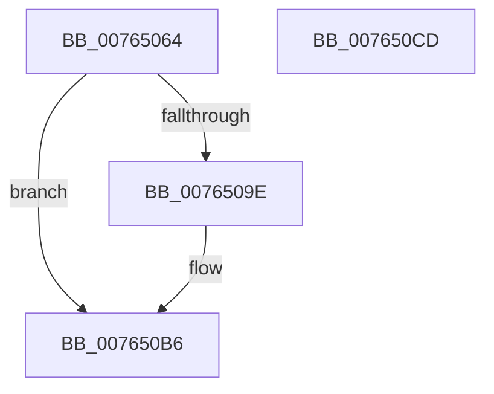

# PopPowerAggregatorSnapDiagnosticContext

- RVA: `0x00765064`–`0x007650CE` (길이 `106` bytes)
- VA: `0x0000000140765064`
- 실행 섹션: `PAGE`
- PDB 이름 있음: `예`; PDB Function 태그: `아니요`
- unwind 정보 RVA: `0x0005CAAC`
- 디코드: `26`개 명령, `106/106` bytes 표시
- 미해석 바이트: `0` (있으면 어셈블리에 `.byte`로 보존)

> 이 문서는 커널 이미지의 기계어와 PDB 기호를 분석해 생성했습니다. 4번과 5번은 함수 원형과 자료형을 바이너리 사용 방식에서 추정한 C 해석이며 원본 소스 복구 결과는 아닙니다.

## 1. Dependencies

- 직접 호출 지점: **4**; 고유 호출 대상: **4**
- 직접 호출자로 확인된 함수: **1**
- RIP 상대 이미지 참조: **2**

### Outgoing calls
- `0x0076507C` → [PopAcquireRwLockExclusive](../../text/43/PopAcquireRwLockExclusive_function_00430B44.md) (function, `0x00430B44`)
- `0x00765091` → [ExAllocatePool2](../../poolcode/B8/ExAllocatePool2_function_00B820F0.md) (function, `0x00B820F0`)
- `0x007650AE` → [memcpy](../../text/6C/memcpy_function_006C6840.md) (function, `0x006C6840`)
- `0x007650BD` → [PopReleaseRwLock](../../text/2D/PopReleaseRwLock_function_002DFBBC.md) (function, `0x002DFBBC`)

### Direct callers
- [PopIdlePhaseWatchdogCallback](../../text/4C/PopIdlePhaseWatchdogCallback_function_004CB090.md) at `0x004CB163`

### Static image references
- `0x00765075` → RVA `0x00F09710` (`.data`; read)
- `0x007650A4` → RVA `0x00F09740` (`.data`; read)

## 2. Other-region calls and transfers

- 다른 실행 섹션으로 향하는 call: **4**
  - `0x0076507C` → [PopAcquireRwLockExclusive](../../text/43/PopAcquireRwLockExclusive_function_00430B44.md) (`PAGE` → `.text`)
  - `0x00765091` → [ExAllocatePool2](../../poolcode/B8/ExAllocatePool2_function_00B820F0.md) (`PAGE` → `POOLCODE`)
  - `0x007650AE` → [memcpy](../../text/6C/memcpy_function_006C6840.md) (`PAGE` → `.text`)
  - `0x007650BD` → [PopReleaseRwLock](../../text/2D/PopReleaseRwLock_function_002DFBBC.md) (`PAGE` → `.text`)
- 별도 외부 분기/꼬리 이동을 확인하지 못했습니다.

## 3. Assembly (complete function range)

```asm
00765064  48 89 5C 24 08                  mov qword ptr [rsp + 8], rbx
00765069  57                              push rdi
0076506A  48 83 EC 20                     sub rsp, 0x20
0076506E  48 83 21 00                     and qword ptr [rcx], 0
00765072  48 8B F9                        mov rdi, rcx
00765075  48 8D 0D 94 46 7A 00            lea rcx, [rip + 0x7a4694]
0076507C  E8 C3 BA CC FF                  call 0x140430b44
00765081  BA F8 15 00 00                  mov edx, 0x15f8
00765086  B9 00 01 00 00                  mov ecx, 0x100
0076508B  41 B8 50 64 69 67               mov r8d, 0x67696450
00765091  E8 5A D0 41 00                  call 0x140b820f0
00765096  48 8B D8                        mov rbx, rax
00765099  48 85 C0                        test rax, rax
0076509C  74 18                           je 0x1407650b6
0076509E  41 B8 F8 15 00 00               mov r8d, 0x15f8
007650A4  48 8D 15 95 46 7A 00            lea rdx, [rip + 0x7a4695]
007650AB  48 8B C8                        mov rcx, rax
007650AE  E8 8D 17 F6 FF                  call 0x1406c6840
007650B3  48 89 1F                        mov qword ptr [rdi], rbx
007650B6  48 8D 0D 53 46 7A 00            lea rcx, [rip + 0x7a4653]
007650BD  E8 FA AA B7 FF                  call 0x1402dfbbc
007650C2  48 8B 5C 24 30                  mov rbx, qword ptr [rsp + 0x30]
007650C7  48 83 C4 20                     add rsp, 0x20
007650CB  5F                              pop rdi
007650CC  C3                              ret
007650CD  CC                              int3
```

## 4. C-style interpretation (structured pseudocode)

```c
__int64 __fastcall PopPowerAggregatorSnapDiagnosticContext(__int64 a1)
{
    __int64 result;
    __int64 v_rsp;
    unsigned __int64 v_stack_p8;

    v_stack_p8 = v_rbx;
    v_rsp = (v_rsp) - (32);
    result = PopAcquireRwLockExclusive(v_rip + 8013460, a2, a3, a4);
    result = ExAllocatePool2(256, (unsigned int)(0x15F8ULL), (unsigned int)(0x67696450ULL), a4);
    if (result != 0) {
        a3 = 0x15F8ULL;
        a2 = v_rip + 8013461;
        a1 = result;
        result = memcpy(a1, a2, a3, a4);
        *(unsigned __int64 *)(a1) = result;
    }
    result = PopReleaseRwLock(v_rip + 8013395, a2, a3, a4);
    v_rsp = (v_rsp) + (32);
    return result;
}
```

## 5. (Beta) C Style

```c
int64_t PopPowerAggregatorSnapDiagnosticContext(void *Arg1)
{
    uint8_t *arg1 = (uint8_t *)Arg1;

    int64_t result;
    int64_t local_rsp;
    uint64_t v_stack_p8;

    v_stack_p8 = local_rbx;
    local_rsp = (local_rsp) - (32);
    result = PopAcquireRwLockExclusive(v_rip + 8013460, a2, a3, a4);
    result = ExAllocatePool2(256, (uint32_t)(0x15F8ULL), (uint32_t)(0x67696450ULL), a4);
    if (result != 0) {
        a3 = 0x15F8ULL;
        a2 = v_rip + 8013461;
        Arg1 = result;
        result = memcpy(Arg1, a2, a3, a4);
        *(uint64_t *)(arg1) = result;
    }
    result = PopReleaseRwLock(v_rip + 8013395, a2, a3, a4);
    local_rsp = (local_rsp) + (32);
    return result;
}
```

### 관측된 메모리 오프셋

구조체 형식이 확인되지 않은 접근은 인자 기준의 오프셋으로만 기록했습니다.

| 기준 인자 | 오프셋 표현 | 폭 (bit) | 접근 |
|---|---:|---:|---|
| `Arg1` | `+ 0x0` | `64` | `R/W` |
| `Arg1` | `+ 0x0` | `64` | `W` |

## 6. Execution-region graph

[열기: 2D/3D 그래프와 함수 탐색 컨트롤 패널](../../../control-panel.html?section=page&rva=0x00765064&view=graph)

- 2D 그래프는 위에서 아래로 흐르고, 3D 그래프는 빈 공간을 드래그해 회전합니다. Shift+드래그는 이동, 휠은 확대·축소, 함수 노드 선택은 대상 보고서 이동입니다.

### Static fallback


