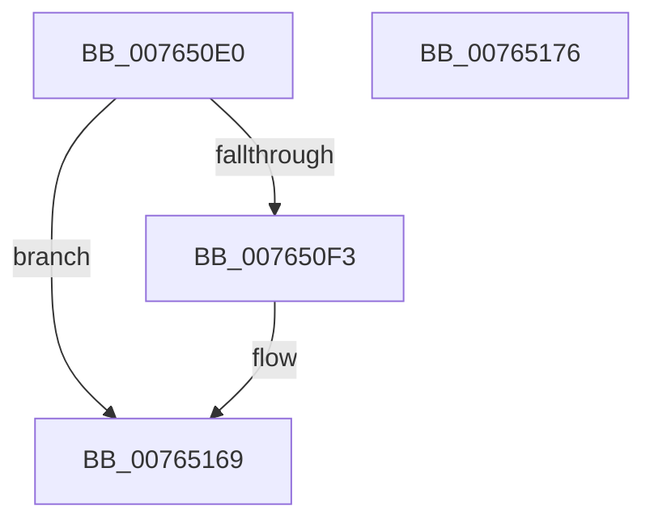

# PopPowerAggregatorSystemTransitionEnterStateHandler

- RVA: `0x007650E0`–`0x00765177` (길이 `151` bytes)
- VA: `0x00000001407650E0`
- 실행 섹션: `PAGE`
- PDB 이름 있음: `예`; PDB Function 태그: `아니요`
- unwind 정보 RVA: `0x00065960`
- 디코드: `37`개 명령, `151/151` bytes 표시
- 미해석 바이트: `0` (있으면 어셈블리에 `.byte`로 보존)

> 이 문서는 커널 이미지의 기계어와 PDB 기호를 분석해 생성했습니다. 4번과 5번은 함수 원형과 자료형을 바이너리 사용 방식에서 추정한 C 해석이며 원본 소스 복구 결과는 아닙니다.

## 1. Dependencies

- 직접 호출 지점: **8**; 고유 호출 대상: **8**
- 직접 호출자로 확인된 함수: **0**
- RIP 상대 이미지 참조: **1**

### Outgoing calls
- `0x007650F6` → [PopGetMonitorReasonFromPowerEventId](../../text/4B/PopGetMonitorReasonFromPowerEventId_function_004BB2D8.md) (function, `0x004BB2D8`)
- `0x00765120` → [PopPowerAggregatorSetCurrentState](../98/PopPowerAggregatorSetCurrentState_function_0098A3B0.md) (function, `0x0098A3B0`)
- `0x0076512C` → [PopReleaseRwLock](../../text/2D/PopReleaseRwLock_function_002DFBBC.md) (function, `0x002DFBBC`)
- `0x00765136` → [PopSuspendResumePdc](../A9/PopSuspendResumePdc_function_00A910AC.md) (function, `0x00A910AC`)
- `0x0076513B` → [PopPowerRequestRevokeRequestsForSleep](../AC/PopPowerRequestRevokeRequestsForSleep_function_00AC68AC.md) (function, `0x00AC68AC`)
- `0x0076514C` → [KeSetEvent](../../text/33/KeSetEvent_function_0033F310.md) (function, `0x0033F310`)
- `0x00765158` → [PopSleepstudyStartNextSession](../AC/PopSleepstudyStartNextSession_function_00AC4720.md) (function, `0x00AC4720`)
- `0x00765164` → [PopAcquireRwLockExclusive](../../text/43/PopAcquireRwLockExclusive_function_00430B44.md) (function, `0x00430B44`)

### Direct callers
- 이 함수 시작 RVA로 연결되는 직접 call은 확인되지 않았습니다. 간접 호출은 완전히 역산할 수 없습니다.

### Static image references
- `0x00765125` → RVA `0x00F09710` (`.data`; read)

## 2. Other-region calls and transfers

- 다른 실행 섹션으로 향하는 call: **4**
  - `0x007650F6` → [PopGetMonitorReasonFromPowerEventId](../../text/4B/PopGetMonitorReasonFromPowerEventId_function_004BB2D8.md) (`PAGE` → `.text`)
  - `0x0076512C` → [PopReleaseRwLock](../../text/2D/PopReleaseRwLock_function_002DFBBC.md) (`PAGE` → `.text`)
  - `0x0076514C` → [KeSetEvent](../../text/33/KeSetEvent_function_0033F310.md) (`PAGE` → `.text`)
  - `0x00765164` → [PopAcquireRwLockExclusive](../../text/43/PopAcquireRwLockExclusive_function_00430B44.md) (`PAGE` → `.text`)
- 별도 외부 분기/꼬리 이동을 확인하지 못했습니다.

## 3. Assembly (complete function range)

```asm
007650E0  48 89 5C 24 08                  mov qword ptr [rsp + 8], rbx
007650E5  57                              push rdi
007650E6  48 83 EC 40                     sub rsp, 0x40
007650EA  83 79 38 05                     cmp dword ptr [rcx + 0x38], 5
007650EE  48 8B F9                        mov rdi, rcx
007650F1  74 76                           je 0x140765169
007650F3  8B 49 3C                        mov ecx, dword ptr [rcx + 0x3c]
007650F6  E8 DD 61 D5 FF                  call 0x1404bb2d8
007650FB  0F 57 C0                        xorps xmm0, xmm0
007650FE  48 8D 54 24 20                  lea rdx, [rsp + 0x20]
00765103  8B D8                           mov ebx, eax
00765105  48 8B CF                        mov rcx, rdi
00765108  0F 11 44 24 20                  movups xmmword ptr [rsp + 0x20], xmm0
0076510D  81 E3 FF FF FF 00               and ebx, 0xffffff
00765113  C7 44 24 20 05 00 00 00         mov dword ptr [rsp + 0x20], 5
0076511B  0F 11 44 24 30                  movups xmmword ptr [rsp + 0x30], xmm0
00765120  E8 8B 52 22 00                  call 0x14098a3b0
00765125  48 8D 0D E4 45 7A 00            lea rcx, [rip + 0x7a45e4]
0076512C  E8 8B AA B7 FF                  call 0x1402dfbbc
00765131  B9 01 00 00 00                  mov ecx, 1
00765136  E8 71 BF 32 00                  call 0x140a910ac
0076513B  E8 6C 17 36 00                  call 0x140ac68ac
00765140  48 8D 8F 08 01 00 00            lea rcx, [rdi + 0x108]
00765147  45 33 C0                        xor r8d, r8d
0076514A  33 D2                           xor edx, edx
0076514C  E8 BF A1 BD FF                  call 0x14033f310
00765151  8B D3                           mov edx, ebx
00765153  B9 03 00 00 00                  mov ecx, 3
00765158  E8 C3 F5 35 00                  call 0x140ac4720
0076515D  48 8D 0D AC 45 7A 00            lea rcx, [rip + 0x7a45ac]
00765164  E8 DB B9 CC FF                  call 0x140430b44
00765169  48 8B 5C 24 50                  mov rbx, qword ptr [rsp + 0x50]
0076516E  33 C0                           xor eax, eax
00765170  48 83 C4 40                     add rsp, 0x40
00765174  5F                              pop rdi
00765175  C3                              ret
00765176  CC                              int3
```

## 4. C-style interpretation (structured pseudocode)

```c
__int64 __fastcall PopPowerAggregatorSystemTransitionEnterStateHandler(__int64 a1, __int64 a2, int a3)
{
    __int64 result;
    __int64 v_rbx;
    __int64 v_rsp;
    unsigned __int64 v_stack_m18;
    unsigned __int64 v_stack_m28;
    unsigned __int64 v_stack_p8;

    v_stack_p8 = v_rbx;
    v_rsp = (v_rsp) - (64);
    if ((*(unsigned int *)(a1 + 56)) != 5) {
        a1 = *(unsigned int *)(a1 + 60);
        result = PopGetMonitorReasonFromPowerEventId(a1, a2, a3, a4);
        a2 = v_stack_m28;
        v_rbx = (unsigned int)(result);
        a1 = a1;
        v_stack_m28 = v_xmm0;
        v_rbx = (unsigned int)((v_rbx) & (0xFFFFFFULL));
        v_stack_m28 = 5;
        v_stack_m18 = v_xmm0;
        result = PopPowerAggregatorSetCurrentState(a1, a2, a3, a4);
        a1 = v_rip + 8013284;
        result = PopReleaseRwLock(a1, a2, a3, a4);
        a1 = 1;
        result = PopSuspendResumePdc(a1, a2, a3, a4);
        result = PopPowerRequestRevokeRequestsForSleep(a1, a2, a3, a4);
        a1 = a1 + 264;
        a3 = 0;
        a2 = 0;
        result = KeSetEvent(a1, a2, a3, a4);
        a2 = (unsigned int)(v_rbx);
        a1 = 3;
        result = PopSleepstudyStartNextSession(a1, a2, a3, a4);
        a1 = v_rip + 8013228;
        result = PopAcquireRwLockExclusive(a1, a2, a3, a4);
    }
    result = 0;
    v_rsp = (v_rsp) + (64);
    return result;
}
```

## 5. (Beta) C Style

```c
int64_t PopPowerAggregatorSystemTransitionEnterStateHandler(void *Arg1, int64_t Arg2, int32_t Arg3)
{
    uint8_t *arg1 = (uint8_t *)Arg1;

    int64_t result;
    int64_t local_rbx;
    int64_t local_rsp;
    uint64_t v_stack_m18;
    uint64_t v_stack_m28;
    uint64_t v_stack_p8;

    v_stack_p8 = local_rbx;
    local_rsp = (local_rsp) - (64);
    if ((*(uint32_t *)(arg1 + 0x38)) != 5) {
        Arg1 = *(uint32_t *)(arg1 + 0x3C);
        result = PopGetMonitorReasonFromPowerEventId(Arg1, Arg2, Arg3, a4);
        Arg2 = v_stack_m28;
        local_rbx = (uint32_t)(result);
        Arg1 = Arg1;
        v_stack_m28 = v_xmm0;
        local_rbx = (uint32_t)((local_rbx) & (0xFFFFFFULL));
        v_stack_m28 = 5;
        v_stack_m18 = v_xmm0;
        result = PopPowerAggregatorSetCurrentState(Arg1, Arg2, Arg3, a4);
        Arg1 = v_rip + 8013284;
        result = PopReleaseRwLock(Arg1, Arg2, Arg3, a4);
        Arg1 = 1;
        result = PopSuspendResumePdc(Arg1, Arg2, Arg3, a4);
        result = PopPowerRequestRevokeRequestsForSleep(Arg1, Arg2, Arg3, a4);
        Arg1 = Arg1 + 264;
        Arg3 = 0;
        Arg2 = 0;
        result = KeSetEvent(Arg1, Arg2, Arg3, a4);
        Arg2 = (uint32_t)(local_rbx);
        Arg1 = 3;
        result = PopSleepstudyStartNextSession(Arg1, Arg2, Arg3, a4);
        Arg1 = v_rip + 8013228;
        result = PopAcquireRwLockExclusive(Arg1, Arg2, Arg3, a4);
    }
    result = 0;
    local_rsp = (local_rsp) + (64);
    return result;
}
```

### 관측된 메모리 오프셋

구조체 형식이 확인되지 않은 접근은 인자 기준의 오프셋으로만 기록했습니다.

| 기준 인자 | 오프셋 표현 | 폭 (bit) | 접근 |
|---|---:|---:|---|
| `Arg1` | `+ 0x38` | `32` | `R` |
| `Arg1` | `+ 0x3C` | `32` | `R` |
| `Arg1` | `+ 0x108` | `64` | `R` |

## 6. Execution-region graph

[열기: 2D/3D 그래프와 함수 탐색 컨트롤 패널](../../../control-panel.html?section=page&rva=0x007650E0&view=graph)

- 2D 그래프는 위에서 아래로 흐르고, 3D 그래프는 빈 공간을 드래그해 회전합니다. Shift+드래그는 이동, 휠은 확대·축소, 함수 노드 선택은 대상 보고서 이동입니다.

### Static fallback


