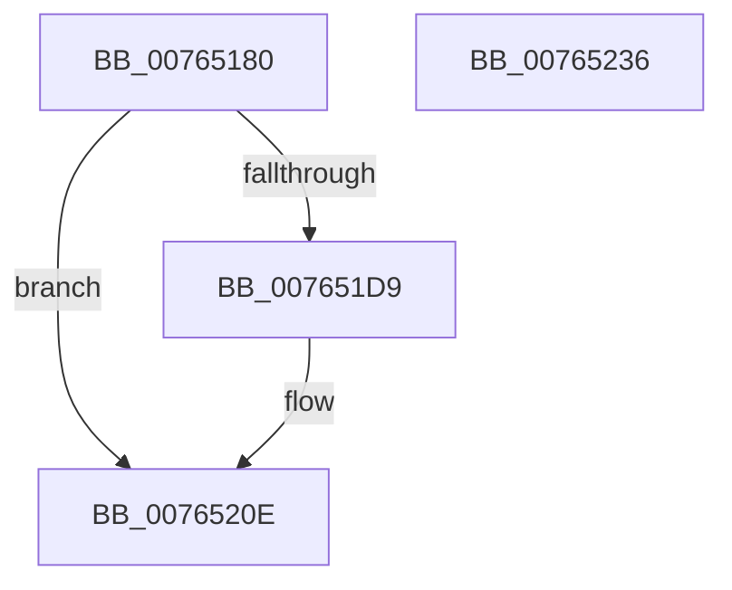

# PopPowerAggregatorSystemTransitionExitStateHandler

- RVA: `0x00765180`–`0x00765237` (길이 `183` bytes)
- VA: `0x0000000140765180`
- 실행 섹션: `PAGE`
- PDB 이름 있음: `예`; PDB Function 태그: `아니요`
- unwind 정보 RVA: `0x00071A74`
- 디코드: `41`개 명령, `183/183` bytes 표시
- 미해석 바이트: `0` (있으면 어셈블리에 `.byte`로 보존)

> 이 문서는 커널 이미지의 기계어와 PDB 기호를 분석해 생성했습니다. 4번과 5번은 함수 원형과 자료형을 바이너리 사용 방식에서 추정한 C 해석이며 원본 소스 복구 결과는 아닙니다.

## 1. Dependencies

- 직접 호출 지점: **11**; 고유 호출 대상: **9**
- 직접 호출자로 확인된 함수: **0**
- RIP 상대 이미지 참조: **3**

### Outgoing calls
- `0x00765190` → [KeResetEvent](../../text/24/KeResetEvent_function_00248350.md) (function, `0x00248350`)
- `0x007651B2` → [PopPowerAggregatorSetCurrentState](../98/PopPowerAggregatorSetCurrentState_function_0098A3B0.md) (function, `0x0098A3B0`)
- `0x007651BE` → [PopReleaseRwLock](../../text/2D/PopReleaseRwLock_function_002DFBBC.md) (function, `0x002DFBBC`)
- `0x007651CB` → [PopSleepstudyStartNextSession](../AC/PopSleepstudyStartNextSession_function_00AC4720.md) (function, `0x00AC4720`)
- `0x007651E0` → [KeResetEvent](../../text/24/KeResetEvent_function_00248350.md) (function, `0x00248350`)
- `0x007651EA` → [PopGetPolicyWorker](../../text/48/PopGetPolicyWorker_function_00482D24.md) (function, `0x00482D24`)
- `0x007651EF` → [PopCheckForWork](../../text/48/PopCheckForWork_function_00482CAC.md) (function, `0x00482CAC`)
- `0x00765209` → [KeWaitForSingleObject](../../text/20/KeWaitForSingleObject_function_0020E6B0.md) (function, `0x0020E6B0`)
- `0x00765213` → [PopSuspendResumePdc](../A9/PopSuspendResumePdc_function_00A910AC.md) (function, `0x00A910AC`)
- `0x0076521D` → [PopSuspendResumePdc](../A9/PopSuspendResumePdc_function_00A910AC.md) (function, `0x00A910AC`)
- `0x00765229` → [PopAcquireRwLockExclusive](../../text/43/PopAcquireRwLockExclusive_function_00430B44.md) (function, `0x00430B44`)

### Direct callers
- 이 함수 시작 RVA로 연결되는 직접 call은 확인되지 않았습니다. 간접 호출은 완전히 역산할 수 없습니다.

### Static image references
- `0x007651B7` → RVA `0x00F09710` (`.data`; read)
- `0x007651D0` → RVA `0x00E0B558` (`.data`; read)
- `0x007651D9` → RVA `0x00F0AD60` (`.data`; read)

## 2. Other-region calls and transfers

- 다른 실행 섹션으로 향하는 call: **7**
  - `0x00765190` → [KeResetEvent](../../text/24/KeResetEvent_function_00248350.md) (`PAGE` → `.text`)
  - `0x007651BE` → [PopReleaseRwLock](../../text/2D/PopReleaseRwLock_function_002DFBBC.md) (`PAGE` → `.text`)
  - `0x007651E0` → [KeResetEvent](../../text/24/KeResetEvent_function_00248350.md) (`PAGE` → `.text`)
  - `0x007651EA` → [PopGetPolicyWorker](../../text/48/PopGetPolicyWorker_function_00482D24.md) (`PAGE` → `.text`)
  - `0x007651EF` → [PopCheckForWork](../../text/48/PopCheckForWork_function_00482CAC.md) (`PAGE` → `.text`)
  - `0x00765209` → [KeWaitForSingleObject](../../text/20/KeWaitForSingleObject_function_0020E6B0.md) (`PAGE` → `.text`)
  - `0x00765229` → [PopAcquireRwLockExclusive](../../text/43/PopAcquireRwLockExclusive_function_00430B44.md) (`PAGE` → `.text`)
- 별도 외부 분기/꼬리 이동을 확인하지 못했습니다.

## 3. Assembly (complete function range)

```asm
00765180  40 53                           push rbx
00765182  48 83 EC 50                     sub rsp, 0x50
00765186  48 8B D9                        mov rbx, rcx
00765189  48 81 C1 08 01 00 00            add rcx, 0x108
00765190  E8 BB 31 AE FF                  call 0x140248350
00765195  0F 57 C0                        xorps xmm0, xmm0
00765198  48 8D 54 24 30                  lea rdx, [rsp + 0x30]
0076519D  0F 11 44 24 30                  movups xmmword ptr [rsp + 0x30], xmm0
007651A2  48 8B CB                        mov rcx, rbx
007651A5  C7 44 24 30 03 00 00 00         mov dword ptr [rsp + 0x30], 3
007651AD  0F 11 44 24 40                  movups xmmword ptr [rsp + 0x40], xmm0
007651B2  E8 F9 51 22 00                  call 0x14098a3b0
007651B7  48 8D 0D 52 45 7A 00            lea rcx, [rip + 0x7a4552]
007651BE  E8 F9 A9 B7 FF                  call 0x1402dfbbc
007651C3  BA 14 00 00 00                  mov edx, 0x14
007651C8  8D 4A ED                        lea ecx, [rdx - 0x13]
007651CB  E8 50 F5 35 00                  call 0x140ac4720
007651D0  83 3D 81 63 6A 00 00            cmp dword ptr [rip + 0x6a6381], 0
007651D7  74 35                           je 0x14076520e
007651D9  48 8D 0D 80 5B 7A 00            lea rcx, [rip + 0x7a5b80]
007651E0  E8 6B 31 AE FF                  call 0x140248350
007651E5  B9 80 00 00 00                  mov ecx, 0x80
007651EA  E8 35 DB D1 FF                  call 0x140482d24
007651EF  E8 B8 DA D1 FF                  call 0x140482cac
007651F4  48 83 64 24 20 00               and qword ptr [rsp + 0x20], 0
007651FA  48 8D 0D 5F 5B 7A 00            lea rcx, [rip + 0x7a5b5f]
00765201  45 33 C9                        xor r9d, r9d
00765204  45 33 C0                        xor r8d, r8d
00765207  33 D2                           xor edx, edx
00765209  E8 A2 94 AA FF                  call 0x14020e6b0
0076520E  B9 02 00 00 00                  mov ecx, 2
00765213  E8 94 BE 32 00                  call 0x140a910ac
00765218  B9 03 00 00 00                  mov ecx, 3
0076521D  E8 8A BE 32 00                  call 0x140a910ac
00765222  48 8D 0D E7 44 7A 00            lea rcx, [rip + 0x7a44e7]
00765229  E8 16 B9 CC FF                  call 0x140430b44
0076522E  33 C0                           xor eax, eax
00765230  48 83 C4 50                     add rsp, 0x50
00765234  5B                              pop rbx
00765235  C3                              ret
00765236  CC                              int3
```

## 4. C-style interpretation (structured pseudocode)

```c
__int64 __fastcall PopPowerAggregatorSystemTransitionExitStateHandler(__int64 a1, __int64 a2, int a3, int a4)
{
    __int64 result;
    __int64 v_rsp;
    unsigned __int64 v_stack_m18;
    unsigned __int64 v_stack_m28;
    unsigned __int64 v_stack_m38;

    v_rsp = (v_rsp) - (80);
    a1 = (a1) + (264);
    result = KeResetEvent(a1, a2, a3, a4);
    v_stack_m28 = v_xmm0;
    v_stack_m28 = 3;
    v_stack_m18 = v_xmm0;
    result = PopPowerAggregatorSetCurrentState(a1, v_stack_m28, a3, a4);
    result = PopReleaseRwLock(v_rip + 8013138, v_stack_m28, a3, a4);
    result = PopSleepstudyStartNextSession(20 - 19, 20, a3, a4);
    if ((*(unsigned int *)(v_rip + 6972289)) != 0) {
        a1 = v_rip + 8018816;
        result = KeResetEvent(a1, 20, a3, a4);
        a1 = 128;
        result = PopGetPolicyWorker(a1, 20, a3, a4);
        result = PopCheckForWork(a1, 20, a3, a4);
        a1 = v_rip + 8018783;
        a4 = 0;
        a3 = 0;
        a2 = 0;
        result = KeWaitForSingleObject(a1, a2, a3, a4);
    }
    result = PopSuspendResumePdc(2, a2, a3, a4);
    result = PopSuspendResumePdc(3, a2, a3, a4);
    result = PopAcquireRwLockExclusive(v_rip + 8013031, a2, a3, a4);
    result = 0;
    v_rsp = (v_rsp) + (80);
    return result;
}
```

## 5. (Beta) C Style

```c
int64_t PopPowerAggregatorSystemTransitionExitStateHandler(int64_t Arg1, int64_t Arg2, int32_t Arg3, int32_t Arg4)
{
    int64_t result;
    int64_t local_rsp;
    uint64_t v_stack_m18;
    uint64_t v_stack_m28;
    uint64_t v_stack_m38;

    local_rsp = (local_rsp) - (80);
    Arg1 = (Arg1) + (264);
    result = KeResetEvent(Arg1, Arg2, Arg3, Arg4);
    v_stack_m28 = v_xmm0;
    v_stack_m28 = 3;
    v_stack_m18 = v_xmm0;
    result = PopPowerAggregatorSetCurrentState(Arg1, v_stack_m28, Arg3, Arg4);
    result = PopReleaseRwLock(v_rip + 8013138, v_stack_m28, Arg3, Arg4);
    result = PopSleepstudyStartNextSession(20 - 19, 20, Arg3, Arg4);
    if ((*(uint32_t *)(v_rip + 0x6A6381)) != 0) {
        Arg1 = v_rip + 8018816;
        result = KeResetEvent(Arg1, 20, Arg3, Arg4);
        Arg1 = 128;
        result = PopGetPolicyWorker(Arg1, 20, Arg3, Arg4);
        result = PopCheckForWork(Arg1, 20, Arg3, Arg4);
        Arg1 = v_rip + 8018783;
        Arg4 = 0;
        Arg3 = 0;
        Arg2 = 0;
        result = KeWaitForSingleObject(Arg1, Arg2, Arg3, Arg4);
    }
    result = PopSuspendResumePdc(2, Arg2, Arg3, Arg4);
    result = PopSuspendResumePdc(3, Arg2, Arg3, Arg4);
    result = PopAcquireRwLockExclusive(v_rip + 8013031, Arg2, Arg3, Arg4);
    result = 0;
    local_rsp = (local_rsp) + (80);
    return result;
}
```

## 6. Execution-region graph

[열기: 2D/3D 그래프와 함수 탐색 컨트롤 패널](../../../control-panel.html?section=page&rva=0x00765180&view=graph)

- 2D 그래프는 위에서 아래로 흐르고, 3D 그래프는 빈 공간을 드래그해 회전합니다. Shift+드래그는 이동, 휠은 확대·축소, 함수 노드 선택은 대상 보고서 이동입니다.

### Static fallback


