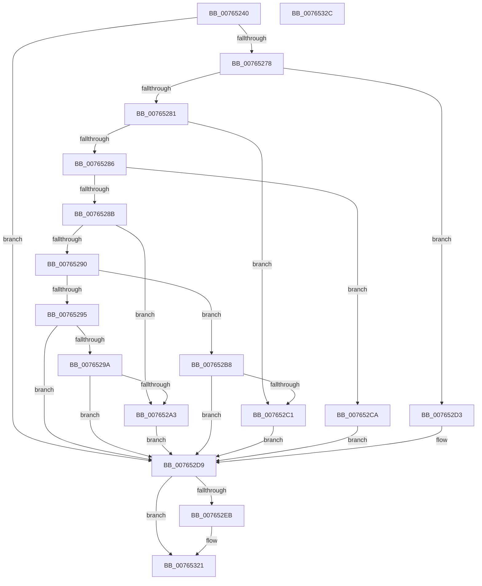

# PopPowerAggregatorTriggerAdaptiveAction

- RVA: `0x00765240`–`0x0076532D` (길이 `237` bytes)
- VA: `0x0000000140765240`
- 실행 섹션: `PAGE`
- PDB 이름 있음: `예`; PDB Function 태그: `아니요`
- unwind 정보 RVA: `0x0009EAB4`
- 디코드: `61`개 명령, `237/237` bytes 표시
- 미해석 바이트: `0` (있으면 어셈블리에 `.byte`로 보존)

> 이 문서는 커널 이미지의 기계어와 PDB 기호를 분석해 생성했습니다. 4번과 5번은 함수 원형과 자료형을 바이너리 사용 방식에서 추정한 C 해석이며 원본 소스 복구 결과는 아닙니다.

## 1. Dependencies

- 직접 호출 지점: **6**; 고유 호출 대상: **5**
- 직접 호출자로 확인된 함수: **1**
- RIP 상대 이미지 참조: **4**

### Outgoing calls
- `0x0076526A` → [PopAcquireRwLockExclusive](../../text/43/PopAcquireRwLockExclusive_function_00430B44.md) (function, `0x00430B44`)
- `0x0076529A` → [Feature_AdaptiveHibernateEnhancements__private_IsEnabledDeviceUsageNoInline](../../text/4F/Feature_AdaptiveHibernateEnhancements__private_IsEnabledDeviceUsageNoInline_function_004F78F0.md) (function, `0x004F78F0`)
- `0x007652B1` → [PopPowerAggregatorHandleIntentUnsafe](../91/PopPowerAggregatorHandleIntentUnsafe_function_009146D8.md) (function, `0x009146D8`)
- `0x007652B8` → [Feature_AdaptiveHibernateEnhancements__private_IsEnabledDeviceUsageNoInline](../../text/4F/Feature_AdaptiveHibernateEnhancements__private_IsEnabledDeviceUsageNoInline_function_004F78F0.md) (function, `0x004F78F0`)
- `0x007652E0` → [PopReleaseRwLock](../../text/2D/PopReleaseRwLock_function_002DFBBC.md) (function, `0x002DFBBC`)
- `0x0076531C` → [PopExecutePowerAction](../75/PopExecutePowerAction_function_0075E6B4.md) (function, `0x0075E6B4`)

### Direct callers
- [PopAdaptiveStandbyActionWorker](PopAdaptiveStandbyActionWorker_function_0076C9B0.md) at `0x0076CAA8`

### Static image references
- `0x0076525E` → RVA `0x00F09710` (`.data`; read)
- `0x0076526F` → RVA `0x00F09750` (`.data`; read)
- `0x00765278` → RVA `0x00F0986C` (`.data`; read)
- `0x007652D3` → RVA `0x00F09870` (`.data`; write)

## 2. Other-region calls and transfers

- 다른 실행 섹션으로 향하는 call: **4**
  - `0x0076526A` → [PopAcquireRwLockExclusive](../../text/43/PopAcquireRwLockExclusive_function_00430B44.md) (`PAGE` → `.text`)
  - `0x0076529A` → [Feature_AdaptiveHibernateEnhancements__private_IsEnabledDeviceUsageNoInline](../../text/4F/Feature_AdaptiveHibernateEnhancements__private_IsEnabledDeviceUsageNoInline_function_004F78F0.md) (`PAGE` → `.text`)
  - `0x007652B8` → [Feature_AdaptiveHibernateEnhancements__private_IsEnabledDeviceUsageNoInline](../../text/4F/Feature_AdaptiveHibernateEnhancements__private_IsEnabledDeviceUsageNoInline_function_004F78F0.md) (`PAGE` → `.text`)
  - `0x007652E0` → [PopReleaseRwLock](../../text/2D/PopReleaseRwLock_function_002DFBBC.md) (`PAGE` → `.text`)
- 별도 외부 분기/꼬리 이동을 확인하지 못했습니다.

## 3. Assembly (complete function range)

```asm
00765240  48 89 5C 24 08                  mov qword ptr [rsp + 8], rbx
00765245  55                              push rbp
00765246  48 8B EC                        mov rbp, rsp
00765249  48 83 EC 60                     sub rsp, 0x60
0076524D  48 83 65 F8 00                  and qword ptr [rbp - 8], 0
00765252  8B D9                           mov ebx, ecx
00765254  0F 57 C0                        xorps xmm0, xmm0
00765257  C7 45 E0 11 00 00 00            mov dword ptr [rbp - 0x20], 0x11
0076525E  48 8D 0D AB 44 7A 00            lea rcx, [rip + 0x7a44ab]
00765265  F3 0F 7F 45 E8                  movdqu xmmword ptr [rbp - 0x18], xmm0
0076526A  E8 D5 B8 CC FF                  call 0x140430b44
0076526F  83 3D DA 44 7A 00 01            cmp dword ptr [rip + 0x7a44da], 1
00765276  75 61                           jne 0x1407652d9
00765278  80 3D ED 45 7A 00 00            cmp byte ptr [rip + 0x7a45ed], 0
0076527F  74 52                           je 0x1407652d3
00765281  83 EB 01                        sub ebx, 1
00765284  74 3B                           je 0x1407652c1
00765286  83 EB 01                        sub ebx, 1
00765289  74 3F                           je 0x1407652ca
0076528B  83 EB 01                        sub ebx, 1
0076528E  74 13                           je 0x1407652a3
00765290  83 EB 01                        sub ebx, 1
00765293  74 23                           je 0x1407652b8
00765295  83 FB 01                        cmp ebx, 1
00765298  75 3F                           jne 0x1407652d9
0076529A  E8 51 26 D9 FF                  call 0x1404f78f0
0076529F  85 C0                           test eax, eax
007652A1  74 36                           je 0x1407652d9
007652A3  33 D2                           xor edx, edx
007652A5  41 B9 35 00 00 00               mov r9d, 0x35
007652AB  45 33 C0                        xor r8d, r8d
007652AE  8D 4A 03                        lea ecx, [rdx + 3]
007652B1  E8 22 F4 1A 00                  call 0x1409146d8
007652B6  EB 21                           jmp 0x1407652d9
007652B8  E8 33 26 D9 FF                  call 0x1404f78f0
007652BD  85 C0                           test eax, eax
007652BF  74 18                           je 0x1407652d9
007652C1  C7 45 E0 0D 00 00 00            mov dword ptr [rbp - 0x20], 0xd
007652C8  EB 0F                           jmp 0x1407652d9
007652CA  C7 45 E0 0E 00 00 00            mov dword ptr [rbp - 0x20], 0xe
007652D1  EB 06                           jmp 0x1407652d9
007652D3  89 1D 97 45 7A 00               mov dword ptr [rip + 0x7a4597], ebx
007652D9  48 8D 0D 30 44 7A 00            lea rcx, [rip + 0x7a4430]
007652E0  E8 D7 A8 B7 FF                  call 0x1402dfbbc
007652E5  83 7D E0 11                     cmp dword ptr [rbp - 0x20], 0x11
007652E9  74 36                           je 0x140765321
007652EB  83 65 D8 00                     and dword ptr [rbp - 0x28], 0
007652EF  4C 8D 45 D0                     lea r8, [rbp - 0x30]
007652F3  41 B9 05 00 00 00               mov r9d, 5
007652F9  C7 45 E4 80 00 00 00            mov dword ptr [rbp - 0x1c], 0x80
00765300  33 D2                           xor edx, edx
00765302  C7 45 D0 03 00 00 00            mov dword ptr [rbp - 0x30], 3
00765309  48 8D 4D E0                     lea rcx, [rbp - 0x20]
0076530D  C7 45 D4 24 00 00 80            mov dword ptr [rbp - 0x2c], 0x80000024
00765314  C7 44 24 20 01 00 00 00         mov dword ptr [rsp + 0x20], 1
0076531C  E8 93 93 FF FF                  call 0x14075e6b4
00765321  48 8B 5C 24 70                  mov rbx, qword ptr [rsp + 0x70]
00765326  48 83 C4 60                     add rsp, 0x60
0076532A  5D                              pop rbp
0076532B  C3                              ret
0076532C  CC                              int3
```

## 4. C-style interpretation (structured pseudocode)

```c
__int64 __fastcall PopPowerAggregatorTriggerAdaptiveAction(int a1, int a2, int a3)
{
    __int64 result;
    __int64 v_rbx;
    __int64 v_rsp;
    unsigned __int64 v_stack_m10;
    unsigned __int64 v_stack_m20;
    unsigned int v_stack_m24;
    unsigned int v_stack_m28;
    unsigned int v_stack_m30;
    unsigned int v_stack_m34;
    unsigned __int64 v_stack_m38;
    unsigned int v_stack_m48;
    unsigned __int64 v_stack_p8;

    v_stack_p8 = v_rbx;
    v_rsp = (v_rsp) - (96);
    v_stack_m28 = 17;
    v_stack_m20 = v_xmm0;
    result = PopAcquireRwLockExclusive(v_rip + 8012971, a2, a3, a4);
    if ((*(unsigned int *)(v_rip + 8013018)) != 1) goto loc_007652D9;
    if ((*(unsigned __int8 *)(v_rip + 8013293)) == 0) goto loc_007652D3;
    v_rbx = (unsigned int)(((unsigned int)(a1)) - (1));
    if (condition_is_equal) goto loc_007652C1;
    v_rbx = (unsigned int)((v_rbx) - (1));
    if (condition_is_equal) goto loc_007652CA;
    v_rbx = (unsigned int)((v_rbx) - (1));
    if (condition_is_equal) goto loc_007652A3;
    v_rbx = (unsigned int)((v_rbx) - (1));
    if (condition_is_equal) goto loc_007652B8;
    if (((unsigned int)(v_rbx)) != 1) goto loc_007652D9;
    result = Feature_AdaptiveHibernateEnhancements__private_IsEnabledDeviceUsageNoInline(v_rip + 8012971, a2, a3, a4);
    if ((unsigned int)(result) == 0) goto loc_007652D9;
loc_007652A3:
    a2 = 0;
    a3 = 0;
    result = PopPowerAggregatorHandleIntentUnsafe(a2 + 3, a2, a3, 53);
    goto loc_007652D9;
loc_007652B8:
    result = Feature_AdaptiveHibernateEnhancements__private_IsEnabledDeviceUsageNoInline(a2 + 3, a2, a3, 53);
    if ((unsigned int)(result) == 0) goto loc_007652D9;
loc_007652C1:
    v_stack_m28 = 13;
    goto loc_007652D9;
loc_007652CA:
    v_stack_m28 = 14;
    goto loc_007652D9;
loc_007652D3:
    *(unsigned int *)(v_rip + 8013207) = (unsigned int)(v_rbx);
loc_007652D9:
    result = PopReleaseRwLock(v_rip + 8012848, a2, a3, 53);
    if (v_stack_m28 != 17) {
        a3 = v_stack_m38;
        a4 = 5;
        v_stack_m24 = 128;
        a2 = 0;
        v_stack_m38 = 3;
        a1 = v_stack_m28;
        v_stack_m34 = 0x80000024ULL;
        v_stack_m48 = 1;
        result = PopExecutePowerAction(a1, a2, a3, a4);
    }
    v_rsp = (v_rsp) + (96);
    return result;
}
```

## 5. (Beta) C Style

```c
int64_t PopPowerAggregatorTriggerAdaptiveAction(int32_t Arg1, int32_t Arg2, int32_t Arg3)
{
    int64_t result;
    int64_t local_rbx;
    int64_t local_rsp;
    uint64_t v_stack_m10;
    uint64_t v_stack_m20;
    uint32_t v_stack_m24;
    uint32_t v_stack_m28;
    uint32_t v_stack_m30;
    uint32_t v_stack_m34;
    uint64_t v_stack_m38;
    uint32_t v_stack_m48;
    uint64_t v_stack_p8;

    v_stack_p8 = local_rbx;
    local_rsp = (local_rsp) - (96);
    v_stack_m28 = 17;
    v_stack_m20 = v_xmm0;
    result = PopAcquireRwLockExclusive(v_rip + 8012971, Arg2, Arg3, a4);
    if ((*(uint32_t *)(v_rip + 0x7A44DA)) != 1) goto loc_007652D9;
    if ((*(uint8_t *)(v_rip + 0x7A45ED)) == 0) goto loc_007652D3;
    local_rbx = (uint32_t)(((uint32_t)(Arg1)) - (1));
    if (condition_is_equal) goto loc_007652C1;
    local_rbx = (uint32_t)((local_rbx) - (1));
    if (condition_is_equal) goto loc_007652CA;
    local_rbx = (uint32_t)((local_rbx) - (1));
    if (condition_is_equal) goto loc_007652A3;
    local_rbx = (uint32_t)((local_rbx) - (1));
    if (condition_is_equal) goto loc_007652B8;
    if (((uint32_t)(local_rbx)) != 1) goto loc_007652D9;
    result = Feature_AdaptiveHibernateEnhancements__private_IsEnabledDeviceUsageNoInline(v_rip + 8012971, Arg2, Arg3, a4);
    if ((uint32_t)(result) == 0) goto loc_007652D9;
loc_007652A3:
    Arg2 = 0;
    Arg3 = 0;
    result = PopPowerAggregatorHandleIntentUnsafe(Arg2 + 3, Arg2, Arg3, 53);
    goto loc_007652D9;
loc_007652B8:
    result = Feature_AdaptiveHibernateEnhancements__private_IsEnabledDeviceUsageNoInline(Arg2 + 3, Arg2, Arg3, 53);
    if ((uint32_t)(result) == 0) goto loc_007652D9;
loc_007652C1:
    v_stack_m28 = 13;
    goto loc_007652D9;
loc_007652CA:
    v_stack_m28 = 14;
    goto loc_007652D9;
loc_007652D3:
    *(uint32_t *)(v_rip + 0x7A4597) = (uint32_t)(local_rbx);
loc_007652D9:
    result = PopReleaseRwLock(v_rip + 8012848, Arg2, Arg3, 53);
    if (v_stack_m28 != 17) {
        Arg3 = v_stack_m38;
        a4 = 5;
        v_stack_m24 = 128;
        Arg2 = 0;
        v_stack_m38 = 3;
        Arg1 = v_stack_m28;
        v_stack_m34 = 0x80000024ULL;
        v_stack_m48 = 1;
        result = PopExecutePowerAction(Arg1, Arg2, Arg3, a4);
    }
    local_rsp = (local_rsp) + (96);
    return result;
}
```

## 6. Execution-region graph

[열기: 2D/3D 그래프와 함수 탐색 컨트롤 패널](../../../control-panel.html?section=page&rva=0x00765240&view=graph)

- 2D 그래프는 위에서 아래로 흐르고, 3D 그래프는 빈 공간을 드래그해 회전합니다. Shift+드래그는 이동, 휠은 확대·축소, 함수 노드 선택은 대상 보고서 이동입니다.

### Static fallback


