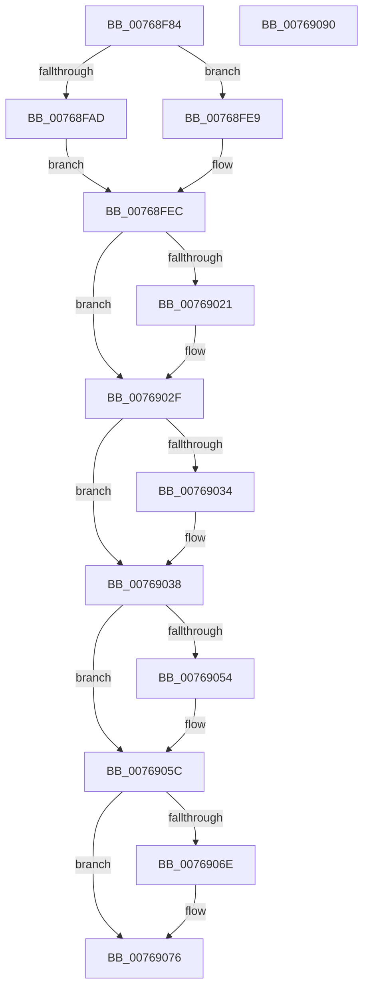

# PopPowerButtonBugcheckConfigure

- RVA: `0x00768F84`–`0x00769091` (길이 `269` bytes)
- VA: `0x0000000140768F84`
- 실행 섹션: `PAGE`
- PDB 이름 있음: `예`; PDB Function 태그: `아니요`
- unwind 정보 RVA: `0x000CD080`
- 디코드: `74`개 명령, `269/269` bytes 표시
- 미해석 바이트: `0` (있으면 어셈블리에 `.byte`로 보존)

> 이 문서는 커널 이미지의 기계어와 PDB 기호를 분석해 생성했습니다. 4번과 5번은 함수 원형과 자료형을 바이너리 사용 방식에서 추정한 C 해석이며 원본 소스 복구 결과는 아닙니다.

## 1. Dependencies

- 직접 호출 지점: **8**; 고유 호출 대상: **8**
- 직접 호출자로 확인된 함수: **2**
- RIP 상대 이미지 참조: **3**

### Outgoing calls
- `0x00768FDD` → [ZwNotifyChangeKey](../../text/6A/ZwNotifyChangeKey_function_006AF550.md) (function, `0x006AF550`)
- `0x00769010` → [KeAbPreAcquire](../../text/21/KeAbPreAcquire_function_00210230.md) (function, `0x00210230`)
- `0x0076902A` → [ExfAcquirePushLockExclusiveEx](../../text/20/ExfAcquirePushLockExclusiveEx_function_0020FC90.md) (function, `0x0020FC90`)
- `0x0076903E` → [PopQueryPowerButtonConfiguration](../../text/4C/PopQueryPowerButtonConfiguration_function_004CA6EC.md) (function, `0x004CA6EC`)
- `0x00769057` → [ExfTryToWakePushLock](../../text/26/ExfTryToWakePushLock_function_00265DD0.md) (function, `0x00265DD0`)
- `0x0076905F` → [KeAbPostRelease](../../text/2E/KeAbPostRelease_function_002E1600.md) (function, `0x002E1600`)
- `0x00769064` → [KeLeaveCriticalRegion](../../text/25/KeLeaveCriticalRegion_function_0025D8B0.md) (function, `0x0025D8B0`)
- `0x00769071` → [ZwClose](../../text/6A/ZwClose_function_006AD2B0.md) (function, `0x006AD2B0`)

### Direct callers
- [PopPowerButtonBugcheckWatchCallback](PopPowerButtonBugcheckWatchCallback_function_007690A0.md) at `0x007690B0`
- [PopInitializePowerButtonHold](../../init/C4/PopInitializePowerButtonHold_function_00C425A8.md) at `0x00C42767`
- [PopInitializePowerButtonHold](../../init/C4/PopInitializePowerButtonHold_function_00C425A8.md) at `0x00C427EB`

### Static image references
- `0x00768FBB` → RVA `0x00F085C0` (`.data`; read)
- `0x00768FF5` → RVA `0x00F085E0` (`.data`; read)
- `0x00769043` → RVA `0x00F085E0` (`.data`; read/write)

## 2. Other-region calls and transfers

- 다른 실행 섹션으로 향하는 call: **8**
  - `0x00768FDD` → [ZwNotifyChangeKey](../../text/6A/ZwNotifyChangeKey_function_006AF550.md) (`PAGE` → `.text`)
  - `0x00769010` → [KeAbPreAcquire](../../text/21/KeAbPreAcquire_function_00210230.md) (`PAGE` → `.text`)
  - `0x0076902A` → [ExfAcquirePushLockExclusiveEx](../../text/20/ExfAcquirePushLockExclusiveEx_function_0020FC90.md) (`PAGE` → `.text`)
  - `0x0076903E` → [PopQueryPowerButtonConfiguration](../../text/4C/PopQueryPowerButtonConfiguration_function_004CA6EC.md) (`PAGE` → `.text`)
  - `0x00769057` → [ExfTryToWakePushLock](../../text/26/ExfTryToWakePushLock_function_00265DD0.md) (`PAGE` → `.text`)
  - `0x0076905F` → [KeAbPostRelease](../../text/2E/KeAbPostRelease_function_002E1600.md) (`PAGE` → `.text`)
  - `0x00769064` → [KeLeaveCriticalRegion](../../text/25/KeLeaveCriticalRegion_function_0025D8B0.md) (`PAGE` → `.text`)
  - `0x00769071` → [ZwClose](../../text/6A/ZwClose_function_006AD2B0.md) (`PAGE` → `.text`)
- 별도 외부 분기/꼬리 이동을 확인하지 못했습니다.

## 3. Assembly (complete function range)

```asm
00768F84  48 8B C4                        mov rax, rsp
00768F87  48 89 58 08                     mov qword ptr [rax + 8], rbx
00768F8B  48 89 68 10                     mov qword ptr [rax + 0x10], rbp
00768F8F  48 89 70 18                     mov qword ptr [rax + 0x18], rsi
00768F93  57                              push rdi
00768F94  41 54                           push r12
00768F96  41 56                           push r14
00768F98  48 83 EC 60                     sub rsp, 0x60
00768F9C  0F 57 C0                        xorps xmm0, xmm0
00768F9F  4D 8B F0                        mov r14, r8
00768FA2  48 8B F1                        mov rsi, rcx
00768FA5  0F 11 40 D8                     movups xmmword ptr [rax - 0x28], xmm0
00768FA9  84 D2                           test dl, dl
00768FAB  74 3C                           je 0x140768fe9
00768FAD  C6 40 D0 01                     mov byte ptr [rax - 0x30], 1
00768FB1  41 B9 01 00 00 00               mov r9d, 1
00768FB7  83 60 C8 00                     and dword ptr [rax - 0x38], 0
00768FBB  4C 8D 05 FE F5 79 00            lea r8, [rip + 0x79f5fe]
00768FC2  48 83 60 C0 00                  and qword ptr [rax - 0x40], 0
00768FC7  33 D2                           xor edx, edx
00768FC9  C6 40 B8 00                     mov byte ptr [rax - 0x48], 0
00768FCD  C7 40 B0 04 00 00 00            mov dword ptr [rax - 0x50], 4
00768FD4  48 8D 40 D8                     lea rax, [rax - 0x28]
00768FD8  48 89 44 24 20                  mov qword ptr [rsp + 0x20], rax
00768FDD  E8 6E 65 F4 FF                  call 0x1406af550
00768FE2  8B F8                           mov edi, eax
00768FE4  C1 EF 1F                        shr edi, 0x1f
00768FE7  EB 03                           jmp 0x140768fec
00768FE9  40 B7 01                        mov dil, 1
00768FEC  65 48 8B 04 25 88 01 00 00      mov rax, qword ptr gs:[0x188]
00768FF5  4C 8D 25 E4 F5 79 00            lea r12, [rip + 0x79f5e4]
00768FFC  48 83 CB FF                     or rbx, 0xffffffffffffffff
00769000  45 33 C0                        xor r8d, r8d
00769003  33 D2                           xor edx, edx
00769005  49 8B CC                        mov rcx, r12
00769008  66 01 98 E4 01 00 00            add word ptr [rax + 0x1e4], bx
0076900F  90                              nop
00769010  E8 1B 72 AA FF                  call 0x140210230
00769015  F0 49 0F BA 2C 24 00            lock bts qword ptr [r12], 0
0076901C  48 8B E8                        mov rbp, rax
0076901F  73 0E                           jae 0x14076902f
00769021  4D 8B C4                        mov r8, r12
00769024  48 8B D0                        mov rdx, rax
00769027  49 8B CC                        mov rcx, r12
0076902A  E8 61 6C AA FF                  call 0x14020fc90
0076902F  48 85 ED                        test rbp, rbp
00769032  74 04                           je 0x140769038
00769034  C6 45 0A 01                     mov byte ptr [rbp + 0xa], 1
00769038  49 8B D6                        mov rdx, r14
0076903B  48 8B CE                        mov rcx, rsi
0076903E  E8 A9 16 D6 FF                  call 0x1404ca6ec
00769043  F0 48 0F C1 1D 94 F5 79 00      lock xadd qword ptr [rip + 0x79f594], rbx
0076904C  80 E3 06                        and bl, 6
0076904F  80 FB 02                        cmp bl, 2
00769052  75 08                           jne 0x14076905c
00769054  49 8B CC                        mov rcx, r12
00769057  E8 74 CD AF FF                  call 0x140265dd0
0076905C  49 8B CC                        mov rcx, r12
0076905F  E8 9C 85 B7 FF                  call 0x1402e1600
00769064  E8 47 48 AF FF                  call 0x14025d8b0
00769069  40 84 FF                        test dil, dil
0076906C  74 08                           je 0x140769076
0076906E  48 8B CE                        mov rcx, rsi
00769071  E8 3A 42 F4 FF                  call 0x1406ad2b0
00769076  4C 8D 5C 24 60                  lea r11, [rsp + 0x60]
0076907B  49 8B 5B 20                     mov rbx, qword ptr [r11 + 0x20]
0076907F  49 8B 6B 28                     mov rbp, qword ptr [r11 + 0x28]
00769083  49 8B 73 30                     mov rsi, qword ptr [r11 + 0x30]
00769087  49 8B E3                        mov rsp, r11
0076908A  41 5E                           pop r14
0076908C  41 5C                           pop r12
0076908E  5F                              pop rdi
0076908F  C3                              ret
00769090  CC                              int3
```

## 4. C-style interpretation (structured pseudocode)

```c
__int64 __fastcall PopPowerButtonBugcheckConfigure(__int64 a1, int a2, __int64 a3)
{
    __int64 result;
    __int64 v_rbx;
    __int64 v_rdi;
    __int64 v_rsp;
    unsigned __int64 v_stack_m18;
    unsigned __int64 v_stack_m58;

    *(unsigned __int64 *)(v_rsp + 8) = v_rbx;
    *(unsigned __int64 *)(v_rsp + 16) = v_rbp;
    *(unsigned __int64 *)(v_rsp + 24) = v_rsi;
    v_rsp = (v_rsp) - (96);
    *(unsigned __int64 *)(v_rsp - 40) = v_xmm0;
    if ((unsigned __int8)(a2) == 0) goto loc_00768FE9;
    *(unsigned __int8 *)(v_rsp - 48) = 1;
    a2 = 0;
    *(unsigned __int8 *)(v_rsp - 72) = 0;
    *(unsigned int *)(v_rsp - 80) = 4;
    v_stack_m58 = v_rsp - 40;
    result = ZwNotifyChangeKey(a1, a2, v_rip + 7992830, 1);
    v_rdi = (unsigned int)(((unsigned int)((unsigned int)(result))) >> (31));
    goto loc_00768FEC;
loc_00768FE9:
loc_00768FEC:
    v_rbx = (v_rbx) | (-1);
    a3 = 0;
    a2 = 0;
    result = KeAbPreAcquire(v_rip + 7992804, a2, a3, 1);
    if (!(condition_is_above_or_equal)) {
        a3 = v_rip + 7992804;
        a2 = result;
        a1 = v_rip + 7992804;
        result = ExfAcquirePushLockExclusiveEx(a1, a2, a3, 1);
    }
    if (result != 0) {
        *(unsigned __int8 *)(result + 10) = 1;
    }
    result = PopQueryPowerButtonConfiguration(a1, a3, a3, 1);
    v_rbx = (unsigned __int8)((v_rbx) & (6));
    if (((unsigned __int8)(v_rbx)) == 2) {
        a1 = v_rip + 7992804;
        result = ExfTryToWakePushLock(a1, a3, a3, 1);
    }
    result = KeAbPostRelease(v_rip + 7992804, a3, a3, 1);
    result = KeLeaveCriticalRegion(v_rip + 7992804, a3, a3, 1);
    if (1 != 0) {
        a1 = a1;
        result = ZwClose(a1, a3, a3, 1);
    }
    return result;
}
```

## 5. (Beta) C Style

```c
int64_t PopPowerButtonBugcheckConfigure(int64_t Arg1, int32_t Arg2, int64_t Arg3)
{
    int64_t result;
    int64_t local_rbx;
    int64_t local_rdi;
    int64_t local_rsp;
    uint64_t v_stack_m18;
    uint64_t v_stack_m58;

    *(uint64_t *)(local_rsp + 0x8) = local_rbx;
    *(uint64_t *)(local_rsp + 0x10) = local_rbp;
    *(uint64_t *)(local_rsp + 0x18) = local_rsi;
    local_rsp = (local_rsp) - (96);
    *(uint64_t *)(local_rsp - 0x28) = v_xmm0;
    if ((uint8_t)(Arg2) == 0) goto loc_00768FE9;
    *(uint8_t *)(local_rsp - 0x30) = 1;
    Arg2 = 0;
    *(uint8_t *)(local_rsp - 0x48) = 0;
    *(uint32_t *)(local_rsp - 0x50) = 4;
    v_stack_m58 = local_rsp - 40;
    result = ZwNotifyChangeKey(Arg1, Arg2, v_rip + 7992830, 1);
    local_rdi = (uint32_t)(((uint32_t)((uint32_t)(result))) >> (31));
    goto loc_00768FEC;
loc_00768FE9:
loc_00768FEC:
    local_rbx = (local_rbx) | (-1);
    Arg3 = 0;
    Arg2 = 0;
    result = KeAbPreAcquire(v_rip + 7992804, Arg2, Arg3, 1);
    if (!(condition_is_above_or_equal)) {
        Arg3 = v_rip + 7992804;
        Arg2 = result;
        Arg1 = v_rip + 7992804;
        result = ExfAcquirePushLockExclusiveEx(Arg1, Arg2, Arg3, 1);
    }
    if (result != 0) {
        *(uint8_t *)(result + 0xA) = 1;
    }
    result = PopQueryPowerButtonConfiguration(Arg1, Arg3, Arg3, 1);
    local_rbx = (uint8_t)((local_rbx) & (6));
    if (((uint8_t)(local_rbx)) == 2) {
        Arg1 = v_rip + 7992804;
        result = ExfTryToWakePushLock(Arg1, Arg3, Arg3, 1);
    }
    result = KeAbPostRelease(v_rip + 7992804, Arg3, Arg3, 1);
    result = KeLeaveCriticalRegion(v_rip + 7992804, Arg3, Arg3, 1);
    if (1 != 0) {
        Arg1 = Arg1;
        result = ZwClose(Arg1, Arg3, Arg3, 1);
    }
    return result;
}
```

## 6. Execution-region graph

[열기: 2D/3D 그래프와 함수 탐색 컨트롤 패널](../../../control-panel.html?section=page&rva=0x00768F84&view=graph)

- 2D 그래프는 위에서 아래로 흐르고, 3D 그래프는 빈 공간을 드래그해 회전합니다. Shift+드래그는 이동, 휠은 확대·축소, 함수 노드 선택은 대상 보고서 이동입니다.

### Static fallback


